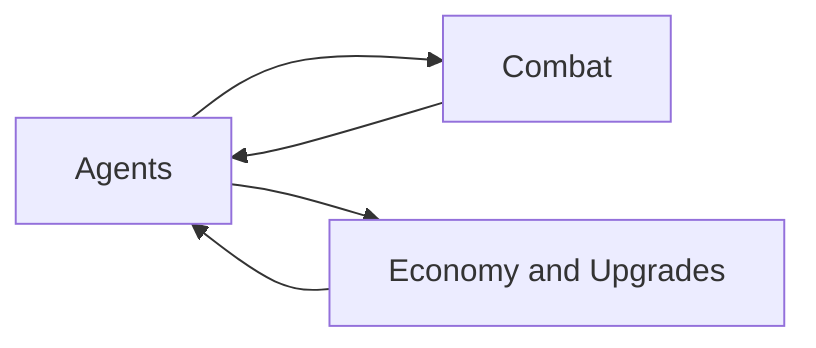
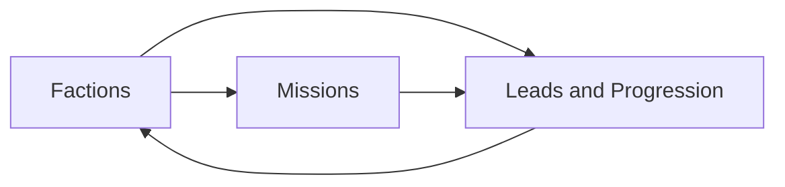
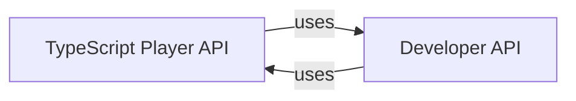

# Specification relationship cycles

This informative register records every remaining cyclic component after the uses/refines review. It is outside the
registered specification corpus and introduces no relationships or gameplay requirements. The owning contracts and
their mirrored inventories remain authoritative. Removal approaches below are future design work, not approved
changes to gameplay or the review sequence.

## Coverage and maintenance

The review combines all explicit uses and refines relationships and finds groups in which every document can reach
every other document by following dependency-to-dependent arrows. Such a group is a strongly connected component.
Listing every internal edge covers longer cycles as well as reciprocal pairs without enumerating every possible loop.
The review also includes implicit follows relationships in a separate pass to identify mixed governance cycles.

The complete result is four components with only uses edges, and one governance component with two documents and
two internal edges of different Relationship kinds. The four are: a personnel component with three documents and four
edges, a progression component with three documents and four edges, an estimate component with two documents and two
edges, and an API component with two documents and two edges. Neither the refines graph nor the follows graph alone
contains a cycle. No Foundation specification occurs in a cyclic component: Engine Contract uses only Core Concepts,
and every other Foundation specification uses only Foundation specifications. The remaining documents do not belong
to cycles. These results were recomputed after Turn Resolution and Initial Campaign Content were deleted; together
they had joined these documents and Campaign into one component of 11 documents.

When a relationship changes, recompute these components from the registered inventories, check the supporting prose,
and update the diagrams, tables, counts, and removal criteria together. Include all internal edges, including edges
that close longer paths rather than a two-document loop. Remove a component from this register when it is acyclic.
The [Relationship graphs](specs/governance/artifact-relationships.md#relationship-graphs) require this maintenance;
deterministic specification lint alone does not establish the semantic justification or completeness of this report.

## Personnel component: agents, combat, and economic effects

Every arrow means **supplier is used by consumer**. All arrows are uses. This is the complete internal-edge inventory:

| Consumer uses                                                                       | Supplier                                                                                             | Independently supplied meaning                                 |
| ----------------------------------------------------------------------------------- | ---------------------------------------------------------------------------------------------------- | -------------------------------------------------------------- |
| Agents — [Overview](specs/mechanics/agents-spec.md#overview)                        | Combat — [Combat calculations](specs/mechanics/combat.md#combat-calculations)                        | Battle-earned experience applied to personnel growth           |
| Agents — [Overview](specs/mechanics/agents-spec.md#overview)                        | Economy and Upgrades — [Upgrade effects](specs/mechanics/economy-and-upgrades.md#upgrade-effects)    | Economic effects and capability changes applied to personnel   |
| Combat — [Overview](specs/mechanics/combat.md#overview)                             | Agents — [Attributes and effectiveness](specs/mechanics/agents-spec.md#attributes-and-effectiveness) | Combatant attributes and capabilities                          |
| Economy and Upgrades — [Overview](specs/mechanics/economy-and-upgrades.md#overview) | Agents — [Overview](specs/mechanics/agents-spec.md#overview)                                         | Personnel state and capabilities used by economic calculations |

Agents owns capability and state transitions; Combat supplies earned experience and Economy and Upgrades supplies
capability effects. Exact formulas remain unresolved, so reassess this justification as the contracts become concrete.
A future removal could separate shared personnel inputs and effect descriptions from the contracts that calculate or
apply them. The exit criterion is that Agents, Combat, and Economy and Upgrades can be read without reciprocal
dependencies.

## Progression component: factions, leads, and missions

Every arrow means **supplier is used by consumer**. All arrows are uses. This is the complete internal-edge inventory:

| Consumer uses                                                                         | Supplier                                                                                                                        | Independently supplied meaning                                |
| ------------------------------------------------------------------------------------- | ------------------------------------------------------------------------------------------------------------------------------- | ------------------------------------------------------------- |
| Factions — [Overview](specs/mechanics/factions.md#overview)                           | Leads and Progression — [Completion and unlock effects](specs/mechanics/leads-and-progression.md#completion-and-unlock-effects) | Earned unlock effects and prerequisites                       |
| Leads and Progression — [Overview](specs/mechanics/leads-and-progression.md#overview) | Factions — [Suppression and defeat](specs/mechanics/factions.md#suppression-and-defeat)                                         | Faction state and defeat facts                                |
| Leads and Progression — [Overview](specs/mechanics/leads-and-progression.md#overview) | Missions — [Overview](specs/mechanics/missions.md#overview)                                                                     | Mission lifecycle and outcomes used by progression predicates |
| Missions — [Overview](specs/mechanics/missions.md#overview)                           | Factions — [Overview](specs/mechanics/factions.md#overview)                                                                     | Operation provenance and suppression semantics                |

Factions supplies state and defeat facts; Leads and Progression supplies unlock effects and prerequisites; Missions
supplies outcome facts. Exact rules remain unresolved, so reassess this justification as the contracts become concrete.
A future removal could separate progression facts and effect descriptions from predicates and effect application.
The exit criterion is that faction and mission facts can be consumed without those producers relying back on the
progression evaluator.

## Estimate component: investigation mathematics and player information

Every arrow means **supplier is used by consumer**. This is the complete internal-edge inventory:

| Consumer uses                                                                    | Supplier                                                                                                                                                           | Independently supplied meaning                        |
| -------------------------------------------------------------------------------- | ------------------------------------------------------------------------------------------------------------------------------------------------------------------ | ----------------------------------------------------- |
| Player Information — [Overview](specs/interfaces/player-information.md#overview) | Investigations — [Player uncertainty](specs/mechanics/investigations.md#player-uncertainty)                                                                        | Estimate mathematics and its conditioning information |
| Investigations — [Overview](specs/mechanics/investigations.md#overview)          | Player Information — [Player-visible information schemas and visibility](specs/interfaces/player-information.md#player-visible-information-schemas-and-visibility) | Exposed field shapes and reveal conditions            |

Investigations supplies estimates; Player Information supplies the field shapes and reveal conditions used by the
current estimate contract. A future removal could define estimates over explicit information inputs in
Investigations, then let Player Information map permitted Player-visible information to those inputs and expose the
results. The exit criterion is that Investigations no longer depends on Player Information.

## API component: callable signatures and full-state inspection

Every arrow means **supplier is used by consumer**. This is the complete internal-edge inventory:

| Consumer uses                                                                   | Supplier                                                                                              | Independently supplied meaning                                 |
| ------------------------------------------------------------------------------- | ----------------------------------------------------------------------------------------------------- | -------------------------------------------------------------- |
| TypeScript Player API — [Overview](specs/interfaces/typescript-api.md#overview) | Developer API — [Inspection contract](specs/interfaces/developer-api.md#inspection-contract)          | Full Campaign state query schemas and developer access results |
| Developer API — [Overview](specs/interfaces/developer-api.md#overview)          | TypeScript Player API — [Functions and types](specs/interfaces/typescript-api.md#functions-and-types) | Callable Dev mode controls and full-state query surface        |

Developer API owns full-state inspection and Dev mode policy; TypeScript Player API owns callable signatures. A future
removal could separate shared state-view contracts and access-mode lifecycle policy from their callable adapters. The
exit criterion is no multi-document component containing both documents.

## Governance component: relationship language and document conventions

This is the complete internal-edge inventory:

| Dependency → Dependent                             | Kind             | Independently supplied meaning and evidence                                                                                                                                                                                                                      |
| -------------------------------------------------- | ---------------- | ---------------------------------------------------------------------------------------------------------------------------------------------------------------------------------------------------------------------------------------------------------------- |
| Specification Conventions → Artifact Relationships | Implicit follows | Conventions — [Implicit relationships](specs/governance/spec-conventions.md#implicit-relationships) supplies document structure, lifecycle, and writing rules for every other registered specification.                                                          |
| Artifact Relationships → Specification Conventions | Uses             | Artifact Relationships — [Relationship kinds](specs/governance/artifact-relationships.md#relationship-kinds) supplies relationship meanings used by the conventions — [Relationship inventories](specs/governance/spec-conventions.md#relationship-inventories). |

The meanings are independently stated: writing rules govern a document that defines the relationship vocabulary.
The relationship definition does not need a missing definition supplied only by the writing rule.

A future removal could consolidate the relationship language and inventory rules into Specification Conventions and
retire the separate REL contract with explicit requirement migration. That would require a separately reviewed
governance change. The exit criterion is no multi-document component containing CONV and REL after including implicit
follows edges, with all definitions and requirement references preserved. Until then this mixed cycle stays documented.
