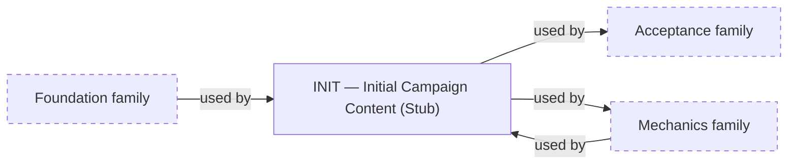

# About the Content family

> Informative overview. It owns no rules; each linked specification owns its content.

# What this family is for

Content specifications own versioned game data: Game Data Records (GDRs), named parameter values, catalogs, and
starting configurations. They supply values for meanings defined elsewhere and never change mechanical behavior.

# Documents

## Initial Campaign Content

[Initial Campaign Content](initial-campaign.md) answers _what exact data does the first playable campaign start from?_
It owns the complete, versioned numeric and GDR inputs for that campaign.

# How they relate

Initial Campaign Content uses the Foundation family for GDR meanings and composition rules and the Mechanics family for
the parameters and catalogs it must fill. Mechanics in turn uses its values, and the Acceptance family builds scenarios
on them.

<!-- generated:family-diagram:start -->

_Generated from the specifications’ Relationships sections by `npm run docs:generate`; do not edit between the markers. Arrows run from Dependency to Dependent; dashed boxes stand for whole other Families._

## Within the family

This family has a single specification, so there are no relationships within it.

## Across families

<!-- generated:family-diagram:end -->

# Why these boundaries

Data is separated from behavior so that balancing a campaign changes only this family. A new campaign or data set
would become another Content specification without touching any Mechanics document.
