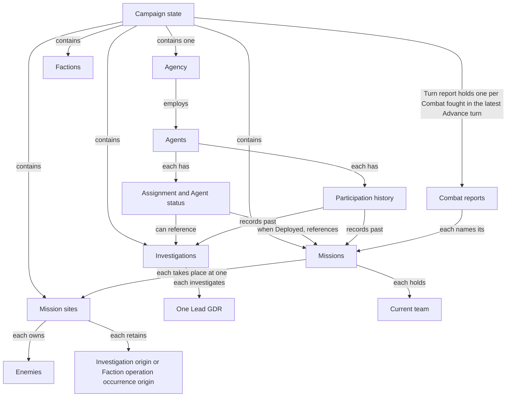

# Domain Model

| Metadata | Value |
| --- | --- |
| Spec ID | DOM |
| Family | Mechanics |
| Audience | Engine designer, Content designer, AI designer, Implementer |
| Owns | Game concepts, how they relate, and the structural invariants that span several concepts. |
| Conventions | [Specification Conventions](../../governance/conventions/spec-conventions.md), [Design Specification Conventions](../../governance/conventions/design-spec-conventions.md) |

# Overview

The game is a [Campaign](../foundation/core-concepts.md#campaign-and-session) in which the player runs one Agency against the Factions that oppose it. Everything the Agency does, its Agents do: each Agent is an operative who does one thing at a time, so sending it to one task always means taking it from another.

The concepts are arranged around where the Agency's work comes from and where it leads. The Agency finds work by investigating Leads, and the Factions create work through their operations. Either can lead to a Mission site, a place where Enemies are present for a limited time. Deploying a team of Agents to a Mission site creates a Mission, in which they fight those Enemies.

Every concept is modeled with the vocabulary of [Campaign State](../foundation/campaign-state.md). Domain Model says how the concepts connect, which every concept must agree on; how each one behaves is refined separately, e.g. by [Agents](agents-spec.md), so that one concept's rules can change without touching the others.

# Glossary

These terms name the concepts of the game. Modeling terms are in the [Core Concepts](../foundation/core-concepts.md#glossary), [Campaign State](../foundation/campaign-state.md#glossary), and [Campaign Instances](../foundation/campaign-instances.md#glossary) glossaries; terms about a single concept are in the Glossary of the Mechanics specification that details it, e.g. the [Agents](agents-spec.md#glossary) and [Combat](combat.md#glossary) glossaries.

## Agency and Agents

The player-controlled organization, its Agents, what each Agent is doing, and what each has taken part in. [Economy and Upgrades](economy-and-upgrades.md) states what each Upgrade does and how the Agent cap is set.

| Term | Definition | Prohibited synonyms |
| --- | --- | --- |
| Agency | The organization the player controls in a [Campaign](../foundation/core-concepts.md#campaign-and-session). It holds the money, funding, and upgrades, and employs the Agents. |  |
| Agent | An operative employed by the Agency, whom the player assigns to Investigations and Missions. |  |
| Assignment | What an Agent is currently assigned to do, e.g. take part in a particular Investigation or Mission. | Current assignment |
| Agent status | Where an Agent stands with respect to its Assignment and its employment, e.g. still travelling to its Assignment or no longer serving. [Agents](agents-spec.md) states the other Agent statuses. | Task phase; Agent lifecycle state |
| At assignment | The Agent status of an Agent carrying out its Assignment. |  |
| In transit | The Agent status of an Agent still travelling to its Assignment. |  |
| Participation history | The permanent record of which Agents took part in which past Investigations and Missions. | Participation; agent history; past participation |
| Upgrade | A permanent improvement the Agency buys with money, any number of times. |  |
| Agent cap | The most Agents the Agency can employ when it hires another one. |  |

## Leads, Investigations, Mission sites, and Missions

The work the Agency discovers and undertakes. [Investigations](investigations.md) states how Investigation progress grows, and [Leads and Progression](leads-and-progression.md) states when a Lead is discovered and when it is available.

| Term | Definition | Prohibited synonyms |
| --- | --- | --- |
| Lead | A line of inquiry the Agency can investigate. Investigating it can open further Leads and Mission sites. | Opportunity. Ordinary uses, e.g. opportunity cost, remain valid. |
| Investigation | One effort by a team of Agents to investigate one Lead, from its start until it concludes. | Attempt. Attempts to execute commands or undertake Missions remain distinct. |
| Mission site | A place where Enemies of one Faction are present for a limited time, and to which the Agency can deploy one team of Agents. | Open Mission; available Mission; pending Mission, for which say Active Mission site; Mission template, for which say MissionSiteArchetype; expiry, for which say expiration; expiry, for which say expiration |
| Initiative Mission site | A Mission site the Agency found by completing an Investigation of a Lead. | Offensive mission |
| Response Mission site | A Mission site created by a Faction operation occurrence, where the Agency can stop that operation. | Defensive mission |
| Mission | One deployment of a team of Agents to one Mission site, together with its outcome. | Mission deployment; deployment, as a thing; Mission definition, for which say MissionArchetype. Deployment as the ordinary act of deploying remains valid. |
| Initiative Mission | A Mission at an Initiative Mission site. |  |
| Response Mission | A Mission at a Response Mission site. |  |
| Consequences | What a Mission site and its Mission change in the Campaign once they reach a final state, e.g. the money a Won Mission brings or the Panic an ignored Response Mission site raises. | Rewards and penalties |
| Current team | The Agents currently assigned to a given Investigation or Mission. |  |
| Investigation progress | The work a team has done on an Investigation so far, counted in progress points. |  |
| Progress point | The unit in which Investigation progress, and the work a Lead takes to investigate, are counted. |  |
| Lead availability | Whether a Lead may be investigated, as far as its prerequisites, its own earlier results, and its Faction allow. |  |

## Combat

A Combat, its participants, and its [retained](../foundation/world-history.md#glossary) results.

| Term | Definition | Prohibited synonyms |
| --- | --- | --- |
| Combat | One armed clash between the Agents deployed to a Mission site and the Enemies there, resolved in full within one Advance turn. | Battle; skirmish; fight, as a noun. Ordinary verbs, e.g. "Agents fight Enemies", remain valid. |
| Combatant | An Agent or an Enemy as a participant in a Combat. |  |
| Combatant Role Type | What an Agent or an Enemy must have in order to be a Combatant, and what it gains while a Combat lasts. |  |
| Enemy | An opponent present at one Mission site, whom the Agency's Agents fight in a Combat. |  |
| Combat report | The record of how a Combat went, kept as part of the [Turn report](../foundation/world-history.md#glossary) of the Advance turn that fought it and used to determine its Mission's Consequences. | Battle result |

## Factions

The opposing organizations and their operations. [Factions](factions.md) states when a Faction becomes Eliminated.

| Term | Definition | Prohibited synonyms |
| --- | --- | --- |
| Faction | An organization that opposes the Agency and carries out operations in the world. |  |
| Faction operation occurrence | One operation carried out by a Faction, which creates one Response Mission site. |  |
| Eliminated | Permanently put out of action by a Won [Mission](domain-model.md#leads-investigations-mission-sites-and-missions): an Eliminated Faction no longer escalates or carries out operations, and it stays Eliminated for the rest of the [Campaign](../foundation/core-concepts.md#campaign-and-session). | Defeated; defeat, naming the end of a Faction. Defeat remains the Campaign ending under [Panic and Endings](panic-and-endings.md). |

## Campaign standing

How the Campaign as a whole stands, which no single concept owns. [Panic and Endings](panic-and-endings.md) states how each changes.

| Term | Definition | Prohibited synonyms |
| --- | --- | --- |
| Panic | How alarmed the public is, from 0% to 100%; the Campaign is lost when it gets high enough. |  |
| Campaign ending | How a Campaign finished: Victory or Defeat. A Campaign without one is still being played. |  |

## Turn advancement steps

The stages of Advance turn. [Turn Advancement](turn-advancement.md) states every step and their order.

| Term | Definition | Prohibited synonyms |
| --- | --- | --- |
| Turn advancement step | One stage of Advance turn, in which the rules of one subject are applied, e.g. paying upkeep. Advance turn applies every step once, in order. |  |
| Step-start value | A value as it is when a Turn advancement step begins: after every earlier step of the same Advance turn, and before any rule of that step. |  |

# Game concepts

Each game concept has the following modeling role and multiplicity. This table is exhaustive.

| Concept | Modeling role | Multiplicity within one Campaign | Detailed in |
| --- | --- | --- | --- |
| Agency | [Campaign instance](../foundation/core-concepts.md#campaign-instances) [Type](../foundation/core-concepts.md#data-modeling) | Exactly one, under [Agency per Campaign](#agency-per-campaign) | [Economy and Upgrades](economy-and-upgrades.md) |
| Agent | Campaign instance Type | Any number; the roster is limited under [Agency caps](economy-and-upgrades.md#agency-caps) | [Agents](agents-spec.md) |
| Investigation | Campaign instance Type | Any number; at most one Active Investigation per Lead, under [One Active Investigation per Lead](investigations.md#one-active-investigation-per-lead) | [Investigations](investigations.md) |
| Mission site | Campaign instance Type | Any number; none in the initial [Campaign state](../foundation/core-concepts.md#campaign-and-session), under [Initial Campaign state](#initial-campaign-state); exactly one Response Mission site per Faction operation occurrence, under [How concepts relate](#how-concepts-relate) | [Missions](missions.md) |
| Mission | Campaign instance Type | Any number; at most one per Mission site, under [How concepts relate](#how-concepts-relate) | [Missions](missions.md) |
| Enemy | Campaign instance Type | Any number, each belonging to exactly one Mission site, under [How concepts relate](#how-concepts-relate) | [Combat](combat.md) |
| Faction | Campaign instance Type | Exactly one per FactionArchetype supplied by the [Game build](../foundation/core-concepts.md#game-build-and-content), under [Initial Campaign state](#initial-campaign-state) | [Factions](factions.md) |
| Combatant Role Type | [Role Type](../foundation/campaign-instances.md#glossary) adopted by Agent and Enemy; not a Campaign instance Type | No Campaign instances | [Combatant Role Type](agents-spec.md#combatant-role-type) in Agents |
| Lead | GDR serving the Referenced [GDR](../foundation/core-concepts.md#game-build-and-content) and Key for campaign facts purposes | Not a Campaign instance | [Leads and Progression](leads-and-progression.md) |
| Combat report | Part of the Turn report of the Advance turn in which its Combat was fought; not a Campaign instance and not part of any Mission | Exactly one per fought Combat, so at most one per Mission | [Combat report](combat.md#combat-report) in Combat |
| Faction operation occurrence | Values in the [Constants](../foundation/core-concepts.md#campaign-instances) of the Response Mission site it creates, whose [Instance ID](../foundation/campaign-instances.md#glossary) identifies it; not a Campaign instance | Exactly one per Response Mission site | [Faction operation occurrence generation](factions.md#faction-operation-occurrence-generation) in Factions |
| Weapon GDRs | GDRs | Not Campaign instances | [Weapon](combat.md#weapon) in Combat |
| Upgrade GDRs | GDRs | Not Campaign instances | [Upgrades](economy-and-upgrades.md#upgrades) in Economy and Upgrades |
| EncyclopediaArticle GDRs | GDRs serving the Display content purpose | Not Campaign instances | [EncyclopediaArticle](compendium.md#encyclopediaarticle) in Compendium |
| Archetypes of the seven Campaign instance Types | GDRs serving the [Archetype](../foundation/core-concepts.md#campaign-instances) purpose | Not Campaign instances; sharing an Archetype does not limit how many Campaign instances exist | The specification that details each Campaign instance Type |

GDR purposes are defined under [Purposes of GDRs](../foundation/game-data-records.md#purposes-of-gdrs). Every Campaign instance of the seven Campaign instance Types has the four properties stated under [Campaign instance structure](../foundation/campaign-instances.md#campaign-instance-structure). A concept can include facts hidden from the player. Being a property of a concept does not determine whether a value is an [Authoritative value](../foundation/core-concepts.md#value-classification) or a [Derived value](../foundation/core-concepts.md#value-classification); e.g., an Agent's career statistics may be Derived values calculated from retained facts.

Arrows show the labelled relationships, not inheritance.

## How concepts relate

Campaign instances reference each other as follows. Every row holds in every [Committed state](../foundation/engine-contract.md#player-actions-and-turns). Each concept has further references, listed with its properties.

| From | To | How many | Reference |
| --- | --- | --- | --- |
| Agent | The Agency | Exactly one | Immutable reference |
| Agent, through its Assignment | An Investigation, or a Mission | At most one | Mutable reference |
| Investigation | The Lead GDR it investigates | Exactly one | Immutable reference |
| Mission site | The Faction it targets | Exactly one | Immutable reference |
| Initiative Mission site | Its origin: the Investigation whose completion created it | Exactly one | Immutable reference |
| Response Mission site | Its origin: the Faction operation occurrence that created it, which identifies the initiating Faction | Exactly one; each Faction operation occurrence creates exactly one Response Mission site | Immutable reference |
| Mission | The Mission site at which it takes place | Exactly one; a Mission site has at most one Mission | Immutable reference |
| Enemy | The Mission site at which it is present | Exactly one | Immutable reference |

A Mission site is either an Initiative Mission site or a Response Mission site, so every Mission site has exactly one origin. An Initiative Mission site identifies, through its origin Investigation, the Lead that created it. A Faction operation occurrence that spans several Mission sites, or that has no Response Mission site, is out of scope.

# Campaign and Agency

A Campaign contains one Agency, the current [Turn](../foundation/engine-contract.md#player-actions-and-turns), Panic and the Campaign ending, Agents, Factions, Investigations, Mission sites, and Missions. Campaign-wide properties, e.g. the current Turn and Panic, belong directly to Campaign state, not to the Agency.

## Agency per Campaign

Campaign state must contain exactly one Agency, because a Campaign has exactly one player under [Single-player scope](../foundation/engine-contract.md#single-player-scope) in Engine Contract. Trading between Campaigns is out of scope.

## Initial Campaign state

Everything a new Campaign starts with is either game data, supplied as GDRs by the Game build, or game behavior, stated as rules in specifications. Among GDRs, only those serving the [Campaign configuration preset](../foundation/configuration.md#glossary) purpose can be overridden by the player before creation; every other GDR is fixed, e.g. a Faction's Archetype.

Which Campaign instances the initial Campaign state contains is the same for every new Campaign. No GDR serving the [Campaign configuration preset](../foundation/game-data-records.md#glossary) purpose, under [GDR purpose: campaign configuration preset](../foundation/game-data-records.md#gdr-purpose-campaign-configuration-preset), adds, removes, or selects an initial Campaign instance; e.g., no preset changes the initial roster of Agents, the initial Factions, or the absence of initial Mission sites. A [Campaign configuration](../foundation/campaign-state.md#glossary) value can still supply an initial value of an initial Campaign instance, e.g. starting money becomes the Agency's initial money, and can influence which Campaign instances come into existence during play, e.g. a multiplier of how often Mission sites appear.

The initial Campaign state contains exactly one Agency, under [Agency per Campaign](#agency-per-campaign), exactly one Faction for each FactionArchetype the Game build supplies, and no Mission sites, and therefore no Missions and no Enemies. For each Campaign instance Type, the rule determining the initial Campaign instances of that Type and the source of each of their initial values, under [Campaign instance creation](../foundation/campaign-instances.md#campaign-instance-creation), is in the Mechanics specification that details it; e.g., [Initial Factions](factions.md#initial-factions) gives which values each initial Faction takes from its FactionArchetype. The rule is game behavior; the content it reads is supplied by GDRs that serve no Campaign configuration preset purpose, e.g. the FactionArchetypes and their values.

## Campaign instance identity scope

Agency, Agent, Investigation, Mission site, Mission, Enemy, and Faction share one Instance ID scope, as [Campaign instance identity](../foundation/campaign-instances.md#campaign-instance-identity) requires: Instance IDs must be unique across all seven Types within one Campaign. A repeated Investigation of one Lead, or a second Mission site with the same Archetype, is therefore a distinct Campaign instance with its own Instance ID. A Mission and its Mission site have different Instance IDs. Each of the seven Types numbers its own Instance IDs, e.g. when a new Campaign starts with four Agents, they are agent-1 to agent-4 and its first Mission site is mission-site-1. The next Agent hired is agent-5, even after agent-2 dies, and when that hire is undone and an Agent is hired again, the new Agent is again agent-5.

# Current versus historical teams

The Current team of an Investigation or Mission must agree with Assignments: an Agent whose Assignment references Investigation I belongs to the Current team of I, and an Agent whose Assignment references Mission M belongs to the Current team of M. An Agent cannot belong to more than one Current team. In Committed state, the Agent-side and team-side views of Current team membership agree, and no Assignment references an Investigation that is no longer Active or a Mission that is Won or Lost.

Participation history describes the same relationship for the past: an Agent's Participation history and the past participants of an Investigation or Mission are one relationship seen from opposite sides. Agents recorded in Participation history are not members of the Current team, and Participation history neither assigns nor reserves an Agent; e.g., a Won Mission retains an Agent's Participation history after that Agent is assigned elsewhere.

# Edge cases and failure behavior

| Case | Result and owner |
| --- | --- |
| An Agent is In transit to an Investigation | The Agent belongs to its Current team; arrival and progress timing belong to Agents and Investigations |
| An Investigation concludes while members of its Current team are In transit | In the next Committed state no Assignment references it; the replacement Assignments belong to Agents and Investigations |
| The player deploys Agents to a Mission site | A new Mission at that Mission site comes into existence, whose Current team is those Agents, and each of them has an Assignment that references the Mission, under [Current versus historical teams](#current-versus-historical-teams); preconditions, rejection, and transit belong to Missions and Agents |
| A team is to be deployed to a Mission site that already has a Mission | Never valid: a Mission site has at most one Mission, under [How concepts relate](#how-concepts-relate); Missions owns the rejection |
| A Mission retains an Agent in its Participation history after it is Won or Lost | The Agent's Assignment is not reserved, under [Current versus historical teams](#current-versus-historical-teams) |
| The roster is empty, or no Mission sites or Investigations exist | Valid; [Panic and Endings](panic-and-endings.md) owns Defeat conditions |
| A Faction is [Eliminated](factions.md#glossary) while Mission sites targeting it or Leads affiliated with it remain | References remain resolvable under [References](../foundation/campaign-instances.md#references); Factions, Leads and Progression, and Missions own the resulting availability and outcomes |

# Acceptance examples

These are structural fixtures, not playable scenarios or API signatures. Symbolic identifiers are labels, not a chosen identifier format. Numbers below are exact test-only integers, not campaign balance. All other scalar values of Mechanics specifications are assumed valid for these structural checks.

## D. Initial Campaign state

Given a new Campaign created from a Game build that supplies exactly two FactionArchetypes, F1 and F2, the initial Campaign state contains exactly one Agency, exactly two Factions, one with Archetype F1 and one with Archetype F2, and no Mission sites, no Missions, and no Enemies, under [Initial Campaign state](#initial-campaign-state). An initial Campaign state with a second Faction of Archetype F1, with no Faction of Archetype F2, or with any Mission site, is invalid.
