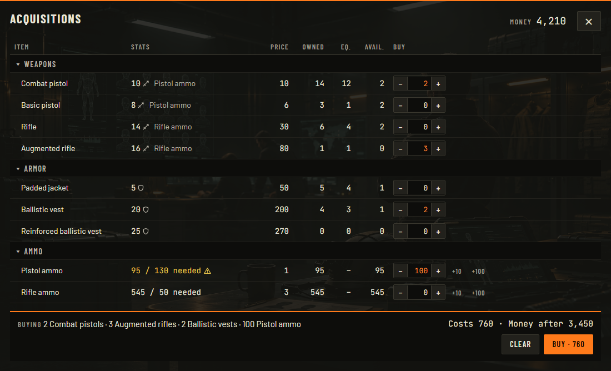

# Acquisitions View

| Metadata | Value |
| --- | --- |
| Spec ID | ACQVIEW |
| Family | UI |
| Audience | UI designer, Implementer |
| Owns | What the Acquisitions View of the Campaign screen shows of the Items and Ammo the agency can buy, and how it buys them. |
| Conventions | [Specification Conventions](../../../governance/conventions/spec-conventions.md), [Design Specification Conventions](../../../governance/conventions/design-spec-conventions.md) |

# Overview

The Acquisitions View is where the Player buys gear, and its mirror is the [Storage View](storage-view.md): the same groups and counts, with prices in place of Sale values and a buy bar in place of the sell bar. It is the fifth of the Operations [Detail views](../gui.md#glossary) of the [Campaign Screen](campaign-screen.md). Its header shows the agency's money.

Finding new gear is part of what the Player discovers, as finding new [Compendium](../../mechanics/compendium.md) articles is, so the Acquisitions View lists only what is [Unlocked](../../mechanics/equipment.md#unlocked-items): an Item that is not Unlocked is not shown at all, and nothing says which interrogation would unlock it.

# Acquisitions table

The [Acquisitions](../../mechanics/economy-and-upgrades.md#glossary) table lists every [Unlocked](../../mechanics/equipment.md#glossary) [Item](../../mechanics/equipment.md#glossary) and [AmmoType](../../mechanics/combat.md#ammotype) in the three groups and the order of the [Storage table](storage-view.md#storage-table), each group under a group row that can be folded, with these columns in this order:

| Column | What it shows |
| --- | --- |
| Item | The `name` of the Item or AmmoType. |
| Stats | As in the [Storage](../../mechanics/equipment.md#glossary) table, the warning icon of [Ammo short](../../mechanics/equipment.md#ammo-short) included. |
| Price | Its `price`, for one Item or one round. |
| Owned, Eq., Avail. | As in the Storage table, so that the Player sees what the agency already has before buying more. |
| Buy | A stepper with a number field, from 0 up, and for an AmmoType also "+10" and "+100" buttons, because [Ammo](../../mechanics/combat.md#ammo) is bought in bulk. |

A group with no Unlocked Item says "Nothing to buy yet".

# Buying

A buy bar along the bottom of the Acquisitions View gathers the counts chosen in the Buy column into one purchase:

1. **What is bought:** each Item and AmmoType whose Buy count is above 0, by `name` and count, e.g. "Buying 2 Combat pistols · 100 Pistol ammo".
2. **What it costs:** the [cost](../../mechanics/equipment.md#buying-items) of the whole purchase and the money after it, e.g. "Costs 120 · Money after 4,090". While the cost is above the money, the cost is in Danger and the bar says how much money is missing.
3. **Clear,** which sets every Buy count to 0, and **Buy,** a primary button labelled with the cost, which makes one [`buyItems`](../../mechanics/equipment.md#buying-items) with the chosen counts, at once and without a confirmation, because Undo Action takes it back. Both are disabled while every Buy count is 0, and Buy also while [Action preview](../../foundation/player-api.md#action-preview) reports that the engine would reject the purchase.

After a purchase every Buy count is 0 again, and what was bought is in Storage, ready to [equip](agents-view.md#equipment-picker).

# Artboard

The sample values, e.g. the Items, counts, prices, and money, [appear only on the Artboard](../visual-design.md#reading-artboards).
