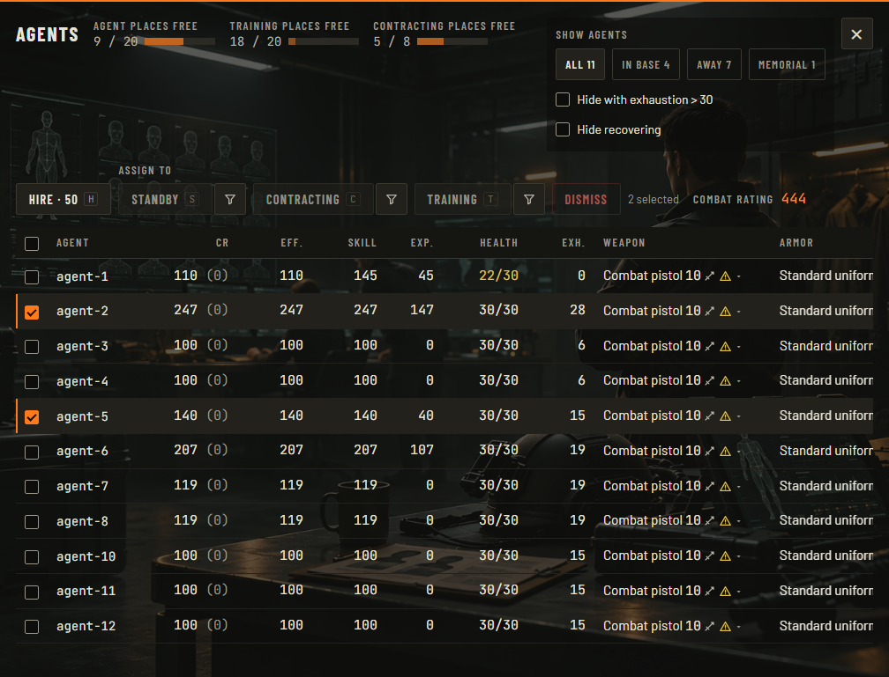
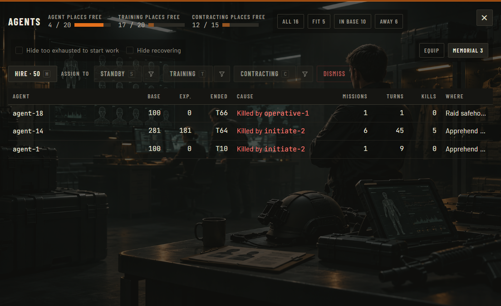
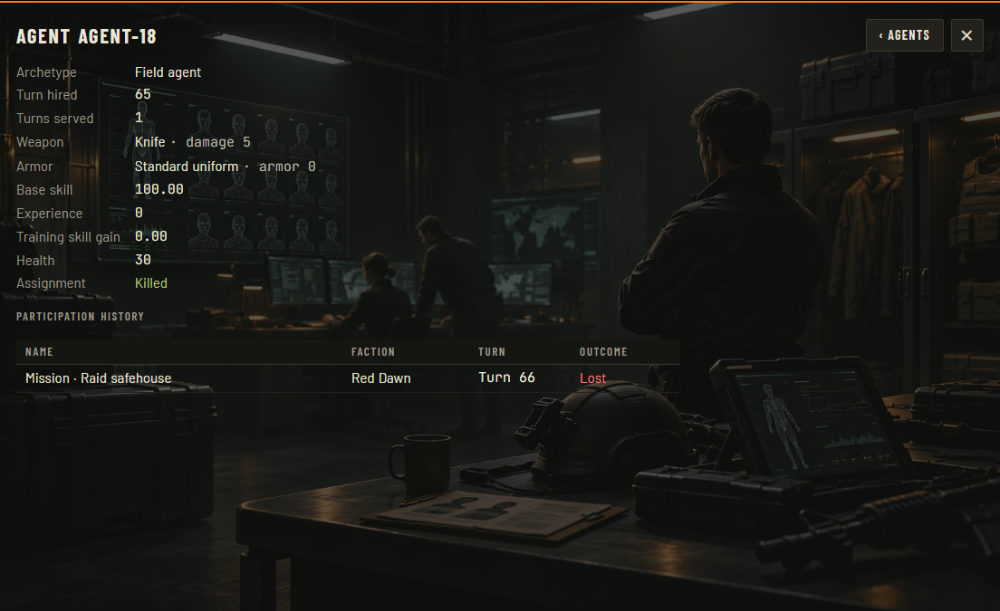

# Agents View

| Metadata | Value |
| --- | --- |
| Spec ID | AVIEW |
| Family | UI |
| Audience | UI designer, Implementer |
| Owns | What the Agents View of the Campaign screen shows and how it hires, dismisses, and assigns Agents. |
| Conventions | [Specification Conventions](../../../governance/conventions/spec-conventions.md), [Design Specification Conventions](../../../governance/conventions/design-spec-conventions.md) |

# Overview

The Agents View is where the Player manages the roster: who serves, what each [Agent](../../mechanics/domain-model.md#agency-and-agents) is doing, and how fit each is for the next task. It is the third of the Operations [Detail views](../gui.md#glossary) of the [Campaign Screen](campaign-screen.md). Unlike the [Missions View](missions-view.md) and the [Leads View](leads-view.md), it is one table, because the Player compares Agents with one another and acts on several at once. It is also where the Player equips Agents, so that what an Agent wears is weighed beside how well it fights.

# Glossary

| Term | Definition | Prohibited synonyms |
| --- | --- | --- |
| Assignment filter | The toggle after each button of Assign to that, while on, [lets the Player select only the Agents that button can assign](#assignment-filters) and orders the table so that they come first. | selection filter |

# Header

The header shows how many places are still free under the caps, so that the Player sees how much room is left to hire, to train, and to contract:

1. **Agent places free:** the [Agent cap](../../mechanics/domain-model.md#agency-and-agents) minus the number of [Serving](../../mechanics/agents-spec.md#agent-statuses) Agents, against the Agent cap.
2. **Training places free:** the [Training cap](../../mechanics/economy-and-upgrades.md#glossary) minus the number of Agents counted against it, against the Training cap.
3. **Contracting places free:** the [Contracting cap](../../mechanics/economy-and-upgrades.md#glossary) minus the number of Agents counted against it, against the Contracting cap. It is shown only while the Contracting cap is at least 1.

Each has its [cap bar](../visual-design.md#cap-bars). A free count is never shown below 0, and the cap bar of a cap of 0 is an empty track.

The header holds these controls:

1. **Hire,** labelled with `hire_cost`, which [hires 1 Agent](../../mechanics/economy-and-upgrades.md#hiring-agents) in one [Player action](../../foundation/engine-contract.md#player-actions-and-turns).
2. **Assign to,** the buttons **[Standby](../../mechanics/agents-spec.md#assignments),** **[Training](../../mechanics/agents-spec.md#assignments),** and **[Contracting](../../mechanics/agents-spec.md#assignments),** each with its Assignment filter. Contracting and its Assignment filter are shown only while the Contracting cap is at least 1, so that, until a [Lead](../../mechanics/domain-model.md#leads-investigations-mission-sites-and-missions) unlocks Contracting, the Player sees no way to start it. Each button [assigns the selected Agents](../../mechanics/agents-spec.md#assigning-agents) to that [Assignment](../../mechanics/domain-model.md#agency-and-agents) in one Player action, at once and without a confirmation, because Undo Action takes it back.
3. **Dismiss,** a destructive button, which [dismisses the selected Agents](../../mechanics/economy-and-upgrades.md#dismissing-agents) in one Player action, after the Player confirms the Agents it names.

The header also shows how many Agents are selected and, while at least one is selected, the [Combat rating](../../mechanics/combat.md#combatant-condition-in-a-combat) of the selected Agents taken as one side, in the [shared Combat rating style](missions-view.md#combat-ratings), so that the Player can gather a team strong enough for a [Mission site](../../mechanics/domain-model.md#leads-investigations-mission-sites-and-missions) before opening the Missions View.

A button is enabled only when pressing it would succeed with the current selection, i.e. when [Action preview](../../foundation/player-api.md#action-preview) reports that the engine would accept the Player action it makes, so that no button repeats a precondition of the action. E.g., with an Agent on Standby and an Agent on Training selected, Standby and Training are disabled, because one of the selected Agents already has that Assignment, and so is Dismiss, because one of them is not on Standby.

# Filters

The Agents View has two kinds of filter: one decides which Agents the table shows, and the other decides which of the shown Agents can be selected.

## Row filters

Five row filters, each with its count, stand in the title row after the places free, without a Label, because their names say what they filter. Exactly one is on at a time, and All is on whenever the Agents View opens.

- **All:** every Serving [Agent](../../mechanics/domain-model.md#agency-and-agents).
- **Fit:** every Agent that [can take orders](../../mechanics/agents-spec.md#agents-that-can-take-orders) and is [Fit to start work](../../mechanics/agents-spec.md#assignments), i.e. every Agent the Player can give new work now.
- **[In base](../../mechanics/agents-spec.md#agent-statuses):** every Agent In base.
- **[Away](../../mechanics/agents-spec.md#agent-statuses):** every Agent Away.
- **Memorial:** every [Terminated](../../mechanics/agents-spec.md#agent-statuses) Agent, in the [Memorial](#memorial).

On a row of their own under the title row, two checkboxes hide more Agents from the table that All, Fit, In base, or Away shows, so that the Player can keep in view only the Agents ready for work, and a third, Details, chooses the [columns of the table](#agent-table):

- **Hide too exhausted to start work:** hides every Agent whose [exhaustion](../../mechanics/agents-spec.md#combatant-attributes) is above `exhaustion_work_start_max` of [AgentParameters](../../mechanics/agents-spec.md#agentparameters), so that it is not [Fit to start work](../../mechanics/agents-spec.md#start-work-gate) whatever its health.
- **Hide recovering:** hides every Agent whose Assignment is [Recovery](../../mechanics/agents-spec.md#assignments), whether it is [Recovering](../../mechanics/agents-spec.md#agent-statuses) or [In transit](../../mechanics/domain-model.md#agency-and-agents).

All three are unchecked whenever the Agents View opens. They change no count of the row filters. While Memorial is on, all three are disabled and keep their check.

## Assignment filters

At most one Assignment filter is on at a time: turning one on turns off the one that was on, and pressing the one that is on turns it off. No Assignment filter is on whenever the Agents View opens.

While an Assignment filter is on, the table keeps showing every Agent its row filter shows, but an Agent can be selected only when the filter's button would succeed with that Agent alone selected, as Action preview reports it; e.g., with the Standby Assignment filter on, an Agent on Contracting can be selected and an Agent In transit cannot. While no Assignment filter is on, every shown Serving Agent can be selected.

Whenever the Assignment filter, the row filter, a checkbox of the [row filters](#row-filters), or the [Current world state](../../foundation/engine-contract.md#player-actions-and-turns) changes, every selected Agent that can no longer be selected, or is no longer shown, is no longer selected. A row does not leave the table because its Agent was just assigned: e.g., after assigning the selected Agents to Contracting with the Contracting Assignment filter on, their rows stay, muted, with "In transit" as [the reason they cannot be selected](#agent-table).

# Agent table

The table lists one row per Serving [Agent](../../mechanics/domain-model.md#agency-and-agents) that the row filter shows and its checkboxes do not hide, with a selection checkbox and these columns: [Instance ID](../../foundation/campaign-instances.md#glossary), [Combat rating](../../mechanics/combat.md#combatant-condition-in-a-combat) headed CR, [Rank](../gui.md#ranks), [current health](../../mechanics/agents-spec.md#combatant-attributes) against [effective max health](../../mechanics/agents-spec.md#combatant-attributes), exhaustion, Weapon, Armor, and Assignment with its [Agent status](../../mechanics/agents-spec.md#agent-statuses). The table's default order is by Instance ID, and its column headers [sort it](../visual-design.md#tables). Current health and exhaustion take the colours of their [Agent condition](../visual-design.md#agent-condition).

The CR cell shows the Combat rating alone. The [Rank](../gui.md#glossary) cell shows the Rank's `name` followed by its [Rank insignia](../gui.md#glossary), e.g. "Rank II" and one chevron, and the column sorts by [base skill](../../mechanics/agents-spec.md#combatant-attributes).

While the Details checkbox is checked, the table trades what the Agents wear for the numbers behind how well they fight: Weapon and Armor are left out, and [effective skill](../../mechanics/agents-spec.md#combatant-attributes) headed Skill, [base skill](../../mechanics/agents-spec.md#combatant-attributes) headed Base, and [Experience](../../mechanics/agents-spec.md#growth) headed Exp. stand after Rank. The CR cell then shows the Combat rating followed by its [Equipment Combat rating](../../mechanics/combat.md#rested-and-equipment-combat-ratings) in parentheses, with its sign, e.g. "136 (+56)", "100 (0)", or "75 (−25)": in Positive when it is above 0, in Danger when it is below 0, and in Text muted at 0; the column still sorts by the Combat rating. A sort tier on a column that is left out is dropped.

The Assignment cell reads:

- for an [Investigation](../../mechanics/domain-model.md#leads-investigations-mission-sites-and-missions), "Investigating", without its [Lead](../../mechanics/domain-model.md#leads-investigations-mission-sites-and-missions)'s `name`;
- for a [Mission](../../mechanics/domain-model.md#leads-investigations-mission-sites-and-missions), "[Deployed](../../mechanics/agents-spec.md#assignments)", without its Mission site's `name`;
- for Recovery, "Recovery" and the Agent's [Recovery turns remaining](../../mechanics/agent-recovery.md#glossary), e.g. "Recovery · 3 T left";
- for any other Assignment, its name.

An Agent In transit is marked by the [In transit icon](../visual-design.md#icons) after the Assignment, never by words, e.g. "Contracting ✈", so that the Assignment column stays narrow. The cell is in Accent text for Recovery, in Text muted for Standby or In transit, and in Positive otherwise. The Assignment column never [cuts its value short](../visual-design.md#tables) with "…". Pressing "Investigating" or "Deployed" opens the [Leads View](leads-view.md) with the Investigation's Lead selected or the [Missions View](missions-view.md) with the Mission's Mission site selected, as a [Follow](campaign-screen.md#view-trail), so that the Player can go from an Agent to the work it is on, and the pointer resting on it shows that Lead's or Mission site's `name`.

While an Assignment filter is on, a [locked](../visual-design.md#tables) first sort tier puts the Agents that can be selected first, and the tiers the Player chooses order the Agents within each of the two groups. When the Assignment filter is turned off, that tier is dropped, and the tiers the Player chose stay.

A row whose Agent cannot be selected has its checkbox disabled and its text in Text muted, except the colours of current health and exhaustion. The tooltip of its checkbox says why, as the first of these that applies:

1. **Deployed:** its Assignment is [Deployed](../../mechanics/agents-spec.md#assignments).
2. **Recovering:** its Assignment is Recovery, whether it is Recovering or In transit.
3. **In transit:** it is In transit.
4. **On assignment:** it is on Contracting or an Investigation and the Assignment filter that is on is for Contracting or Training.
5. **Already on Standby, Contracting, or Training:** the Assignment filter that is on is for the Assignment it has.
6. **Too exhausted:** it is not [Fit to start work](../../mechanics/agents-spec.md#assignments) and the Assignment filter that is on is for Contracting or Training.
7. **Training full:** the Training Assignment filter is on and the Training cap has no place left.
8. **Contracting full:** the Contracting Assignment filter is on and the Contracting cap has no place left.
9. **Otherwise:** the message of the rejection that Action preview reports.

## Weapon and Armor cells

The Weapon cell shows the `name` of the Agent's Weapon and its `base_weapon_damage` with the sword icon, e.g. "Combat pistol 10 ⚔", and the Armor cell the `name` of its Armor and its `base_armor` with the shield icon, e.g. "Ballistic vest 20 🛡"; each column sorts by the number. While the [AmmoType](../../mechanics/combat.md#ammotype) of the Agent's Weapon is [Ammo short](../../mechanics/equipment.md#ammo-short), the Weapon cell shows the warning icon in Warning, with the tooltip "[Ammo short](../../mechanics/equipment.md#glossary)".

Pressing a Weapon or Armor cell opens the [Equipment picker](#equipment-picker) for it, without selecting or unselecting its row, whether or not its Agent can be selected.

## Equipment picker

The Equipment picker is a dropdown that lists what the Agent can wear in place of what it wears: the Weapon or Armor it wears, marked as worn, then every [Item](../../mechanics/equipment.md#glossary) of that kind whose count in [Storage](../../mechanics/equipment.md#storage) is at least 1, from the highest `base_weapon_damage` or `base_armor` down, and last the [Fallback Weapon](../../mechanics/combat.md#ammo) or the [Fallback Armor](../../mechanics/equipment.md#glossary) unless the Agent wears it. Each row shows the `name` and the number with its icon, and a stored Item's row how many [Storage](../../mechanics/equipment.md#glossary) holds; a Weapon's row also shows its AmmoType's `name` and its rounds in Storage, or "no ammo" for a Weapon without an AmmoType, with the warning icon while that AmmoType is [Ammo short](../../mechanics/equipment.md#glossary). Choosing a row other than the worn one [equips the Agent](../../mechanics/equipment.md#equipping-agents) with it in one [Player action](../../foundation/engine-contract.md#player-actions-and-turns), at once and without a confirmation, and closes the picker.

# Memorial

The Memorial remembers the Agents who have left the [Agency](../../mechanics/domain-model.md#agency-and-agents) and how their service ended. While the Memorial filter is on, the table lists one row per Terminated Agent, by default newest [Turn](../../foundation/engine-contract.md#player-actions-and-turns) terminated first and then by Instance ID, and its column headers sort it. Its rows have no selection checkbox, and the buttons and Assignment filters of Assign to and Dismiss are disabled. Its columns are:

- **Instance ID,** **[base skill](../../mechanics/agents-spec.md#combatant-attributes),** and **[Experience](../../mechanics/agents-spec.md#growth),** headed Exp.
- **Turn terminated,** headed Ended.
- **Cause:** for a [Dismissed](../../mechanics/agents-spec.md#agent-statuses) Agent, "Dismissed" in Text muted; for a [Killed](../../mechanics/agents-spec.md#agent-statuses) one, "Killed by" and the [Enemy](../../mechanics/domain-model.md#combat) that its Killed by references, by its [Enemy label](../gui.md#glossary), in Danger text, e.g. "Killed by init-2".
- **Missions:** the number of Missions in its [Participation history](../../mechanics/domain-model.md#agency-and-agents).
- **Turns with the Agency,** headed Turns: its Turn terminated minus its Turn hired.
- **Enemies killed,** headed Kills: the Enemies killed of its [Service record](../../mechanics/agents-spec.md#service-record).
- **Where:** the Mission site that its Killed by references, by its [Archetype](../../foundation/core-concepts.md#campaign-instances)'s `name` followed by "#" and the number that ends its Instance ID, e.g. "Apprehend member #5" for mission-site-5; empty for a Dismissed Agent.

# Agent details

Selecting an Agent's Instance ID, in the table of Serving Agents or in the Memorial, opens its details one step away, in place of the table, as a [Follow](campaign-screen.md#view-trail). They show its AgentArchetype's `name`, its [Turn](../../foundation/engine-contract.md#player-actions-and-turns) hired, its Turns served under it, i.e. the current Turn minus its Turn hired, or its Turns with the Agency for a Terminated Agent, as the [Memorial](#memorial) counts them, its Weapon and its Armor as their [cells](#weapon-and-armor-cells) show them, its base skill labelled "Base skill", its [effective skill](../../mechanics/agents-spec.md#combatant-attributes) labelled "Effective skill" under it, its Experience, its current health against its effective max health, its exhaustion, its Assignment as the [Assignment cell](#agent-table) reads it, its Combat ratings, and its [Participation history](#participation-history). The Weapon and the Armor of a Serving Agent each open the [Equipment picker](#equipment-picker) when pressed. The Combat ratings line shows its Combat rating, its [Rested Combat rating](../../mechanics/combat.md#rested-and-equipment-combat-ratings) labelled max, and its [Equipment Combat rating](../../mechanics/combat.md#rested-and-equipment-combat-ratings) with its sign labelled equipment, e.g. "COMBAT RATING 136 · max 149 · equipment +56"; its effective skill, which is its [base Combat rating](../../mechanics/combat.md#combatant-condition-in-a-combat), is not repeated there. Its base skill, current health, and exhaustion are shown [with two decimals](../gui.md#decimal-quantities-shown).

The Agent details are the one place that shows the [Rested Combat rating](../../mechanics/combat.md#combatant-condition-in-a-combat) beside the Combat rating, so that the Player can see what rest and equipment are worth for this Agent. A Terminated Agent's details show its Weapon with its [Final](../../mechanics/agents-spec.md#service-record) weapon damage and its Armor with its Final armor, e.g. "Ballistic vest · armor 20", and its Final max health in place of its current health against its effective max health; they show no effective skill, no exhaustion, and no Combat rating, and its Weapon and Armor open no picker.

## Participation history

The Agent details list the Agent's [Participation history](../../mechanics/domain-model.md#agency-and-agents) in its order, one row per Investigation or [Mission](../../mechanics/domain-model.md#leads-investigations-mission-sites-and-missions):

| Column | What it shows |
| --- | --- |
| Name | "Investigation" and its Lead's `name`, or "Mission" and its Mission site's MissionSiteArchetype `name`, e.g. "Mission · Raid outpost". |
| Faction | The [Faction](../../mechanics/domain-model.md#factions) of an Investigation's Lead, or nothing for a Lead without one, or the target Faction of a Mission's Mission site. |
| Turn | An Investigation's Turn started, or a Mission's Turn deployed, e.g. "Turn 42". |
| Outcome | The Investigation's or the Mission's final lifecycle state: Completed or Won in Positive, Lost in Danger, and Abandoned in Text muted. |

Each row leads to what it records, so that the Player can see how each Mission the Agent served in went. Pressing a Mission's row opens the Missions View with its Mission site selected, and pressing an Investigation's row opens the Leads View with its Lead selected, each as a Follow.

# Screenshots

The Agents View as the game draws it:

_Captured on 2026-11-23 19:47 UTC._

_Captured on 2026-11-23 19:47 UTC._

_Captured on 2026-11-23 19:47 UTC._
