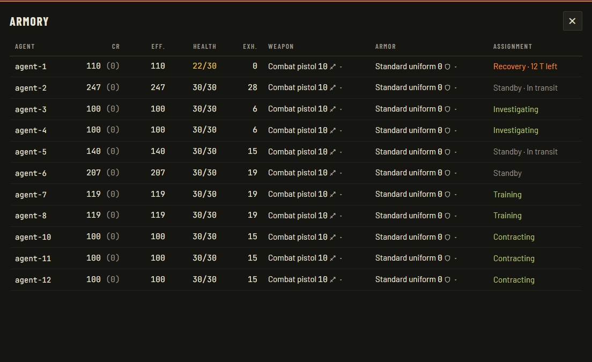

# Armory View

| Metadata | Value |
| --- | --- |
| Spec ID | ARMV |
| Family | UI |
| Audience | UI designer, Implementer |
| Owns | What the Armory View of the Campaign screen shows and how it equips Agents. |
| Conventions | [Specification Conventions](../../../governance/conventions/spec-conventions.md), [Design Specification Conventions](../../../governance/conventions/design-spec-conventions.md) |

# Overview

The Armory View is where the Player equips the roster: what each [Agent](../../mechanics/domain-model.md#agency-and-agents) wears, and what that is worth in a [Combat](../../mechanics/domain-model.md#combat). It is the fourth of the Operations [Detail views](../gui.md#glossary) of the [Campaign Screen](campaign-screen.md). It shows the same Agents as the [Agents View](agents-view.md), which assigns them: the roster has one table for each of the two tasks, so that each [fits its view](../visual-design.md#tables) with every column its task needs.

# Agent table

The table lets the Player compare what the Agents wear against how well each fights, and change it in place. It lists one row per [Serving](../../mechanics/agents-spec.md#agent-statuses) [Agent](../../mechanics/domain-model.md#agency-and-agents), with these columns: [Instance ID](../../foundation/campaign-instances.md#glossary), [Combat rating](../../mechanics/combat.md#combatant-condition-in-a-combat) headed CR, [effective skill](../../mechanics/agents-spec.md#combatant-attributes), [current health](../../mechanics/agents-spec.md#combatant-attributes) against [effective max health](../../mechanics/agents-spec.md#combatant-attributes), [exhaustion](../../mechanics/agents-spec.md#combatant-attributes), Weapon, Armor, and [Assignment](../../mechanics/domain-model.md#agency-and-agents). Its rows follow their Instance IDs until a column header [sorts them](../visual-design.md#tables). Current health and exhaustion take the colours of their [Agent condition](../visual-design.md#agent-condition). Its rows have no selection checkbox, because the Player equips one Agent at a time.

The CR cell shows the Agent's Combat rating followed by its [Equipment Combat rating](../../mechanics/combat.md#rested-and-equipment-combat-ratings) in parentheses, with its sign, e.g. "136 (+56)", "100 (0)", or "75 (−25)": in Positive when it is above 0, in Danger when it is below 0, and in Text muted at 0. The column sorts by the Combat rating.

The Assignment cell names the Agent's Assignment without the work it is on, which the [Assignment cell of the Agents View](agents-view.md#agent-table) names: "Investigating" for an [Investigation](../../mechanics/domain-model.md#leads-investigations-mission-sites-and-missions) and "[Deployed](../../mechanics/agents-spec.md#assignments)" for a [Mission](../../mechanics/domain-model.md#leads-investigations-mission-sites-and-missions), and otherwise what that cell reads, in its colours, e.g. "Recovery · 3 T left" or "Contracting · In transit".

Selecting an Agent's Instance ID opens the Agents View with its [Agent details](agents-view.md#agent-details), as a [Follow](campaign-screen.md#view-trail).

## Weapon and Armor cells

The Weapon cell shows the `name` of the Agent's Weapon and its `base_weapon_damage` with the sword icon, e.g. "Combat pistol 10 ⚔", and the Armor cell the `name` of its Armor and its `base_armor` with the shield icon, e.g. "Ballistic vest 20 🛡"; each column sorts by the number. While the [AmmoType](../../mechanics/combat.md#ammotype) of the Agent's Weapon is [Ammo short](../../mechanics/equipment.md#ammo-short), the Weapon cell shows the warning icon in Warning, with the tooltip "[Ammo short](../../mechanics/equipment.md#glossary)".

Pressing a Weapon or Armor cell opens the [Equipment picker](#equipment-picker) for it.

## Equipment picker

The Equipment picker is a dropdown that lists what the Agent can wear in place of what it wears: the Weapon or Armor it wears, marked as worn, then every [Item](../../mechanics/equipment.md#glossary) of that kind whose count in [Storage](../../mechanics/equipment.md#storage) is at least 1, from the highest `base_weapon_damage` or `base_armor` down, and last the [Fallback Weapon](../../mechanics/combat.md#ammo) or the [Fallback Armor](../../mechanics/equipment.md#glossary) unless the Agent wears it. Each row shows the `name` and the number with its icon, and a stored Item's row how many [Storage](../../mechanics/equipment.md#glossary) holds; a Weapon's row also shows its AmmoType's `name` and its rounds in Storage, or "no ammo" for a Weapon without an AmmoType, with the warning icon while that AmmoType is [Ammo short](../../mechanics/equipment.md#glossary). Choosing a row other than the worn one [equips the Agent](../../mechanics/equipment.md#equipping-agents) with it in one [Player action](../../foundation/engine-contract.md#player-actions-and-turns), at once and without a confirmation, and closes the picker.

# Screenshot

The Armory View as the game draws it:

_Captured on 2026-11-24 10:21 UTC._
