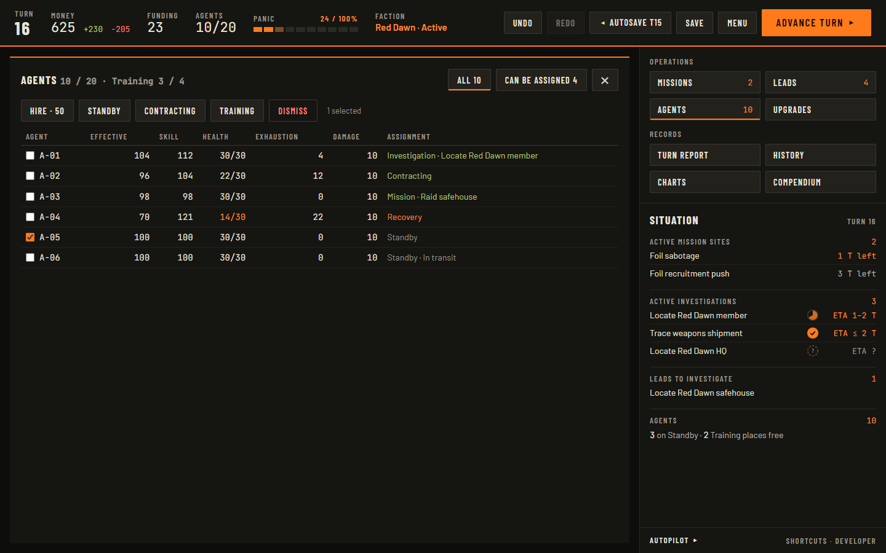

# Campaign Screen

| Metadata    | Value                                                                                                                                                                            |
| ----------- | -------------------------------------------------------------------------------------------------------------------------------------------------------------------------------- |
| Spec ID     | CSCR                                                                                                                                                                             |
| Family      | UI                                                                                                                                                                               |
| Audience    | UI designer, Implementer                                                                                                                                                         |
| Owns        | The regions of the Campaign screen of the graphical user interface, its Side panel, and its Detail views.                                                                        |
| Conventions | [Specification conventions](../../../governance/conventions/spec-conventions.md), [Design Specification Conventions](../../../governance/conventions/design-spec-conventions.md) |

# Overview

While a [Campaign](../../foundation/core-concepts.md#campaign-and-session) is current, the GUI shows the Campaign screen. Its idea is a command console over a view of the
Earth: a globe fills most of the screen, and everything the Player reads or decides sits beside it or opens over it.
The screen therefore shows little by default and keeps the detail one step away. A side panel keeps the Player aware,
without searching, of what is under way and what waits for a decision, through the compact
[Situation panel](situation-panel.md); every detail and every decision is in a Detail view that the side panel opens. The
[Turn summary](turn-summary.md), shown once after an Advance turn, completes what the Situation panel keeps in view.

Where the Turn summary or a Detail view shows [Investigation progress](../../mechanics/domain-model.md#leads-investigations-mission-sites-and-missions) or a gain of it in [progress points](../../mechanics/domain-model.md#leads-investigations-mission-sites-and-missions), it shows them
with two decimals, e.g. 7.02 for a stored 702.

The Campaign screen is one of the screens that the [Graphical User Interface](../gui.md) lists, and it is drawn with
the Design tokens and components of [Visual Design](../visual-design.md).

# Regions

The regions keep the agency's vital values and the work waiting for the Player in view, while leaving most of the
screen to the globe.

- The status bar spans the top of the screen, under [Status bar](../visual-design.md#status-bar) in Visual Design.
- The [Side panel](../gui.md#glossary) runs along the right edge of the screen below the status bar, at a fixed width.
- The [Globe stage](../gui.md#glossary) fills the rest of the screen, to the left of the Side panel. The globe sits centred in the Globe
  stage, and so left of the centre of the screen.

The globe is a decoration: it shows a rotating Earth that the Player can turn and zoom, reads no game state, and offers
no [Player action](../../foundation/engine-contract.md#player-actions-and-turns). The screen is complete without it; when no globe can be shown, the Globe stage is left empty.

# Side panel

The Side panel is the Player's way into every [Detail view](../gui.md#glossary) and the place where the state of the [Campaign](../../foundation/core-concepts.md#campaign-and-session) is read at a glance.
It holds, from top to bottom:

1. **Navigation:** one button for each Detail view, in the two groups and the order under [Detail views](#detail-views), each group under
   its name. A button shows a count where that section gives one. Selecting the button of a Detail view opens it,
   and selecting the button of the open Detail view closes it.
2. **[Situation panel](situation-panel.md):** it fills the height that the navigation and the footer leave, and
   scrolls inside when its content is taller.
3. **Footer:** the [Autopilot](../../foundation/engine-contract.md#autopilot) controls, collapsed to one row until the Player expands them, and the entries to the
   keyboard shortcuts and the developer tools.

# Detail views

A Detail view opens over the Globe stage and covers it, while the status bar and the Side panel stay in view, so that the
Player keeps the [Situation panel](situation-panel.md#glossary) in sight while acting in a Detail view. One Detail view is open at a time: opening another replaces
it. The Player closes the open Detail view with its close control or the Escape key, which shows the globe again. The Detail
views are, in these groups and this order; the list is exhaustive:

- **Operations,** the Detail views in which the Player acts:
  1. [Missions](missions-view.md), for the [Mission sites](../../mechanics/domain-model.md#leads-investigations-mission-sites-and-missions) and the deployment of Agents to them, with the number of Active
     Mission sites.
  2. [Leads](leads-view.md), for the [Leads](../../mechanics/domain-model.md#leads-investigations-mission-sites-and-missions) and their [Investigations](../../mechanics/domain-model.md#leads-investigations-mission-sites-and-missions), with the number of Active Investigations and Leads to
     investigate, under [Groups](situation-panel.md#groups) in Situation Panel.
  3. [Agents](agents-view.md), for hiring, dismissing, and assigning [Agents](../../mechanics/domain-model.md#agency-and-agents), with the number of [Serving](../../mechanics/agents-spec.md#agent-statuses) Agents.
  4. [Upgrades](upgrades-view.md), for the [Upgrades](../../mechanics/domain-model.md#agency-and-agents) of the agency.
- **Records,** the Detail views in which the Player reads what has happened and how the game works:
  1. [Turn report](turn-report-view.md), for the most recent [Turn report](../../foundation/world-history.md#glossary) in full.
  2. [History](history-view.md).
  3. [Charts](charts-view.md).
  4. [Compendium](compendium-view.md), for reference information about the game.

A Detail view is styled under [Detail views and navigation](../visual-design.md#detail-views-and-navigation) in Visual Design.

# Artboards

The [Artboards](../visual-design.md#glossary) show the Situation panel and the Agents Detail view as sample content of their regions; each is detailed
by its own specification and Artboard. The following appear only on the Artboards and must not be implemented, under
[Reading Artboards](../visual-design.md#reading-artboards) in Visual Design:

- The sample values, e.g. Turn 16, Money 625, and the [Agent](../../mechanics/domain-model.md#agency-and-agents) IDs.
- The labels, order, and grouping of the controls in the status bar, e.g. "Menu" instead of "Main menu", and the
  missing keyboard-shortcut hints.
- The drawing of the globe, which stands in for the real one.

# TODOs

- TODO: State how the Campaign screen reaches Advance turn, [Timeline](../../foundation/engine-contract.md#persisted-data) navigation, saving, and
  [Autopilot](../../foundation/engine-contract.md#autopilot), each through the operations that [API hierarchy](../../foundation/engine-contract.md#api-hierarchy) names.
