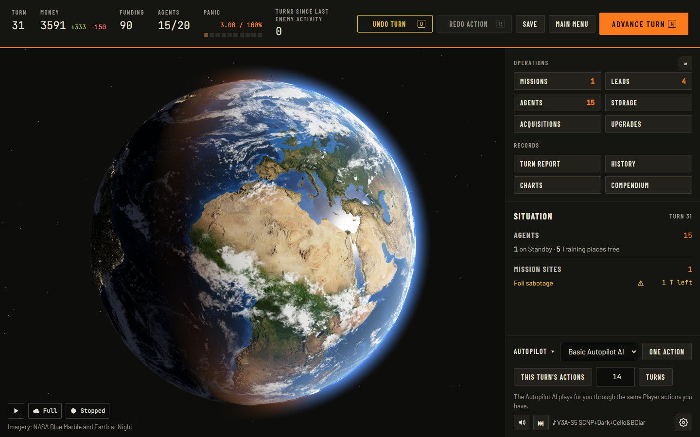
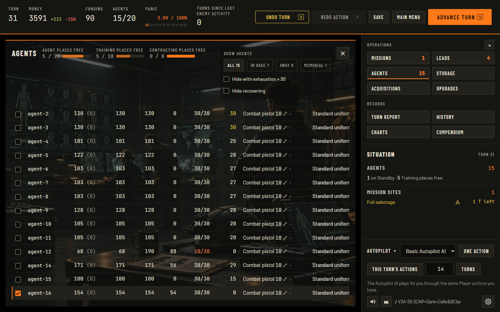
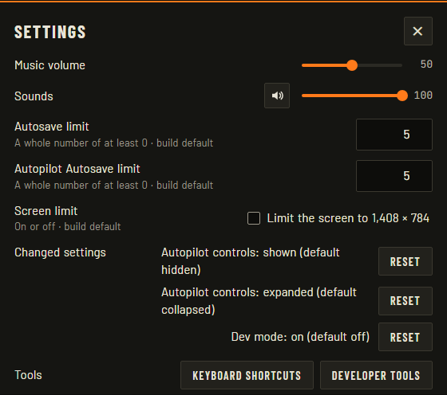
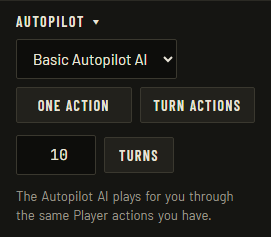
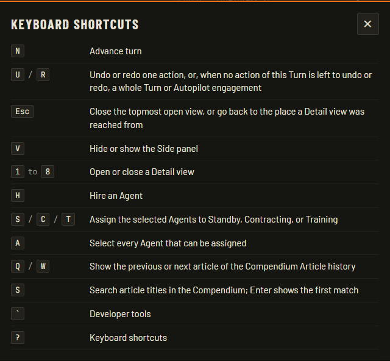

# Campaign Screen

| Metadata | Value |
| --- | --- |
| Spec ID | CSCR |
| Family | UI |
| Audience | UI designer, Implementer |
| Owns | The regions of the Campaign screen of the graphical user interface, its Side panel, its Detail views and the View trail through them, its status bar values and controls, its Autopilot controls, its Globe devastation controls, and its keyboard shortcuts view. |
| Conventions | [Specification Conventions](../../../governance/conventions/spec-conventions.md), [Design Specification Conventions](../../../governance/conventions/design-spec-conventions.md) |

# Overview

While a [Campaign](../../foundation/core-concepts.md#campaign-and-session) is current, the GUI shows the Campaign screen. Its idea is a command console over a view of the Earth: a globe fills most of the screen, and everything the Player reads or decides sits beside it or opens over it. The screen therefore shows little by default and keeps the detail one step away. A side panel keeps the Player aware, without searching, of what is under way and what waits for a decision, through the compact [Situation panel](situation-panel.md); every detail and every decision is in a Detail view that the side panel opens. The [Turn summary](turn-summary.md), shown once after an Advance turn, completes what the Situation panel keeps in view.

The Campaign screen is one of the screens that the [Graphical User Interface](../gui.md) lists, and it is drawn with the Design tokens and components of [Visual Design](../visual-design.md).

# Regions

The regions keep the agency's vital values and the work waiting for the Player in view, while leaving most of the screen to the globe. They are the [status bar](../visual-design.md#status-bar), the [Side panel](../gui.md#glossary), unless the Player [has hidden it](#hiding-the-side-panel), and the [Globe stage](../gui.md#glossary).

The globe is a decoration: it shows a rotating Earth that the Player can turn and zoom, reads no game state, and offers no [Player action](../../foundation/engine-contract.md#player-actions-and-turns). The globe and its own controls are those of [Globe Integration](../../../implementation/recipes/globe-integration.md). The screen is complete without the globe; when no globe can be shown, the Globe stage is left empty. The Globe stage also holds the [Music control](../music.md#music-control-on-the-globe-stage), at its bottom right corner.

## Globe devastation controls

The globe can show the Earth wrecked: its devastation runs from 0%, the Earth as it is, to 100%, with smoke, a fouled sky, scorched land, and fires. Nothing in the game sets it yet, so the Player always sees the Earth as it is. The Globe devastation controls let the Game designer set it by hand, to judge how it looks in the game, and stay out of the Player's way until they are asked for. One [Global configuration](../../foundation/configuration.md#global-configuration) setting governs them:

| Setting | Permitted values | Game build default | Set by |
| --- | --- | --- | --- |
| Globe devastation controls shown | On or off | Off | The "Show Globe devastation controls" checkbox of the [developer tools](../gui.md#developer-tools), which [Dev mode](../../foundation/engine-contract.md#principals-and-access) gates. |

While the setting is on and Dev mode is enabled, the controls stand at the top left corner of the Globe stage, drawn as the globe's own controls are, and are hidden while a [Detail view](../gui.md#glossary) covers the Globe stage:

- **Devastation:** a [slider](../visual-design.md#sliders) labelled "Devastation", from 0 to 100 in steps of 1, followed by its value as a percentage in the Figure style. The globe follows it within about a second.
- **Effects:** three [checkboxes](../visual-design.md#checkboxes), "Ash in orbit", "Bloom", and "Dim sun", each switching one effect of devastation on or off.

What the controls hold belongs to the [Session](../../foundation/core-concepts.md#campaign-and-session), not to a [Campaign](../../foundation/core-concepts.md#campaign-and-session) or to [Global configuration](../../foundation/engine-contract.md#persisted-data): a Session starts with devastation at 0% and every effect on. While the setting is off or Dev mode is disabled, the globe shows the Earth as it is, and the controls come back holding what they held.

# Side panel

The Side panel is the Player's way into every [Detail view](../gui.md#glossary) and the place where the state of the [Campaign](../../foundation/core-concepts.md#campaign-and-session) is read at a glance. It holds:

1. **[Navigation](#navigation):** a button for every Detail view.
2. **[Situation panel](situation-panel.md):** it scrolls inside when its content is taller than the room it has.
3. **Footer:** while [Dev mode](../../foundation/engine-contract.md#principals-and-access) is enabled and [Autopilot](../../foundation/engine-contract.md#autopilot) controls shown is on, the [Autopilot controls](#autopilot-controls); otherwise the Side panel has no footer.

## Navigation

The Player reaches every Detail view in one press, so the navigation keeps a button for each of them in view at all times and folds none away, e.g. behind a tab. The buttons stand under the names of their groups, in the order of [Detail views](#detail-views). The navigation is as tall as its buttons need, and the [Situation panel](situation-panel.md#glossary) takes the height that is left, so a Detail view added later costs the Situation panel room and never a press.

A button shows a count where that section gives one, and no count while it is 0. Selecting the button of a Detail view opens it, and selecting the button of the open Detail view closes it.

## Hiding the Side panel

The Player who reads a wide chart or a long table wants the whole width of the screen, so the Side panel can be put away and brought back at a keystroke. Pressing the button "»", with the accessible name "Hide the Side panel", or the V key, hides the Side panel: a narrow strip takes its place, holding the button "«", with the accessible name "Show the Side panel", and the Globe stage and the open Detail view take the rest of the width. Pressing that button, or the V key again, shows the Side panel as it was. The V key does so wherever the Player is on the Campaign screen, except while typing in a field. Whether the Side panel is hidden is the [Global configuration](../../foundation/configuration.md#global-configuration) setting Side panel hidden, off by default, so it stays as the Player last left it whatever Campaign is loaded and in every later [Session](../../foundation/core-concepts.md#campaign-and-session).

While the [Compendium View](compendium-view.md) or the [Storage View](storage-view.md) is open, the status bar and the Side panel are left out altogether, with no strip in place of the Side panel, and the open view covers the whole screen, because the Player reading a reference, or weighing a trade across a wide table, needs neither the agency's values, nor the Situation panel, nor the navigation. The V key and the keys of the status bar controls, i.e. N, U, and R, do nothing meanwhile, so that the Campaign never changes behind a screen that hides its values. Once that view gives way to another place, or closes, the status bar is back, and the Side panel is back, hidden or shown as the Player last left it.

# Detail views

A Detail view opens over the Globe stage and covers it, while the status bar and the Side panel stay in view, except for the Compendium View and the Storage View as [Hiding the Side panel](#hiding-the-side-panel) says, so that the Player keeps the [Situation panel](situation-panel.md#glossary) in sight while acting in a Detail view. One Detail view is open at a time: opening another replaces it. The Detail views are in these groups:

- **Operations,** the Detail views of the work the Player sends Agents to and of what the agency owns:
  1. [Missions](missions-view.md), for the [Mission sites](../../mechanics/domain-model.md#leads-investigations-mission-sites-and-missions) and the deployment of Agents to them, with the number of Active Mission sites.
  2. [Leads](leads-view.md), for the [Leads](../../mechanics/domain-model.md#leads-investigations-mission-sites-and-missions) and their [Investigations](../../mechanics/domain-model.md#leads-investigations-mission-sites-and-missions), with the number of Active Investigations and of the Leads of the [Leads group](situation-panel.md#groups).
  3. [Agents](agents-view.md), for hiring, dismissing, assigning, and equipping [Agents](../../mechanics/domain-model.md#agency-and-agents), with the number of [Serving](../../mechanics/agents-spec.md#agent-statuses) Agents.
  4. [Storage](storage-view.md), for the [Items and Ammo](../../mechanics/equipment.md#storage) the agency holds and can buy, and buying and selling them.
  5. [Upgrades](upgrades-view.md), for the [Upgrades](../../mechanics/domain-model.md#agency-and-agents) of the agency.
- **Records,** the Detail views in which the Player reads what has happened and how the game works:
  1. [Turn report](turn-report-view.md), for the most recent [Turn report](../../foundation/campaign-state.md#glossary) in full.
  2. [History](history-view.md).
  3. [Charts](charts-view.md).
  4. [Compendium](compendium-view.md), for reference information about the game.

# View trail

A Detail view often leads to another, e.g. a Lead discovered in the [Turn Report View](turn-report-view.md) opens the [Leads View](leads-view.md), and the Player who has read what they followed wants to be back where they were, not at the globe. The [View trail](../gui.md#glossary) remembers the places the Player came through, so that the Escape key retraces them one at a time, however many there are.

A place is what the Detail view area shows: an open Detail view together with what it shows one step away in place of its content, e.g. the [Combat report](turn-report-view.md#combat-report) of the Turn Report View or the [Agent details](agents-view.md#agent-details) of the Agents View, its selected item, its filters, the lists the Player expanded, and its scroll position. The [Turn summary](turn-summary.md) is a place too, together with the place it was shown over, so that a [Combat report](../../mechanics/domain-model.md#combat) read from it leads back to it. The View trail is a stack of places, the most recent last, with no limit on its length. It changes only as follows:

1. **Follow:** when the Player, from inside the open Detail view, opens another Detail view or opens something one step away in place of the Detail view's content, the place they leave is added to the end of the View trail, e.g. selecting a Lead in the Turn Report View, a Combat report button, or an Agent's Instance ID. Selecting an item, changing a filter, or expanding a list within the same place is not a Follow and changes nothing on the View trail.
2. **[Go back](../sounds.md#glossary):** the Escape key, or the [Back control](../gui.md#glossary), removes the last place from the View trail and shows it as the Player left it, with each part read from the current state. A selected item that is no longer listed, e.g. a Mission site that has since Expired, gives way to the item the Detail view selects when it opens. The Escape key goes back only when no view is open over the Detail view, e.g. the [Settings panel](../gui.md#settings-panel), which it closes first. Going back to the [Turn summary](turn-summary.md#glossary) shows it again, over the place it was shown over.
3. **Start afresh:** the View trail is emptied when the Player opens a Detail view from outside the open one, i.e. from the Side panel or an item of the [Situation panel](situation-panel.md), or closes the open one from the Side panel, because the Player has chosen a new direction rather than followed a link.
4. **From the Turn summary:** when the Player opens a Detail view from the Turn summary, e.g. with the Combat replay link of a [Mission](../../mechanics/domain-model.md#leads-investigations-mission-sites-and-missions) or the [link of a Mission site](turn-summary.md#links), the View trail is emptied and then holds the Turn summary as its only place, because the Player means to come back to the rest of the Turn summary.
5. **Close:** the close control of the open Detail view, or the Escape key with an empty View trail, closes the Detail view, which shows the globe, and empties the View trail. When the first place of the View trail is the Turn summary, closing instead shows the Turn summary again, over the place it was shown over, and empties the View trail, because the Player came to the Detail view from the Turn summary.
6. **New [Turn](../../foundation/engine-contract.md#player-actions-and-turns):** the View trail is emptied, and the open place stays open, when the [Turn](../../foundation/engine-contract.md#player-actions-and-turns) changes, e.g. on an Advance turn or an Undo Turn, because the places on it showed a Turn that has passed. It is also empty whenever the Campaign screen is shown anew, e.g. after a [Campaign](../../foundation/core-concepts.md#campaign-and-session) is loaded.

While the View trail is not empty, the open Detail view shows a Back control, which does what the Escape key does and is labelled "‹" and the name of the place it returns to: the Detail view's name, or the name of what that place shows one step away, or "Turn summary", e.g. "‹ Turn report", "‹ Combat report", or "‹ Turn summary".

E.g., the Player opens the Turn Report View from the Side panel and selects its Combat report button: the Combat report shows in place of the sections, with "‹ Turn report". The Player presses Escape: the sections show again, scrolled as they were, and the Back control is gone. The Player selects the discovered Lead "Locate Red Dawn safehouse": the Leads View opens with that Lead selected and "‹ Turn report". The Player starts an Investigation of it and presses Escape: the Turn Report View shows again. The Player presses Escape once more: the View trail is empty, so the Turn Report View closes and the globe shows. Had the Player instead selected Missions in the Side panel while in the Leads View, the Missions View would have opened with an empty View trail, and Escape would have closed it.

# Status bar values

The status bar keeps in view the values that decide whether the Campaign is going well, and leaves every [Faction](../../mechanics/domain-model.md#factions)'s details to the Detail views. Its values are:

1. **Turn:** the current [Turn](../../foundation/engine-contract.md#player-actions-and-turns) number.
2. **Money:** the [Agency](../../mechanics/domain-model.md#agency-and-agents)'s money, with its [projected income](../../mechanics/economy-and-upgrades.md#projected-income-and-upkeep) and its projected upkeep.
3. **Funding:** the Agency's funding.
4. **Agents:** the number of [Serving](../../mechanics/agents-spec.md#agent-statuses) Agents and the [Agent cap](../../mechanics/economy-and-upgrades.md#glossary), e.g. "10/20".
5. **Panic:** [Panic](../../mechanics/domain-model.md#campaign-standing) as a [meter](../visual-design.md#meters) against the [Panic limit](../../mechanics/panic-and-endings.md#glossary).
6. **Enemy quiet:** the number of Turns since a [Response Mission site](../../mechanics/domain-model.md#leads-investigations-mission-sites-and-missions) last appeared, written with "T", e.g. "4 T", so that the Player senses how long the [Factions](../../mechanics/domain-model.md#factions) have been quiet without the status bar naming any of them. Its tooltip names it in full: "Turns since last enemy activity". It is the current Turn number minus 1 minus the greatest [Turn created](../../mechanics/missions.md#mission-site-properties) of any Response Mission site, whatever its lifecycle state, and the current Turn number minus 1 before any Response Mission site exists.

# Status bar controls

The status bar's controls are:

1. **Undo** and **Redo,** the buttons of [Undo and redo](#undo-and-redo).
2. **Save,** which [writes a Campaign save](../../foundation/saves.md#saving) of the [Current campaign](../../foundation/core-concepts.md#campaign-and-session).
3. **[Main menu](../../foundation/campaign-lifecycle.md#glossary),** which [closes the Current campaign](../../foundation/campaign-lifecycle.md#campaign-selection) and shows the Main menu.
4. **Settings,** a square button showing a cogwheel, with the accessible name "Settings", which opens the [Settings panel](../gui.md#settings-panel).
5. **Advance turn,** the primary button, which makes the Advance turn Player action. The N key presses it. While the engine reports Advance turn unavailable, the button is disabled and its tooltip gives the reason the engine reports.

While an [Autopilot engagement](../../foundation/engine-contract.md#autopilot) is active, every status bar control but Settings is disabled, because the [Session controller](../../foundation/engine-contract.md#principals-and-access) [cannot use their operations](../../foundation/autopilot.md#autopilot-lifecycle-and-concurrency) until disengagement completes.

# Autopilot controls

The Autopilot controls in the footer of the Side panel let the Player hand play to an [Autopilot AI](../../foundation/engine-contract.md#principals-and-access) for a bounded stretch and take it back at any moment, through the operations of [Autopilot](../../foundation/autopilot.md). Collapsed, they hold a toggle labelled Autopilot that expands them; expanded, they are:

1. The toggle, which collapses them again.
2. **Autopilot AI:** a selector of the [available Autopilot AIs](../../foundation/autopilot.md#available-autopilot-ais), by name.
3. **One action** and **Turn actions:** two buttons side by side on one row, the second standing for this [Turn](../../foundation/engine-contract.md#player-actions-and-turns)'s actions, that engage the chosen Autopilot AI with the [Autopilot limit](../../foundation/autopilot.md#glossary) `singleAction` or `turnActions`.
4. **Turns:** a field for a whole number of Turns, which shows [Autopilot Turns](#autopilot-settings), and a Turns button that engages with the Autopilot limit `turnAdvancements` and that number as `count`.
5. A line saying that the Autopilot AI plays for the Player through the same Player actions the Player has.

The selector and the engaging buttons are disabled, each with the reason as its tooltip, while an Autopilot engagement is active, after the Campaign has ended, and when no Autopilot AI is available. While an Autopilot engagement is active, its [Autopilot progress](../../foundation/autopilot.md#glossary), in Player actions and Turns advanced, and a Stop button that disengages Autopilot stand in the collapsed controls and in place of the line in the expanded controls. When the Autopilot engagement ends, the controls show again what they show before any engagement, with no account of its disengagement reason or Autopilot progress, because the Player sees what Autopilot did in the Campaign itself.

The Player sets up Autopilot once rather than in every [Session](../../foundation/core-concepts.md#campaign-and-session) or Campaign: whether the Autopilot controls are expanded and the chosen Autopilot AI are [Autopilot settings](#autopilot-settings), so they stay as the Player last left them whatever Campaign is created or loaded and in every later Session. When the chosen Autopilot AI is no longer available, the selector shows the first available one.

## Autopilot settings

Autopilot is a tool for the Game designer and for testing, not part of playing the game, so its controls stay out of the Player's way until they are asked for, and the Game designer who uses them sets them up once rather than in every Session. Four [Global configuration](../../foundation/configuration.md#global-configuration) settings govern them:

| Setting | Permitted values | Game build default | Set by |
| --- | --- | --- | --- |
| Autopilot controls shown | On or off | Off | The "Show Autopilot controls" checkbox of the [developer tools](../gui.md#developer-tools), which Dev mode gates. |
| Autopilot controls expanded | On or off | Off | The toggle of the Autopilot controls. |
| Autopilot AI | The name of an Autopilot AI, or none | None, which shows the first available Autopilot AI | The Autopilot AI selector of the Autopilot controls. |
| Autopilot Turns | A whole number of at least 1 | 10 | The Turns field of the Autopilot controls, whenever the Player leaves it holding a permitted value, e.g. 100 stays 100 in every later Session. |

The "Show Autopilot controls" checkbox is disabled while an Autopilot engagement is active, so that the Stop button never leaves the screen while it is needed.

# Undo and redo

The Player undoes and redoes with one Undo button and one Redo button in the status bar, and the GUI chooses the [Timeline](../../foundation/engine-contract.md#persisted-data) navigation behind each, within the current [Turn](../../foundation/engine-contract.md#player-actions-and-turns) or across Turns, so that the Player never manages [Campaign saves](../../foundation/engine-contract.md#persisted-data) to go back or forward. Each button names the step it takes:

| Button | Label | When | Operation |
| --- | --- | --- | --- |
| Undo | Undo Action | `undoAction()` is available | `undoAction()` |
| Undo | Undo Autopilot | `undoAction()` is unavailable and `undoToAutosave()` is available and crosses an Autopilot engagement | `undoToAutosave()` |
| Undo | Undo Turn | `undoAction()` is unavailable and `undoToAutosave()` is available and crosses no Autopilot engagement | `undoToAutosave()` |
| Redo | Redo Action | `redoAction()` is available | `redoAction()` |
| Redo | Redo Autopilot | `redoAction()` is unavailable and `redoToAutosave()` is available and crosses an Autopilot engagement | `redoToAutosave()` |
| Redo | Redo Turn | `redoAction()` is unavailable and `redoToAutosave()` is available and crosses no Autopilot engagement | `redoToAutosave()` |

The operations are those of [Action navigation](../../foundation/timeline.md#action-navigation) and [Autosave navigation](../../foundation/timeline.md#autosave-navigation), which also reports whether a step crosses an Autopilot engagement. A button with no available operation is disabled and keeps its Action label. A button is a neutral button while it takes an Action step, a [weighty button](../visual-design.md#buttons) while it takes a Turn step, and an Autopilot button while it takes an Autopilot step. It keeps one width, that of its widest label, so that no control moves when its label changes. A Turn or Autopilot step's tooltip names the Turn and [Autosave](../../foundation/saves.md#autosave-kinds) it loads, e.g. "Back to the end of Turn 12" or "Back to Turn 5, before Autopilot was engaged". The U and R keys press the Undo and Redo buttons, except that the R key belongs to the [Combat replay](combat-replay.md#playback) while it is shown.

While [Ctrl](../gui.md#glossary) is held, both buttons take their step across Turns, so that the Player who wants the last Turn back skips the Actions within it in one press: each button takes `undoToAutosave()` or `redoToAutosave()` even when its Action step is available, labelled and styled as the table gives for that operation, e.g. Undo Turn or Redo Autopilot, and is disabled with the label Undo Turn or Redo Turn when that operation is unavailable.

# Keyboard shortcuts

The keyboard shortcuts view, opened from the [Settings panel](../gui.md#settings-panel), lets the Player learn every key of the Campaign screen at one glance. It is a [dialog](../visual-design.md#dialogs).

It lists every keyboard shortcut of the Campaign screen, those the specifications give, e.g. the N key for Advance turn, and those the Implementation adds, one row each: its keys, where keys that share one description are separated by "/", e.g. "U / R", and what the keys do. A description too long for one line wraps onto further lines and is never cut short, unlike a value in a row of a [table](../visual-design.md#tables).

# Screenshots

The Campaign Screen as the game draws it:

_Captured on 2026-11-27 01:19 UTC._

_Captured on 2026-11-27 01:19 UTC._

_Captured on 2026-11-27 01:19 UTC._

_Captured on 2026-11-27 01:19 UTC._

_Captured on 2026-11-27 01:19 UTC._
