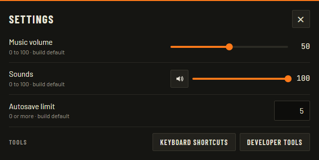

# Campaign Screen

| Metadata | Value |
| --- | --- |
| Spec ID | CSCR |
| Family | UI |
| Audience | UI designer, Implementer |
| Owns | The regions of the Campaign screen of the graphical user interface, its Side panel, its Detail views and the View trail through them, its status bar values and controls, and its Autopilot controls. |
| Conventions | [Specification Conventions](../../../governance/conventions/spec-conventions.md), [Design Specification Conventions](../../../governance/conventions/design-spec-conventions.md) |

# Overview

While a [Campaign](../../foundation/core-concepts.md#campaign-and-session) is current, the GUI shows the Campaign screen. Its idea is a command console over a view of the Earth: a globe fills most of the screen, and everything the Player reads or decides sits beside it or opens over it. The screen therefore shows little by default and keeps the detail one step away. A side panel keeps the Player aware, without searching, of what is under way and what waits for a decision, through the compact [Situation panel](situation-panel.md); every detail and every decision is in a Detail view that the side panel opens. The [Turn summary](turn-summary.md), shown once after an Advance turn, completes what the Situation panel keeps in view.

Where the Turn summary or a Detail view shows [Investigation progress](../../mechanics/domain-model.md#leads-investigations-mission-sites-and-missions) or a gain of it in [progress points](../../mechanics/domain-model.md#leads-investigations-mission-sites-and-missions), it shows them with two decimals, e.g. 7.02 for a stored 702.

The Campaign screen is one of the screens that the [Graphical User Interface](../gui.md) lists, and it is drawn with the Design tokens and components of [Visual Design](../visual-design.md).

# Regions

The regions keep the agency's vital values and the work waiting for the Player in view, while leaving most of the screen to the globe.

- The status bar spans the top of the screen, under [Status bar](../visual-design.md#status-bar) in Visual Design.
- The [Side panel](../gui.md#glossary) runs along the right edge of the screen below the status bar, at a fixed width.
- The [Globe stage](../gui.md#glossary) fills the rest of the screen, to the left of the Side panel. The globe sits centred in the Globe stage, and so left of the centre of the screen.

The globe is a decoration: it shows a rotating Earth that the Player can turn and zoom, reads no game state, and offers no [Player action](../../foundation/engine-contract.md#player-actions-and-turns). Its own controls sit at the bottom left of the Globe stage, above its imagery credit: they stop and start its rotation, show its clouds in full, at half opacity, or not at all, and set the speed of its day and night cycle, as [Globe Integration](../../../implementation/recipes/globe-integration.md) describes. The screen is complete without the globe; when no globe can be shown, the Globe stage is left empty.

# Side panel

The Side panel is the Player's way into every [Detail view](../gui.md#glossary) and the place where the state of the [Campaign](../../foundation/core-concepts.md#campaign-and-session) is read at a glance. It holds, from top to bottom:

1. **Navigation:** one button for each Detail view, in the two groups and the order under [Detail views](#detail-views), each group under its name. A button shows a count where that section gives one. Selecting the button of a Detail view opens it, and selecting the button of the open Detail view closes it, each emptying the [View trail](#view-trail).
2. **[Situation panel](situation-panel.md):** it fills the height that the navigation and the footer leave, and scrolls inside when its content is taller.
3. **Footer:** the [Autopilot](../../foundation/engine-contract.md#autopilot) controls, collapsed to one row until the Player expands them, under [Autopilot controls](#autopilot-controls), and, in the bottom row, the [Music control](../music.md#music-control) with the title of the [Track](../music.md#glossary) that is playing, followed at the right end by the Settings button, a square neutral button 36 px wide and tall holding a cogwheel, with the accessible name "Settings", which opens the [Settings panel](../gui.md#settings-panel). The bottom right corner of the screen thus holds the controls the Player reaches for at any moment, while the volumes, the other settings, the keyboard shortcuts, and the developer tools wait one click away in the [Settings panel](../gui.md#glossary).

# Detail views

A Detail view opens over the Globe stage and covers it, while the status bar and the Side panel stay in view, so that the Player keeps the [Situation panel](situation-panel.md#glossary) in sight while acting in a Detail view. One Detail view is open at a time: opening another replaces it. The Player closes the open Detail view with its close control, which shows the globe again, and goes back through the Detail views they came from with the Escape key, under [View trail](#view-trail). The Detail views are, in these groups and this order; the list is exhaustive:

- **Operations,** the Detail views in which the Player acts:
  1. [Missions](missions-view.md), for the [Mission sites](../../mechanics/domain-model.md#leads-investigations-mission-sites-and-missions) and the deployment of Agents to them, with the number of Active Mission sites.
  2. [Leads](leads-view.md), for the [Leads](../../mechanics/domain-model.md#leads-investigations-mission-sites-and-missions) and their [Investigations](../../mechanics/domain-model.md#leads-investigations-mission-sites-and-missions), with the number of Active Investigations and Leads to investigate, under [Groups](situation-panel.md#groups) in Situation Panel.
  3. [Agents](agents-view.md), for hiring, dismissing, and assigning [Agents](../../mechanics/domain-model.md#agency-and-agents), with the number of [Serving](../../mechanics/agents-spec.md#agent-statuses) Agents.
  4. [Upgrades](upgrades-view.md), for the [Upgrades](../../mechanics/domain-model.md#agency-and-agents) of the agency.
- **Records,** the Detail views in which the Player reads what has happened and how the game works:
  1. [Turn report](turn-report-view.md), for the most recent [Turn report](../../foundation/world-history.md#glossary) in full.
  2. [History](history-view.md).
  3. [Charts](charts-view.md).
  4. [Compendium](compendium-view.md), for reference information about the game.

A Detail view is styled under [Detail views and navigation](../visual-design.md#detail-views-and-navigation) in Visual Design.

# View trail

A Detail view often leads to another, e.g. a Lead discovered in the [Turn Report View](turn-report-view.md) opens the [Leads View](leads-view.md), and the Player who has read what they followed wants to be back where they were, not at the globe. The [View trail](../gui.md#glossary) remembers the places the Player came through, so that the Escape key retraces them one at a time, however many there are.

A place is what the Detail view area shows: an open Detail view together with what it shows one step away in place of its content, e.g. the [Combat report](turn-report-view.md#combat-report) of the Turn Report View or the [Agent details](agents-view.md#agent-details) of the Agents View, its selected item, its filters, the lists the Player expanded, and its scroll position. The [Turn summary](turn-summary.md) is a place too, together with the place it was shown over, so that a [Combat report](../../mechanics/domain-model.md#combat) read from it leads back to it. The View trail is a stack of places, the most recent last, with no limit on its length. It changes only as follows; the list is exhaustive:

1. **Follow:** when the Player, from inside the open Detail view, opens another Detail view or opens something one step away in place of the Detail view's content, the place they leave is added to the end of the View trail, e.g. selecting a Lead in the Turn Report View, a Combat report button, or an Agent's Instance ID. Selecting an item, changing a filter, or expanding a list within the same place is not a Follow and changes nothing on the View trail.
2. **[Go back](../sounds.md#glossary):** the Escape key, or the [Back control](../gui.md#glossary), removes the last place from the View trail and shows it as the Player left it, with each part read from the current state. A selected item that is no longer listed, e.g. a Mission site that has since Expired, gives way to the item the Detail view selects when it opens. The Escape key goes back only when no view is open over the Detail view, e.g. the [Settings panel](../gui.md#settings-panel), which it closes first. Going back to the [Turn summary](turn-summary.md#glossary) shows it again, over the place it was shown over.
3. **Start afresh:** the View trail is emptied when the Player opens a Detail view from outside the open one, i.e. from the Side panel or an item of the [Situation panel](situation-panel.md), because the Player has chosen a new direction rather than followed a link.
4. **From the Turn summary:** when the Player opens a Detail view from the Turn summary, i.e. a [Mission](../../mechanics/domain-model.md#leads-investigations-mission-sites-and-missions) card's Combat report button or the offer to open the full Turn report, the View trail is emptied and then holds the Turn summary as its only place, because the Player means to come back to the rest of the Turn summary.
5. **Close:** the close control of the open Detail view, or the Escape key with an empty View trail, closes the Detail view, which shows the globe, and empties the View trail. When the first place of the View trail is the Turn summary, closing instead shows the Turn summary again, over the place it was shown over, and empties the View trail, because the Player came to the Detail view from the Turn summary.
6. **New [Turn](../../foundation/engine-contract.md#player-actions-and-turns):** the View trail is emptied, and the open place stays open, when the [Turn](../../foundation/engine-contract.md#player-actions-and-turns) changes, e.g. on an Advance turn or an Undo Turn, because the places on it showed a Turn that has passed. It is also empty whenever the Campaign screen is shown anew, e.g. after a [Campaign](../../foundation/core-concepts.md#campaign-and-session) is loaded.

While the View trail is not empty, the open Detail view shows a Back control, a neutral button that does what the Escape key does and is labelled "‹" and the name of the place it returns to: the Detail view's name, or the name of what that place shows one step away, or "Turn summary", e.g. "‹ Turn report", "‹ Combat report", or "‹ Turn summary". It is styled under [Detail views and navigation](../visual-design.md#detail-views-and-navigation) in Visual Design.

E.g., the Player opens the Turn Report View from the Side panel and selects its Combat report button: the Combat report shows in place of the sections, with "‹ Turn report". The Player presses Escape: the sections show again, scrolled as they were, and the Back control is gone. The Player selects the discovered Lead "Locate Red Dawn safehouse": the Leads View opens with that Lead selected and "‹ Turn report". The Player starts an Investigation of it and presses Escape: the Turn Report View shows again. The Player presses Escape once more: the View trail is empty, so the Turn Report View closes and the globe shows. Had the Player instead selected Missions in the Side panel while in the Leads View, the Missions View would have opened with an empty View trail, and Escape would have closed it.

E.g., after an Advance turn with two Missions, the Turn summary shows over the Missions View. The Player selects the Combat report button of the first Mission card: the Turn summary closes, and the Turn Report View opens showing that Combat report, with "‹ Turn summary". The Player selects the close control: the Turn summary shows again over the Missions View, and the Player selects the Combat report button of the second Mission card. After reading it, the Player presses Escape: the Turn summary shows again, and dismissing it shows the Missions View.

# Status bar values

The status bar keeps in view the values that decide whether the Campaign is going well, and leaves every [Faction](../../mechanics/domain-model.md#factions)'s details to the Detail views. Its values are, in this order; the list is exhaustive:

1. **Turn:** the current [Turn](../../foundation/engine-contract.md#player-actions-and-turns) number.
2. **Money:** the [Agency](../../mechanics/domain-model.md#agency-and-agents)'s money, followed by its projected income in Positive and its projected upkeep in Danger, under [Status bar](../visual-design.md#status-bar) in Visual Design.
3. **Funding:** the Agency's funding.
4. **Agents:** the number of [Serving](../../mechanics/agents-spec.md#agent-statuses) Agents and the [Agent cap](../../mechanics/economy-and-upgrades.md#glossary), e.g. "10/20".
5. **Panic:** [Panic](../../mechanics/domain-model.md#campaign-standing) as a meter against the [Panic limit](../../mechanics/panic-and-endings.md#glossary), under [Meters](../visual-design.md#meters) in Visual Design.
6. **Turns since last enemy activity:** the number of Turns since a [Response Mission site](../../mechanics/domain-model.md#leads-investigations-mission-sites-and-missions) last appeared, so that the Player senses how long the [Factions](../../mechanics/domain-model.md#factions) have been quiet without the status bar naming any of them. It counts Response Mission sites only: an [Initiative Mission site](../../mechanics/domain-model.md#leads-investigations-mission-sites-and-missions), created by the Player's own [Investigation](../../mechanics/domain-model.md#leads-investigations-mission-sites-and-missions), never resets it. It is the current Turn number minus 1 minus the greatest Turn created of any Response Mission site, under [Mission site properties](../../mechanics/missions.md#mission-site-properties) in Missions, whatever its lifecycle state, so it is 0 in the Turn after the Advance turn that created a Response Mission site, and it grows by 1 with each Advance turn that creates none. Before any Response Mission site exists, it is the current Turn number minus 1. Its label may wrap onto two lines, so that the status bar keeps its controls in one row at a window 1280 px wide.

# Status bar controls

The status bar's controls follow its values in this order, so that the main action is last, under [Status bar](../visual-design.md#status-bar) in Visual Design; the list is exhaustive:

1. **Undo** and **Redo,** under [Undo and redo](#undo-and-redo).
2. **Save,** a neutral button that writes a [Campaign save](../../foundation/engine-contract.md#persisted-data) of the [Current campaign](../../foundation/core-concepts.md#campaign-and-session) with `session.saves.save()`, under [Saving](../../foundation/saves.md#saving) in Saves.
3. **[Main menu](../../foundation/campaign-lifecycle.md#glossary),** a neutral button that closes the Current campaign with `session.campaign.close()` and shows the Main menu, under [Campaign selection](../../foundation/campaign-lifecycle.md#campaign-selection) in Campaign Lifecycle. Nothing is lost, because closing writes no Campaign save and the [Current Autosave](../../foundation/saves.md#autosave-kinds) already holds the [Committed state](../../foundation/engine-contract.md#player-actions-and-turns).
4. **Advance turn,** the primary button, which makes the Advance turn Player action `advanceTurn()`. The N key presses it. While the engine reports Advance turn unavailable, the button is disabled and its tooltip gives the reason the engine reports.

While an [Autopilot engagement](../../foundation/engine-contract.md#autopilot) is active, every status bar control is disabled, because the [Session controller](../../foundation/engine-contract.md#principals-and-access) cannot use their operations until disengagement completes, under [Autopilot lifecycle and concurrency](../../foundation/autopilot.md#autopilot-lifecycle-and-concurrency) in Autopilot.

# Autopilot controls

The Autopilot controls in the footer of the Side panel let the Player hand play to an [Autopilot AI](../../foundation/engine-contract.md#principals-and-access) for a bounded stretch and take it back at any moment, through the operations of [Autopilot](../../foundation/autopilot.md). Collapsed, they are one row: a toggle labelled Autopilot that expands them and, while an Autopilot engagement is active, its progress and a Stop button. Expanded, the footer grows upward and the Situation panel above it shrinks, and the controls are, from top to bottom:

1. The toggle, which collapses them again.
2. **Autopilot AI:** a selector of the Autopilot AIs that `session.autopilot.listAutopilotAis()` reports, by name.
3. **One action** and **This [Turn](../../foundation/engine-contract.md#player-actions-and-turns)'s actions:** neutral buttons that engage the chosen Autopilot AI with `session.autopilot.engage(autopilotAiId, limit)` and the [Autopilot limit](../../foundation/autopilot.md#glossary) `singleAction` or `turnActions`. Neither ever advances the Turn, which is left to the Player.
4. **Turns:** a field for a whole number of Turns of at least 1 and a neutral Turns button that engages with the Autopilot limit `turnAdvancements` and that number as `count`.
5. A line in 12 px Body and Text muted saying that the Autopilot AI plays for the Player through the same Player actions the Player has.

The selector and the engaging buttons are disabled, each with the reason as its tooltip, while an Autopilot engagement is active, after the Campaign has ended, and when no Autopilot AI is available. While an Autopilot engagement is active, its [Autopilot progress](../../foundation/autopilot.md#glossary), in Player actions and Turns advanced as `session.autopilot.getStatus(engagementId)` reports them, and a neutral Stop button that calls `session.autopilot.disengage(engagementId)` stand in the collapsed row and in place of the line in the expanded controls. When the Autopilot engagement ends, a line in 12 px Body and Text muted takes the place of the progress and the Stop button and tells the Player in plain words its disengagement reason and Autopilot progress, e.g. "Autopilot disengaged because its limit was reached: 14 Player actions, 3 Turns advanced". It stays until Autopilot is engaged again or the [Committed state](../../foundation/engine-contract.md#player-actions-and-turns) changes. For the disengagement reason Advance turn withheld, the line says that the Autopilot AI has left Advance turn to the Player, and, when no Player action was committed, that it has nothing more to do this Turn; e.g., "Autopilot finished this Turn's actions: 6 Player actions. Advancing the Turn is up to you." or "Autopilot has nothing more to do this Turn."

# Undo and redo

The Player undoes and redoes with one Undo button and one Redo button in the status bar, and the GUI chooses the [Timeline](../../foundation/engine-contract.md#persisted-data) navigation behind each, within the current [Turn](../../foundation/engine-contract.md#player-actions-and-turns) or across Turns, so that the Player never manages [Campaign saves](../../foundation/engine-contract.md#persisted-data) to go back or forward. Each button names the step it takes:

| Button | Label       | When                                                              | Operation          |
| ------ | ----------- | ----------------------------------------------------------------- | ------------------ |
| Undo   | Undo Action | `undoAction()` is available                                       | `undoAction()`     |
| Undo   | Undo Turn   | `undoAction()` is unavailable and `undoToAutosave()` is available | `undoToAutosave()` |
| Redo   | Redo Action | `redoAction()` is available                                       | `redoAction()`     |
| Redo   | Redo Turn   | `redoAction()` is unavailable and `redoToAutosave()` is available | `redoToAutosave()` |

The operations are those of [Action navigation](../../foundation/timeline.md#action-navigation) and [Autosave navigation](../../foundation/timeline.md#autosave-navigation) in Timeline. A button with no available operation is disabled and keeps its Action label. A button is a neutral button while it takes an Action step and a weighty button while it takes a Turn step, under [Buttons](../visual-design.md#buttons) in Visual Design, and it keeps one width, that of its wider label, so that no control moves when its label changes. A Turn step's tooltip names the Turn and [Autosave](../../foundation/saves.md#autosave-kinds) it loads, as `getAutosaveStatus()` reports them, e.g. "Back to the end of Turn 12", because one step can cross a whole Autopilot engagement. The U and R keys press the Undo and Redo buttons.

# Artboards

The [Artboards](../visual-design.md#glossary) show the Situation panel and the Agents Detail view as sample content of their regions; each is detailed by its own specification and Artboard. The Settings panel Artboard shows the dialog that the Settings button opens, under [Settings panel](../gui.md#settings-panel) in the Graphical User Interface. The Side panel footer Artboard shows the footer with the Autopilot controls expanded and no Autopilot engagement active, under [Autopilot controls](#autopilot-controls). The following appear only on the Artboards and must not be implemented, under [Reading Artboards](../visual-design.md#reading-artboards) in Visual Design:

- The sample values, e.g. Turn 16, Money 625, Turns since last enemy activity 2, the [Agent](../../mechanics/domain-model.md#agency-and-agents) IDs, the Track title GEO-4, the Music volume 50, the Autosave limit 5, the Autopilot AI name, and the number of Turns 10.
- The drawing of the globe, which stands in for the real one.
