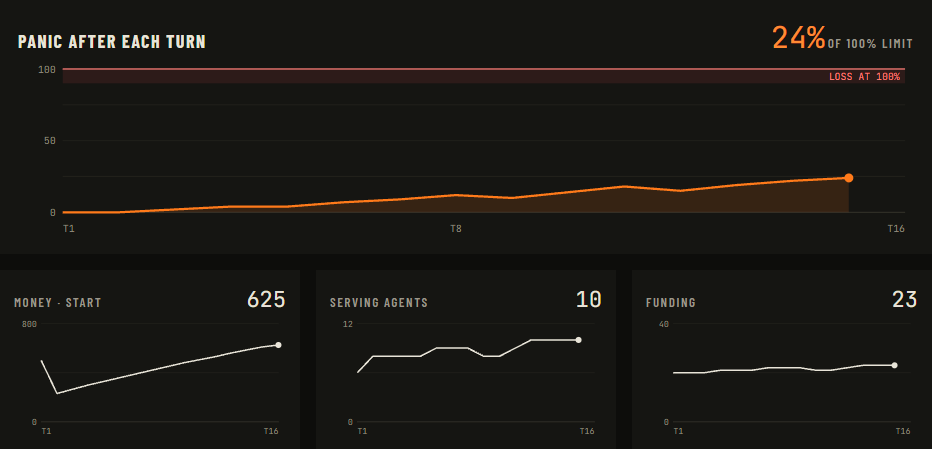

# Charts View

| Metadata | Value |
| --- | --- |
| Spec ID | CVIEW |
| Family | UI |
| Audience | UI designer, Implementer |
| Owns | Which charts the Charts View of the Campaign screen shows and in which order. |
| Conventions | [Specification Conventions](../../../governance/conventions/spec-conventions.md), [Design Specification Conventions](../../../governance/conventions/design-spec-conventions.md) |

# Overview

The Charts View lets the Player read how the [Campaign](../../foundation/core-concepts.md#campaign-and-session) has gone, [Turn](../../foundation/engine-contract.md#player-actions-and-turns) by Turn, so that a slow trend, e.g. Panic creeping up, is visible before it decides the Campaign. It is one of the Records [Detail views](../gui.md#glossary) of the [Campaign Screen](campaign-screen.md), and its charts follow [Charts](../visual-design.md#charts) in Visual Design. The Turn in which a value changed is found in the [History View](history-view.md).

# Panic chart

The Charts View leads with [Panic](../../mechanics/domain-model.md#campaign-standing), because Panic is how a [Campaign](../../foundation/core-concepts.md#campaign-and-session) is lost. The Panic chart spans the full width of the [Detail view](../gui.md#glossary) above the other charts, is at least 180 px tall at a window 1280 px wide, and draws its series in Accent with a 14% Accent fill below the line. Its current value uses a 30 px Figure style in Accent text. The [Panic limit](../../mechanics/panic-and-endings.md#glossary) is a 1.5 px Danger line at the limit value with a Limit band below it, labelled "LOSS AT" and the limit, e.g. "LOSS AT 100%".

# Trend charts

Three smaller charts show the resources the agency runs on. They sit side by side below the Panic chart, in this order:

1. Money at the start of each [Turn](../../foundation/engine-contract.md#player-actions-and-turns).
2. The number of [Serving](../../mechanics/agents-spec.md#agent-statuses) [Agents](../../mechanics/domain-model.md#agency-and-agents).
3. Funding.

# Artboard

The sample values, e.g. the Turn numbers and the values of each series, appear only on the Artboard, under [Reading Artboards](../visual-design.md#reading-artboards) in Visual Design.
