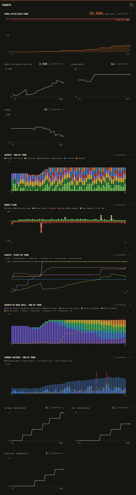

# Charts View

| Metadata | Value |
| --- | --- |
| Spec ID | CVIEW |
| Family | UI |
| Audience | UI designer, Implementer |
| Owns | Which charts the Charts View of the Campaign screen shows, what each Agency chart and Faction chart counts, and in which order. |
| Conventions | [Specification Conventions](../../../governance/conventions/spec-conventions.md), [Design Specification Conventions](../../../governance/conventions/design-spec-conventions.md) |

# Overview

The Charts View lets the Player read how the [Campaign](../../foundation/core-concepts.md#campaign-and-session) has gone, [Turn](../../foundation/engine-contract.md#player-actions-and-turns) by Turn, so that a slow trend, e.g. Panic creeping up, is visible before it decides the Campaign. It is one of the Records [Detail views](../gui.md#glossary) of the [Campaign Screen](campaign-screen.md), and its charts follow [Charts](../visual-design.md#charts) in Visual Design. The Turn in which a value changed is found in the [History View](history-view.md).

# Panic chart

The Charts View leads with [Panic](../../mechanics/domain-model.md#campaign-standing), because Panic is how a [Campaign](../../foundation/core-concepts.md#campaign-and-session) is lost. The Panic chart shows Panic after each [Turn](../../foundation/engine-contract.md#player-actions-and-turns), and its current value is written with two decimals, e.g. "24.35%". The [Panic limit](../../mechanics/panic-and-endings.md#glossary) is a line at the limit value with a Limit band below it, labelled "LOSS AT" and the limit, e.g. "LOSS AT 100%".

# Trend charts

Three smaller charts show the resources the agency runs on:

1. Money at the start of each [Turn](../../foundation/engine-contract.md#player-actions-and-turns).
2. The number of [Serving](../../mechanics/agents-spec.md#agent-statuses) [Agents](../../mechanics/domain-model.md#agency-and-agents).
3. Funding.

# Agency charts

Five larger charts break the agency down, Turn by Turn: what its Agents were doing, where its money came from and went, what it owned, how skilled its Agents were, and how strong they were against the [Mission sites](../../mechanics/domain-model.md#leads-investigations-mission-sites-and-missions) that appeared. Each series has its [Chart series colour](../visual-design.md#chart-series-colours).

Each value comes from the [History entry](../../foundation/world-history.md#glossary) of its Turn, or for the current Turn from the [Open History entry](../../foundation/world-history.md#glossary), or from the [Turn series of money](../../mechanics/economy-and-upgrades.md#turn-series-of-money). In the three charts of a [Turn-end state](../../foundation/engine-contract.md#player-actions-and-turns), i.e. Agent activity, Agents by [effective skill](../../mechanics/agents-spec.md#combatant-attributes), and [Combat](../../mechanics/domain-model.md#combat) strength, the bar and the points of the current Turn show the [Current world state](../../foundation/engine-contract.md#player-actions-and-turns).

1. **Agent activity**, titled "Agents · end of Turn": for each Turn, a stacked bar of the [Serving](../../mechanics/agents-spec.md#agent-statuses) [Agents](../../mechanics/domain-model.md#agency-and-agents) in its Turn-end state, by what each was doing: Standby, [Training](../../mechanics/agents-spec.md#assignments), [Contracting](../../mechanics/agents-spec.md#assignments), Investigating, [Deployed](../../mechanics/agents-spec.md#assignments), [Recovering](../../mechanics/agents-spec.md#agent-statuses), and [In transit](../../mechanics/domain-model.md#agency-and-agents). An [Agent](../../mechanics/domain-model.md#agency-and-agents) In transit counts as In transit whatever its [Assignment](../../mechanics/domain-model.md#agency-and-agents), a Recovering Agent as Recovering, and every other Serving Agent by the Assignment it is [At assignment](../../mechanics/domain-model.md#agency-and-agents) on, Investigating standing for an [Investigation](../../mechanics/domain-model.md#leads-investigations-mission-sites-and-missions).
2. **Money flow**, titled "Money flow": for each ended Turn t, a stacked bar of what the Turn earned above the baseline and a stacked bar of what it spent below it, and a Net flow line. The income series are Funding, the funding the [Agency](../../mechanics/domain-model.md#agency-and-agents) income step of the Advance turn ending t used; Contracting income, that step's income less that funding; and [Mission](../../mechanics/domain-model.md#leads-investigations-mission-sites-and-missions) rewards, the money of every Consequence that applied in that Advance turn. The expenditure series are Upkeep, the upkeep of that Advance turn; Hiring, the money that the `hireAgents` items of the [Action record](../../foundation/world-history.md#glossary) of Turn t spent; [Cap Upgrades](../../mechanics/economy-and-upgrades.md#glossary), the money that its `purchaseUpgrade` items spent on a Cap Upgrade; and Other [Upgrades](../../mechanics/domain-model.md#agency-and-agents), the money that its other `purchaseUpgrade` items spent. Net flow is Money at the start of turn of Turn t + 1 less that of Turn t, so it also counts money that nothing above shows, e.g. that of `addMoney`. The current Turn has not ended, so the chart shows no bar or point for it.
3. **Assets**, titled "Assets · start of Turn": for each Turn, lines of Money at the start of turn on the left axis, and of the number of Serving Agents, the [Agent cap](../../mechanics/domain-model.md#agency-and-agents), the [Transport cap](../../mechanics/economy-and-upgrades.md#glossary), the [Training cap](../../mechanics/economy-and-upgrades.md#glossary), and the [Contracting cap](../../mechanics/economy-and-upgrades.md#glossary) in its [Turn-start state](../../foundation/engine-contract.md#player-actions-and-turns) on the right axis. The Contracting cap line and its legend entry are shown only once the Contracting cap is at least 1 in a Turn the chart shows.
4. **Agents by [effective skill](../../mechanics/agents-spec.md#combatant-attributes)**, titled "Agents by effective skill · end of Turn": for each Turn, a stacked bar of the Serving Agents in its Turn-end state, by effective skill in the bands of the [Ranks](../gui.md#ranks), so that the Player reads the chart in the words of the Agents View: a first band from 0 up to below the lowest `min_base_skill` of the [Rank](../gui.md#glossary) GDRs, then one band for each Rank, from its `min_base_skill` up to below the next, and the band of the highest Rank open-ended. The legend names each band by its range and the band of a Rank also by its `name` in parentheses, e.g. "0–99", "100–149 (Rookie)", and "750+ (Commander)", from the first band up to the highest band that holds an Agent in any Turn shown. Over the bars, three lines count Serving Agents of the same Turn-end state: Recovering, those whose Assignment is [Recovery](../../mechanics/agents-spec.md#assignments), In transit to it included; "[Exhaustion](../../mechanics/agents-spec.md#combatant-attributes) > N", with N the `exhaustion_work_limit` of AgentParameters, e.g. "Exhaustion > 70", those whose exhaustion is above it; and "Exhaustion > M", with M its `exhaustion_free_points`, e.g. "Exhaustion > 30", those whose exhaustion is above that, which include those above N.
5. **Combat strength**, titled "[Combat ratings](../../mechanics/combat.md#combatant-condition-in-a-combat) · end of Turn": for each Turn, a stacked bar of the [Combat rating](../../mechanics/combat.md#combat-rating) of the Agency's Agents in its Turn-end state, and two lines of the Combat ratings of the Mission sites that had appeared by then. The bar's series are Deployable Agents, the Combat rating of every [Deployable Agent](../../mechanics/missions.md#glossary) taken as one side, and Other Agents, the Combat rating of every Serving Agent taken as one side less that of the Deployable Agents, so that the whole bar is the Combat rating of every Serving Agent. The line series are Last Mission site, the [Creation Combat rating](../../mechanics/missions.md#mission-site-properties) of the last Mission site created, and Last 5 Mission sites, the mean of the Creation Combat ratings of the last five Mission sites created, or of all while fewer exist, rounded down, each over the Mission sites that exist in that Turn-end state, in their creation order, whatever their lifecycle state. A Turn in which no Mission site exists has no point.

# Faction charts

One chart for each [Faction](../../mechanics/domain-model.md#factions) shows how much that Faction has pressed the [Agency](../../mechanics/domain-model.md#agency-and-agents), so that the Player can tell which Faction has been the most active and whether one has fallen quiet. The Faction charts are in the order of the Factions in [Campaign state](../../foundation/core-concepts.md#campaign-and-session).

Each is titled with the Faction's name and "response sites", e.g. "Red Dawn · response sites", and its series is, for each Turn, the number of [Response Mission sites](../../mechanics/domain-model.md#leads-investigations-mission-sites-and-missions) whose target Faction is that Faction and whose [Turn created](../../mechanics/missions.md#mission-site-properties) is less than that Turn, i.e. the total the Faction has produced by the start of that Turn. Its current value is that total in the current Turn. Every [Response Mission site](../../mechanics/domain-model.md#leads-investigations-mission-sites-and-missions) counts, whatever its lifecycle state, and a Faction that is [Eliminated](../../mechanics/domain-model.md#factions) keeps its chart.

# Screenshot

The Charts View as the game draws it:

_Captured on 2026-11-23 19:47 UTC._
