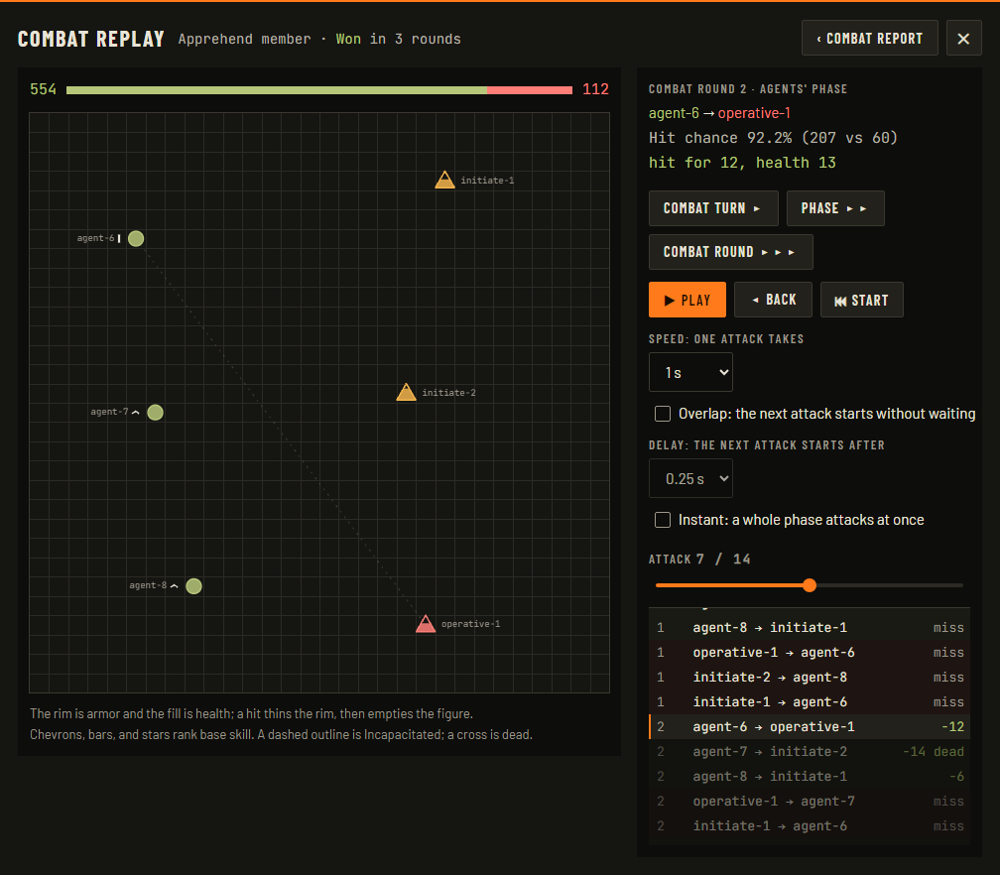

# Combat Replay

| Metadata | Value |
| --- | --- |
| Spec ID | CRPLAY |
| Family | UI |
| Audience | UI designer, Implementer |
| Owns | How the Combat replay opens from the Turn Report View and covers its screen, how it draws the Combatants and their attacks on the Battlefield, and how the Player steps and plays it. |
| Conventions | [Specification Conventions](../../../governance/conventions/spec-conventions.md), [Design Specification Conventions](../../../governance/conventions/design-spec-conventions.md) |

# Overview

The Combat replay lets the Player watch a Combat instead of reading it: it plays the Combat log back, attack by attack, as shots between the figures of the Combatants on a Battlefield, so that who fought whom, who wore armor, and who fell is seen at a glance. It is one step away in the [Turn Report View](turn-report-view.md), like the Combat report it is drawn from.

It shows only what the Combat report holds and fights nothing again, so in a Campaign it exists only for a Combat whose Combat report the Turn report still holds. Another screen may show the same Combat replay for a Combat report of its own. Where a figure stands decides nothing: the Battlefield is a picture of the Combat, not part of its rules.

# Glossary

| Term | Definition |
| --- | --- |
| Combat replay | The view, e.g. of the Turn Report View, that plays one [Combat](../../mechanics/domain-model.md#combat) back from its [Combat report](../../mechanics/domain-model.md#combat), as attacks between the figures of its [Combatants](../../mechanics/domain-model.md#combat) on the Battlefield. |
| Battlefield | The square grid of the Combat replay on which one figure stands for each [Combatant](../../mechanics/domain-model.md#combat) of both sides. |
| Rank insignia | The mark beside a figure on the Battlefield that says how skilled its Combatant is when rested. |

# Visualize button

The Player reaches the Combat replay from wherever a [Combat](../../mechanics/domain-model.md#combat) is summed up. A Visualize button stands beside each [Combat report](../../mechanics/domain-model.md#combat) button, i.e. on a row of the Missions section of the Turn Report View and in the title row of a Combat report, and a [Mission](../../mechanics/domain-model.md#leads-investigations-mission-sites-and-missions) card of the [Turn summary](turn-summary.md#mission-cards) does the same when selected. It opens the Turn Report View with that Mission's Combat replay shown in place of its content, as a Follow, and the Combat replay then covers the [whole screen](#whole-screen).

# Battlefield layout

The Battlefield places the two sides apart so that every shot reads as crossing from one to the other. It is a grid 40 cells wide and 32 cells high: the Agents stand on its left half and the Enemies on its right half. A figure never leaves its cell, except to lunge with a blade, and the same Combat always shows every figure in the same cell. The Battlefield stands at the left, as large as the height of the screen lets it be, and what stands beside it takes the rest of the width.

Every figure stands apart, so that a shot never reads as aimed at a neighbour: none of the eight cells around a figure holds another figure. A side therefore stands in columns two cells apart, with the figures of a column at least two rows apart; nine such columns of one half still hold more figures than a side of a Combat has.

Each side stands several columns deep, and how near the other side a figure stands follows how strong its Combatant is, so that a side reads as a front line of its weakest with its elite behind them. Among the Combatants of its side, the lower a Combatant's [Combat rating](../../mechanics/combat.md#combatant-condition-in-a-combat) at [Combat start](../../mechanics/combat.md#combat-rounds-and-results), the nearer the other side its figure tends to stand, and the higher, the nearer its own edge of the Battlefield. A side stands seven columns deep, or up to nine when it has more Combatants than seven columns hold. Chance moves a figure a little from the column its Combat rating alone gives it, so that a side of equal Combatants still stands spread over its columns. A column that is full passes a Combatant to the nearest column with room, so that a crowded rank of strength spreads over neighbouring columns.

A column says how strong its Combatants are, and where in the column a figure stands says nothing. The figures of one column therefore stand evenly spaced around the middle row of the Battlefield, in the fixed order of their side from top to bottom: at most four rows apart, so that a column of few figures gathers at the middle, and closer when the column holds more than that fits, down to two rows apart. Columns whose figures stand four rows apart are staggered, each one row below the column before it, so that the names beside the figures have room.

# Figures

A figure shows what the Player must know about its Combatant without a table: whose side it is on, what kind it is, how much health and armor it has left, and how skilled it is.

- **Name:** each figure is named beside it, an [Agent](../../mechanics/domain-model.md#agency-and-agents) by its [Instance ID](../../foundation/campaign-instances.md#glossary) and an [Enemy](../../mechanics/domain-model.md#combat) by its [Enemy label](../gui.md#glossary). A side with more Combatants than the Battlefield has rows shows no names, because they would lie over one another; the pointer resting on a figure still names it.
- **Agent:** a circle in Positive.
- **Enemy:** a shape and a colour that say its EnemyArchetype, by the place of that EnemyArchetype in the EnemyArchetype order. The first three EnemyArchetypes are triangles, the next three squares, the next three pentagons, and the three after them hexagons. Within a shape, the first is in Enemy amber, the second in Danger, and the third in Enemy violet.
- **Health:** the figure is filled with its colour from the bottom, as far as its [current health](../../mechanics/agents-spec.md#combatant-attributes) is of its [effective max health](../../mechanics/agents-spec.md#combatant-attributes), so that it empties from the top as it is hit.
- **Armor:** a rim around the figure in Text muted, the thicker the more [current armor](../../mechanics/agents-spec.md#combatant-attributes) the Combatant has, so that a hit thins the rim before it empties the figure, and a Combatant with no current armor has no rim.
- **Condition:** a figure whose Combatant is [Incapacitated](../../mechanics/combat.md#combatant-condition-in-a-combat) is dimmed and has a dashed outline, and that of a dead one is empty and crossed out.
- **Rank insignia:** a mark beside the figure, of Agents and Enemies alike.

## Rank insignia thresholds

A Rank insignia lets the Player pick out the veterans of both sides, so it must not change as a Combatant is worn down in the Combat. It is therefore taken from the Combatant's [base skill](../../mechanics/agents-spec.md#combatant-attributes) at Combat start, rounded down, which is its [effective skill](../../mechanics/agents-spec.md#combatant-attributes) at full current health and without [exhaustion](../../mechanics/agents-spec.md#combatant-attributes).

| Base skill at least | Rank insignia  |
| ------------------- | -------------- |
| 100                 | One chevron    |
| 120                 | Two chevrons   |
| 145                 | Three chevrons |
| 175                 | One bar        |
| 210                 | Two bars       |
| 250                 | Three bars     |
| 300                 | One star       |
| 450                 | Two stars      |
| 700                 | Three stars    |

A Combatant below the first row has no Rank insignia.

# Shots

Each kind of Weapon attacks in its own way, so that the Player sees what a Combatant is armed with, and when an Agent has run out of [Ammo](../../mechanics/combat.md#ammo), without reading the [Combat log](../../mechanics/combat.md#combat-rounds-and-results). An attack is drawn in this order: the attacker is marked, its shot crosses to the defender, the shot lands or passes beside the defender, and a hit thins the defender's rim, empties its figure, and shows its damage outcome above it.

The shot of an attack follows the `shot` of the AmmoType of the attacker's Weapon. An attack with a Weapon that has no `ammo_type`, e.g. an Agent's attack with the Fallback Weapon after its Ammo has run out, is a blade.

| Shot | Crossing | Hit |
| --- | --- | --- |
| `bullet` | One tracer in Tracer flies from the attacker to the defender. | A ring of sparks. |
| `burst` | Three tracers in Tracer follow one another. | Three smaller rings of sparks, one after another. |
| `beam` | A straight beam in Beam appears at once from the attacker to the defender and fades. | A glow in Beam that spreads over the defender. |
| Blade | The attacker lunges to the defender and returns to its cell. | A slash across the defender. |

A tracer or a beam is the longer and thicker the higher the attacker's [effective weapon damage](../../mechanics/agents-spec.md#combatant-attributes). A shot that misses is aimed beside the defender and flies on past it, and a blade that misses slashes beside it. A hit shakes the defender.

# Whole screen

The Battlefield needs all the room there is, so while the Combat replay is shown it covers the whole screen it was opened on: on the [Campaign screen](campaign-screen.md#regions) the status bar, the [Side panel](../gui.md#glossary), and the [Globe stage](../gui.md#glossary), and on the [Combat simulator](combat-simulator.md#layout) its Teams pane. Its title row holds the title "Combat replay", what Combat it shows, and at its right end the [Back control](../gui.md#glossary), when there is one, before a [close control](../visual-design.md#close-controls).

On the [Campaign](../../foundation/core-concepts.md#campaign-and-session) screen the Combat replay stays a place of the [View trail](campaign-screen.md#view-trail): the Back control, the close control, and the Escape key do what they do in the Turn Report View. The Campaign screen takes no other keyboard shortcut while the Combat replay is shown, because the Player would not see what the key did.

# Playback

The Player sets the pace: one attack at a time to study a Combat, or all of it at a chosen pace to see how it went. Beside the Battlefield stand, from the top, the [Combat ratings and the attack being played](#attack-being-played) side by side, the [transport buttons](#transport-buttons), the [Rewind, Repeat, and Options buttons](#rewind-repeat-and-options-buttons), the [Options](#options) while shown, and [the slider and the Combat log](#slider-and-combat-log).

## Transport buttons

The transport buttons look like the keys of a tape player, so each shows a symbol and no label, and its name is its tooltip and its accessible name. They stand in one row, in this order:

| Button | Symbol | What it does |
| --- | --- | --- |
| Pause | Two upright bars | Stops the playing where it is. It is disabled while nothing plays. |
| [Combat turn](../../mechanics/combat.md#combat-rounds-and-results) | The digit 1 | Plays the next attack alone, with the Speed and the Aim lines of the Options. A [Combat turn](../../mechanics/combat.md#combat-rounds-and-results) in which a Combatant made no attack is not in the Combat log and is not a step. |
| Slow | One arrow | Plays at the Slow pace. |
| Medium | Two arrows | Plays at the Medium pace. |
| Fast | Three arrows | Plays at the Fast pace. |
| Very fast | Four arrows | Plays at the Very fast pace. |

Every arrow points right. A pace button plays to the end of the Combat with the values of its pace, from Combat start when the Combat replay is at the end of the Combat, and leaves the Options as they are, so that each pace always plays the same way and the Options keep what the Player set for the step buttons. While the Combat replay plays at a pace, that pace's button is shown pressed.

| Pace      | Speed | Overlap | Delay  | Instant | Aim lines |
| --------- | ----- | ------- | ------ | ------- | --------- |
| Slow      | 2 s   | Off     | None   | Off     | On        |
| Medium    | 1.5 s | On      | 1 s    | Off     | On        |
| Fast      | 1 s   | On      | 0.25 s | Off     | Off       |
| Very fast | 1 s   | On      | 0.25 s | On      | Off       |

When the Combat replay is opened, its Options have the values of the Medium pace.

## Rewind, Repeat, and Options buttons

A second row holds what the Player needs less often:

- **Rewind:** a button showing the rewind symbol of a tape player and no label. It returns to Combat start.
- **Back one:** a button showing a left-pointing arrow before the digit 1, the mirror of the Combat turn button. It goes back one attack as the [slider](#slider-and-combat-log) does: it shows the Combat right before the previous attack and plays that attack again, so that the Combat stands where it was before the last attack. It is disabled at Combat start.
- **Repeat:** a button showing a circling arrow and no label. It plays again the last step the Player took, i.e. with the Combat turn button, its twin among the Options, the Phase button, or the [Combat round](../../mechanics/combat.md#combat-rounds-and-results) button, or the last attack the Player picked with the slider, a row of the Combat log, or the Back one button: it returns to where that step began and plays the same attacks once more, e.g. the same Combat round after the Combat round button, or the picked attack with its aim line, so that the Player can watch a step as often as needed. It is disabled until a step has been taken. The R key presses it. While the Combat replay is shown on the [Campaign screen](campaign-screen.md#undo-and-redo), the R key therefore does not press the Redo button.
- **Options:** a button labelled "Options", which shows the Options and hides them again.

## Options

The Options are how the step buttons play, i.e. the three buttons at their end, and how the slider and the Combat log play an attack; the pace buttons never read them or change them. They are set once and then left alone, so they stay hidden until asked for, and the Battlefield and everything beside it share one screen of the [Reference window](../visual-design.md#reference-window) with them shown or hidden. They are hidden whenever a [Session](../../foundation/core-concepts.md#campaign-and-session) starts, and whether they are shown stays as the Player last left it for the rest of the Session. Each is named by one or two words and explained nowhere on the screen, so that all of them take few rows:

- **Speed:** how long one attack takes to play: from 2 s down to 0.25 s in steps of 0.25 s, or 0.1 s.
- **Overlap:** when on, the next attack starts a Delay after the last one started, whether or not that one has finished, and keeps doing so across phases and Combat rounds.
- **Delay:** from 1.5 s down to 0.25 s in steps of 0.25 s, or 0.1 s, independent of the Speed. With Instant on, the Delay runs from the start of one phase to the start of the next.
- **Instant:** when on, all attacks of a phase play at the same time, so a step of the playing is a phase, and several hits on one defender show their damage outcomes as one sum.
- **Aim lines:** when on, a faint dashed line joins each attacker to its defender, for every attack being played and, at rest, for the step last played. Turning them off helps e.g. in a Combat of many Combatants in which they hide the shots. Whoever moves the slider or selects a row of the Combat log looks for who attacked whom, so the attack it plays has its line even with Aim lines off.
- **Steps:** three buttons in one row, each labelled with its step and a filled right-pointing arrow, e.g. "Turn ▶", "Phase ▶", and "Round ▶". The first plays the next attack, as the Combat turn button does, also with Instant on; the Phase button plays to the end of the current Agents' phase or [Enemies' phase](../../mechanics/combat.md#combat-rounds-and-results), and the Combat round button to the end of the current [Combat round](../../mechanics/combat.md#combat-rounds-and-results).

## Slider and Combat log

Under the buttons, a slider returns to any attack, and the Combat log is listed below it, one short row per attack. Moving the slider to an attack, or selecting its row, shows the Combat right before that attack and plays the attack alone, with the Options as they are, so that the Player sees the shot and not only its result. The slider at 0 shows Combat start.

## Attack being played

Above the buttons, the Combat replay names the attack being played, i.e. its Combat round and phase, attacker, defender, [Hit chance](../../mechanics/combat.md#combat-rounds-and-results), and result, and at the end the [Combat outcome](../../mechanics/combat.md#combat-rounds-and-results). It keeps the height of its longest content, so that the buttons below it never move as the attacks are played.

The result says how narrowly the attack hit or missed, as its margin: the difference between its Hit chance and its [Hit roll](../../mechanics/combat.md#hit-outcome), shown like a Hit chance, as a percentage with one decimal place. Nothing on the screen explains the margin.

- **Miss:** the margin alone, e.g. "miss by 5.2%" for the Hit chance 11.6% and the Hit roll 168.
- **Hit:** the margin, the damage outcome, and the defender's [current health](../../mechanics/agents-spec.md#combatant-attributes) before and after the attack, e.g. "hit with 9.0% margin, for 8 damage, health 20 → 12". When the defender had current armor before the hit, the [armor removed](../../mechanics/combat.md#combat-rounds-and-results) and the defender's current armor before and after the attack stand between the damage outcome and the health, e.g. "hit with 9.0% margin, for 15 damage, 8 absorbed, armor 8 → 0, health 31 → 23".

Before the attack being played, on its left, a pie chart compares the [Combat ratings](../../mechanics/combat.md#combatant-condition-in-a-combat) of the two sides as of the last Combat round completed, the Agents' share in Positive and the Enemies' in Danger, so that it takes no height from the Battlefield. Under it stand the two Combat ratings, the Agents' first, e.g. "115 : 100", and under them the Agents' Combat rating as a percentage of the Enemies', rounded to a whole percent, e.g. "115%", or "–" when the Enemies' Combat rating is 0. The pointer resting on a figure shows the values of its Combatant.

# Screenshot

The Combat replay as the game draws it:

_Captured on 2026-11-24 00:10 UTC._

# TODOs

- TODO (later): Let the Player change a Combat from the Combat replay, e.g. choose whom a Combatant attacks, and have the Advance turn apply the changed result.
- TODO (later): Make where a figure stands in the [Battlefield layout](#battlefield-layout) matter, e.g. through range, obstacles, and movement.
