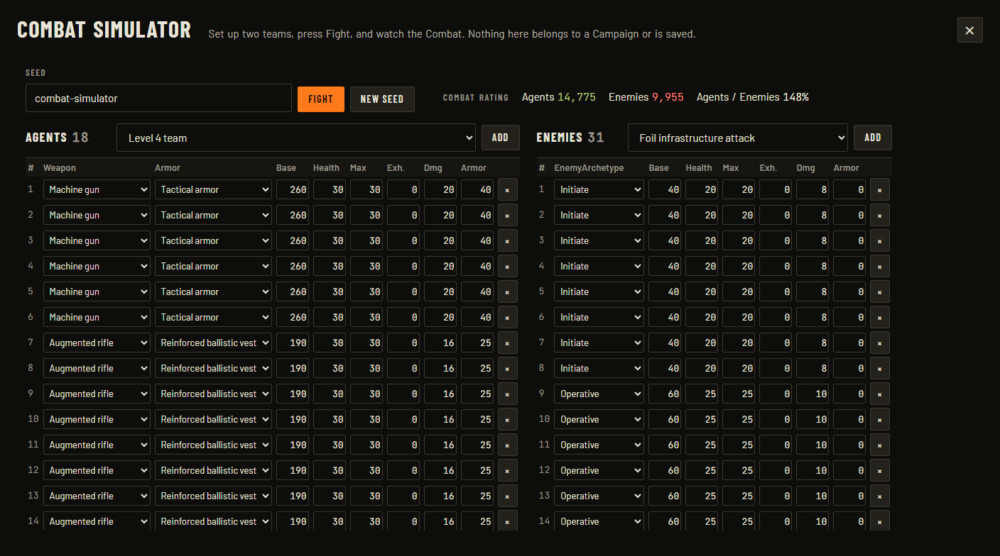

# Combat Simulator

| Metadata | Value |
| --- | --- |
| Spec ID | CSIM |
| Family | UI |
| Audience | UI designer, Implementer |
| Owns | The Combat simulator screen of the graphical user interface: how it opens, how the Game designer sets up the two teams, and how the Combat it fights is shown. |
| Conventions | [Specification Conventions](../../../governance/conventions/spec-conventions.md), [Design Specification Conventions](../../../governance/conventions/design-spec-conventions.md) |

# Overview

Judging how a Combat goes, or how the Combat replay draws it, should not need a Campaign played up to the Combat in question. The Combat simulator is a screen on which the Game designer puts any Agents against any Enemies, has the Combat fought, and watches it in the [Combat replay](combat-replay.md).

It is a tool for the Game designer and for testing, not part of playing the game, so it stays hidden until it is asked for. It has no [Campaign](../../foundation/core-concepts.md#campaign-and-session): it reads only the [Game build](../../foundation/core-concepts.md#game-build-and-content), every Combat it fights is a [Detached Combat](../../mechanics/combat.md#detached-combat-without-a-current-campaign), and nothing it does is saved.

# Glossary

| Term | Definition |
| --- | --- |
| Combat simulator | The screen of the GUI on which the Game designer sets up two teams, has a [Detached Combat](../../mechanics/combat.md#combat-rounds-and-results) fought between them, and watches it in the [Combat replay](combat-replay.md#glossary). |

# Opening the Combat simulator

The [Main menu](main-menu.md) shows a Combat simulator button while the [Global configuration](../../foundation/configuration.md#global-configuration) setting Combat simulator shown is on. The button shows the Combat simulator in place of the [Main menu](../../foundation/campaign-lifecycle.md#glossary).

| Setting | Permitted values | Game build default | Set by |
| --- | --- | --- | --- |
| Combat simulator shown | On or off | Off | The "Show Combat simulator" checkbox of the [developer tools](../gui.md#developer-tools), which [Dev mode](../../foundation/engine-contract.md#principals-and-access) gates. |

A test, or a developer at work on the Combat simulator, must reach it without setting anything first. Opening the game at an address whose query holds `combat-simulator`, e.g. `?combat-simulator`, therefore shows the Combat simulator at once when the [Session](../../foundation/core-concepts.md#campaign-and-session) has no [Current campaign](../../foundation/core-concepts.md#campaign-and-session), whatever the setting is.

The Combat simulator has a [close control](../visual-design.md#close-controls). It and the Escape key show the Main menu again, except that while the Combat replay is shown the Escape key closes the Combat replay.

# Layout

The Combat simulator has no [Campaign](../../foundation/core-concepts.md#campaign-and-session) to report on, so it has none of the regions of the [Campaign screen](campaign-screen.md). It shows one of two parts at a time:

1. **Teams pane:** the [two teams](#teams) and the [Fight controls](#fighting-the-combat). It is what the Combat simulator opens with.
2. **Combat replay:** the [Combat replay](combat-replay.md) of the [Combat](../../mechanics/domain-model.md#combat) last fought, which [covers the whole screen](combat-replay.md#whole-screen) once a Combat has been fought. Its close control shows the Teams pane again, with its rows as they were.

# Teams

Every value a Combat reads of a [Combatant](../../mechanics/domain-model.md#combat) can be set, so that any Combat can be tried. The Teams pane lists the Agents' side and to its right the Enemies' side, so that both are seen at once without scrolling, each as one row per Combatant in the fixed order of the side, with a count of its Combatants.

A row holds one field for each value of an explicit entry of a [Detached Combat](../../mechanics/combat.md#detached-combat): [base skill](../../mechanics/agents-spec.md#combatant-attributes), [current health](../../mechanics/agents-spec.md#combatant-attributes), [effective max health](../../mechanics/agents-spec.md#combatant-attributes), [exhaustion](../../mechanics/agents-spec.md#combatant-attributes), [effective weapon damage](../../mechanics/agents-spec.md#combatant-attributes), and [effective armor](../../mechanics/agents-spec.md#combatant-attributes). Beside them it holds what the values were filled from, which also decides how the [Combat replay](combat-replay.md#figures) draws the Combatant:

- **Agent:** a Weapon and an Armor, each a select of every one in the [Game build](../../foundation/core-concepts.md#game-build-and-content). Selecting a Weapon sets the row's effective weapon damage to its `base_weapon_damage`, and selecting an Armor sets the row's effective armor to its `base_armor`. The [Agent](../../mechanics/domain-model.md#agency-and-agents)'s [shots](combat-replay.md#shots) follow the selected Weapon.
- **Enemy:** an EnemyArchetype, a select of every one in the Game build in the [EnemyArchetype order](../gui.md#enemyarchetype-order). Selecting it sets every value of the row to that of a [newly created Enemy](../../mechanics/combat.md#enemy-creation) of it. The [Enemy](../../mechanics/domain-model.md#combat)'s figure, [Enemy label](../gui.md#glossary), and shots follow the selected EnemyArchetype.

A field edited afterwards keeps its value until a select of its row sets it again. Each row has a Remove button, and each side has an Add button, which appends a copy of the side's last row, or, on an empty side, an Agent as [newly hired](../../mechanics/agents-spec.md#agent-creation) or an Enemy of the first EnemyArchetype.

Each side is filled as a whole from a preset, which replaces all its rows:

- **Agents' side:** a select of every [DetachedCombatTeam](../../mechanics/combat.md#detachedcombatteam) of the Game build in their authored order, each shown by its `name`. Selecting one fills the side with the Agents of its groups.
- **Enemies' side:** a select of every MissionSiteArchetype of the Game build, each shown by its name. Selecting one fills the side with the Enemies a new [Mission site](../../mechanics/domain-model.md#leads-investigations-mission-sites-and-missions) of it would have, in their [creation order](../../mechanics/missions.md#enemy-creation).

The Combat simulator opens with the first DetachedCombatTeam against the first MissionSiteArchetype.

## Combat ratings of the teams

How even a Combat is should be seen before it is fought, so that the Game designer can tune a team against a Mission site by its numbers. Above the two sides, the Teams pane shows the [Combat rating](../../mechanics/combat.md#combatant-condition-in-a-combat) of the Agents' side, that of the Enemies' side, and the first as a percentage of the second, rounded to a whole percent, e.g. "236%". The values are those `session.combatSimulator.rateSides(setup)` returns for the rows as they are, so they follow every edit at once and need no Fight. When the Combat rating of the Enemies' side is 0, a dash stands in place of the percentage, and while the setup is rejected a line says so in place of all three.

# Fighting the Combat

The Fight controls stand at the top of the Teams pane:

- **Seed:** a field holding the Detached seed, which starts as `combat-simulator`.
- **Fight:** the primary button. It has `session.combatSimulator.fightCombat(setup)` fight a Detached Combat between the two sides as the rows give them, each row as an explicit entry, with the Detached seed of the field, no changed [GDR](../../foundation/core-concepts.md#game-build-and-content) value, and no limit on any AmmoType. The Combat replay then shows that Combat from [Combat start](../../mechanics/combat.md#combat-rounds-and-results).
- **New seed:** a button that puts a new seed, chosen at random, into the field and fights nothing, so that the next Fight shows the same teams fighting another way.

When the setup is rejected, e.g. because the Agents' side is empty or a field holds a value out of its range, the reason the engine reports is shown under the Fight controls and no Combat replay is shown. Fight with the same rows and the same Detached seed fights the same Combat, so the Game designer who closed a Combat replay sees it again by pressing Fight.

The [Combat replay](combat-replay.md#battlefield-layout) derives where its figures stand from the Detached seed, and names an Agent by its place in its side, e.g. "agent-3". Its title row says what Combat it shows as a [Combat report](../../mechanics/domain-model.md#combat) does, with the [Combat outcome](../../mechanics/combat.md#combat-rounds-and-results) and the number of [Combat rounds](../../mechanics/combat.md#combat-rounds-and-results), beside the two sides' sizes and the Detached seed, e.g. "4 Agents vs 3 Enemies · Won in 2 rounds · seed combat-simulator".

# Screenshot

The Combat simulator as the game draws it:

_Captured on 2026-11-24 00:10 UTC._

# TODOs

- TODO (later): Limited [Ammo](../../mechanics/combat.md#ammo) in the Combat simulator.
- TODO (later): Changed GDR values in the Combat simulator, e.g. another `incapacitation_skill_fraction`.
