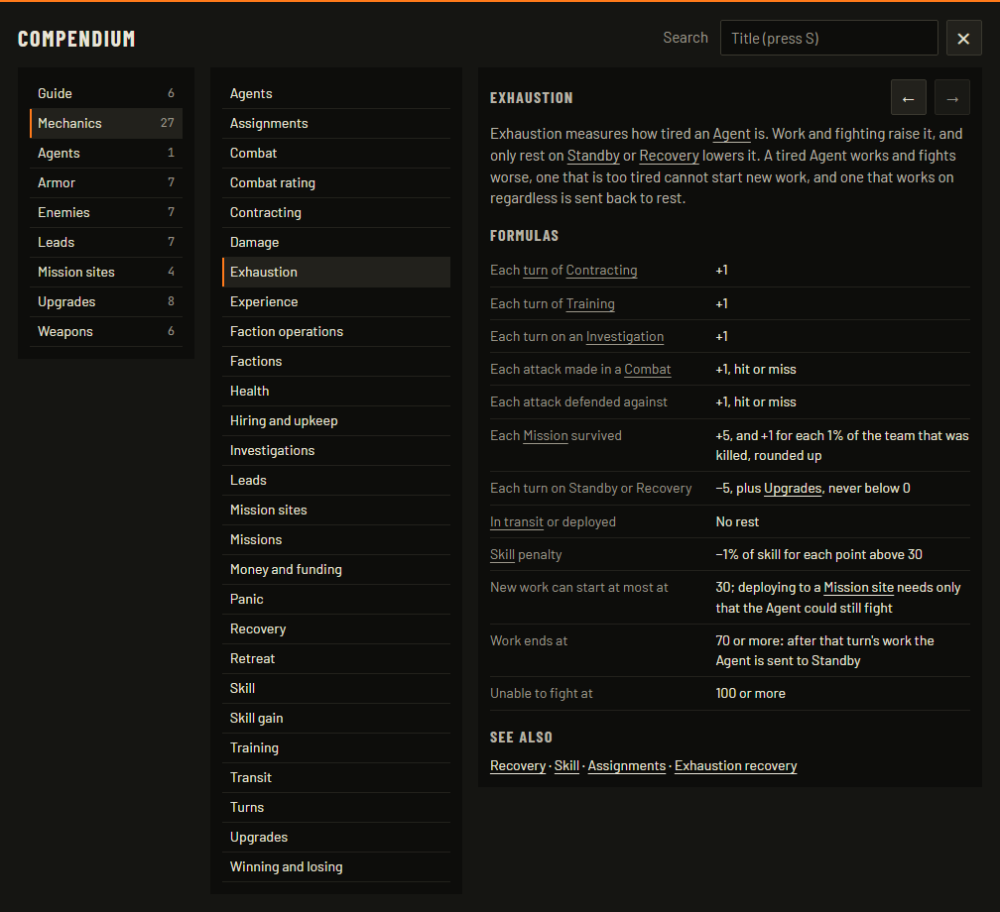
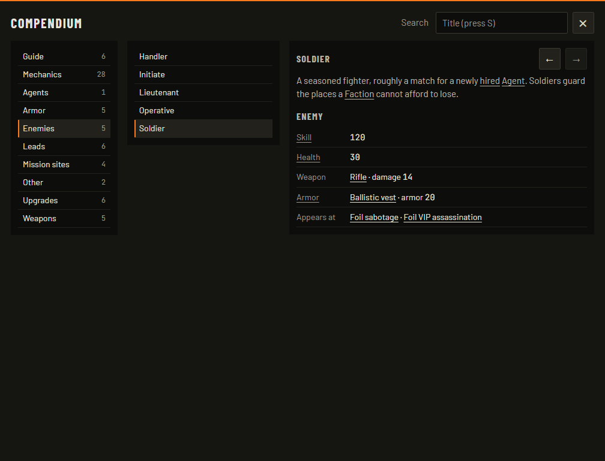

# Compendium View

| Metadata | Value |
| --- | --- |
| Spec ID | COMPV |
| Family | UI |
| Audience | UI designer, Implementer |
| Owns | What the Compendium View of the Campaign screen shows of a Compendium article, the data sheet of each kind of subject, and how the Player finds an article and follows the links between articles. |
| Conventions | [Specification Conventions](../../../governance/conventions/spec-conventions.md), [Design Specification Conventions](../../../governance/conventions/design-spec-conventions.md) |

# Overview

The Compendium View is where the Player looks something up without leaving the [Campaign](../../foundation/core-concepts.md#campaign-and-session), e.g. how a hit is decided or what a Soldier is armed with. It is one of the Records [Detail views](../gui.md#glossary) of the [Campaign Screen](campaign-screen.md), and it shows the [Compendium articles](../../mechanics/compendium.md#glossary) that are [Player-visible](../../mechanics/compendium.md#article-visibility), so it never shows an article about something the Player may not know yet.

It reads like a small reference work. The Player narrows from a category to an article, or searches by title, and then moves on through [Article links](../../mechanics/compendium.md#glossary) from one article to the next, with an Article history to return by. The engine supplies each article [resolved](../../mechanics/compendium.md#article-resolution), with its values and links already in place, and the Compendium View adds one thing of its own: for a [Subject article](../../mechanics/compendium.md#glossary), a data sheet of its subject, laid out for that kind of subject.

# Glossary

| Term | Definition |
| --- | --- |
| Article history | The articles the Player has shown one after another in the Compendium View, with the place among them of the one shown now, through which the Previous article and Next article buttons move. |
| Article art | The [picture](#article-pane) of what an article is about, at the right of the Article pane. |
| Data sheet | The rows of a subject's Player-visible values that the Compendium View shows below the description of a [Subject article](../../mechanics/compendium.md#glossary). |
| Subject order | The [order](#subject-order) in which the Compendium View lists Subject articles, from the least to the most of their kind. |

# Panes

The category tabs and two panes narrow the Compendium from a category to one article:

1. **Category tabs:** one row of tabs in the title row, between the title and the search field, so that the panes below keep the whole height and width. The tabs are Guide first, for the [Guide articles](../../mechanics/compendium.md#glossary) and [what the GUI teaches the Player](../tutorials.md#tutorials-in-the-compendium), then Mechanics, for the [Mechanics articles](../../mechanics/compendium.md#glossary), then the categories of the subjects of the Player-visible Subject articles, named after each subject's [Type](../../foundation/core-concepts.md#data-modeling) as [Subject data sheets](#subject-data-sheets) names it and sorted by that name, e.g. Enemies before Leads, except that the category Combat, for the articles listed under the topic `combat`, stands right after Agents. A Guide article or a Mechanics article with a [`listed_under`](../../mechanics/compendium.md#compendiumarticle) is in the category of that Type, or in [Combat](../../mechanics/domain-model.md#combat), instead of in Guide or Mechanics. A tab shows its category's name and no count, and a category with no Player-visible article has no tab. The tab of the selected category has a 2 px Accent line along its bottom edge. When the tabs are wider than the room between the title and the search field, their row scrolls sideways within that room and never wraps onto a second line.
2. **Articles:** the [displayed title](../../mechanics/compendium.md#displayed-title) of each Player-visible article of the selected category, in the [Article sections](#article-sections) of that category, each with its Subject articles first, in [Subject order](#subject-order), then its other articles sorted by displayed title ignoring case. A category without Article sections, e.g. Enemies or Combat, lists all its articles as one list, ordered the same way.
3. **Article:** the selected article, in the parts of the [Article pane](#article-pane).

When the Compendium View opens, the Guide category and its first article are selected. A search field filters the articles of every category to those whose displayed title contains the search text, ignoring case; while it holds text, the tab of a category with no matching article is disabled and dimmed but keeps its place, so that the tabs never move while the Player types. An article that a new [World state](../../foundation/engine-contract.md#player-actions-and-turns) makes Player-visible appears without reopening the Compendium View.

While [Reveal hidden content](../gui.md#reveal-hidden-content) is on, the Compendium View shows the [Revealed Compendium](../../mechanics/compendium.md#revealed-compendium), in which every article counts as Player-visible.

The Player finds an article without the mouse by pressing S, typing part of its title, and pressing Enter. The search field has no visible label and the accessible name "Search", and while it is empty it shows the placeholder "Search titles (S)". While the Compendium View is open and the search field does not have the keyboard focus, the S key gives it the keyboard focus and selects its whole text, and the S key is not typed into it. While the search field has the keyboard focus, the Enter key shows the first article listed under the search text, i.e. the first matching article of the first category whose tab is enabled, and moves the keyboard focus out of the search field, keeping its text. When no article matches, the Enter key does nothing. While the search field holds text, the Escape key clears it, wherever the keyboard focus is, and keeps the article shown, so that the Player who found an article and pressed Escape is back to every category without leaving the Compendium View; only an Escape with the search field empty closes the Compendium View or goes back.

# Article sections

A long list reads faster in a few named groups, so the article list of some categories is split into Article sections, each under a Group heading and ordered on its own. Which section an article is in is read from its GDRs wherever they tell, so that a new article needs no list of its own to be placed. The sections of a category stand in the order of this table, and a section with no listed article is left out with its heading, e.g. while the search text matches none of its articles.

| Category | Article sections, in order |
| --- | --- |
| Guide | **Guides:** the Guide articles. **Tutorials:** the [Tutorial bubbles](../tutorials.md#tutorials-in-the-compendium) it lists, whatever Tutorials on is. |
| Mechanics | **Campaign**, **[Leads](../../mechanics/domain-model.md#leads-investigations-mission-sites-and-missions) and Missions**, **Agents**, and **[Assignments](../../mechanics/domain-model.md#agency-and-agents):** each the Mechanics articles whose `section` names it. |
| Agents | **Overview:** the Subject articles about AgentArchetypes. **Agent properties:** the articles listed under AgentArchetype. |
| Combat | **Overview:** the article whose displayed title is "Combat". **Combat mechanics:** the other articles listed under the topic `combat`. |
| Weapons | **Weapons:** the Subject articles about Weapons. **Ammo:** those about AmmoTypes. |
| Upgrades | **Cap upgrades:** the Subject articles about [Cap Upgrades](../../mechanics/economy-and-upgrades.md#glossary). **Other upgrades:** the rest. |
| [Mission sites](../../mechanics/domain-model.md#leads-investigations-mission-sites-and-missions) | **Initiative**, then **Response:** the Subject articles about the MissionSiteArchetypes of that `kind`. |
| Leads | **One-time**, **Initiative**, and **Interrogations:** the Subject articles about the [Leads](../../mechanics/domain-model.md#leads-investigations-mission-sites-and-missions) of that kind, as below. |

A Lead's kind is read from its [GDR](../../foundation/core-concepts.md#game-build-and-content), each rule tried in this order:

- **Initiative:** its `on_completion` creates a Mission site, i.e. it leads to an [Initiative Mission site](../../mechanics/domain-model.md#leads-investigations-mission-sites-and-missions), however often it can be investigated.
- **Interrogations:** otherwise, its identifier starts with `interrogate`.
- **One-time:** otherwise, it has no `investigate_again`, so that it can be investigated only once, e.g. a Faction's profile.

An article of a category with Article sections that is in none of them, e.g. a Lead of none of these kinds, is listed after the sections without a heading, so that every Player-visible article stays reachable.

A Mechanics article with no `section`, or a `section` the table does not name, is a [data defect](../../foundation/game-data-records.md#data-defects), unless it has a `listed_under`.

# Subject order

The Player reads a list of things of one kind as a progression, e.g. the Initiative Mission sites from Apprehend member to Raid HQ, so the Compendium View lists Subject articles in Subject order rather than by title. Subject articles whose subjects have different Types stand in the order of the Types in the table of [Subject data sheets](#subject-data-sheets), and those of a Type without a row there stand last, sorted by displayed title ignoring case. Those of one Type stand in the [authored order](../../foundation/game-data-records.md#gdr-file-layout) of their subject GDRs, which the Game designer writes from the least to the most, e.g. the One-time Leads end with "Peace on Earth", except as follows:

- **EnemyArchetype:** in ascending order of the [Combat rating](../../mechanics/combat.md#combatant-condition-in-a-combat) of an [Enemy](../../mechanics/domain-model.md#combat) of it as [created](../../mechanics/combat.md#enemy-creation), and those of equal Combat rating in the [EnemyArchetype order](../gui.md#enemyarchetype-order).
- **MissionSiteArchetype:** those of kind response in ascending order of their `operation_level`, and those of equal `operation_level` in authored order.

# Article pane

The Article pane shows the parts of one article in a fixed order, so that every article of a category reads alike. A part an article does not have is left out with its heading.

1. **Title row:** the displayed title and the two buttons of the [Article history](#following-links).
2. **Article art:** a picture of what the article is about, laid out as below.
3. **Body:** the resolved `body`, as one paragraph.
4. **Formulas,** for a Mechanics article: the heading "Formulas" and one row for each resolved formula row in order, its `label` above its `text`, as in a Data sheet.
5. **Data sheet,** for a Subject article: the [Data sheet](#subject-data-sheets) of its subject.
6. **See also:** the heading "See also" and the [See also entries](../../mechanics/compendium.md#see-also) of the article in order, separated by "·".

Every resolved text is shown segment by segment: plain text and inserted values as they are, with nothing that sets an inserted value apart, and each [Article link](../../mechanics/compendium.md#glossary) as a link the Player [follows](#following-links).

The Article art lets every article show what it is about as large as the Article pane allows while its text stays readable. The Article pane fills the height of the [Detail view](../gui.md#glossary), and the Article art is as tall as the Article pane and 4:3, i.e. 936 × 702 px in the [Reference window](../visual-design.md#reference-window), flush with the pane's top, right, and bottom edges. Art for it is painted at 1872 × 1404 px, so that it stays sharp on a display of twice the density. Its left 17% fades into the pane's Background fill. The parts after the title row stand in a column 520 px wide, about 80 characters a line, the most that reads comfortably, so that the column's right part lies over the picture. Text over the picture has an outline in the Background colour, so that it stays readable over a bright picture, and the divider lines of the rows fade out before they reach it. When the Article pane is too narrow for the whole width, the picture is cropped at its left. A long article, e.g. a Guide article, scrolls within that column while the picture stays in place. Until a picture exists, the Article art is a placeholder drawn in the colour of the article's category, as the page "Compendium Image Slot", <https://claude.ai/artifact/WXYDS6MpeA8WWQ2UNGWUvW>, shows for each category under layout D, Guide and Mechanics included, each category in a colour of its own.

# Following links

Reading about one thing raises a question about the next, so every mention the engine has linked is one click from its article, and the way back is as short.

Selecting an Article link, whether in a resolved text, in a See also entry, or in a Data sheet, shows the article it links to: the Compendium View selects that article's category tab and the article in the Articles pane, and clears the search field when the article would not be listed under its text. Following an Article link selects an item within the same place, so it is not a [Follow](campaign-screen.md#view-trail) and adds nothing to the [View trail](../gui.md#glossary).

The Article history remembers the articles shown, so that the Player can go back to the article they came from and forward again. One of its articles is current, the article shown. It changes as follows:

1. **Open:** when the Compendium View opens, the Article history holds only the article selected, which is current.
2. **Show another article:** when the Player shows an article other than the current one, by an Article link, the Articles pane, selecting a category, which shows the first article of that category, or the Enter key in the search field, every article after the current one is removed from the Article history, and the article shown is added at its end and becomes current. Typing in the search field shows no other article by itself: the article shown stays until the Player selects one or presses Enter.
3. **Previous article:** the article before the current one becomes current and is shown.
4. **Next article:** the article after the current one becomes current and is shown.
5. **No longer Player-visible:** an article that is no longer Player-visible, e.g. when Reveal hidden content is turned off, is removed from the Article history. When it was the current one, the article before it becomes current, or else the article after it, or else the first article of the Guide category is shown as in Open.

The two buttons of the Article history have the accessible names "Previous article" and "Next article", and each is disabled while the Article history has no article in its direction. While the Compendium View is open, the Q key presses the Previous article button and the W key presses the Next article button; while the search field has the keyboard focus, the Q and W keys type into it instead. The Article history is part of the [place](campaign-screen.md#view-trail) of the Compendium View, so going back to the Compendium View shows the article and the Article history the Player left, and closing the Compendium View discards it.

# Subject data sheets

A Subject article describes its subject in words, and every value of the subject comes from the subject [GDR](../../foundation/core-concepts.md#game-build-and-content) itself, so that the Compendium never repeats a number that could go stale. The Data sheet shows those values, chosen and worded for each kind of subject instead of listed as raw properties.

A Data sheet has a heading and rows of a label and a value, each label above its value, so that the Data sheet fits the narrow column beside the [Article art](#article-pane). The following rules hold for every Data sheet:

- **Rows:** the rows are those of the table for the subject's Type below, in that order. A row whose value is absent or empty is left out, and a Data sheet without a row is left out with its heading.
- **Labels:** a label is an Article link to the article that the [Article term lookup](../../mechanics/compendium.md#player-visible-information) reports for the label's text, and plain text when it reports none, e.g. "Skill" links to the article that has the Article term "skill".
- **Referenced GDRs:** a GDR that a value references is shown by its `name`, as an Article link to the Subject article about it when that article is Player-visible, and as plain text otherwise.
- **Subject articles listed:** a row that lists Subject articles shows the displayed title of each as an Article link, in [Subject order](#subject-order).
- **Items:** a value that lists two or more items, e.g. Subject articles, Effects, or the entries of `enemies`, shows each item on a line of its own.
- **[Effect lists](../../foundation/effect-lists.md#glossary):** an [Effect list](../../foundation/effect-lists.md#glossary) is shown as its [Effects](../../foundation/effect-lists.md#glossary), each [worded by its Effect kind](#effects-shown), or as "None" when it holds no Effect.

Each subject Type has a category name and a Data sheet heading. A Subject article whose subject has any other Type is listed under the category Other and has no Data sheet.

| Subject Type | Category | Data sheet heading |
| --- | --- | --- |
| AgentArchetype | Agents | New [Agent](../../mechanics/domain-model.md#agency-and-agents) |
| EnemyArchetype | Enemies | Enemy |
| Weapon | Weapons | Weapon |
| Armor | Armor | Armor |
| AmmoType | Weapons | Ammo |
| Upgrade | Upgrades | Upgrade |
| FactionArchetype | Factions | Faction |
| Lead | Leads | Lead |
| MissionSiteArchetype | [Mission sites](../../mechanics/domain-model.md#leads-investigations-mission-sites-and-missions) | Mission site |

## Agent data sheet

The Data sheet of an AgentArchetype shows what a newly hired Agent [starts with](../../mechanics/agents-spec.md#agent-creation), before any [Upgrade](../../mechanics/domain-model.md#agency-and-agents).

| Label | Value |
| --- | --- |
| Skill | `base_skill`. |
| Health | `base_health`. |
| Weapon | The Weapon that `weapon` references, followed by "· damage" and its `base_weapon_damage`, e.g. "Combat pistol · damage 10". |
| Armor | The Armor that `armor` references, followed by "· armor" and its `base_armor`, e.g. "Standard uniform · armor 0". |

## Enemy data sheet

The Data sheet of an EnemyArchetype shows what every [Enemy](../../mechanics/domain-model.md#combat) of that kind has [when its Mission site is created](../../mechanics/combat.md#enemy-creation).

| Label | Value |
| --- | --- |
| Skill | `base_skill`. |
| Health | `base_health`. |
| Weapon | The Weapon that `weapon` references, followed by "· damage" and its `base_weapon_damage`, e.g. "Rifle · damage 14". |
| Armor | The Armor that `armor` references, followed by "· armor" and its `base_armor`, e.g. "None · armor 0". |
| Appears at | The Player-visible Subject articles whose subject is a MissionSiteArchetype whose `enemies` names this EnemyArchetype. |

## Weapon data sheet

The Data sheet of a Weapon shows how hard it hits in the hands of a [Combatant](../../mechanics/domain-model.md#combat) without an Upgrade.

| Label | Value |
| --- | --- |
| Damage | `base_weapon_damage`. |
| Damage of a hit | The range of the [damage outcome](../../mechanics/combat.md#damage-outcome) for an [effective weapon damage](../../mechanics/agents-spec.md#combatant-attributes) equal to `base_weapon_damage`, as its two bounds joined by an en dash, e.g. "5–15" for a `base_weapon_damage` of 10 and a `weapon_damage_range` of 0.5. |
| Carried by | The Player-visible Subject articles whose subject is an AgentArchetype or an EnemyArchetype whose `weapon` references this Weapon. |
| Ammo | The [AmmoType](../../mechanics/combat.md#ammotype) that `ammo_type` references, or "None" for a Weapon without one. |
| Price | `price`, or "Not for sale" for a Weapon without one. |

## Armor data sheet

The Data sheet of an Armor shows how much of the damage of hits it [absorbs](../../mechanics/combat.md#effects-of-an-attack) in each [Combat](../../mechanics/domain-model.md#combat) on a Combatant without an Upgrade.

| Label | Value |
| --- | --- |
| Armor | `base_armor`. |
| Worn by | The Player-visible Subject articles whose subject is an AgentArchetype or an EnemyArchetype whose `armor` references this Armor. |
| Price | `price`, or "Not for sale" for an Armor without one. |

## Ammo data sheet

The Data sheet of an AmmoType shows what a round costs and which Weapons spend it.

| Label   | Value                                                                                                     |
| ------- | --------------------------------------------------------------------------------------------------------- |
| Price   | `price`, for one round.                                                                                   |
| Used by | The Player-visible Subject articles whose subject is a Weapon whose `ammo_type` references this AmmoType. |

## Upgrade data sheet

The Data sheet of an Upgrade shows what one acquisition costs and [adds](../../mechanics/economy-and-upgrades.md#upgrade-effects). What the [Agency](../../mechanics/domain-model.md#agency-and-agents) has acquired so far is shown by the [Upgrades View](upgrades-view.md), not here.

| Label | Value |
| --- | --- |
| Price | `price`, followed by "money", e.g. "500 money". |
| Each purchase | The `increment` with a plus sign, worded by the `effect` as the following table states. |
| Purchases | The `max_acquisitions` followed by "at most", e.g. "8 at most"; the row is left out for an Upgrade without one. |

| `effect` | Wording, e.g. |
| --- | --- |
| `agent_cap` | "+20 to the [Agent cap](../../mechanics/domain-model.md#agency-and-agents)" |
| `transport_cap` | "+8 to the [Transport cap](../../mechanics/economy-and-upgrades.md#glossary)" |
| `training_cap` | "+10 to the [Training cap](../../mechanics/economy-and-upgrades.md#glossary)" |
| `agent_max_health` | "+1 max health for every Agent" |
| `training_skill_gain` | "+0.50 skill for each turn of [Training](../../mechanics/agents-spec.md#assignments)" |
| `exhaustion_recovery` | "+1.00 [exhaustion](../../mechanics/agents-spec.md#combatant-attributes) recovered each turn" |
| `health_recovery` | "+1.00% of max health recovered each turn" |

## Faction data sheet

A FactionArchetype has no Player-visible value beyond its `name`, so its Data sheet only leads on to what the Player has learned of the [Faction](../../mechanics/domain-model.md#factions).

| Label | Value |
| --- | --- |
| Leads | The Player-visible Subject articles whose subject is a [Lead](../../mechanics/domain-model.md#leads-investigations-mission-sites-and-missions) whose `faction` references this FactionArchetype. |

## Lead data sheet

The Data sheet of a [Lead](../../mechanics/leads-and-progression.md#lead) shows where the Lead belongs and what it leads to.

| Label | Value |
| --- | --- |
| Faction | The FactionArchetype that `faction` references. A Lead without `faction` has no such row. |
| [Required progress](../../mechanics/leads-and-progression.md#glossary) | `required_progress` when the Lead is an [Assessed Lead](../../mechanics/investigations.md#glossary); otherwise "Unknown", in Text muted. |
| Reveals | The MissionSiteArchetype that the `create_mission_site` Effect of `on_completion` names. A Lead without that Effect has no such row. |
| On completion | "Eliminates the Faction" for an `eliminate_faction` Effect of `on_completion`, "Unlocks [Contracting](../../mechanics/agents-spec.md#assignments)" for an `unlock_contracting` Effect, and "Wins the [Campaign](../../foundation/core-concepts.md#campaign-and-session)" for a `win_campaign` Effect, each in Positive. A Lead with none of these Effects has no such row. |
| Can be investigated again | By the `investigate_again` of the Lead: "Never" for `never`, "Until its [Mission](../../mechanics/domain-model.md#leads-investigations-mission-sites-and-missions) is won" for `until_mission_won`, and "Always" for `always`. |

## Mission site data sheet

The Data sheet of a MissionSiteArchetype shows what awaits a team there and what [is at stake](../../mechanics/missions.md#consequences). The operation level of a MissionSiteArchetype of kind response is the FactionOperationLevel whose `level` equals its `operation_level`.

| Label | Value |
| --- | --- |
| Appears | For the kind initiative: "When an [Investigation](../../mechanics/domain-model.md#leads-investigations-mission-sites-and-missions) completes". For the kind response: "When a Faction carries out an operation of level", the `level` of the operation level, and its `name` in parentheses, e.g. "When a Faction carries out an operation of level 1 (Soft operations)". |
| Expires in | `expires_in_turns`, followed by "turn" when it is 1 and "turns" otherwise, e.g. "1 turn" or "3 turns". |
| Enemies | Each entry of `enemies`, in the [Subject order](#subject-order) of its EnemyArchetype, as its count, "×", and the EnemyArchetype, e.g. "8 × Initiate" and "1 × Soldier". |
| Reward for a win | For the kind initiative, the Effect list `on_win`. For the kind response, the Effect list `on_win` of the operation level. |
| If lost or expired | For the kind response only, the Effect list `on_ignored_or_lost` of the operation level. |
| Revealed by | For the kind initiative only, the Player-visible Subject articles whose subject is a Lead whose `on_completion` names this MissionSiteArchetype. |

## Effects shown

An Effect of a Data sheet is worded by its [Effect kind](../../foundation/effect-lists.md#glossary), so that the Player reads at once whether it helps or harms.

| Effect kind | Wording | E.g. |
| --- | --- | --- |
| `money` | The value with a plus or minus sign, followed by "money". | "+100 money" |
| `funding` | The value with a plus or minus sign, followed by "funding". | "−1 funding" |
| `panic` | The value with two decimals, a plus or minus sign, and a percent sign, followed by "[Panic](../../mechanics/domain-model.md#campaign-standing)". | "−0.10% Panic" |
| `eliminate_faction` | "Eliminates the Faction". | "Eliminates the Faction" |
| `defeat` | "Loses the [Campaign](../../foundation/core-concepts.md#campaign-and-session)". | "Loses the Campaign" |

The minus sign is "−" (U+2212). A gain for the Player, i.e. positive money or funding, a negative `panic` value, and `eliminate_faction`, is in Positive, and a loss is in Danger.

# Screenshots

The Compendium View as the game draws it:

_Captured on 2026-11-27 01:19 UTC._

_Captured on 2026-11-27 01:19 UTC._

# TODOs

- TODO (later): A picture of [Article art](#article-pane) for each article.
- TODO (later): Opening an article from elsewhere in the graphical user interface, e.g. from the word "exhaustion" in the Agents View.
- TODO (later): Searching the text of articles as well as their displayed titles in the [search field](#panes).
- TODO (later): Values of the current [Campaign](../../foundation/core-concepts.md#campaign-and-session) in a [Data sheet](#subject-data-sheets), e.g. whether a Faction is Eliminated or how often an Upgrade was acquired.
