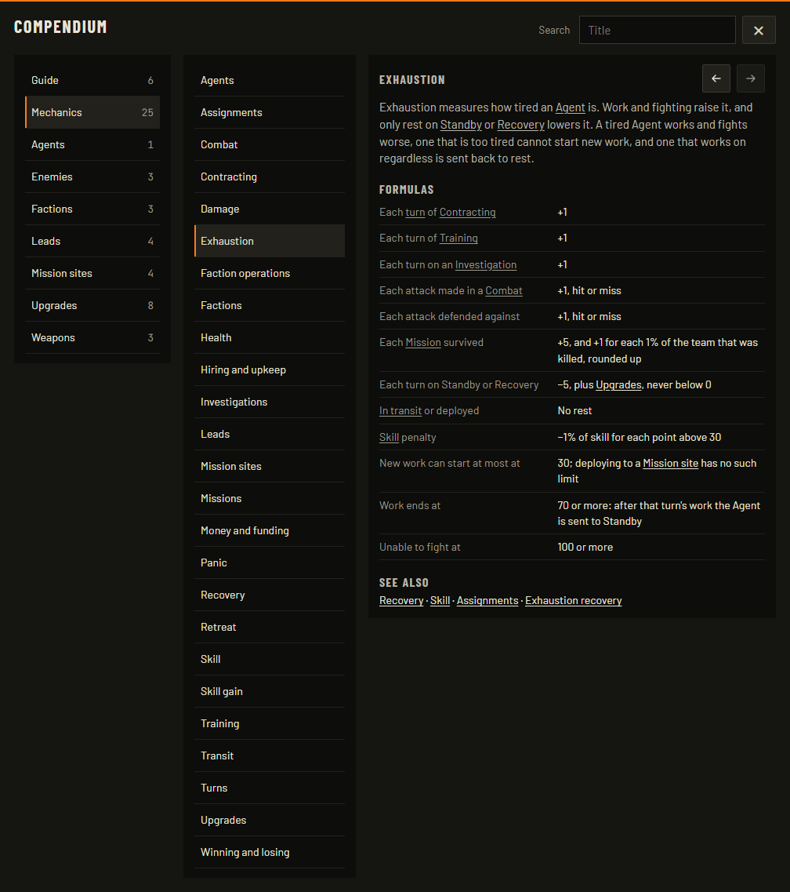

# Compendium View

| Metadata | Value |
| --- | --- |
| Spec ID | COMPV |
| Family | UI |
| Audience | UI designer, Implementer |
| Owns | What the Compendium View of the Campaign screen shows and how the Player finds an article in it. |
| Conventions | [Specification Conventions](../../../governance/conventions/spec-conventions.md), [Design Specification Conventions](../../../governance/conventions/design-spec-conventions.md) |

# Overview

The Compendium View is where the Player looks something up without leaving the [Campaign](../../foundation/core-concepts.md#campaign-and-session), e.g. what a Soldier is armed with or what the Transport cap Upgrade does. It is one of the Records [Detail views](../gui.md#glossary) of the [Campaign Screen](campaign-screen.md), and it shows the Player-visible [Encyclopedia articles](../../mechanics/compendium.md#glossary), under [Article visibility](../../mechanics/compendium.md#article-visibility) in Compendium, so it never shows an article about something the Player may not know yet.

# Panes

The three panes narrow the Compendium from a category to one article, left to right:

1. **Categories:** Guide first, for the [Guide articles](../../mechanics/compendium.md#glossary), then one category for each [Type](../../foundation/core-concepts.md#data-modeling) of the subjects of the Player-visible articles, named after the Type in plain words and sorted by that name, e.g. Enemies for EnemyArchetype and Leads for Lead. Each category shows the number of its Player-visible articles, and a category with none is left out.
2. **Articles:** the `title` of each Player-visible article of the selected category, sorted by title.
3. **Article:** the selected article's `title` and `body`. For an article with a subject, the subject's Player-visible properties follow the body as a table of property and value, under the [Player-visible information](../../foundation/engine-contract.md#api-surfaces) of the specification that owns the subject's Type, e.g. an Enemy's base skill, base health, and Weapon.

When the Compendium View opens, the Guide category and its first article are selected. A search field above the panes filters the articles of every category to those whose `title` contains the search text, ignoring case; while it holds text, the categories show the numbers of matching articles, and a category with none is left out. An article that a new [World state](../../foundation/engine-contract.md#player-actions-and-turns) makes Player-visible appears without reopening the Compendium View.

# Artboard

The sample values, e.g. the article titles, bodies, and property values, appear only on the Artboard, under [Reading Artboards](../visual-design.md#reading-artboards) in Visual Design.
