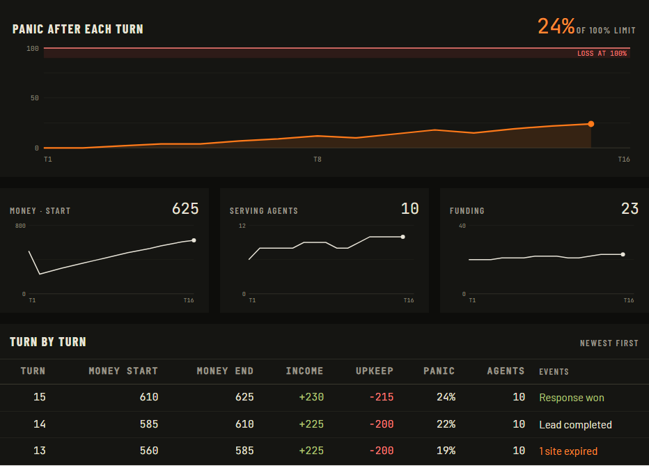

# History Tab

| Metadata    | Value                                                                                                                                                                            |
| ----------- | -------------------------------------------------------------------------------------------------------------------------------------------------------------------------------- |
| Spec ID     | HTAB                                                                                                                                                                             |
| Family      | UI                                                                                                                                                                               |
| Audience    | UI designer, Implementer                                                                                                                                                         |
| Owns        | What the History tab of the Campaign screen shows and in which order.                                                                                                            |
| Conventions | [Specification conventions](../../../governance/conventions/spec-conventions.md), [Design Specification Conventions](../../../governance/conventions/design-spec-conventions.md) |

# Overview

The History tab lets the Player read how the [Campaign](../../foundation/core-concepts.md#campaign-and-session) has gone, Turn by Turn, so that a slow trend, e.g. Panic
creeping up, is visible before it decides the Campaign. It is the last tab of the [Campaign Screen](campaign-screen.md),
and its charts follow [Charts](../visual-design.md#charts) in Visual Design.

# Panic chart

The History tab leads with [Panic](../../mechanics/domain-model.md#campaign-standing), because Panic is how a [Campaign](../../foundation/core-concepts.md#campaign-and-session) is lost. The Panic chart spans the full width of
the tab above the other charts, is at least 180 px tall at a window 1280 px wide, and draws its series in Accent with a
14% Accent fill below the line. Its current value uses a 30 px Figure style in Accent text. The [Panic limit](../../mechanics/panic-and-endings.md#glossary) is a
1.5 px Danger line at the limit value with a Limit band below it, labelled "LOSS AT" and the limit, e.g.
"LOSS AT 100%".

# Trend charts

Three smaller charts show the resources the agency runs on. They sit side by side below the Panic chart, in this order:

1. Money at the start of each [Turn](../../foundation/engine-contract.md#player-actions-and-turns).
2. The number of [Serving](../../mechanics/agents-spec.md#agent-statuses) [Agents](../../mechanics/domain-model.md#agency-and-agents).
3. Funding.

# Turn by Turn table

The Turn by Turn table lets the Player find the Turn in which something changed. It lists one row per Turn, newest
first, under [Tables](../visual-design.md#tables) in Visual Design, with these columns in this order: Turn, Money at the
start of the Turn, Money at its end, income, upkeep, Panic, Serving Agents, and events. Income is in Positive and upkeep
in Danger.

# Artboard

The sample values, e.g. the Turn numbers and the events of each Turn, appear only on the Artboard, under
[Reading Artboards](../visual-design.md#reading-artboards) in Visual Design.
