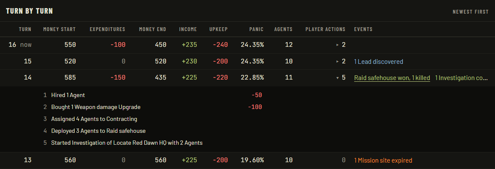

# History View

| Metadata    | Value                                                                                                                                                                            |
| ----------- | -------------------------------------------------------------------------------------------------------------------------------------------------------------------------------- |
| Spec ID     | HVIEW                                                                                                                                                                            |
| Family      | UI                                                                                                                                                                               |
| Audience    | UI designer, Implementer                                                                                                                                                         |
| Owns        | What the History View of the Campaign screen shows and in which order.                                                                                                           |
| Conventions | [Specification Conventions](../../../governance/conventions/spec-conventions.md), [Design Specification Conventions](../../../governance/conventions/design-spec-conventions.md) |

# Overview

The History View lets the Player find the [Turn](../../foundation/engine-contract.md#player-actions-and-turns) in which something changed in the [Campaign](../../foundation/core-concepts.md#campaign-and-session). It is one of the Records
[Detail views](../gui.md#glossary) of the [Campaign Screen](campaign-screen.md); the trends over the same Turns are in
the [Charts View](charts-view.md).

# Turn by Turn table

The [Turn](../../foundation/engine-contract.md#player-actions-and-turns) by Turn table lists one row per Turn, newest first, under [Tables](../visual-design.md#tables) in Visual
Design, with these columns in this order: Turn, Money at the start of the Turn, Money at its end, income, upkeep,
[Panic](../../mechanics/domain-model.md#campaign-standing), [Serving](../../mechanics/agents-spec.md#agent-statuses) [Agents](../../mechanics/domain-model.md#agency-and-agents), and events. Income is in Positive and upkeep in Danger.

# Artboard

The sample values, e.g. the Turn numbers and the events of each Turn, appear only on the Artboard, under
[Reading Artboards](../visual-design.md#reading-artboards) in Visual Design.
