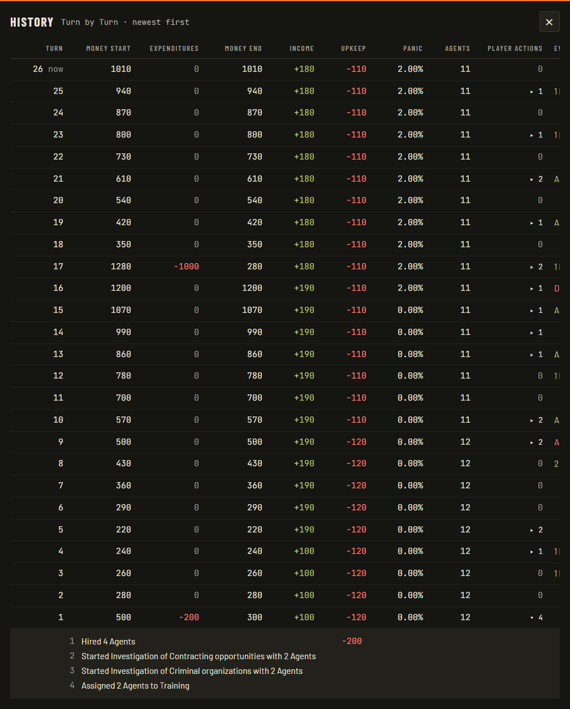

# History View

| Metadata | Value |
| --- | --- |
| Spec ID | HVIEW |
| Family | UI |
| Audience | UI designer, Implementer |
| Owns | What the History View of the Campaign screen shows and in which order: its columns, the events of each Turn with the links from its Missions to their Mission sites, and the list of each Turn's Player actions. |
| Conventions | [Specification Conventions](../../../governance/conventions/spec-conventions.md), [Design Specification Conventions](../../../governance/conventions/design-spec-conventions.md) |

# Overview

The History View lets the Player find the [Turn](../../foundation/engine-contract.md#player-actions-and-turns) in which something changed in the [Campaign](../../foundation/core-concepts.md#campaign-and-session), and see what the player did in that Turn and what came of it. It is one of the Records [Detail views](../gui.md#glossary) of the [Campaign Screen](campaign-screen.md); the trends over the same Turns are in the [Charts View](charts-view.md).

It shows one row for each [History entry](../../foundation/world-history.md#glossary) that [`getHistory()`](../../foundation/world-history.md#current-world-state-turn-report-and-history) returns, and one row for the current Turn from its [Open History entry](../../foundation/world-history.md#glossary), so that the Player sees this Turn's decisions so far beside earlier Turns, as if the Turn ended now. The current Turn's row follows every Player action, undo, and redo, e.g. an undone `hireAgent` leaves its list and its Agent leaves its Agents count, and a redo puts both back.

# Turn by Turn table

The [Turn](../../foundation/engine-contract.md#player-actions-and-turns) by Turn [table](../visual-design.md#tables) lists one row per ended Turn and one row for the current Turn, newest first. Once the [Campaign](../../foundation/core-concepts.md#campaign-and-session) has a [Campaign ending](../../mechanics/domain-model.md#campaign-standing), the table has no row for the current Turn.

| Column | What it shows for Turn t | Form |
| --- | --- | --- |
| Turn | The turn number t. | A number. |
| Money | [Money at the start of turn](../../mechanics/economy-and-upgrades.md#turn-series-of-money) for Turn t. | A number. |
| Spent | The money spent by the [Player actions](../../foundation/engine-contract.md#player-actions-and-turns) of Turn t: the sum of the money changes below 0 in its [Action record](../../foundation/world-history.md#action-record), as a positive amount. | "−" and the amount in Danger, or "0" in Text muted when nothing was spent. |
| Income | The [Agency income](../../mechanics/economy-and-upgrades.md#agency-income) of the Advance turn ending Turn t. | "+" and the amount in Positive. |
| Upkeep | The [upkeep](../../mechanics/economy-and-upgrades.md#upkeep) that Advance turn charged. | "−" and the amount in Danger. |
| Panic | [Panic](../../mechanics/domain-model.md#campaign-standing) after that Advance turn. | A percentage with two decimals. |
| Agents | The number of [Serving](../../mechanics/agents-spec.md#agent-statuses) [Agents](../../mechanics/domain-model.md#agency-and-agents) in the [Turn-end state](../../foundation/engine-contract.md#player-actions-and-turns) of Turn t. | A number. |
| Actions | The number of items in the [Action record](../../foundation/world-history.md#glossary) of Turn t, which opens the [Player actions list](#player-actions-list). | A number after "▸", or "▾" while its list is open; "0" in Text muted, with no marker. |
| Events | The [Events](#events) of the Advance turn ending Turn t. | Short labels. |

The current Turn's row shows each column as if the Advance turn ending it were committed at the [Current world state](../../foundation/engine-contract.md#player-actions-and-turns), as far as that is known before it is committed:

- **Turn:** t, followed by "now".
- **Income and Upkeep:** the [projected income and projected upkeep](../../mechanics/economy-and-upgrades.md#projected-income-and-upkeep).
- **Panic:** Panic in the Current world state.
- **Agents:** the number of Serving Agents in the Current world state.
- **Events:** empty.
- **Money, Spent, and Actions:** as for an ended Turn, from the [Open History entry](../../foundation/world-history.md#glossary).

# Events

The Events column lists the following labels, in this order, each only when it applies. Each counts or names what the reduced [Turn report](../../foundation/campaign-state.md#glossary) in the [History entry](../../foundation/world-history.md#glossary) holds.

1. **Each [Mission](../../mechanics/domain-model.md#leads-investigations-mission-sites-and-missions):** for each [Combat](../../mechanics/domain-model.md#combat) the Advance turn fought, in the order of its [Combat reports](../../mechanics/combat.md#combat-report), its [Mission site](../../mechanics/domain-model.md#leads-investigations-mission-sites-and-missions)'s [MissionSiteArchetype](../../mechanics/missions.md#missionsitearchetype) `name` followed by "won" in Positive or "lost" in Danger, and then ", N killed" when N of its Agents were [Killed](../../mechanics/agents-spec.md#agent-statuses); e.g. "Apprehend member won, 1 killed". The label is a [link to its Mission site](#mission-links).
2. **Investigations completed:** "N Investigations completed", or "1 [Investigation](../../mechanics/domain-model.md#leads-investigations-mission-sites-and-missions) completed", in Positive.
3. **Leads discovered:** "N [Leads](../../mechanics/domain-model.md#leads-investigations-mission-sites-and-missions) discovered", or "1 Lead discovered", in Notice.
4. **Mission sites expired:** "N Mission sites expired", or "1 Mission site expired", in Accent text.
5. **Campaign ending:** "Victory" in Positive or "Defeat" in Danger, when the Advance turn gave the Campaign its Campaign ending.

Labels too many for the column's width are [cut short](../visual-design.md#tables) with "…".

## Mission links

The Player who sees that a Mission was won or lost wants to see how, so each Mission label leads to its Mission site in full. Pressing it opens the [Missions View](missions-view.md) with that Mission site selected, which shows it as a [Concluded Mission site](missions-view.md#concluded-mission-site), and is a [Follow](campaign-screen.md#view-trail). The label keeps its colour, and the pointer resting on it underlines it.

# Player actions list

Pressing the Actions cell of a Turn whose Action record is not empty opens a list of what the player did in that Turn, and pressing it again closes the list; the Player can open the lists of several Turns at once. Every list is closed when the View opens. The current Turn's list stays open while its Action record changes, and closes when an undo empties it; the list of a Turn stays open when Advance turn ends that Turn. The list shows one line for each item of the Action record, in its order.

Each line starts with the number of the Player action in the Turn, from 1, followed by what that Player action did, and ends with its money change, "−" and the amount in Danger or "+" and the amount in Positive, or nothing when it is 0. Consecutive items that name the same operation with the same arguments are one line, and so are consecutive `hireAgents` items whatever their `count`; the line is numbered with the first and last of their numbers, e.g. "1–4", and its count and money change are their totals. E.g., four `hireAgents` of 1 Agent each followed by three `purchaseUpgrade` of the Agent cap Upgrade are the two lines "1–4 Hired 4 Agents" and "5–7 Bought 3 Agent cap Upgrades", and one `hireAgents` of 12 Agents is the line "1 Hired 12 Agents".

| Operation | Line, where N is the number of Agents the arguments name, for `hireAgents` the sum of the `count` of the items the line covers, or for `purchaseUpgrade` the number of items the line covers |
| --- | --- |
| `hireAgents` | "Hired N Agents". |
| `dismissAgents` | "[Dismissed](../../mechanics/agents-spec.md#agent-statuses) N Agents". |
| `purchaseUpgrade` | "Bought N" and the [Upgrade](../../mechanics/economy-and-upgrades.md#upgrade)'s `name` followed by "[Upgrades](../../mechanics/domain-model.md#agency-and-agents)", e.g. "Bought 3 Agent cap Upgrades". |
| `equipAgent` | "Equipped" and the [Agent](../../mechanics/domain-model.md#agency-and-agents)'s [Instance ID](../../foundation/campaign-instances.md#glossary), then "with" and the `name` of the Weapon or Armor, e.g. "Equipped agent-7 with Rifle". |
| `buyItems` | "Bought" and each entry's count and `name`, joined by ", ", e.g. "Bought 2 Rifles, 100 Pistol ammo". |
| `sellItems` | "Sold" and each entry's count and `name`, joined by ", ", e.g. "Sold 1 Machine gun, 30 Rifle ammo". |
| `assignAgents` | "Assigned N Agents to" and the [Assignment](../../mechanics/domain-model.md#agency-and-agents), e.g. "Assigned 5 Agents to Contracting". |
| `startInvestigation` | "Started Investigation of" and the [Lead](../../mechanics/domain-model.md#leads-investigations-mission-sites-and-missions)'s `name`, then "with N Agents", e.g. "Started Investigation of Locate Red Dawn courier with 2 Agents". |
| `assignAgentsToInvestigation` | "Assigned N Agents to Investigation of" and its Lead's `name`. |
| `deployAgents` | "[Deployed](../../mechanics/agents-spec.md#assignments) N Agents to" and the Mission site's MissionSiteArchetype `name`, e.g. "Deployed 3 Agents to Raid safehouse". |
| `addMoney` | "Added" and the amount, then "money (cheat)"; for a negative amount, "Removed" and the amount without its sign, then "money (cheat)". |
| `addAgents` | "Added N Agents (cheat)". |
| Any other operation | The operation's name, e.g. that of a Player action a later Mechanics specification adds. |

A count of 1 takes the singular, e.g. "Hired 1 Agent". No line names the Agents an action concerned; a line names only the Lead or Mission site it concerned.

# Screenshot

The History View as the game draws it:

_Captured on 2026-11-23 19:47 UTC._
