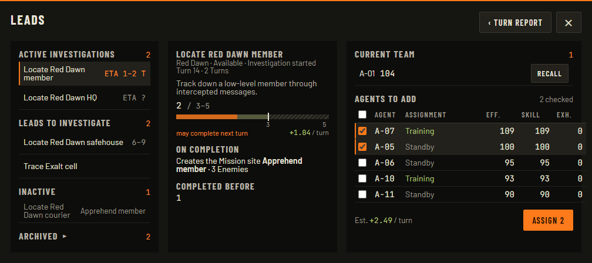

# Leads View

| Metadata | Value |
| --- | --- |
| Spec ID | LVIEW |
| Family | UI |
| Audience | UI designer, Implementer |
| Owns | What the Leads View of the Campaign screen shows, how its panes are arranged, and how it starts and staffs Investigations. |
| Conventions | [Specification Conventions](../../../governance/conventions/spec-conventions.md), [Design Specification Conventions](../../../governance/conventions/design-spec-conventions.md) |

# Overview

The Leads View is where the Player decides what to investigate and with whom: it shows every [Lead](../../mechanics/domain-model.md#leads-investigations-mission-sites-and-missions) the Player knows of, how far each [Investigation](../../mechanics/domain-model.md#leads-investigations-mission-sites-and-missions) has come, and what completing it would bring. It is the second of the Operations [Detail views](../gui.md#glossary) of the [Campaign Screen](campaign-screen.md). Like the [Missions View](missions-view.md), it has three panes side by side: the list of Leads, the selected Lead, and its team.

# Lead list

The left pane lists the [Discovered Leads](../../mechanics/leads-and-progression.md#glossary) in the following groups, in this order, each under its name and the number of its items. A group with no item is left out.

1. **Active Investigations:** each [Investigation](../../mechanics/domain-model.md#leads-investigations-mission-sites-and-missions) that is [Active](../../mechanics/investigations.md#investigation-lifecycle), with its [Lead](../../mechanics/domain-model.md#leads-investigations-mission-sites-and-missions)'s `name` and its [Completion estimate](../gui.md#glossary).
2. **Leads to investigate:** each Discovered Lead whose [Lead status](../../mechanics/leads-and-progression.md#lead-status) is Available and that has no Active Investigation, with its [Required progress range](../../mechanics/investigations.md#glossary) when it is an [Assessed Lead](../../mechanics/investigations.md#glossary), and otherwise nothing in its place, because saying on every such line that the range is unknown tells the Player nothing.
3. **Inactive:** each Discovered Lead whose [Lead status](../../mechanics/leads-and-progression.md#glossary) is Inactive, with the [Mission site](../../mechanics/domain-model.md#leads-investigations-mission-sites-and-missions) it created that is not yet finished, when it has one.
4. **Archived:** each Discovered Lead whose Lead status is Archived, collapsed to its name and count until the Player expands it.

When the Leads View opens, the first item is selected, unless the Player opened it from an item of the [Situation Panel](situation-panel.md) or of the [Turn Report View](turn-report-view.md), or from an Investigation of an [Agent](../../mechanics/domain-model.md#agency-and-agents)'s [Participation history](agents-view.md#participation-history) or [Assignment](agents-view.md#agent-table), which selects that item's Lead.

# Selected Lead

The middle pane shows the selected Lead:

- Its `name`, its [Faction](../../mechanics/domain-model.md#factions) when it has one, its `description`, and its Lead status: Available, Inactive, i.e. it cannot be investigated for now, or Archived, i.e. it can never be investigated again.
- When its [`investigate_again`](../../mechanics/leads-and-progression.md#lead-availability) is `never`, a note that the Lead can be completed only once, and when it is `always`, a note that it can be investigated again after a win.
- What its completion does, under the heading "On completion", one line for each [Effect](../../foundation/effect-lists.md#glossary) of its [`on_completion`](../../mechanics/leads-and-progression.md#completion-effect): for a Mission site it creates, "Creates the Mission site", its MissionSiteArchetype's `name`, and its number of Enemies; for its Faction made [Eliminated](../../mechanics/domain-model.md#factions), "Eliminates" and the Faction's name, in Positive; for [Contracting](../../mechanics/agents-spec.md#assignments) unlocked, "Unlocks Contracting" and the [Contracting cap](../../mechanics/economy-and-upgrades.md#glossary) it opens, `base_contracting_cap`, e.g. "Unlocks Contracting · 4 places", in Positive; and for the [Campaign](../../foundation/core-concepts.md#campaign-and-session) won, "Wins the Campaign", in Positive. A Lead whose `on_completion` is empty shows no such heading.
- For a Lead with an Active Investigation: its [Progress bar](../gui.md#glossary) with the [Investigation progress](../../mechanics/domain-model.md#leads-investigations-mission-sites-and-missions), the Required progress range when the Lead is an Assessed Lead, the [projected progress gain](../../mechanics/investigations.md#projected-progress-gain), and the number of [Turns](../../foundation/engine-contract.md#player-actions-and-turns) since the Investigation's Turn started.
- The Lead's completion count, i.e. its Completed Investigations, when it has any.

# Team

The right pane staffs the selected Lead's Investigation. It is left out for an Inactive or Archived Lead without an Active Investigation.

- **[Current team](../../mechanics/domain-model.md#leads-investigations-mission-sites-and-missions):** for an Active Investigation, each member of its Current team with its [Instance ID](../../foundation/campaign-instances.md#glossary) and [effective skill](../../mechanics/agents-spec.md#combatant-attributes), a member [In transit](../../mechanics/domain-model.md#agency-and-agents) marked as such, and a Recall control that assigns the member to [Standby](../../mechanics/agents-spec.md#assignments) through `assignAgents` at once, without a confirmation, because Undo Action takes it back. The Recall control of a member In transit is disabled.
- **Agents to add:** the [Agents](../../mechanics/domain-model.md#agency-and-agents) that [can take orders](../../mechanics/agents-spec.md#agents-that-can-take-orders), are on a [Base Assignment](../../mechanics/agents-spec.md#assignments), and are [Fit to start work](../../mechanics/agents-spec.md#assignments), in a [table](../visual-design.md#tables), one row each with a checkbox and these columns, each under its header, in this order: Instance ID, [Assignment](../../mechanics/domain-model.md#agency-and-agents), effective skill, [base skill](../../mechanics/agents-spec.md#combatant-attributes), and [exhaustion](../../mechanics/agents-spec.md#combatant-attributes), coloured by [Agent condition](../visual-design.md#agent-condition). Its default order is by effective skill, highest first, and then by Instance ID. Pressing a column header [sorts it by that column](../visual-design.md#tables).
- **Team progress estimate:** while at least one Agent is checked, the [Team progress estimate](../../mechanics/investigations.md#team-progress-estimate) of the team the primary button would make, in [progress points](../../mechanics/domain-model.md#leads-investigations-mission-sites-and-missions), e.g. "Est. +3.62 / turn": for Start, of the checked Agents; for Assign, of the Current team together with the checked Agents.
- **Primary button:** for a Lead to investigate, Start makes one [`startInvestigation`](../../mechanics/investigations.md#starting-an-investigation) [Player action](../../foundation/engine-contract.md#player-actions-and-turns) with the checked Agents; for an Active Investigation, Assign makes one [`assignAgentsToInvestigation`](../../mechanics/investigations.md#assigning-agents-to-an-investigation). Either is disabled while no Agent is checked.

# Artboard

The sample values, e.g. the Lead names, their descriptions, and the Agent IDs, [appear only on the Artboard](../visual-design.md#reading-artboards).
