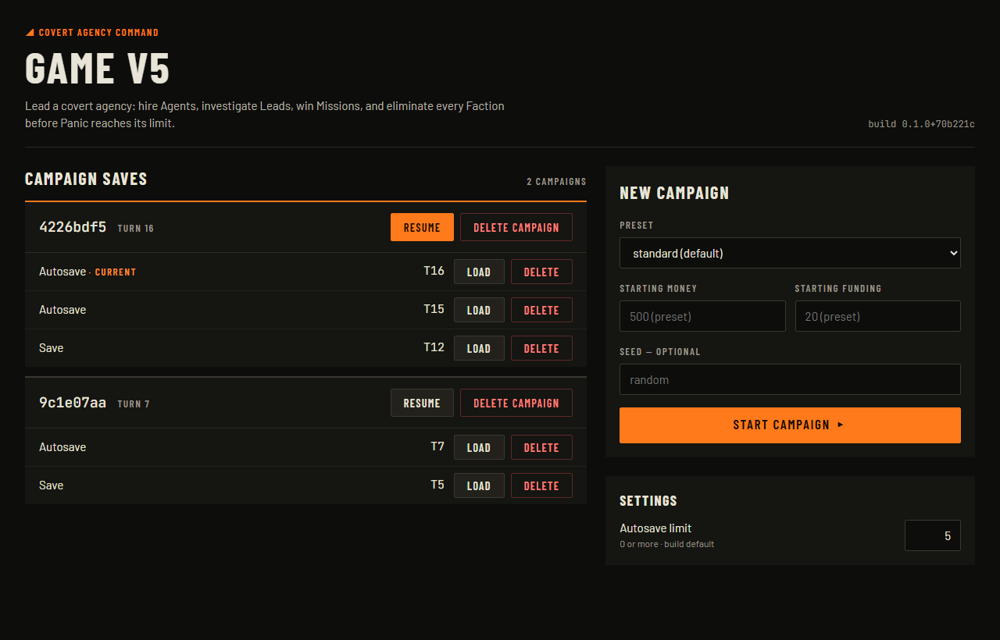

# Main Menu

| Metadata    | Value                                                                                                                                                                            |
| ----------- | -------------------------------------------------------------------------------------------------------------------------------------------------------------------------------- |
| Spec ID     | MENU                                                                                                                                                                             |
| Family      | UI                                                                                                                                                                               |
| Audience    | UI designer, Implementer                                                                                                                                                         |
| Owns        | What the Main menu screen of the graphical user interface shows and how it is laid out.                                                                                          |
| Conventions | [Specification conventions](../../../governance/conventions/spec-conventions.md), [Design Specification Conventions](../../../governance/conventions/design-spec-conventions.md) |

# Overview

The GUI opens at the [Main menu](../../foundation/campaign-lifecycle.md#glossary), the [Session](../../foundation/core-concepts.md#campaign-and-session) state with no [Current campaign](../../foundation/core-concepts.md#campaign-and-session) under
[Session lifecycle](../../foundation/campaign-lifecycle.md#session-lifecycle) in Campaign Lifecycle. It is one of the screens that the
[Graphical User Interface](../gui.md) lists, and it is drawn with the Design tokens and components of
[Visual Design](../visual-design.md).

# Campaign saves

The [Main menu](../../foundation/campaign-lifecycle.md#glossary) lists the [Campaign saves](../../foundation/engine-contract.md#persisted-data), and lets the Player delete each listed Campaign save and each listed [Campaign](../../foundation/core-concepts.md#campaign-and-session)
with all its Campaign saves, under [Deleting Campaign saves](../../foundation/saves.md#deleting-campaign-saves) in Saves.
Because deleting cannot be undone, the GUI asks the Player to confirm each deletion first, naming the Campaign save or
the Campaign and how many Campaign saves it removes.

# Layout

The layout puts what the Player most often wants, the Campaign saves, in the wider column, and the rarer actions beside
it.

- The Campaign saves fill the left column, one card per Campaign, under
  [Panels and cards](../visual-design.md#panels-and-cards) in Visual Design. The card of the Campaign of the most recent
  Campaign save has the Accent top edge.
- A card's header shows the Campaign and its latest [Turn](../../foundation/engine-contract.md#player-actions-and-turns), with Delete campaign at its right edge.
- Each Campaign save of the Campaign is one row of the card: its name, its [Turn](../../foundation/engine-contract.md#player-actions-and-turns) in the Figure style, and Load and Delete
  in the last column. Load and Delete sit side by side in one row, right-aligned, under
  [Buttons](../visual-design.md#buttons) in Visual Design, so that the buttons of every row line up in the same two
  columns.
- The New Campaign and Settings panels are stacked in the right column.

# Artboard

The following appear only on the [Artboard](../visual-design.md#glossary) and must not be implemented, under
[Reading Artboards](../visual-design.md#reading-artboards) in Visual Design:

- The Resume button in the header of each Campaign.
- The sample values, e.g. the Campaign IDs and Turn 16.

# TODOs

- TODO: State what the Main menu offers by default, e.g. creating a Campaign, loading a Campaign save, and changing
  [Global configuration](../../foundation/engine-contract.md#persisted-data), and what it keeps one step away.
