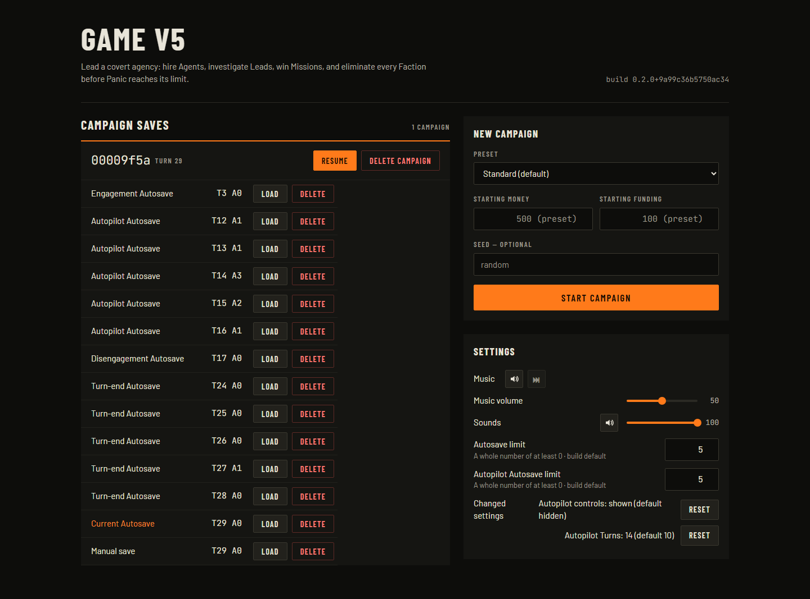

# Main Menu

| Metadata | Value |
| --- | --- |
| Spec ID | MENU |
| Family | UI |
| Audience | UI designer, Implementer |
| Owns | What the Main menu screen of the graphical user interface shows and how it is laid out. |
| Conventions | [Specification Conventions](../../../governance/conventions/spec-conventions.md), [Design Specification Conventions](../../../governance/conventions/design-spec-conventions.md) |

# Overview

The GUI opens at the [Main menu](../../foundation/campaign-lifecycle.md#glossary), the state of the [Session lifecycle](../../foundation/campaign-lifecycle.md#session-lifecycle) in which the [Session](../../foundation/core-concepts.md#campaign-and-session) has no [Current campaign](../../foundation/core-concepts.md#campaign-and-session). It is one of the screens that the [Graphical User Interface](../gui.md) lists, and it is drawn with the Design tokens and components of [Visual Design](../visual-design.md).

# Campaign saves

The [Main menu](../../foundation/campaign-lifecycle.md#glossary) lists the [Campaign saves](../../foundation/engine-contract.md#persisted-data), and lets the Player [delete](../../foundation/saves.md#deleting-campaign-saves) each listed Campaign save and each listed [Campaign](../../foundation/core-concepts.md#campaign-and-session) with all its Campaign saves. Because deleting cannot be undone, the GUI asks the Player to confirm each deletion first, naming the Campaign save or the Campaign and how many Campaign saves it removes.

# New Campaign

The New Campaign panel creates a Campaign. Most Players want one at once, so the panel shows only Start a new Campaign, the primary button, which creates the Campaign and shows the Campaign screen. Below it, a neutral Advanced options button, followed by ▸ while folded and ▾ while unfolded, shows or hides the fields that [select a preset and edit it](../../foundation/configuration.md#preset-selection-and-edits). They are folded whenever the Main menu opens, and Start a new Campaign creates the Campaign they describe either way. The fields are:

1. **Preset:** a selector of every [Campaign configuration preset](../../foundation/game-data-records.md#glossary) the [Game build](../../foundation/core-concepts.md#game-build-and-content) supplies, each shown by its [`name`](../../foundation/configuration.md#campaignconfiguration), marking the [Game build default preset](../../foundation/configuration.md#glossary) and each preset that has [Preset edits](../../foundation/configuration.md#glossary). Choosing a preset selects it.
2. **Preset edits:** one field for each [Campaign configuration](../../foundation/campaign-state.md#glossary) value of the selected preset, labelled with the value's name, showing the preset's own value as its placeholder and its Preset edit, if any, as its content. Entering a value sets a Preset edit, and emptying the field removes it. A value the engine rejects changes nothing, and the field shows the reason the engine reports.
3. **Seed:** an optional [Campaign seed](../../foundation/determinism-and-randomness.md#glossary) or [Campaign setup seed](../../foundation/configuration.md#campaign-setup-seed). When it is left empty, campaign creation receives none, and the engine [chooses one](../../foundation/determinism-and-randomness.md#campaign-seed). When it holds a [Campaign setup seed](../../foundation/configuration.md#glossary), the Preset and Preset edits fields show the preset and Preset edits it holds and cannot be changed, and Start a new Campaign creates the Campaign it describes.

The GUI names each Campaign it creates for the day it was created in the time zone of the Player's device, as "Campaign" followed by that date, e.g. "Campaign 2026-11-27", and supplies it as the [Campaign name](../../foundation/saves.md#identifiers). The Campaign's number on that day follows the date only from the second Campaign of the day on, e.g. "Campaign 2026-11-27 #2". The number is one more than the highest number among the listed Campaigns named for that day, where a name without a number counts as 1, or 1 when there is none.

# Layout

The Main menu keeps in view only what the Player comes for: starting a Campaign, and going back to one. The New Campaign panel stands in the left column and the Campaign saves in the wider right column; the [Global configuration](../../foundation/engine-contract.md#persisted-data) settings wait one step away, in the [Settings panel](../gui.md#settings-panel).

- The header shows the title "Continuity – Demo" in the Screen title style and, below it, the subtitle "[Lead](../../mechanics/domain-model.md#leads-investigations-mission-sites-and-missions) a clandestine organization to wage a secret war to protect humanity, in a turn-based strategy". On every screen the browser tab of the GUI is titled "Continuity Demo".
- The header shows the [Game build ID](../../foundation/core-concepts.md#game-build-and-content) after the word "build", e.g. "build 2026-11-25 PST #48 ec8d48c", linking to its commit in the Implementation repo, so that a Player reporting a problem names the Game build it happened in.
- The header holds a neutral Settings button followed by a cogwheel, which opens the [Settings panel](../gui.md#glossary). It holds no [Music control](../music.md#music-control), because the music [starts](../music.md#playback) only with a Campaign.
- The Campaign saves are grouped into one [card](../visual-design.md#panels-and-cards) per Campaign. The card of the Campaign of the most recent Campaign save has the Accent top edge.
- A card's header shows the Campaign by its [Campaign name](../../foundation/saves.md#identifiers), or by the start of its [Campaign ID](../../foundation/saves.md#identifiers) when its Campaign name is empty, and its latest [Turn](../../foundation/engine-contract.md#player-actions-and-turns), with Resume and Delete Campaign. Resume returns the Player to the Campaign where they left it, by loading its [Current Autosave](../../foundation/saves.md#autosave-kinds), or its most recent Campaign save when it has none. Resume is the primary button on the card with the Accent top edge and a neutral button on the others, so that going back to the Campaign just left from the Campaign screen takes one click.
- When the Player reached the Main menu by leaving a Campaign from the Campaign screen, the Main menu has a [close control](../visual-design.md#close-controls). It and the Escape key do what Resume does for that Campaign. A Main menu reached otherwise, e.g. when the game starts, has no close control.
- Each Campaign save [listed](../../foundation/saves.md#listing-campaign-saves) for the Campaign is one row of the card: its name, its Turn and its number of [Player actions](../../foundation/engine-contract.md#player-actions-and-turns) in that Turn, e.g. T13 A5, and Load and Delete.
- The rows of a card are ordered by Turn, earliest first, and rows of one Turn by their number of Player actions, fewest first, so that the card reads in the order play reached each Campaign save. Rows equal in both are ordered by the time each was last written, earliest first, except that the Current Autosave comes after every other [Autosave](../../foundation/saves.md#autosave-kinds) equal to it in both, because it stands for where play is now, e.g. after a [Disengagement Autosave](../../foundation/saves.md#autosave-kinds) of that World state.
- While the [Combat simulator](combat-simulator.md#glossary) shown setting is on, a neutral Combat simulator button stands in the Main menu's header and [opens the Combat simulator](combat-simulator.md#opening-the-combat-simulator).

# Screenshot

The Main Menu as the game draws it:

_Captured on 2026-11-27 01:19 UTC._
