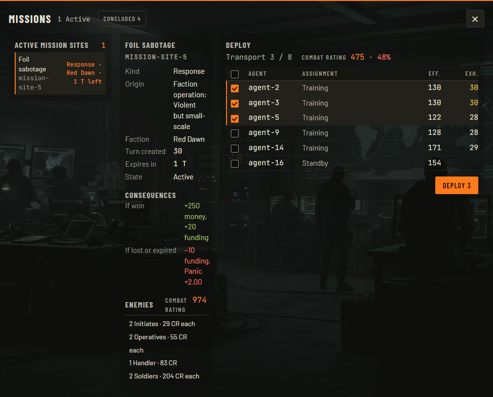
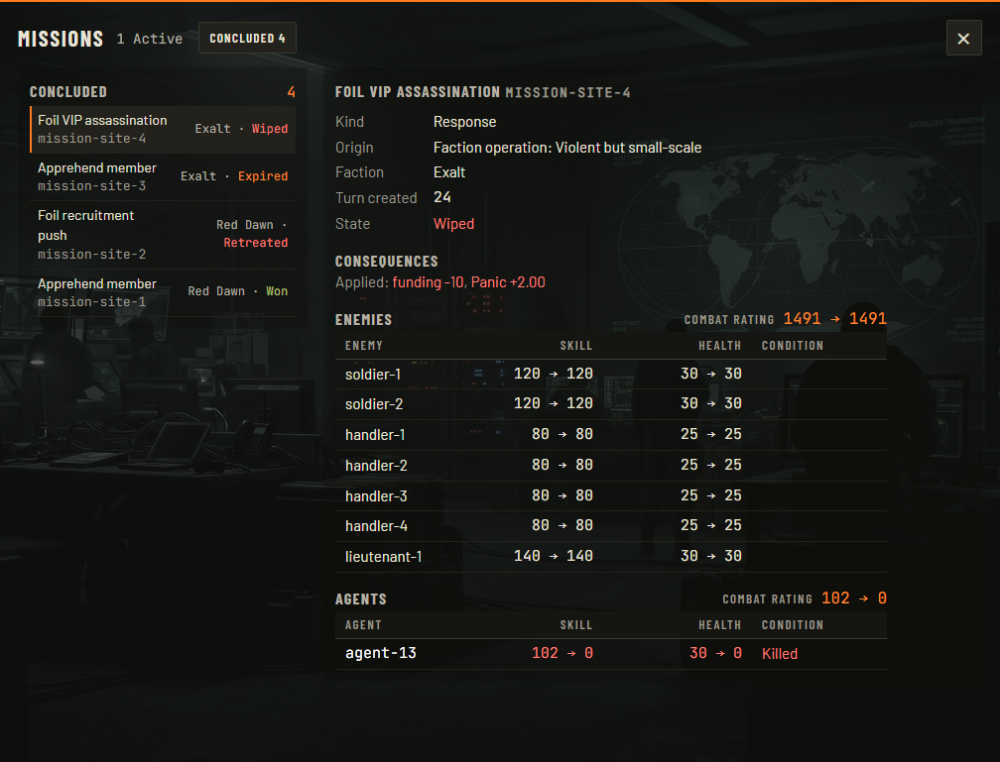

# Missions View

| Metadata | Value |
| --- | --- |
| Spec ID | MVIEW |
| Family | UI |
| Audience | UI designer, Implementer |
| Owns | What the Missions View of the Campaign screen shows, how its panes are arranged, and how it deploys Agents. |
| Conventions | [Specification Conventions](../../../governance/conventions/spec-conventions.md), [Design Specification Conventions](../../../governance/conventions/design-spec-conventions.md) |

# Overview

The Missions View is where the Player answers [Mission sites](../../mechanics/domain-model.md#leads-investigations-mission-sites-and-missions): it shows what waits at each one, what winning or losing it would change, and lets the Player send a team. It is the first of the Operations [Detail views](../gui.md#glossary) of the [Campaign Screen](campaign-screen.md). It reads left to right as the Player decides: which Mission site, what is there, and who goes. It has three panes side by side: the list of Mission sites, the selected Mission site, and the deployment.

# Mission site list

The left pane lists, by default, two groups, each under its name and the number of its items:

1. **Active [Mission sites](../../mechanics/domain-model.md#leads-investigations-mission-sites-and-missions):** each Mission site whose [lifecycle state](../../mechanics/missions.md#mission-site-lifecycle) is Active, soonest to expire first, with its [MissionSiteArchetype](../../mechanics/missions.md#missionsitearchetype)'s `name`, its kind and target [Faction](../../mechanics/domain-model.md#factions), and its [Turns](../../foundation/engine-contract.md#player-actions-and-turns) until expiration.
2. **Deployed this Turn:** each [Mission](../../mechanics/domain-model.md#leads-investigations-mission-sites-and-missions) whose [lifecycle state](../../mechanics/missions.md#mission-lifecycle) is [Deployed](../../mechanics/agents-spec.md#assignments), with its Mission site's MissionSiteArchetype `name` and target Faction, and the number of [Agents](../../mechanics/domain-model.md#agency-and-agents) in its Team sent.

A toggle replaces both groups with one group, Concluded: the Mission sites in a [Final Mission site state](../../mechanics/missions.md#glossary), newest first, each with its MissionSiteArchetype's `name`, its target Faction, and the [final state it reached](#final-state). The toggle is one step away because those Mission sites need no decision. In the title row, the title is followed by the number of Active Mission sites, e.g. "2 Active", and then by the toggle, a neutral button labelled "Concluded" with the number of Mission sites in a final state, e.g. "Concluded 31", drawn as on while it is on.

Every item of the list shows its Mission site's [Instance ID](../../foundation/campaign-instances.md#glossary) after the `name`, e.g. "Apprehend member mission-site-12", because several Mission sites often share one MissionSiteArchetype.

When the Missions View opens, the first Active Mission site is selected, unless the Player opened it from an item of another view, e.g. an item of the [Situation Panel](situation-panel.md), which selects that item's Mission site. A Mission site so selected that is in a final state opens the View with the toggle on Concluded, so that the selected Mission site is in the list.

# Selected Mission site

The middle pane shows the selected Mission site:

- Its MissionSiteArchetype's `name` and its Instance ID, its kind, its [origin](../../mechanics/missions.md#mission-site-properties), shown as the [Lead](../../mechanics/domain-model.md#leads-investigations-mission-sites-and-missions) of the [Investigation](../../mechanics/domain-model.md#leads-investigations-mission-sites-and-missions) that created an [Initiative Mission site](../../mechanics/domain-model.md#leads-investigations-mission-sites-and-missions) or the [Faction operation level](../../mechanics/factions.md#glossary) that created a [Response Mission site](../../mechanics/domain-model.md#leads-investigations-mission-sites-and-missions), its target Faction under the Label "Faction", never "Target", because a Response Mission site is the Faction's own operation rather than a target the [Agency](../../mechanics/domain-model.md#agency-and-agents) chose, its Turn created, its Turns until expiration while it is Active, and its lifecycle state, or for a Mission site in a final state the [final state it reached](#final-state).
- Its [Consequences](../../mechanics/domain-model.md#leads-investigations-mission-sites-and-missions), each change written as what it does, e.g. "+60 money", "Panic −0.50", or "Campaign lost", and [coloured by whom it favours](../visual-design.md#consequences). They come before the Enemies, because what a Mission site is worth decides whether to answer it before who waits there does. While the Mission site is Active or Deployed, they are its [Consequences for each final state](../../mechanics/missions.md#consequences): what a Won Mission changes, and what a Lost Mission or an Expired Mission site changes. Once it is in a final state, they are only the [Consequences that applied](../../mechanics/missions.md#turn-report), after the Label "Applied", from the [History entry](../../foundation/world-history.md#glossary) of the Turn its final state was reached in, or "none" when nothing applied.
- Its Enemies, under the Enemies heading with the [Combat rating](../../mechanics/combat.md#combatant-condition-in-a-combat) of the Enemies' side beside it, counted by EnemyArchetype rather than listed one by one, so that a Mission site of many Enemies stays short: one line for each EnemyArchetype among them, with the number of its Enemies, its `name`, followed by "s" when that number is above 1, and the Combat rating of one of them, e.g. "17 Initiates · 80 CR each" or "1 Commander · 300 CR". The lines are in ascending order of that Combat rating, and those of equal Combat rating in the [EnemyArchetype order](../gui.md#enemyarchetype-order).

For a Deployed Mission site, the pane also shows its Mission with its Team sent, and a row under the Team sent shows the Combat rating of its [Current team](../../mechanics/domain-model.md#leads-investigations-mission-sites-and-missions).

## Concluded Mission site

A Concluded Mission site shows what its [Combat](../../mechanics/domain-model.md#combat) did to every participant, so that the Player sees, Turns later, what each Mission cost and won. Its values come from the reduced [Combat report](../../mechanics/combat.md#combat-report) in the History entry of the Turn its Mission's Combat was fought in, never from the participants' current values, which have changed since.

In place of the Enemies lines and of its Mission's Team sent, below its Consequences, the pane shows two tables of participants, the Enemies first and then the Agents of the Team sent, each in its side's [fixed order](../../mechanics/combat.md#fixed-order-of-each-side) and each under its heading with its side's Combat rating at Combat start and at Combat end, e.g. "COMBAT RATING 240 → 0". Each table has these columns, in this order:

| Column | What it shows |
| --- | --- |
| Enemy or [Agent](../../mechanics/domain-model.md#agency-and-agents) | The [Enemy](../../mechanics/domain-model.md#combat)'s [Enemy label](../gui.md#glossary), or the Agent's Instance ID, which opens the [Agent's details](agents-view.md#agent-details) in the Agents View as a [Follow](campaign-screen.md#view-trail), a [Killed](../../mechanics/agents-spec.md#agent-statuses) Agent's included. |
| Skill | Its [effective skill](../../mechanics/agents-spec.md#combatant-attributes) at Combat start and at Combat end, e.g. "40 → 12". |
| Health | Its [current health](../../mechanics/agents-spec.md#combatant-attributes) at Combat start and at Combat end, e.g. "20 → 0". |
| Condition | Its final condition: "Killed" for a dead Agent, "Dead" for a dead Enemy, "[Incapacitated](../../mechanics/combat.md#combatant-condition-in-a-combat)", or nothing for one [able to fight](../../mechanics/combat.md#combatant-condition-in-a-combat). |

The row of a participant whose final condition is dead is in Danger, and the row of an Incapacitated one is in Warning, on both sides alike, because they are the end states the Player looks for first. A participant able to fight at Combat end keeps Text. An Agent's Instance ID keeps its row's colour.

## Final state

A Mission site in a final state shows the final state it reached, in the list and in place of its lifecycle state in the middle pane, coloured by whom it favours. A Concluded Mission site shows its Mission's outcome instead of "Concluded", because the outcome is what the Player wants to know: "Won" in Positive for a Won Mission, and the [Combat outcome](../../mechanics/combat.md#combat-rounds-and-results) of a Lost Mission, "Retreated" or "Wiped", in Danger. An Expired Mission site shows "Expired" in Accent text, and a Cancelled one "Cancelled" in Text muted.

# Deployment

The right pane deploys a team to the selected Mission site when it is Active, and is left out otherwise. It lists the [Deployable Agents](../../mechanics/missions.md#glossary) in a table, one row each with a selection checkbox and these columns in this order: Instance ID, [Assignment](../../mechanics/domain-model.md#agency-and-agents), effective skill, and [exhaustion](../../mechanics/agents-spec.md#combatant-attributes). The exhaustion of an Agent is shown only when it is at or above the threshold of the [warning on deploying tired Agents](../gui.md#warning-on-deploying-tired-agents), in the colour of its [Agent condition](../visual-design.md#agent-condition), and its cell is empty otherwise. Its default order is by Instance ID, and pressing a column header [sorts it](../visual-design.md#tables). The exhaustion column sorts by every Agent's exhaustion, whether its cell shows it or not. Sorting the rows changes neither which Agents are checked nor the order in which they were checked.

Above the rows, the pane shows how many places of the [Transport cap](../../mechanics/economy-and-upgrades.md#glossary) the Deployed Agents and the checked Agents together take, against the Transport cap, e.g. "Transport 3 / 4". After it, on the same line, the pane shows the Combat rating of the checked Agents taken as one side, so that the Player can weigh the team against the Enemies' Combat rating before deploying it. After it, the pane shows what share it is of the Enemies' Combat rating, as a whole percentage rounded down, e.g. "COMBAT RATING 1063 · 94%", coloured by how the team measures up: Danger below 95%, Accent text from 95% to 99%, Warning from 100% to 104%, Positive from 105% to 109%, and Positive bright from 110%. The share is left out while the Enemies' Combat rating is 0. The pane shows no chance of winning.

The Deploy button is the pane's primary button. It [deploys](../../mechanics/missions.md#deploying-agents) the checked Agents, in the order they were checked, in one [Player action](../../foundation/engine-contract.md#player-actions-and-turns), after the warning on deploying tired Agents when it applies. It is disabled while no Agent is checked or while the checked Agents would exceed the Transport cap.

# Combat ratings

The Player decides whom to send by comparing the Combat ratings of sides, so each Combat rating of a side stands out from the figures around it in one shared style: the Label "Combat rating" followed by the value in the Figure style and Accent text, e.g. "COMBAT RATING 120". None is ever a [base Combat rating](../../mechanics/combat.md#combatant-condition-in-a-combat), which only the [Agent details](agents-view.md#agent-details) show, so that the Player weighs exactly the values the Combat weighs when its team considers retreating.

# Screenshots

The Missions View as the game draws it:

