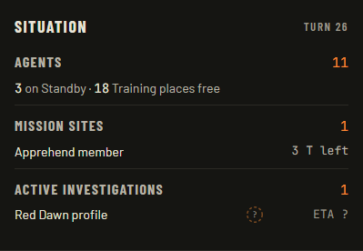

# Situation Panel

| Metadata | Value |
| --- | --- |
| Spec ID | SITP |
| Family | UI |
| Audience | UI designer, Implementer |
| Owns | What the Situation panel of the Campaign screen shows. |
| Conventions | [Specification Conventions](../../../governance/conventions/spec-conventions.md), [Design Specification Conventions](../../../governance/conventions/design-spec-conventions.md) |

# Overview

The Situation panel keeps the work under way and the work waiting for the Player in view, so that nothing needs searching for. It is compact by design: each item takes one line that says what the item is and the one thing the Player must know about it now, and every other detail is in the Detail view that the item opens. It sits in the [Side panel](../gui.md#glossary) of the [Campaign Screen](campaign-screen.md) and is styled as a [panel that lists groups](../visual-design.md#panels-and-cards).

# Glossary

| Term | Definition |
| --- | --- |
| Situation panel | The panel of the [Campaign](../../foundation/core-concepts.md#campaign-and-session) screen that lists [the work under way and the work waiting for the Player](#groups). |

# Groups

The Situation panel shows the following groups, each with the number of its items. A group with nothing to show is left out, and when every group is left out the panel says that nothing needs attention. Each item is one line; a name too long for the line is shortened with an ellipsis.

1. **Agents:** one line with the number of [Serving](../../mechanics/agents-spec.md#agent-statuses) Agents [At assignment](../../mechanics/domain-model.md#agency-and-agents) on [Standby](../../mechanics/agents-spec.md#assignments) and [Fit to start work](../../mechanics/agents-spec.md#assignments), i.e. ready to be sent now, so an [Agent](../../mechanics/domain-model.md#agency-and-agents) [In transit](../../mechanics/domain-model.md#agency-and-agents) to Standby is not counted, and the number of free [Training](../../mechanics/agents-spec.md#assignments) places, i.e. the [Training cap](../../mechanics/economy-and-upgrades.md#glossary) minus the Agents counted against it, e.g. "4 fit to start work · 2 Training places free". Each of the two parts is left out when its number is 0, and the group is left out when both are; the count of the group is the number of Serving Agents.
2. **[Mission sites](../../mechanics/domain-model.md#leads-investigations-mission-sites-and-missions):** first each [Active](../../mechanics/missions.md#mission-site-lifecycle) Mission site, soonest to expire first, with its [MissionSiteArchetype](../../mechanics/missions.md#missionsitearchetype)'s `name` and its [Turns until expiration](../../mechanics/missions.md#mission-site-properties), e.g. "Foil sabotage 3 T left"; then each Mission site that [became Expired or Cancelled](../../mechanics/missions.md#turn-report) in the most recent Advance turn, with its MissionSiteArchetype's `name` and the lifecycle state it reached, e.g. "Foil sabotage Expired". The count of the group is the number of Active Mission sites, because only they wait for a decision. The items are coloured by their [urgency](#mission-site-urgency).
3. **Active Investigations:** one item for each [Active](../../mechanics/investigations.md#investigation-lifecycle) [Investigation](../../mechanics/domain-model.md#leads-investigations-mission-sites-and-missions), with its [Lead](../../mechanics/domain-model.md#leads-investigations-mission-sites-and-missions)'s `name`, its [Progress circle](../gui.md#glossary), and its [Completion estimate](../gui.md#glossary), e.g. "Apprehend Red Dawn member ◔ ETA 3–5 T".

Selecting an item opens the [Detail view](../gui.md#glossary) that details it with that item selected: a Mission site opens [Missions](missions-view.md#mission-site-list), an Investigation opens Leads, and the Agents line opens Agents.

## Mission site urgency

A Mission site about to be lost and one just lost stand out from the rest of the group, so that the Player sees the first in time to deploy to it, and learns of the second here, because an Expired Mission site alone [opens no Turn summary](turn-summary.md#groups).

- **Expires next:** an Active Mission site whose [Turns](../../foundation/engine-contract.md#player-actions-and-turns) until expiration is 1 is in [Warning](../visual-design.md#colours), with the warning-triangle icon of [Agent condition](../visual-design.md#agent-condition) before its Turns until expiration, e.g. "Foil sabotage ⚠ 1 T left".
- **Just lost:** a Mission site that became Expired or Cancelled in the most recent Advance turn is in Danger deep and struck through, name and lifecycle state alike, with a prohibition icon outlined in Danger in place of the warning triangle, e.g. "~~Foil sabotage~~ 🚫 ~~Expired~~".

# Screenshot

The Situation Panel as the game draws it:

_Captured on 2026-11-23 19:47 UTC._
