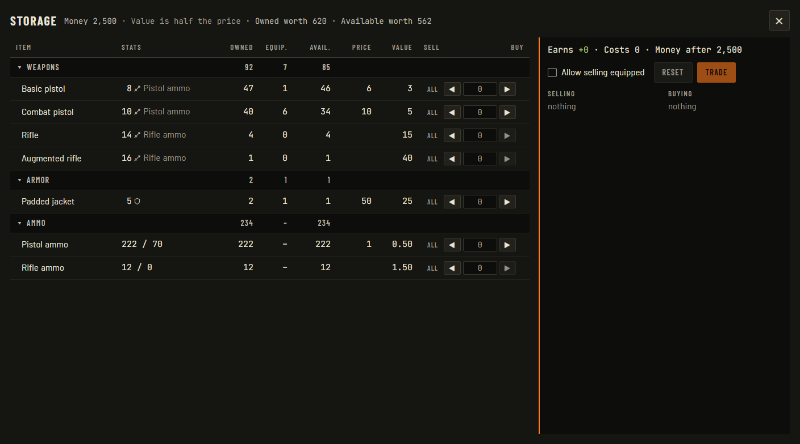

# Storage View

| Metadata | Value |
| --- | --- |
| Spec ID | STVIEW |
| Family | UI |
| Audience | UI designer, Implementer |
| Owns | What the Storage View of the Campaign screen shows of the Agency's Items and Ammo and of what it can buy, and how it sells and buys them. |
| Conventions | [Specification Conventions](../../../governance/conventions/spec-conventions.md), [Design Specification Conventions](../../../governance/conventions/design-spec-conventions.md) |

# Overview

The Storage View is where the Player manages the agency's gear in one place: what it owns, who wears it, what it is worth, what it can buy, and what it buys and sells. It is the fourth of the Operations [Detail views](../gui.md#glossary) of the [Campaign Screen](campaign-screen.md). Its header shows the agency's money and what a value is, as the share of the price that [`sale_price_fraction`](../../mechanics/equipment.md#selling-items) gives, in words where it is a half and as a percentage otherwise, e.g. "Value is half the price" or "Value is 40% of the price".

Finding new gear is part of what the Player discovers, as finding new [Compendium](../../mechanics/compendium.md) articles is, so the Storage View shows an Item only once it is [Unlocked](../../mechanics/equipment.md#unlocked-items) or owned, and nothing says which interrogation would unlock one.

# Totals

The header ends with what all the gear is worth, so that the totals cost the table below no height: the [Sale value](../../mechanics/equipment.md#glossary) of everything the agency owns, and of what is in [Storage](../../mechanics/equipment.md#storage), i.e. what selling all of it without taking anything off an [Agent](../../mechanics/domain-model.md#agency-and-agents) would bring, e.g. "Owned worth 157.50 · Available worth 102.50", each with two decimals when it is not whole.

# Storage table

The [Storage](../../mechanics/equipment.md#glossary) table lists every [Item](../../mechanics/equipment.md#glossary) and [AmmoType](../../mechanics/combat.md#ammotype) that is [Unlocked](../../mechanics/equipment.md#glossary) or whose [Owned count](../../mechanics/equipment.md#glossary) is above 0, in three groups, Weapons, Armor, and [Ammo](../../mechanics/combat.md#ammo), each under a group row that sums its category's counts: the Owned count, the [Equipped count](../../mechanics/equipment.md#glossary), and the count in Storage. Within a group, the rows are in the order the [Game build](../../foundation/core-concepts.md#game-build-and-content) supplies them; a group with no row says "Nothing yet". The columns are:

| Column | What it shows |
| --- | --- |
| Item | The `name` of the Item or the AmmoType. |
| Stats | For a Weapon, its `base_weapon_damage` with the sword icon and its AmmoType's `name`, e.g. "14 ⚔ Rifle ammo"; for an Armor, its `base_armor` with the shield icon, e.g. "20 🛡"; for an AmmoType, its count in Storage against the rounds [Ammo short](../../mechanics/equipment.md#ammo-short) asks for, e.g. "95 / 130", with the number of Agents whose Weapons use it in its tooltip. While the AmmoType is [Ammo short](../../mechanics/equipment.md#glossary), its Stats are in Accent text with the warning icon in Warning, whose tooltip names the AmmoType, its rounds in Storage, and the rounds it falls short of, e.g. "Pistol ammo 69, below 70 for 7 Agents". |
| Owned, Equip., Avail. | The Owned count, the Equipped count, or "–" for an AmmoType, and the count in Storage. |
| Price | Its `price`, for one Item or one round; empty for an Item that is not Unlocked. |
| Value | The Sale value of one, [with two decimals](../gui.md#decimal-quantities-shown) when it is not whole, e.g. "0.50". |
| Buy | For an Unlocked Item or AmmoType, a [stepper](../visual-design.md#steppers) from 0 up, and for an AmmoType also "+10" and "+100" buttons, because [Ammo](../../mechanics/combat.md#ammo) is bought in bulk; empty otherwise. |
| Sell | A stepper, from 0 to the count in Storage, or to the Owned count while Allow selling equipped is checked, and a "max" button that sets it to that limit. |

# Trading

A trade bar below the table, as wide as the table, gathers the counts chosen in the Sell and Buy columns into one trade, so that the Player can sell and buy several kinds of Items and Ammo at once and see what the trade brings and costs before committing. Its parts start at its left edge:

1. **What is sold and bought:** each Item and AmmoType whose Sell count is above 0, one per line, by count and `name`, under the label "Selling", and each whose Buy count is above 0 under the label "Buying", e.g. "2 Rifles" under Selling and "100 Pistol ammo" under Buying.
2. **What it brings and costs:** the [Sale value](../../mechanics/equipment.md#selling-items) of the sale, rounded down once as the action rounds it, the [cost](../../mechanics/equipment.md#buying-items) of the purchase, and the money after both, e.g. "Earns +155 · Costs 120 · Money after 4,435". While the cost is above the money and the Sale value together, the cost is in Danger and the bar says how much money is missing.
3. **Allow selling equipped:** a checkbox, unchecked whenever the Storage View opens. While it is unchecked, no Sell count can exceed the count in Storage. While it is checked and the sale takes Items off Agents, the bar adds one line per such [Agent](../../mechanics/domain-model.md#agency-and-agents) in the order [Selling Items](../../mechanics/equipment.md#selling-items) takes them, e.g. "agent-12 loses Rifle → Knife".
4. **Clear,** which sets every Sell and Buy count to 0, and the primary **Trade,** which makes one [`sellItems`](../../mechanics/equipment.md#selling-items) with the chosen Sell counts and the checkbox as `takeEquipped` when a Sell count is above 0, and then one [`buyItems`](../../mechanics/equipment.md#buying-items) with the chosen Buy counts when a Buy count is above 0, so that the sale's money pays for the purchase. It acts at once and without a confirmation, because Undo Action takes each [Player action](../../foundation/engine-contract.md#player-actions-and-turns) back. Both are disabled while every count is 0, and Trade also while the cost is above the money and the Sale value together.

After a trade every count is 0 again, and what was bought is in Storage, ready to [equip](agents-view.md#equipment-picker).

# Screenshot

The Storage View as the game draws it:

_Captured on 2026-11-23 19:47 UTC._
