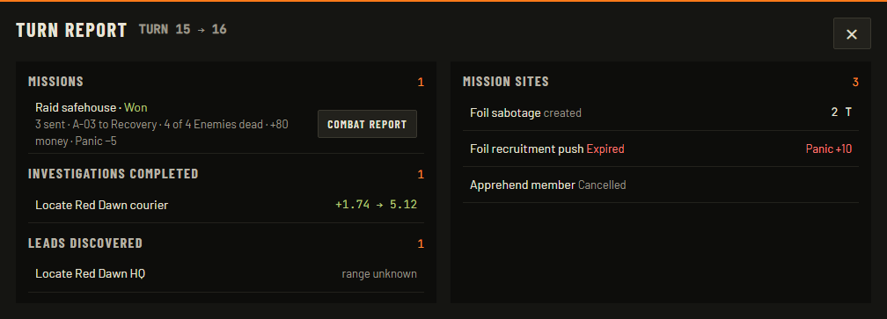

# Turn Report View

| Metadata    | Value                                                                                                                                                                            |
| ----------- | -------------------------------------------------------------------------------------------------------------------------------------------------------------------------------- |
| Spec ID     | TRVIEW                                                                                                                                                                           |
| Family      | UI                                                                                                                                                                               |
| Audience    | UI designer, Implementer                                                                                                                                                         |
| Owns        | What the Turn Report View of the Campaign screen shows of the most recent Turn report, and how it opens a Combat report or reopens the Turn summary.                             |
| Conventions | [Specification Conventions](../../../governance/conventions/spec-conventions.md), [Design Specification Conventions](../../../governance/conventions/design-spec-conventions.md) |

# Overview

The Turn Report View shows in full what the most recent Advance turn did, so that the Player can look past the
[Turn Summary](turn-summary.md) into every fact of it. It is the first of the Records [Detail views](../gui.md#glossary)
of the [Campaign Screen](campaign-screen.md), and the Turn summary's offer to open the full
[Turn report](../../foundation/world-history.md#glossary) opens it.

It shows only the Turn report of the most recent committed Advance turn, because a [Campaign](../../foundation/core-concepts.md#campaign-and-session) keeps no other in full,
under [Turn report and history](../../foundation/world-history.md#turn-report-and-history) in World History; earlier [Turns](../../foundation/engine-contract.md#player-actions-and-turns) are read in the reduced form of the
[History View](history-view.md). Its heading names the Turn that Advance turn ended and the Turn it began. Before the
first committed Advance turn of a Campaign, it says that there is no Turn report yet.

A Turn summary button in its title row, to the left of its close control, reopens the Turn summary of the Turn report
it shows, under [Showing and dismissing](turn-summary.md#showing-and-dismissing) in Turn Summary. The button is
disabled, not hidden, when there is no Turn report yet or the Turn summary would have no group, so that the title row
keeps the same controls from Turn to Turn.

# Sections

The Turn Report View shows the following sections in this order, each under a Group heading with the number of its
items, under [Panels and cards](../visual-design.md#panels-and-cards) in Visual Design. They are exactly
what the [Turn report](../../foundation/world-history.md#glossary) holds, each under the specification that owns it, so a section with nothing to show is left out
and the View adds no section of its own, e.g. none for money or Panic, which the History View shows. The list is
exhaustive.

1. **Missions:** one row for each [Combat report](../../mechanics/domain-model.md#combat), under [Combat report](../../mechanics/combat.md#combat-report) in [Combat](../../mechanics/domain-model.md#combat): its
   [Mission](../../mechanics/domain-model.md#leads-investigations-mission-sites-and-missions)'s [Mission site](../../mechanics/domain-model.md#leads-investigations-mission-sites-and-missions) by its MissionSiteArchetype's `name`, whether the Mission is Won or Lost with its
   [Combat outcome](../../mechanics/combat.md#combat-rounds-and-results) and number of [Combat rounds](../../mechanics/combat.md#combat-rounds-and-results), the number of [Agents](../../mechanics/domain-model.md#agency-and-agents) on its side, the Agents [Killed](../../mechanics/agents-spec.md#agent-statuses), and the
   Enemies dead out of the Enemies present. A Combat report button on the row opens that Combat report.
2. **[Investigations](../../mechanics/domain-model.md#leads-investigations-mission-sites-and-missions) completed:** each under [Turn report](../../mechanics/investigations.md#turn-report) in Investigations, with its
   [Lead](../../mechanics/domain-model.md#leads-investigations-mission-sites-and-missions)'s `name`, the gain of the Advance turn, and its final [Investigation progress](../../mechanics/domain-model.md#leads-investigations-mission-sites-and-missions).
3. **Mission sites:** the [Mission sites](../../mechanics/domain-model.md#leads-investigations-mission-sites-and-missions) created, Expired, and Cancelled, under [Turn report](../../mechanics/missions.md#turn-report) in Missions,
   each with its MissionSiteArchetype's `name` and what happened to it, a created one with its [Turns](../../foundation/engine-contract.md#player-actions-and-turns) until
   expiration and an Expired one with its [Consequences](../../mechanics/domain-model.md#leads-investigations-mission-sites-and-missions).
4. **Leads discovered:** each under [Turn report](../../mechanics/leads-and-progression.md#turn-report) in Leads and Progression, with its
   `name`.

Selecting a Mission site, an [Investigation](../../mechanics/domain-model.md#leads-investigations-mission-sites-and-missions), or a Lead opens the Operations [Detail view](../gui.md#glossary) that details it, with it selected, e.g. a new
Mission site opens the [Missions View](missions-view.md) and a discovered Lead the [Leads View](leads-view.md). It is a
Follow under [View trail](campaign-screen.md#view-trail) in Campaign Screen, so the Escape key and the
[Back control](../gui.md#glossary) return to the Turn Report View.

# Combat report

The Combat report of a Mission opens one step away, in place of the sections, as a Follow under
[View trail](campaign-screen.md#view-trail) in Campaign Screen, so the Escape key and the Back control return to them. It
shows every fact the Combat report holds, under [Combat report](../../mechanics/combat.md#combat-report) in Combat:

- The participants of each side, in their fixed order, as a table under [Tables](../visual-design.md#tables) in Visual
  Design, with their starting and final values, [damage dealt](../../mechanics/combat.md#combat-rounds-and-results) and [damage taken](../../mechanics/combat.md#combat-rounds-and-results), and final condition, a Killed [Agent](../../mechanics/domain-model.md#agency-and-agents) in
  Danger.
- The [Combat rating](../../mechanics/combat.md#combatant-condition-in-a-combat) of each side at Combat start and after each Combat round.
- The [Combat log](../../mechanics/combat.md#combat-rounds-and-results), one row per attack in its order, collapsed until the Player expands it.

## Combat log colours

The colours of the Combat log tell the Player whose attack each row is and whom its outcome favours. Whether a hit or a
miss is good for the Player depends on who made it, so no colour means "hit" or "damage" by itself:

- **Row:** a row whose attacker is an Agent is filled with the Agent attack tint, and a row whose attacker is an [Enemy](../../mechanics/domain-model.md#combat)
  with the Enemy attack tint, under [Colours](../visual-design.md#colours) in Visual Design.
- **Outcome:** the attack's outcome, i.e. its hit outcome, the [health removed](../../mechanics/combat.md#combat-rounds-and-results), the defender's [current health](../../mechanics/agents-spec.md#combatant-attributes) after it,
  and whether it made a participant dead or [Incapacitated](../../mechanics/combat.md#combatant-condition-in-a-combat), is in Positive when an Agent hit, in Danger when an Enemy
  hit, and in Text muted when the attack missed, whichever side made it. The other values of the row are in Text.
- **Decisive attack:** the word that names a participant made dead or Incapacitated is bold, e.g. "hit for 14,
  health 0, **dead**".

E.g., an Enemy that hits an Agent gives a row with the Enemy attack tint and its outcome in Danger, while an Agent
that misses an Enemy gives a row with the Agent attack tint and its outcome in Text muted.

# Artboard

The sample values, e.g. the Mission site names, the Lead names, the Instance IDs, and the numbers, appear only on the Artboards, under
[Reading Artboards](../visual-design.md#reading-artboards) in Visual Design.
