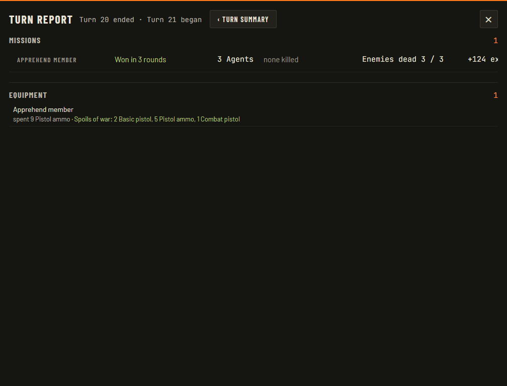
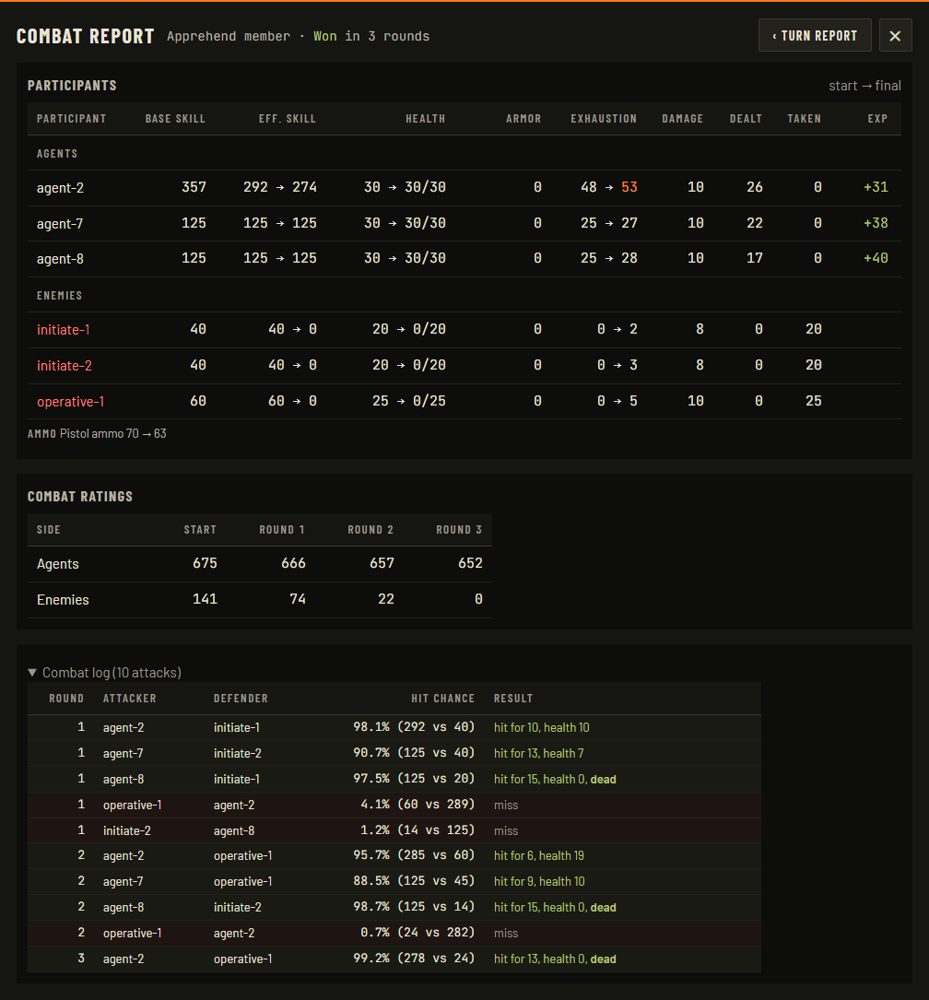

# Turn Report View

| Metadata | Value |
| --- | --- |
| Spec ID | TRVIEW |
| Family | UI |
| Audience | UI designer, Implementer |
| Owns | What the Turn Report View of the Campaign screen shows of the most recent Turn report, and how it opens a Combat report or reopens the Turn summary. |
| Conventions | [Specification Conventions](../../../governance/conventions/spec-conventions.md), [Design Specification Conventions](../../../governance/conventions/design-spec-conventions.md) |

# Overview

The Turn Report View shows in full what the most recent Advance turn did, so that the Player can look past the [Turn Summary](turn-summary.md) into every fact of it. It is the first of the Records [Detail views](../gui.md#glossary) of the [Campaign Screen](campaign-screen.md), and the Turn summary's offer to open the full [Turn report](../../foundation/campaign-state.md#glossary) opens it.

It shows only the Turn report of the most recent committed Advance turn, because a [Campaign](../../foundation/core-concepts.md#campaign-and-session) [keeps no other in full](../../foundation/world-history.md#turn-report-and-history); earlier [Turns](../../foundation/engine-contract.md#player-actions-and-turns) are read in the reduced form of the [History View](history-view.md). Its heading names the Turn that Advance turn ended and the Turn it began, e.g. "Turn 99 ended · Turn 100 began", and a report of an Advance turn that ended the Campaign first says which ending it reached, e.g. "Campaign ending: Victory". Before the first committed Advance turn of a Campaign, it says that there is no Turn report yet.

# Turn summary button

A [Turn summary](turn-summary.md#glossary) button [reopens the Turn summary](turn-summary.md#showing-and-dismissing) of the [Turn report](../../foundation/campaign-state.md#glossary) it shows. The button is disabled, not hidden, when there is no [Turn report](../../foundation/campaign-state.md#glossary) yet or the Turn summary would have no group, and is enabled when its only group is Expired [Mission sites](../../mechanics/domain-model.md#leads-investigations-mission-sites-and-missions), although that alone never shows the Turn summary after the Advance turn, so that the title row keeps the same controls from [Turn](../../foundation/engine-contract.md#player-actions-and-turns) to Turn. While the [Back control](../gui.md#glossary) returns to the Turn summary, e.g. "‹ Turn summary" after the Player opened the full Turn report from it, the Back control stands in the Turn summary button's place and the Turn summary button is not shown, because both would show the same Turn summary.

# Sections

The Turn Report View shows the following sections, each with the number of its items. A section with nothing to show is left out, and the View adds no section of its own, e.g. none for money or Panic, which the History View shows.

1. **Missions:** one row for each [Combat report](../../mechanics/combat.md#combat-report): its [Mission](../../mechanics/domain-model.md#leads-investigations-mission-sites-and-missions)'s [Mission site](../../mechanics/domain-model.md#leads-investigations-mission-sites-and-missions) by its MissionSiteArchetype's `name`, whether the Mission is Won or Lost, with the [Combat outcome](../../mechanics/combat.md#combat-rounds-and-results) of a Lost one, e.g. "Lost · Wiped", and the number of [Combat rounds](../../mechanics/combat.md#combat-rounds-and-results), the number of [Agents](../../mechanics/domain-model.md#agency-and-agents) on its side, the Agents [Killed](../../mechanics/agents-spec.md#agent-statuses), the Enemies dead out of the Enemies present, and the sum of the [Mission experience](../../mechanics/agents-spec.md#growth) of its survivors, e.g. "+176 exp". A [Combat report](../../mechanics/domain-model.md#combat) button on the row opens that Combat report.
2. **[Investigations](../../mechanics/domain-model.md#leads-investigations-mission-sites-and-missions) completed:** each [Investigation completed](../../mechanics/investigations.md#turn-report) in the Advance turn, with its [Lead](../../mechanics/domain-model.md#leads-investigations-mission-sites-and-missions)'s `name`, the gain of the Advance turn, and its final [Investigation progress](../../mechanics/domain-model.md#leads-investigations-mission-sites-and-missions).
3. **Mission sites:** the Mission sites [created, Expired, and Cancelled](../../mechanics/missions.md#turn-report), each with its MissionSiteArchetype's `name`, its [Instance ID](../../foundation/campaign-instances.md#glossary), its target [Faction](../../mechanics/domain-model.md#factions), and what happened to it, a created one with its Turns until expiration and an Expired one with its [Consequences](../../mechanics/domain-model.md#leads-investigations-mission-sites-and-missions).
4. **Leads discovered:** each [Lead discovered](../../mechanics/leads-and-progression.md#turn-report) in the Advance turn, with its `name`.
5. **Equipment:** for each Mission resolved, by its Mission site's MissionSiteArchetype `name`, the [rounds of each AmmoType its Combat spent](../../mechanics/equipment.md#turn-report), for a Won Mission its [Spoils of war](../../mechanics/equipment.md#spoils-of-war) in Positive, its [Recovered Items](../../mechanics/equipment.md#glossary) after "Recovered:", and the [Items lost](../../mechanics/equipment.md#mission-equipment-losses) in Danger, each as counts and `name`s, e.g. "Raid outpost · spent 172 Rifle ammo · Spoils of war: 4 Rifle, 1 Augmented rifle, 11 Rifle ammo".
6. **New acquisitions:** the [Items](../../mechanics/equipment.md#glossary) and AmmoTypes that became [Unlocked](../../mechanics/equipment.md#unlocked-items) in the Advance turn, by `name`, e.g. "Machine gun, Laser pistol, Tactical armor, Battle suit, Machine gun ammo, Laser pistol battery". It is the first place the Player learns what an interrogation unlocked, and selecting it opens the [Acquisitions View](acquisitions-view.md).
7. **Investigations interrupted:** each [Investigation](../../mechanics/domain-model.md#leads-investigations-mission-sites-and-missions) that the Advance turn ended because its [Lead can no longer be investigated](../../mechanics/investigations.md#lead-no-longer-available), with its Lead's `name`.

Selecting a Mission site, an Investigation, or a Lead opens the Operations [Detail view](../gui.md#glossary) that details it, with it selected, e.g. a new Mission site opens the [Missions View](missions-view.md) and a discovered Lead the [Leads View](leads-view.md). Opening it is a [Follow](campaign-screen.md#view-trail).

# Combat report

The Combat report of a Mission opens one step away, in place of the sections, as a [Follow](campaign-screen.md#view-trail). The [Turn summary](turn-summary.md#glossary) opens it too, from its [Mission card](turn-summary.md#mission-cards). It names each [Agent](../../mechanics/domain-model.md#agency-and-agents) by its [Instance ID](../../foundation/campaign-instances.md#glossary) and each [Enemy](../../mechanics/domain-model.md#combat) by its [Enemy label](../gui.md#enemy-labels), in the participants table and in the [Combat log](../../mechanics/combat.md#combat-rounds-and-results) alike, and shows the following of what the [Combat report](../../mechanics/combat.md#combat-report) holds:

- The participants of each side, in their fixed order, as a [table](../visual-design.md#tables), with their starting and final values, [damage dealt](../../mechanics/combat.md#combat-rounds-and-results) and [damage taken](../../mechanics/combat.md#combat-rounds-and-results), and final condition. An Exp column shows, for each Agent that survived, its [Mission experience](../../mechanics/agents-spec.md#mission-growth) from the Turn report, as one total in Positive, e.g. "+43", never split into its parts; for a Killed Agent, its [combat experience](../../mechanics/agents-spec.md#growth) struck through in Text muted, e.g. "~~+5~~", because it was never added; and nothing for an Enemy.
- The final condition of each participant: "[Killed](../../mechanics/agents-spec.md#agent-statuses)" for a dead Agent, "Dead" for a dead Enemy, "[Incapacitated](../../mechanics/combat.md#combatant-condition-in-a-combat)", or nothing for one [able to fight](../../mechanics/combat.md#combatant-condition-in-a-combat). The participant's name and its condition are in Danger when its final condition is dead and in Warning when it is Incapacitated, on both sides alike; the other values of its row keep their own colours.
- The [Combat rating](../../mechanics/combat.md#combatant-condition-in-a-combat) of each side at [Combat](../../mechanics/domain-model.md#combat) start and after each [Combat round](../../mechanics/combat.md#combat-rounds-and-results).
- Each participant's [effective armor](../../mechanics/agents-spec.md#combatant-attributes) at Combat start and its [current armor](../../mechanics/agents-spec.md#combatant-attributes) at Combat end joined by "→", e.g. "3 → 0", and "0" alone for a participant whose effective armor is 0.
- The Combat log, one row per attack in its order, collapsed until the Player expands it. Its toggle names the number of its attacks, e.g. "▸ Combat log (16 attacks)". Each row shows its Combat round, attacker, defender, [Hit chance](../../mechanics/combat.md#combat-rounds-and-results), and result. The Hit chance is the attack's hit chance with one decimal place, followed by A and D, e.g. "99.6% (973 vs 60)". The result of a hit names its damage outcome and then the defender's [current health](../../mechanics/agents-spec.md#combatant-attributes) after it, e.g. "hit for 8, health 12". When the defender had current armor before the hit, the result names the [armor removed](../../mechanics/combat.md#combat-rounds-and-results) as absorbed and the defender's current armor after it between the two, e.g. "hit for 15, 8 absorbed, armor 0, health 23", so that a hit the armor absorbs whole reads "hit for 7, 7 absorbed, armor 18, health 30". An Agent's attack made with the [Fallback Weapon](../../mechanics/combat.md#ammo) because its [Ammo](../../mechanics/combat.md#ammo) had run out names the Fallback Weapon after the attacker, e.g. "agent-9 (Knife, out of Pistol ammo)". The Ammo line gives each AmmoType's rounds at Combat start and at Combat end, e.g. "Rifle ammo 300 → 128".

## Combat log colours

The colours of the Combat log tell the Player whose attack each row is and whom its outcome favours. Whether a hit or a miss is good for the Player depends on who made it, so no colour means "hit" or "damage" by itself:

- **Row:** a row whose attacker is an Agent is filled with the [Agent attack tint](../visual-design.md#colours), and a row whose attacker is an Enemy with the Enemy attack tint.
- **Outcome:** the attack's outcome, i.e. its hit outcome, the armor removed, the defender's current armor after it, the [health removed](../../mechanics/combat.md#combat-rounds-and-results), the defender's current health after it, and whether it made a participant dead or Incapacitated, is in Positive when an Agent hit, in Danger when an Enemy hit, and in Text muted when the attack missed, whichever side made it. The other values of the row are in Text.
- **Decisive attack:** the word that names a participant made dead or Incapacitated is bold, e.g. "hit for 14, health 0, **dead**".

# Screenshots

The Turn Report View as the game draws it:

_Captured on 2026-11-23 19:47 UTC._

_Captured on 2026-11-23 19:47 UTC._
