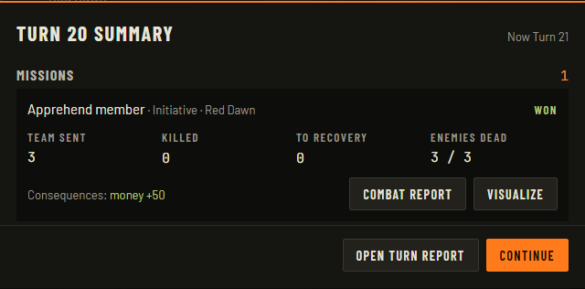

# Turn Summary

| Metadata | Value |
| --- | --- |
| Spec ID | TSUM |
| Family | UI |
| Audience | UI designer, Implementer |
| Owns | When the Turn summary dialog of the Campaign screen appears and what it shows. |
| Conventions | [Specification Conventions](../../../governance/conventions/spec-conventions.md), [Design Specification Conventions](../../../governance/conventions/design-spec-conventions.md) |

# Overview

The Turn summary tells the Player, as soon as an Advance turn ends, what it did that the Player must know before going on, so that a won Mission or a new Mission site is not missed in the full Turn report, and leads from a new Mission site straight to deploying to it. The Player can reopen it later in the Turn. It is a [dialog](../visual-design.md#dialogs) over the [Campaign Screen](campaign-screen.md).

# Glossary

| Term | Definition |
| --- | --- |
| Turn summary | The dialog that summarizes what an Advance turn did, shown after it only when it did [something the Player must know](#groups). |

# Groups

After an Advance turn that the Player requested through the GUI is committed, the GUI shows the Turn summary when that Advance turn did at least one thing listed below other than an Expired [Mission site](../../mechanics/domain-model.md#leads-investigations-mission-sites-and-missions), which the [Situation panel](situation-panel.md#glossary) [already shows](situation-panel.md#groups), and shows nothing otherwise. Once shown, or reopened, the Turn summary lists the Expired Mission sites as well. It reads every item from the [Turn report](../../foundation/campaign-state.md#glossary) and the [Current world state](../../foundation/engine-contract.md#player-actions-and-turns).

Its groups follow, each with the number of its items and each left out when empty:

1. **Missions:** for each [Combat report](../../mechanics/domain-model.md#combat) of the Turn report, the [Mission site title](../gui.md#glossary) of its [Mission](../../mechanics/domain-model.md#leads-investigations-mission-sites-and-missions)'s Mission site; whether the Mission is Won or Lost, with the [Combat outcome](../../mechanics/combat.md#combat-rounds-and-results) of a Lost one, e.g. "Lost · Retreated", while a Won one says "Won" alone; and nothing else, because the [Combat replay](combat-replay.md#glossary) and the Combat report show how its Combat went and the groups below list its [Consequences](../../mechanics/missions.md#consequences).
2. **Benefits:** the gains of every Won Mission, summed by kind on one line: the money and funding gained, the reduction of [Panic](../../mechanics/domain-model.md#campaign-standing), and each [Faction](../../mechanics/domain-model.md#factions) made [Eliminated](../../mechanics/domain-model.md#factions), e.g. "+120 money, +15 funding, Panic −1.00"; and, on a line of its own, each [rise in the Contracting cap](../../mechanics/leads-and-progression.md#turn-report) a Won Mission brings, with its MissionSiteArchetype's `first_win_phrase`, e.g. "Reputation increased for first apprehension: our [Contracting](../../mechanics/agents-spec.md#assignments) network expands by 4".
3. **Setbacks:** the [Consequences](../../mechanics/domain-model.md#leads-investigations-mission-sites-and-missions) that every Lost Mission applied, summed by kind on one line, e.g. "−30 funding, Panic +5.00".
4. **Equipment:** two lines summed over every Mission resolved, as the [Equipment section](turn-report-view.md#sections) of the Turn Report View lists them for each Mission: Recovered, the [Items](../../mechanics/equipment.md#glossary) and rounds put into [Storage](../../mechanics/equipment.md#glossary), and Spent, the rounds spent and the Items lost, each with the number of Items, the number of rounds, and their [Sale value](../../mechanics/equipment.md#glossary), e.g. "Recovered: 3 Items, 11 rounds · worth 165", and each left out when empty. The Equipment section names each Item and AmmoType.
5. **Leads discovered:** each [Lead](../../mechanics/domain-model.md#leads-investigations-mission-sites-and-missions) [discovered in the Advance turn](../../mechanics/leads-and-progression.md#turn-report), with its `name` only, without its [Required progress range](../../mechanics/investigations.md#glossary).
6. **Investigations completed:** each [Investigation](../../mechanics/domain-model.md#leads-investigations-mission-sites-and-missions) that [completed in the Advance turn](../../mechanics/investigations.md#turn-report), with its [Lead](../../mechanics/domain-model.md#leads-investigations-mission-sites-and-missions)'s `name`, the number of [Turns](../../foundation/engine-contract.md#player-actions-and-turns) from its Turn started to the Turn the Advance turn ended, its final [Investigation progress](../../mechanics/domain-model.md#leads-investigations-mission-sites-and-missions), its Lead's [Required progress range](../../mechanics/investigations.md#glossary), its [Progress bar](../gui.md#glossary), the Mission site its completion created, if any, and, when its Lead's [Completion effect](../../mechanics/leads-and-progression.md#completion-effect) holds `unlock_contracting`, a line saying that Agents can now be assigned to [Contracting](../../mechanics/agents-spec.md#assignments) in the [Agents View](agents-view.md), e.g. "Contracting unlocked: assign Agents to it in the Agents View", which opens the Agents View when selected, so that the Player learns where the new work is started.
7. **New Mission sites:** each Mission site [created in the Advance turn](../../mechanics/missions.md#turn-report), with its MissionSiteArchetype's `name`, its kind, its origin, i.e. the Lead of its origin Investigation or its target Faction, its number of Enemies, and its Turns until expiration.
8. **Expired Mission sites:** each Mission site that became Expired in the Advance turn, with its MissionSiteArchetype's `name`, its kind, and its [Consequences](../../mechanics/domain-model.md#leads-investigations-mission-sites-and-missions). A Mission site that became Cancelled is left out.
9. **Investigations interrupted:** the same items as the [section of that name](turn-report-view.md#sections) in the Turn Report View, each by its Lead's `name` alone.

# Showing and dismissing

The Player dismisses the Turn summary with its primary button, "Continue", or the Escape key, and its "Open Turn report" button opens the full Turn report in the [Turn Report View](turn-report-view.md). Opening a [Detail view](../gui.md#glossary) from the Turn summary closes it, and the [View trail](campaign-screen.md#view-trail) leads the Player back to it.

The Turn summary is not shown after loading a [Campaign save](../../foundation/engine-contract.md#persisted-data), after undo, redo, or other [Timeline](../../foundation/timeline.md) navigation, nor for an Advance turn that [Autopilot](../../foundation/engine-contract.md#autopilot) requested, so that a long run of Advance turns does not open one Turn summary for each.

The Player [reopens the Turn summary](turn-report-view.md#turn-summary-button) from the Turn Report View, whenever the Turn report it shows has an item for at least one group, including after loading a Campaign save or after [Timeline](../../foundation/engine-contract.md#persisted-data) navigation. A reopened Turn summary reads the Current world state as it does when first shown, so an item read from it, e.g. a new Mission site's Turns until expiration, shows its current value, not its value when the Advance turn ended.

# Mission cards

Each Mission is a card of one line, so that the outcome of a Mission reads apart from the lists around it and takes little height. Its outcome is in Positive for Won or Danger for Lost.

The card leads to its [Combat](../../mechanics/domain-model.md#combat), so that the Player who reads a Mission's outcome can watch how it came about. Selecting the card opens the Turn Report View with that Mission's [Combat replay](combat-replay.md#glossary) shown, as its [Visualize button](combat-replay.md#visualize-button) in the Turn Report View does, and the pointer resting on the card underlines its Mission site's name.

# Totals and sources

Benefits, Setbacks, and Equipment sum every Mission and name none, so that the Player reads what the Turn gained and lost at a glance; the Turn Report View splits them by Mission. Every line of Leads discovered whose Lead is [credited to](../../mechanics/leads-and-progression.md#turn-report) a Mission ends with the [Mission site title](../gui.md#glossary) of the first such Mission in the order of the Combat reports, aligned to the right, so that the Player connects the Lead to the Mission it came from. The lines are [coloured by whether each is good or bad for the Player](../visual-design.md#consequences): those of Benefits and Recovered in Positive and those of Setbacks and Spent in Danger.

# Mission site links

Each item of New Mission sites and of Expired Mission sites leads to its Mission site, so that the Player who reads of a new Mission site can deploy to it at once. Selecting the item opens the [Missions View](missions-view.md) with [that Mission site selected](missions-view.md#mission-site-list). The pointer resting on the item underlines its name.

# Screenshot

The Turn Summary as the game draws it:

_Captured on 2026-11-24 00:10 UTC._
