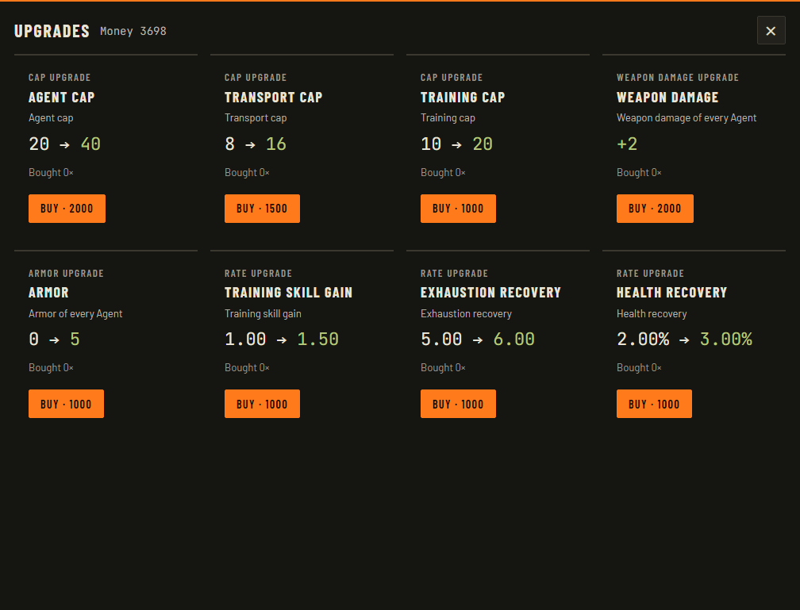

# Upgrades View

| Metadata | Value |
| --- | --- |
| Spec ID | UVIEW |
| Family | UI |
| Audience | UI designer, Implementer |
| Owns | What the Upgrades View of the Campaign screen shows and how it purchases Upgrades. |
| Conventions | [Specification Conventions](../../../governance/conventions/spec-conventions.md), [Design Specification Conventions](../../../governance/conventions/design-spec-conventions.md) |

# Overview

The Upgrades View is where the Player spends money on the agency itself, so it shows for each [Upgrade](../../mechanics/domain-model.md#agency-and-agents) what one more purchase changes and whether the agency can afford it. It is the second of the Base [Detail views](../gui.md#glossary) of the [Campaign Screen](campaign-screen.md). Its header shows the agency's money.

# Upgrade cards

The [Upgrades](../../mechanics/domain-model.md#agency-and-agents) are [cards](../visual-design.md#panels-and-cards), one per Upgrade [GDR](../../foundation/core-concepts.md#game-build-and-content) of the [Game build](../../foundation/core-concepts.md#game-build-and-content), in the order the Game build supplies them. Each card shows:

- Its `name` and its kind: [Cap Upgrade](../../mechanics/economy-and-upgrades.md#glossary), [Max health Upgrade](../../mechanics/economy-and-upgrades.md#glossary), or [Rate Upgrade](../../mechanics/economy-and-upgrades.md#glossary).
- What one more acquisition [changes](../../mechanics/economy-and-upgrades.md#upgrade-effects), by its `effect` and `increment`: the value it changes, and that value now and after one more acquisition:
  - **Cap Upgrade:** the [cap](../../mechanics/economy-and-upgrades.md#agency-caps) it raises, e.g. "Agent cap" and "12 → 14".
  - **Max health Upgrade:** only the [Increment](../../mechanics/economy-and-upgrades.md#glossary) it adds to the [effective max health](../../mechanics/agents-spec.md#combatant-attributes) of every [Serving](../../mechanics/agents-spec.md#agent-statuses) [Agent](../../mechanics/domain-model.md#agency-and-agents), e.g. "Max health of every Agent" and "+1".
  - **Rate Upgrade:** the [rate](../../mechanics/economy-and-upgrades.md#rate-upgrades) it raises, each value [with two decimals](../gui.md#decimal-quantities-shown), e.g. "Exhaustion recovery" and "5.00 → 5.50", and the health recovery percentage as a percentage, e.g. "2.00% → 2.20%".
- Its [Acquisitions](../../mechanics/economy-and-upgrades.md#glossary) so far, as a count, e.g. "Bought 2×", and as a [tally](../visual-design.md#tallies).
- A primary Buy button labelled with its `price`, e.g. "Buy · 120", which makes one [`purchaseUpgrade`](../../mechanics/economy-and-upgrades.md#purchasing-upgrades) [Player action](../../foundation/engine-contract.md#player-actions-and-turns). While money is below the price, the button is disabled and the card says in Danger how much money is missing, e.g. "40 missing".

# Screenshot

The Upgrades View as the game draws it:

_Captured on 2026-11-23 19:47 UTC._
