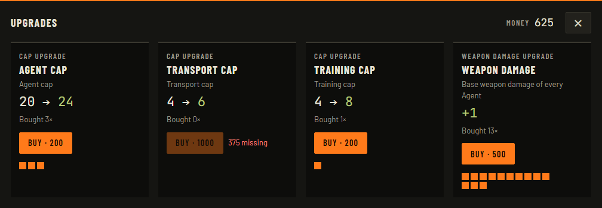

# Upgrades View

| Metadata | Value |
| --- | --- |
| Spec ID | UVIEW |
| Family | UI |
| Audience | UI designer, Implementer |
| Owns | What the Upgrades View of the Campaign screen shows and how it purchases Upgrades. |
| Conventions | [Specification Conventions](../../../governance/conventions/spec-conventions.md), [Design Specification Conventions](../../../governance/conventions/design-spec-conventions.md) |

# Overview

The Upgrades View is where the Player spends money on the agency itself, so it shows for each [Upgrade](../../mechanics/domain-model.md#agency-and-agents) what one more purchase changes and whether the agency can afford it. It is the last of the Operations [Detail views](../gui.md#glossary) of the [Campaign Screen](campaign-screen.md). Its header shows the agency's money.

# Upgrade cards

The [Upgrades](../../mechanics/domain-model.md#agency-and-agents) are [cards](../visual-design.md#panels-and-cards) side by side, four to a row, one per Upgrade [GDR](../../foundation/core-concepts.md#game-build-and-content) of the [Game build](../../foundation/core-concepts.md#game-build-and-content), in the order the Game build supplies them. Each card shows:

- Its `name` and its kind: [Cap Upgrade](../../mechanics/economy-and-upgrades.md#glossary), [Weapon damage Upgrade](../../mechanics/economy-and-upgrades.md#glossary), [Max health Upgrade](../../mechanics/economy-and-upgrades.md#glossary), [Armor Upgrade](../../mechanics/economy-and-upgrades.md#glossary), or [Rate Upgrade](../../mechanics/economy-and-upgrades.md#glossary).
- What one more acquisition [changes](../../mechanics/economy-and-upgrades.md#upgrade-effects), by its `effect` and `increment`:
  - **Cap Upgrade:** the [cap](../../mechanics/economy-and-upgrades.md#agency-caps) it raises, with its current value and its value after one more acquisition, e.g. "Agent cap 12 → 14".
  - **Weapon damage Upgrade:** the [Increment](../../mechanics/economy-and-upgrades.md#glossary) it adds to the [effective weapon damage](../../mechanics/agents-spec.md#combatant-attributes) of every [Serving](../../mechanics/agents-spec.md#agent-statuses) [Agent](../../mechanics/domain-model.md#agency-and-agents), e.g. "+2 weapon damage".
  - **Max health Upgrade:** the Increment it adds to the [effective max health](../../mechanics/agents-spec.md#combatant-attributes) of every Serving Agent, e.g. "+1 max health".
  - **Armor Upgrade:** the [effective armor](../../mechanics/agents-spec.md#combatant-attributes) of a Serving Agent, with its current value and its value after one more acquisition, e.g. "Armor 2 → 3". It is the `base_armor` of the Armor that the AgentArchetype's `armor` references plus the [Upgrade bonus](../../mechanics/economy-and-upgrades.md#glossary) of `agent_armor`, and it is shown even while the [Agency](../../mechanics/domain-model.md#agency-and-agents) has no Serving Agent.
  - **Rate Upgrade:** the [rate](../../mechanics/economy-and-upgrades.md#rate-upgrades) it raises, with its current value and its value after one more acquisition, each [with two decimals](../gui.md#decimal-quantities-shown), e.g. "Exhaustion recovery 5.00 → 5.50". The health recovery percentage is shown as a percentage, e.g. "Health recovery 2.00% → 2.20%".
- Its [Acquisitions](../../mechanics/economy-and-upgrades.md#glossary) so far, as a count, e.g. "Bought 2×".
- A primary Buy button labelled with its `price`, which makes one [`purchaseUpgrade`](../../mechanics/economy-and-upgrades.md#purchasing-upgrades) [Player action](../../foundation/engine-contract.md#player-actions-and-turns). While money is below the price, the button is disabled and the card says how much money is missing, in Danger, beside the button.
- Below the Buy button, a [tally](../visual-design.md#tallies) of its Acquisitions.

# Artboard

The sample values, e.g. the Upgrade names, prices, and caps, [appear only on the Artboard](../visual-design.md#reading-artboards).
