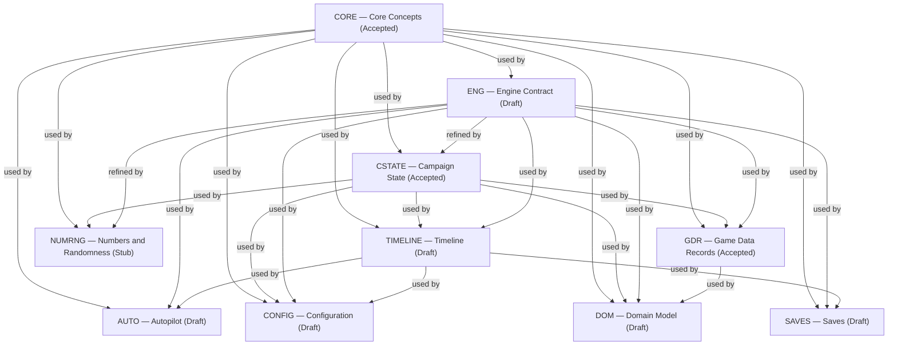
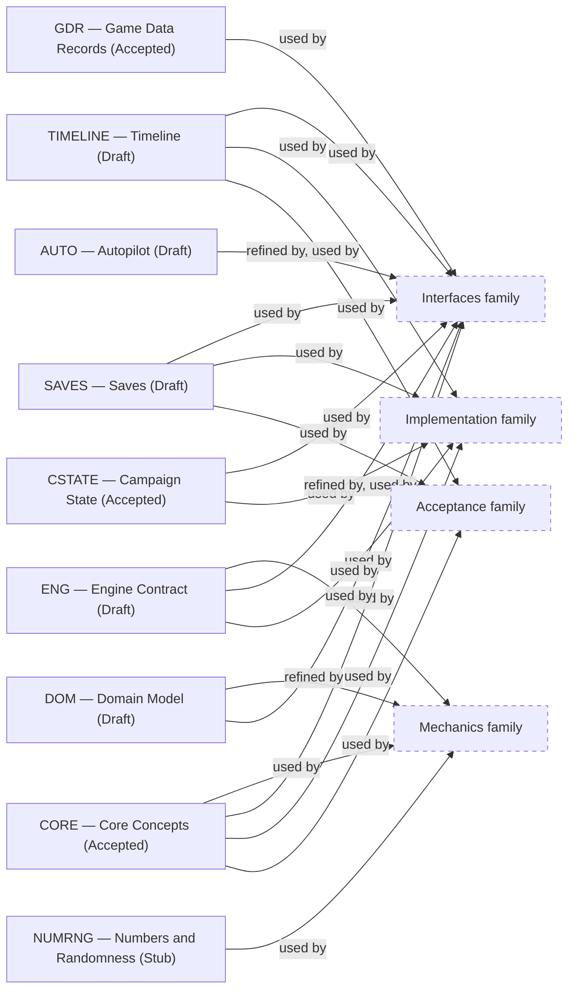

# About the Foundation family

> Informative overview. It owns no rules; each linked specification owns its content.

# What this family is for

Foundation specifications hold the cross-cutting contracts that every other part of the game builds on: shared
vocabulary, engine guarantees, campaign-data structure, the engine subsystems, the domain itself, and the numeric
machinery. Mechanics, Content, Interfaces, Acceptance, and Implementation documents all depend on them; none of
them is about a single game system.

The family reads from abstract to concrete: words, then engine promises, then data rules, then one document per engine
subsystem, then game concepts.

# Documents

## Core Concepts

[Core Concepts](core-concepts.md) answers _what do the shared words mean?_ It owns the vocabulary used across the whole
game contract, e.g. Campaign, Session, and Game build. It defines meanings only, not behavior, data layout, or
mechanics: Engine Contract owns what a Session holds and what is persisted, and Campaign State owns how
Campaign state divides into components. Nearly every other specification uses it, so each term has a single
definition.

## Engine Contract

[Engine Contract](engine-contract.md) answers _what does the engine guarantee, whatever subsystem is involved?_ It owns
the API hierarchy, the data the engine owns and what is persisted, the campaign lifecycle, player queries and actions,
which values a rule uses during Advance turn, Dev mode, determinism, the information boundary, and Committed state integrity. It names the owner of each engine
subsystem without stating that subsystem's behavior.

## Campaign State

[Campaign State](campaign-state.md) answers _how must campaign data be structured?_ It owns
Campaign state composition, with its World state, Current world state, World history, and Campaign configuration terms,
Campaign instance structure, creation and identity, references, value classification, and historical fact preservation.
It refines Engine Contract's campaign-data integrity requirement into concrete data rules. It stays generic: the rules
would hold for any game built on this engine.

## Game Data Records

[Game Data Records](game-data-records.md) answers _what can a Game Data Record (GDR) be used for?_ It owns the six
purposes a GDR can serve and a worked example of each.

## Timeline

[Timeline](timeline.md) answers _how does the player go back and forward?_ It owns undo and redo by action and by turn,
and what a restored Timeline position guarantees.

## Saves

[Saves](saves.md) answers _what do saving and loading do?_ It owns what a Campaign save holds, saving, saving as new,
loading, the Save size limit, and which Campaign saves a Game build loads.

## Configuration

[Configuration](configuration.md) answers _where does each setting live, and which value applies?_ It owns the kinds
of setting, Global configuration, the Campaign configuration presets a Game build supplies, and the configuration
cascade.

## Autopilot

[Autopilot](autopilot.md) answers _how does an AI play on the player's behalf?_ It owns Autopilot limits, what an
Autopilot AI receives, how an Autopilot engagement ends, and Autopilot memory.

## Domain Model

[Domain Model](domain-model.md) answers _what exists in this game?_ It owns the game concepts and how they relate: the
Agency, Agents, Leads, Investigations, Missions, Combat, Factions, weapons, upgrades, and Reports. It applies Core
Concepts' vocabulary and Campaign State's rules to these concepts, and each Mechanics specification
refines one part of it with formulas and transitions.

## Numbers and Randomness

[Numbers and Randomness](numbers-and-randomness.md) answers _how are numbers and random draws made reproducible?_ It
owns numeric operations, units, generator state, and draw consumption, so that a campaign replays identically on every
supported runtime.

# How they relate

Core Concepts sits underneath everything. Engine Contract states the guarantees shared by every subsystem. Campaign
State and Numbers and Randomness refine those guarantees. Timeline, Saves, Configuration, and
Autopilot each use Engine Contract and own one subsystem outright. Game Data Records builds on Campaign State. Domain
Model uses Campaign State and Game Data Records to describe the actual game, and the Mechanics family refines Domain
Model in turn.

<!-- generated:family-diagram:start -->

_Generated from the specifications’ Relationships sections by `npm run docs:generate`; do not edit between the markers. Arrows run from Dependency to Dependent; dashed boxes stand for whole other Families._

## Within the family

## Across families

<!-- generated:family-diagram:end -->

# Why these boundaries

- **Core Concepts versus the rest:** vocabulary is shared by every family, so it cannot live inside any one of its
  users.
- **Engine Contract versus Campaign State:** engine behavior (e.g. sessions and access) and
  data shape (e.g. identity and references) change for different reasons. Keeping data rules in their own refinement lets
  Engine Contract stay about guarantees.
- **Campaign State versus Game Data Records:** the first holds the rules for data that changes during a Campaign; the
  second holds the uses of data that never changes during one.
- **Engine Contract versus Timeline, Saves, Configuration, and Autopilot:** Engine Contract holds only what is true
  across all subsystems, and each subsystem has exactly one owner. E.g., the rule for which Timeline position `undoTurn()`
  restores is stated once, in Timeline.
- **Timeline versus Saves:** World history, the Timeline, and a Campaign save all keep a Campaign's past, for different
  purposes. Undo and redo work without any Campaign save, and a Campaign save may omit its Timeline.
- **Campaign State versus Domain Model:** the first holds rules that would apply to any game on this engine;
  the second holds the concepts of this game. E.g., Factions can be redesigned without touching Campaign State,
  and reference integrity can be tightened without touching Domain Model.
- **Numbers and Randomness:** it refines an Engine Contract guarantee (reproducible calculation) that several
  Mechanics documents depend on, so it does not belong inside a single mechanic.
- **No turn schedule:** the order of rules within Advance turn has no document. Engine Contract gives the default,
  turn-start values, and each Mechanics document states its own exceptions, so the order follows from the rules.

# Reading order

1. [Core Concepts](core-concepts.md) for the vocabulary.
2. [Engine Contract](engine-contract.md) for what the engine promises and the data it owns.
3. [Campaign State](campaign-state.md) and [Game Data Records](game-data-records.md) for how campaign data is shaped.
4. [Timeline](timeline.md), [Saves](saves.md), [Configuration](configuration.md), and [Autopilot](autopilot.md) for
   the engine subsystems.
5. [Domain Model](domain-model.md) for the game's concepts.
6. [Numbers and Randomness](numbers-and-randomness.md) as needed.
