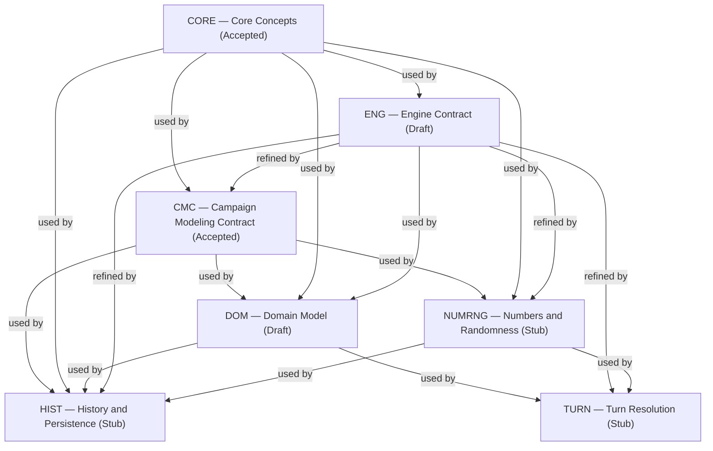
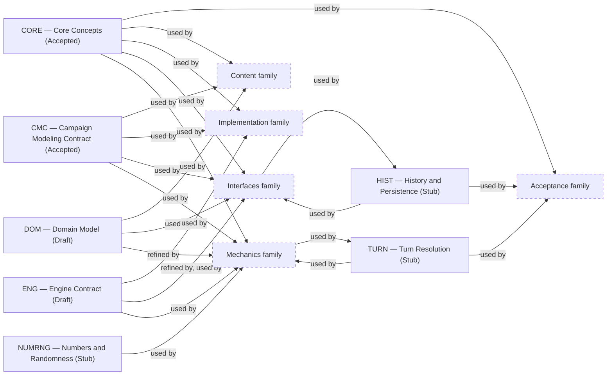

# About the Foundation family

> Informative overview. It owns no rules; each linked specification owns its content.

# What this family is for

Foundation specifications hold the cross-cutting contracts that every other part of the game builds on: shared
vocabulary, engine guarantees, campaign-data structure, the domain itself, and the numeric, timing, and history
machinery. Mechanics, Content, Interfaces, Acceptance, and Implementation documents all depend on them; none of them is about
a single game system.

The family reads from abstract to concrete: words, then engine promises, then data rules, then game concepts, with three
supporting execution contracts beside them.

# Documents

## Core Concepts

[Core Concepts](core-concepts.md) answers _what do the shared words mean?_ It owns the vocabulary used across the whole
game contract, e.g. Campaign, Session, and Game build. It defines meanings only, not behavior, data layout, or
mechanics: Engine Contract owns what a Session holds and what is persisted, and Campaign Modeling Contract owns how
Campaign state divides into components. Nearly every other specification uses it, so each term has a single
definition.

## Engine Contract

[Engine Contract](engine-contract.md) answers _what does the engine guarantee at runtime?_ It owns the API hierarchy,
the campaign lifecycle, including when a Session starts and ends and what it never persists, player queries and actions, Dev mode, Autopilot, action history, save and load, the information
boundary, and Game build compatibility. These are observable guarantees, not internal architecture. Most other
Foundation documents and the Interfaces family refine its requirements in more detail.

## Campaign Modeling Contract

[Campaign Modeling Contract](campaign-modeling-contract.md) answers _how must campaign data be structured?_ It owns
Campaign state composition, with its World state, Current world state, and Campaign configuration terms, Campaign
instance structure, creation and identity, references, value classification, historical fact preservation,
and the roles a Game Data Record (GDR) can play. It refines Engine Contract's campaign-data integrity requirement into
concrete data rules. It stays generic: the rules would hold for any game built on this engine.

## Domain Model

[Domain Model](domain-model.md) answers _what exists in this game?_ It owns the game concepts and how they relate: the
agency, Agents, Leads, Investigations, Missions, Combat, Factions, weapons, upgrades, and reports. It applies Core
Concepts' vocabulary and Campaign Modeling Contract's rules to these concepts, and each Mechanics specification
refines one part of it with formulas and transitions.

## Numbers and Randomness

[Numbers and Randomness](numbers-and-randomness.md) answers _how are numbers and random draws made reproducible?_ It
owns numeric operations, units, generator state, and draw consumption, so that a campaign replays identically on every
supported runtime.

## Turn Resolution

[Turn Resolution](turn-resolution.md) answers _when does each rule run, and what state does it read?_ It owns phase
order, calculation snapshots, and the atomic publication boundary of a turn. Mechanics specifications supply the
transitions; this document schedules them.

## History and Persistence

[History and Persistence](history-and-persistence.md) answers _how is a campaign's past kept, replayed, and saved?_ It
owns reversible campaign history, reproducible replay, and durable save and load behavior.

# How they relate

Core Concepts sits underneath everything. Engine Contract states the guarantees, and the other Foundation documents
refine them: Campaign Modeling Contract for data, and Numbers and Randomness, Turn Resolution, and History and
Persistence for execution. Domain Model uses Campaign Modeling Contract to describe the actual game, and the Mechanics
family refines Domain Model in turn.

<!-- generated:family-diagram:start -->

_Generated from the specifications’ Relationships sections by `npm run docs:generate`; do not edit between the markers. Arrows run from Dependency to Dependent; dashed boxes stand for whole other Families._

## Within the family

## Across families

<!-- generated:family-diagram:end -->

# Why these boundaries

- **Core Concepts versus the rest:** vocabulary is shared by every family, so it cannot live inside any one of its
  users.
- **Engine Contract versus Campaign Modeling Contract:** engine behavior (e.g. sessions, Autopilot, save and load) and
  data shape (e.g. identity, references, GDR roles) change for different reasons. Keeping data rules in their own refinement lets
  Engine Contract stay about guarantees.
- **Campaign Modeling Contract versus Domain Model:** the first holds rules that would apply to any game on this engine;
  the second holds the concepts of this game. E.g., Factions can be redesigned without touching Campaign Modeling Contract,
  and reference integrity can be tightened without touching Domain Model.
- **Numbers and Randomness, Turn Resolution, and History and Persistence:** each refines a distinct Engine Contract
  guarantee (reproducible calculation, phase timing, reversible history) that several Mechanics documents depend on, so
  none of them belongs inside a single mechanic.

# Reading order

1. [Core Concepts](core-concepts.md) for the vocabulary.
2. [Engine Contract](engine-contract.md) for what the engine promises.
3. [Campaign Modeling Contract](campaign-modeling-contract.md) for how campaign data is shaped.
4. [Domain Model](domain-model.md) for the game's concepts.
5. [Numbers and Randomness](numbers-and-randomness.md), [Turn Resolution](turn-resolution.md), and
   [History and Persistence](history-and-persistence.md) as needed.
