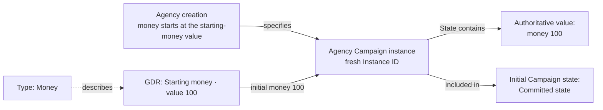
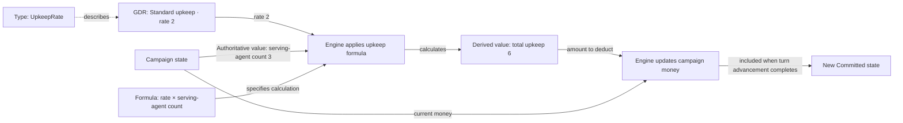
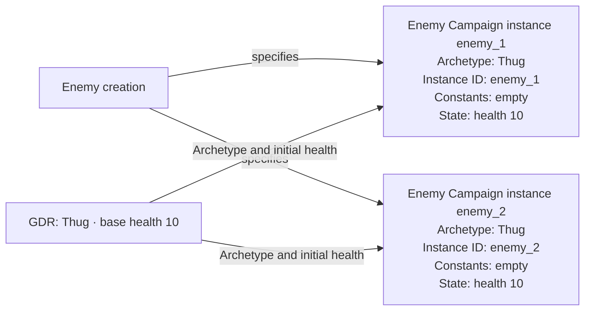
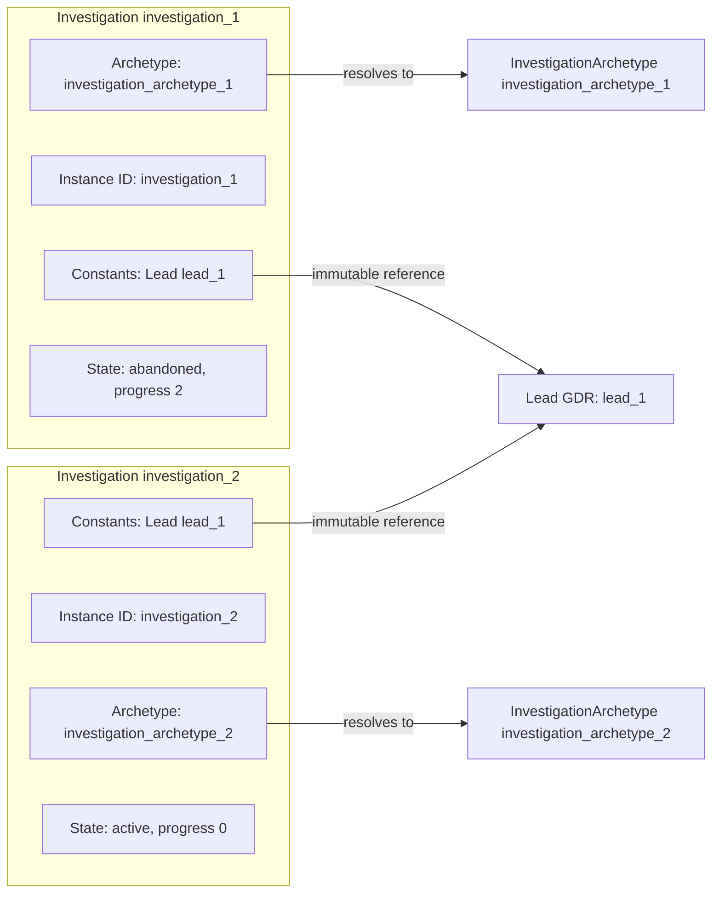
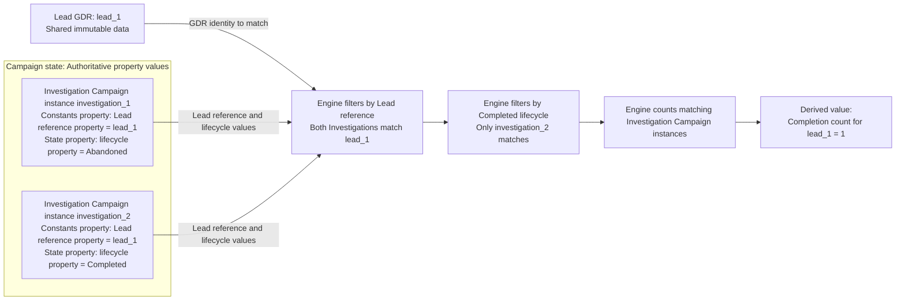
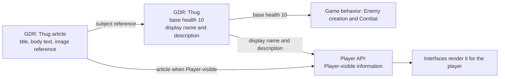

# Campaign Modeling Contract

| Metadata    | Value                                                          |
| ----------- | -------------------------------------------------------------- |
| Spec ID     | CMC                                                            |
| Family      | Foundation                                                     |
| Status      | Accepted                                                       |
| Audience    | Engine designer, Content designer, Implementer                 |
| Conventions | [Specification conventions](../governance/spec-conventions.md) |

# Overview

This document defines campaign-data composition, Campaign instance creation, identity, reference integrity, value classification, and historical preservation. These constraints apply to Campaign state, not the complete engine API hierarchy. Session authority, Autopilot orchestration, API signatures, and interface behavior belong to their owning contracts.

The Game Design Brief supplies strategic intent; mechanics specifications own detailed gameplay behavior.

# Relationships

- Uses [Core Concepts](./core-concepts.md)
- Refines [Engine Contract](./engine-contract.md)
- Used by [Campaign](../mechanics/campaign.md)
- Used by [Developer API](../interfaces/developer-api.md)
- Used by [Domain Model](./domain-model.md)
- Used by [Gameplay Dependency Direction](../guidance/gameplay-dependency-direction.md)
- Used by [History and Persistence](./history-and-persistence.md)
- Used by [Initial Campaign Content](../content/initial-campaign.md)
- Used by [Numbers and Randomness](./numbers-and-randomness.md)
- Used by [Player Information](../interfaces/player-information.md)
- Used by [TypeScript Player API](../interfaces/typescript-api.md)

# Glossary

Shared modeling and execution vocabulary is owned by [Core Concepts](core-concepts.md#glossary), including Campaign
state. The terms below add campaign-specific composition; Instance ID identity constraints are specified under
[Campaign instance identity](#campaign-instance-identity).

## Campaign state components

The components into which Campaign state divides, and whether model data stays available.

| Term                   | Definition                                                                                                                                                                                                                                               |
| ---------------------- | -------------------------------------------------------------------------------------------------------------------------------------------------------------------------------------------------------------------------------------------------------- |
| World state            | The component of Campaign state describing the simulated world and its progression, composed of Current world state and History, distinct from Campaign configuration.                                                                                   |
| Current world state    | The subcomponent of World state other than History: the simulated world as it stands at the selected history position. After undo, it is the state at that earlier position, not the furthest position reached.                                          |
| History                | The subcomponent of World state containing retained data describing past Campaign state or events, including past Campaign configuration values or changes. Game behavior and reports may consult History.                                               |
| Campaign configuration | The component of Campaign state containing campaign-specific parameters that select or adjust gameplay behavior and may be changed through permitted operations during play.                                                                             |
| Retained               | Describes model data kept available for rules, reports, reference resolution, or restoration. Retained describes availability; History describes data about past Campaign state or events. Retention does not establish mutability or a lifecycle state. |

## Campaign instances

The composition of each Campaign instance.

| Term              | Definition                                                                                                                                                                                                                                                 |
| ----------------- | ---------------------------------------------------------------------------------------------------------------------------------------------------------------------------------------------------------------------------------------------------------- |
| Campaign instance | A particular occurrence within a Campaign of a declared Type, with Instance ID, an Archetype reference, Constants, and State.                                                                                                                              |
| Instance ID       | The identifier of one Campaign instance, unique within a declared identity scope and stable for the Campaign instance's lifetime. It is a [Campaign-scoped identifier](engine-contract.md#glossary).                                                       |
| Archetype         | A GDR referenced by a Campaign instance, supplying shared characteristics and initial values. It is shared immutable data, never instantiated; the Campaign instance’s Archetype reference is set when the Campaign instance is created and never changes. |
| State             | Values owned by this Campaign instance that may change under gameplay rules. State is specific to this Campaign instance and is distinct from Campaign state, which describes the whole playthrough.                                                       |
| Constants         | Values owned by this Campaign instance that remain fixed for its lifetime. A reference stored in Constants has a fixed target; it does not require the target’s State to remain fixed.                                                                     |

# Campaign data integrity refinement

This document refines [Campaign data integrity](engine-contract.md#campaign-data-integrity),
[Continuation state](engine-contract.md#continuation-state), and
[Committed state integrity](engine-contract.md#committed-state-integrity) in Engine Contract by specifying the
composition, initialization, identity, reference, and historical-preservation constraints that campaign creation,
committed mutations, and restoration must preserve. It supplies campaign modeling detail without defining API authority
or execution sequencing. Core Concepts supplies the shared vocabulary used to express these constraints.

# Campaign state composition

Campaign state has the following complete conceptual hierarchy. History is a subcomponent of World state.

```text
Campaign state
├── World state
│   ├── Current world state
│   └── History
└── Campaign configuration
```

Campaign state includes both World state and Campaign configuration. E.g., an Investigation's progress is
World state, while a campaign-wide investigation difficulty multiplier is Campaign configuration. Both belong to
the particular Campaign, regardless of which Session selects it. Campaign configuration supplies inputs to game
behavior; changing it does not modify the Game build's game behavior or immutable GDRs.

World state divides into Current world state and History. E.g., an Agent's current health is Current world
state, while a record of the missions that Agent took part in is History. History is a subcomponent of World state,
including when it records past Campaign configuration values or changes.
Current Campaign configuration belongs to its own component of Campaign state; historical records about it belong
to History within World state. This conceptual hierarchy does not require a particular storage layout. What Campaign
state excludes is stated under [Campaign lifecycle](engine-contract.md#campaign-lifecycle) in Engine Contract.
Mechanics specify permitted configuration changes and when their effects apply.

Every Campaign instance is part of World state, never of Campaign configuration. A Campaign instance that participates
in current gameplay is part of Current world state. When a Campaign instance no longer participates in current
gameplay, its data that must remain available is part of History, under
[Historical fact preservation](#historical-fact-preservation). Placing a Campaign instance in this hierarchy does not
change its four properties under [Campaign instance structure](#campaign-instance-structure).

# Campaign initialization

Campaign initialization receives setup inputs and immutable Game Data Records (GDRs) supplied by the Game build, and
produces the initial Campaign state from them as the specifications owning campaign creation describe. GDRs supply
data; specifications describe calculations and permitted behavior, including which Campaign instances the initial
Campaign state contains, under [Campaign instance creation](#campaign-instance-creation). A GDR is data, not game
behavior. The engine performs every operation: it reads GDRs and carries out the specified game behavior, and a GDR
performs no operation. Exact starting data and balance
values are outside this document's ownership. Session lifecycle and publication of Committed state belong to Engine Contract.

# Campaign instances

## Campaign instance structure

A Campaign instance Type always has exactly four properties: Instance ID, an Archetype reference, Constants, and State.
Every Campaign instance has exactly these four properties. The singleton Agency is not exempt: its Archetype reference
is required like that of any other Campaign instance.

The four-property shape is the ubiquitous language for Campaign instances. It is chosen for uniformity and ease of
reasoning: every Campaign instance is described, compared, and inspected in the same terms. The shape therefore
belongs in this specification under the vocabulary criterion of
[What belongs in a specification](../governance/spec-conventions.md#what-belongs-in-a-specification) and must not be
removed or weakened as an implementation detail.

Developer API full Campaign state inspection presents each Campaign instance as its Instance ID, Archetype reference,
Constants, and State. How an implementation stores Campaign instances internally is the implementer's choice.

## Campaign instance creation

Creation of a Campaign instance, during campaign initialization or gameplay, is specified by the specification that
owns the creating behavior. That specification states when the Campaign instance is created, its Type, and the initial
values of its Archetype reference, Constants, and State, together with the source of each value; e.g., a named GDR or a
value in Campaign state. The initial values need not all come from the Campaign instance's Archetype: the creating
specification may take some of them from another GDR, e.g. one serving the Initialization source purpose or a
Referenced GDR (e.g., the Lead GDR supplying an Investigation's hidden difficulty), or from a value in Campaign
state. Every newly created Campaign instance has a fresh Instance ID under
[Campaign instance identity](#campaign-instance-identity). Which code creates Campaign instances, and what that code
receives, is left to the implementer: the creating specification does not state that code, its signature, or its
dependencies. It states the resulting facts instead, e.g. which Campaign instance owns the new one.

## Campaign instance identity

Instance IDs are unique within their explicitly declared scope and stable for the Campaign instance’s lifetime.
Restoration, including undo/redo, preserves identity and immutable facts; uniqueness applies within the Campaign’s current timeline, excluding discarded futures.

# References

References identify a particular target and its expected Type. In Committed state, Campaign instance references must resolve
within the same Campaign; GDR references identify the GDR ID and must resolve against the current Game build.
Required historical references remain resolvable. Relationships must not be inferred from display names or identifier text.

References that can change belong in State; fixed references belong in Constants. Instance ID and the Archetype reference
are separate immutable properties. Reference mutability is independent of the target’s mutability.

# Value classification

Authoritative value and Derived value, including their independence from mutability and player visibility,
are defined in [Authoritative and Derived values](core-concepts.md#authoritative-and-derived-values) in Core Concepts. Each specification using these
concepts must declare which of its values are Authoritative values and which are Derived values. Retaining a past
calculation as a historical fact follows [Historical fact preservation](#historical-fact-preservation).

E.g., each Investigation Campaign instance has a Lead reference property within its Constants property and a lifecycle property
within its State property. The values of these two properties are Authoritative values. The completion count for a
Lead is a Derived value: count the Investigation Campaign instances whose Lead reference property identifies
that Lead GDR and whose lifecycle property has the value Completed. The count for lead_1 is 1 after investigation_2 completes; investigation_1’s Abandoned lifecycle
excludes it. No separate completion record or stored Authoritative completion count is required.

# Historical fact preservation

A past value cannot always be recovered from its current replacement. E.g., a report that needs enemy_1's original
health must retain that value of 10 or the original inputs needed to reconstruct it. Current health of 7 is not a
replacement for that historical fact. When a rule or report needs the historical basis, the original inputs or historical
value must be preserved; required historical values must not be overwritten with current calculations. This does not
require retaining every intermediate calculation or every possible chart.

When a Campaign instance no longer participates in current gameplay, data required by rules, reports, or retained
references must remain in History rather than being deleted. E.g., if enemy_1 no longer participates in a Mission,
a retained reference to enemy_1 must still resolve. Retention does not introduce a separate lifecycle state or transition
name or require moving data into a separate storage location. Consuming specifications must declare which lifecycle
changes require retention and which data must remain available. The Instance ID and relationships needed to resolve
retained references must be preserved under [Campaign instances](#campaign-instances) and [References](#references).
An evolving collection can contain immutable historical records: e.g., adding a Battle result does not permit rewriting
an earlier retained Battle result.

# Purposes of GDRs

GDRs can serve the following six purposes. The purposes can overlap; they do not define separate Types or required
implementation interfaces. Each of the following sections is a worked example of one purpose.

| Purpose                | How the engine uses the GDR                                                                                                                                                             | Example                                                                                      |
| ---------------------- | --------------------------------------------------------------------------------------------------------------------------------------------------------------------------------------- | -------------------------------------------------------------------------------------------- |
| Initialization source  | [Campaign instance creation](#campaign-instance-creation) takes a GDR’s value as the initial value of a property of a new Campaign instance.                                            | A newly created Agency has money 100, the value of the starting-money GDR.                   |
| Calculation parameter  | The engine reads a GDR when computing a Derived value.                                                                                                                                  | The engine reads the rate from the Standard upkeep GDR to calculate upkeep.                  |
| Archetype              | A Campaign instance references the GDR as its Archetype; the GDR supplies shared characteristics and initial values named by [Campaign instance creation](#campaign-instance-creation). | A newly created Enemy whose Archetype is Thug has current health 10 and a fresh Instance ID. |
| Referenced GDR         | A Campaign instance holds a reference to a GDR other than its Archetype.                                                                                                                | An Investigation holds a reference to the Lead GDR it pursues.                               |
| Key for campaign facts | Campaign state holds facts keyed by a GDR’s identity while the GDR remains immutable.                                                                                                   | The engine records completions against a Lead GDR’s identity.                                |
| Display content        | No game behavior reads the GDR's value; the engine exposes it to the player through Player API, subject to Player-visible information boundaries.                                       | The Thug GDR's display name and description appear in the enemy list and the encyclopedia.   |

# GDR purpose: initialization source

Consider an illustrative creation of the Agency with starting money:

| Element                | Modeling role                                             | Meaning in this example                                                                                                                   |
| ---------------------- | --------------------------------------------------------- | ----------------------------------------------------------------------------------------------------------------------------------------- |
| Money                  | Type                                                      | Describes a nonnegative integer amount of money.                                                                                          |
| Starting money         | GDR                                                       | Has Type Money and value 100.                                                                                                             |
| Agency creation        | [Campaign instance creation](#campaign-instance-creation) | Campaign creation creates one Agency Campaign instance with a fresh Instance ID and money in State equal to the starting-money GDR value. |
| Agency                 | Campaign instance                                         | The newly created Agency Campaign instance, with money 100 in State.                                                                      |
| Agency money           | Authoritative value                                       | Initially 100 in the Agency Campaign instance’s State.                                                                                    |
| Initial Campaign state | Committed state                                           | Contains the Agency Campaign instance when campaign creation completes.                                                                   |

Starting money is an Initialization source distinct from the Agency's Archetype so that a campaign can vary that one
value through a separate GDR while the Archetype stays the same.

The example shows only the money initial value; the specification owning Agency creation also states the Agency's
other initial values. When campaign creation completes, the initial Campaign state contains an Agency Campaign instance with a fresh
Instance ID and money 100 in State, the value of the starting-money GDR. The engine publishes the initial Committed
state when campaign creation completes.



If an expense later reduces Agency money to 90, the engine reads 90 from the Agency Campaign instance’s State.
The starting-money GDR still contains the initial value of 100.

# GDR purpose: calculation parameter

Consider an illustrative upkeep calculation for agents serving in a campaign. Its complete local setup is:

| Element             | Modeling role       | Meaning in this example                                                     |
| ------------------- | ------------------- | --------------------------------------------------------------------------- |
| UpkeepRate          | Type                | Describes a nonnegative integer amount of money per serving agent per turn. |
| Standard upkeep     | GDR                 | Has Type UpkeepRate and value 2 money per serving agent per turn.           |
| Serving-agent count | Authoritative value | Value in Campaign state, currently 3.                                       |
| Upkeep calculation  | Formula             | Upkeep for one turn equals the rate multiplied by the serving-agent count.  |
| Total upkeep        | Derived value       | 2 × 3 = 6 money for this turn.                                              |
| Upkeep deduction    | State change        | Deduct total upkeep from Agency money.                                      |

During "advance turn" computation, the engine reads the rate of 2 from the Standard upkeep GDR, which conforms to
Type UpkeepRate, and the serving-agent count of 3, an Authoritative value in Campaign state. The engine applies the
upkeep formula to these inputs, producing total upkeep of 6, a Derived value. Applying the upkeep deduction, the engine deducts 6 from the campaign's current money; the updated
money becomes part of the new Committed state, which is the result of turn advancement completion.



# GDR purpose: archetype

Consider an illustrative creation of two Enemy Campaign instances whose Archetype is the same Thug GDR:

| Element             | Modeling role                                             | Meaning in this example                                                                                                                                                                  |
| ------------------- | --------------------------------------------------------- | ---------------------------------------------------------------------------------------------------------------------------------------------------------------------------------------- |
| Enemy               | Type                                                      | Describes the Enemy Campaign instances.                                                                                                                                                  |
| EnemyArchetype      | Type                                                      | Describes the shared enemy characteristics and initial values.                                                                                                                           |
| Thug                | GDR serving the Archetype purpose                         | Has Type EnemyArchetype and base health 10.                                                                                                                                              |
| Enemy creation      | [Campaign instance creation](#campaign-instance-creation) | A newly created Enemy Campaign instance has a fresh Instance ID, its EnemyArchetype as its Archetype, empty Constants, and current health in State equal to the Archetype's base health. |
| enemy_1 and enemy_2 | Campaign instances                                        | Distinct Enemy Campaign instances sharing Thug as their Archetype, with independent State and Constants.                                                                                 |
| Current health      | Authoritative value                                       | Initially 10 in each Enemy Campaign instance’s State.                                                                                                                                    |

Each newly created Enemy Campaign instance whose Archetype is Thug has current health 10 in State and its own fresh
Instance ID; here the two Instance IDs are enemy_1 and enemy_2. Each belongs to its owning Mission.
Both Enemy Campaign instances refer to the same GDR; damaging enemy_1 changes its health without changing enemy_2 or Thug.



# GDR purpose: referenced GDR

When serving the Referenced GDR purpose, a GDR is referenced by a Campaign instance other than as its Archetype.
Consider an illustrative Lead and an Investigation of that Lead. The complete comparison needed here is:

| Example concept        | Modeling role                                                                                                                                   | Question it answers                                                        |
| ---------------------- | ----------------------------------------------------------------------------------------------------------------------------------------------- | -------------------------------------------------------------------------- |
| Lead                   | GDR serving the Referenced GDR purpose, representing a Lead to pursue.                                                                          | Which Lead can be pursued?                                                 |
| Investigation          | Campaign instance for investigation of a given Lead, with its own Instance ID, progress in State, and an immutable Lead reference in Constants. | Which Investigation concerns that Lead, and how has it progressed?         |
| InvestigationArchetype | GDR used as an Investigation's Archetype, supplying shared characteristics and initial values independently of the referenced Lead.             | What shared characteristics and initial values does the Investigation use? |

Suppose Lead lead_1 is referenced by Investigation investigation_1, created with InvestigationArchetype investigation_archetype_1. Its Instance ID is investigation_1; its Constants contains the
immutable Lead reference, and its State contains lifecycle initialized to active and progress initialized to 0, as an illustrative specification of Investigation creation would state. The archetype remains the separate shared
component. Adding the Lead reference does not create a fifth property or make lead_1 the Investigation's archetype.

For this example, investigation_1 reaches progress 2 and is abandoned. A new Investigation investigation_2 at lead_1 starts at progress 0 with its own Instance ID.
Use archetype investigation_archetype_2 for investigation_2 to show that the Investigation's Lead reference and Archetype are independent relationships. These
are symbolic GDRs without selected production properties or mechanics. The example assumes both combinations are
permitted; it does not define action preconditions or invariants governing them.



Both Investigations can share lead_1 without sharing progress. Retargeting investigation_1 to another Lead or replacing investigation_archetype_1 after creation
would violate its fixed facts. Using lead_1 as its archetype would fail the expected InvestigationArchetype reference,
regardless of whether some properties match.

# GDR purpose: key for campaign facts

When serving the Key for campaign facts purpose, a GDR’s identity associates campaign-specific facts with that GDR. The facts belong to Campaign state;
the GDR remains shared and immutable.

Continuing the illustrative Investigation example, suppose investigation_2 completes after investigation_1 was abandoned.
Campaign state retains both Investigation Campaign instances, including the values of the Lead reference property
within each Campaign instance’s Constants property and the lifecycle property within its State property.

| Element                                                                        | Modeling role                                  | Meaning in this example                                                                                                                                   |
| ------------------------------------------------------------------------------ | ---------------------------------------------- | --------------------------------------------------------------------------------------------------------------------------------------------------------- |
| lead_1                                                                         | GDR serving the Key for campaign facts purpose | Its identity selects the Investigations concerning this Lead; the GDR remains unchanged.                                                                  |
| Properties of completed investigations that denote to which leads they pertain | Authoritative values                           | The Lead reference property within the Constants property of the Completed Investigation Campaign instance investigation_2 identifies lead_1.             |
| Completion count for lead_1                                                    | Derived value                                  | Count Investigation Campaign instances whose Lead reference property identifies lead_1 and whose lifecycle property has value Completed. The result is 1. |

How to determine the Derived value of the completion count for the Lead GDR lead_1 from Authoritative values:

1. **Collect Investigations:** Start with all Investigation Campaign instances in the Campaign state.
2. **Filter by Lead reference:** For each Investigation Campaign instance, read the value of the Lead reference property within its Constants property. Keep only Campaign instances whose Lead reference identifies lead_1.
3. **Filter by Completed lifecycle:** For each remaining Investigation Campaign instance, read the value of the lifecycle property within its State property. Keep only Campaign instances whose lifecycle property has the value Completed.
4. **Count matching Investigations:** Count the remaining Investigation Campaign instances. The result is the Derived value of the completion count for lead_1. In this example, investigation_1 is excluded because its lifecycle property has the value Abandoned; investigation_2 is counted, so the result is 1.

The Lead reference and lifecycle property values read in steps 2 and 3 are Authoritative values.



# GDR purpose: display content

When serving the Display content purpose, a GDR supplies values that exist only for the player to see, e.g. names,
descriptions, in-game encyclopedia articles, and references to images or other media. Consider an illustrative Thug
enemy and its encyclopedia article:

| Element             | Modeling role                                          | Meaning in this example                                                                                        |
| ------------------- | ------------------------------------------------------ | -------------------------------------------------------------------------------------------------------------- |
| EnemyArchetype      | Type                                                   | Describes the shared enemy characteristics and initial values, including a display name and a description.     |
| Thug                | GDR serving the Archetype and Display content purposes | Has Type EnemyArchetype, base health 10, display name "Thug", and a one-sentence description.                  |
| EncyclopediaArticle | Type                                                   | Describes an encyclopedia article: a title, body text, an image reference, and a reference to its subject GDR. |
| Thug article        | GDR serving the Display content purpose                | Has Type EncyclopediaArticle, title "Thug", body text, an image reference, and a reference to the Thug GDR.    |

Combat reads Thug's base health 10 as its Archetype initial value; no game behavior reads its display name, its description,
or the Thug article. Through Player API, the engine exposes the display name and description wherever a Player-visible
view shows an Enemy whose Archetype is Thug, and exposes the Thug article in the encyclopedia once the player is
entitled to see it. The purposes overlap: Thug serves the Archetype and Display content purposes at once.

Display content follows these requirements:

- **No gameplay dependence:** No game behavior reads a value that serves the Display content purpose. Changing Display content
  in a Game build changes only what the player sees; equal initial Campaign state and the same ordered committed
  commands still produce equal Campaign state.
- **Visibility:** The engine exposes Display content only as Player-visible information. Display content describing
  something hidden from the player stays hidden until it becomes Player-visible.
  [Player Information](../interfaces/player-information.md) owns those visibility conditions.
- **No inference:** Relationships and gameplay facts are never inferred from Display content, extending the rule under
  [References](#references). The Thug article identifies its subject through its reference to the Thug GDR, not
  through its title.
- **Media:** A reference to an image or other media is a value in the GDR; the referenced media is part of the Game
  build. Media formats and loading are left to the implementation.



# Acceptance examples

- **Configuration and world:** A Campaign's investigation difficulty multiplier is Campaign configuration; its
  Investigation progress is World state. Both are Campaign state ([Campaign state composition](#campaign-state-composition)).
- **History within world:** A retained record of a past difficulty change belongs to History within World state;
  the current difficulty value belongs to Campaign configuration. Both are Campaign state
  ([Campaign state composition](#campaign-state-composition)).
