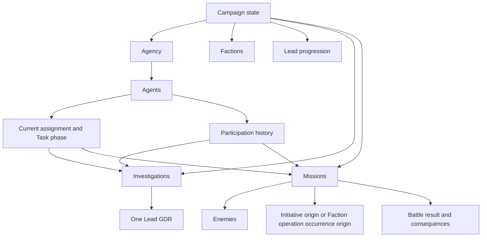

# Domain Model

| Metadata    | Value                                                          |
| ----------- | -------------------------------------------------------------- |
| Spec ID     | DOM                                                            |
| Family      | Foundation                                                     |
| Status      | Draft                                                          |
| Audience    | Engine designer, Content designer, AI designer, Implementer    |
| Conventions | [Specification conventions](../governance/spec-conventions.md) |

# Overview

This document defines what exists in the game and how those concepts relate. A Campaign contains one player-controlled
Agency that allocates Agents, pursues Leads, undertakes Missions, and opposes Factions.

It applies the vocabulary of [Core Concepts](core-concepts.md) and the rules of [Campaign State](campaign-state.md) to
these concepts without adding to either. Each concept is classified by its modeling role under
[Game concepts](#game-concepts). This document does not own, e.g., formulas and transitions, which belong to the
[Mechanics family](../mechanics/about-mechanics.md), or which properties the player sees, which belongs to
[Player Information](../interfaces/player-information.md). A concept can include facts hidden from the player.

# Relationships

- Uses [Campaign State](./campaign-state.md)
- Uses [Core Concepts](./core-concepts.md)
- Uses [Engine Contract](./engine-contract.md)
- Uses [Game Data Records](./game-data-records.md)
- Used by [Developer API](../interfaces/developer-api.md)
- Used by [Player Information](../interfaces/player-information.md)
- Used by [TypeScript Player API](../interfaces/typescript-api.md)
- Refined by [Agents](../mechanics/agents-spec.md)
- Refined by [Combat](../mechanics/combat.md)
- Refined by [Economy and Upgrades](../mechanics/economy-and-upgrades.md)
- Refined by [Factions](../mechanics/factions.md)
- Refined by [Investigations](../mechanics/investigations.md)
- Refined by [Leads and Progression](../mechanics/leads-and-progression.md)
- Refined by [Missions](../mechanics/missions.md)
- Refined by [Panic and Endings](../mechanics/panic-and-endings.md)

# Glossary

Campaign, Campaign state, Type, GDR, Authoritative value, and Derived value are defined by the
[Core Concepts glossary](core-concepts.md#glossary). Campaign instance, Instance ID, Archetype, Constants, State,
World history, and Campaign configuration are defined by the [Campaign State glossary](campaign-state.md#glossary). Committed state is defined by
the [Engine Contract glossary](engine-contract.md#glossary).

## Agency and Agents

The player-controlled organization, its Agents, and what each Agent is doing.

| Term               | Definition                                                                                                                                 |
| ------------------ | ------------------------------------------------------------------------------------------------------------------------------------------ |
| Agency             | The player-controlled Campaign instance Type whose Campaign instance owns resources, upgrades, and the roster of Agents within a Campaign. |
| Agent              | A Campaign instance Type whose Campaign instances have identity, attributes, Current assignments, and Participation history.               |
| Current assignment | An Agent's current orders, with activity references and a destination when travelling.                                                     |
| Task phase         | The distinction between At assignment and In transit, including travel timing facts.                                                       |

## Leads, Investigations, and Missions

The work the Agency discovers and undertakes.

| Term             | Definition                                                                                              |
| ---------------- | ------------------------------------------------------------------------------------------------------- |
| Lead             | A GDR representing a Lead to pursue and describing its progression rules.                               |
| Lead progression | Campaign state keyed by Lead GDR, recording earned facts that are not Derived values.                   |
| Investigation    | A Campaign instance Type whose Campaign instances each represent an Investigation of one Lead.          |
| Mission          | A Campaign instance Type whose Campaign instances each have their own origin, participants, and result. |
| Current team     | The Agents whose Current assignment references a given Investigation or Mission.                        |

## Combat

The participants and retained results of combat.

| Term          | Definition                                                                                                                                                                        |
| ------------- | --------------------------------------------------------------------------------------------------------------------------------------------------------------------------------- |
| Combatant     | Reusable structure described by a Type for combat-related Agent and Enemy state, describing skill, health, exhaustion, and weapon capability; it is not a Campaign instance Type. |
| Enemy         | A Campaign instance Type whose Campaign instances are each owned by one Mission.                                                                                                  |
| Battle result | Retained combat facts owned by a resolved Mission and used to determine its consequences for the Campaign.                                                                        |

## Factions

The opposing organizations and their operations.

| Term                         | Definition                                                                                                    |
| ---------------------------- | ------------------------------------------------------------------------------------------------------------- |
| Faction                      | A Campaign instance Type whose Campaign instances record an opposing organization's activity and progression. |
| Faction operation occurrence | The origin of one Response Mission, identified by that Mission rather than a separate Campaign instance.      |

## Retained records

Records kept to explain past gameplay.

| Term                  | Definition                                                                                                 |
| --------------------- | ---------------------------------------------------------------------------------------------------------- |
| Participation history | Immutable records linking Agents to Investigations and Missions in which they previously participated.     |
| Report                | Historical facts and explanations in World history, linked to commands or turns and to Campaign instances. |

# Game concepts

The following table is the complete set of concepts this specification declares, each with its modeling role.

| Concept                                       | Modeling role                                                                                | Multiplicity within one Campaign                                                                                                             |
| --------------------------------------------- | -------------------------------------------------------------------------------------------- | -------------------------------------------------------------------------------------------------------------------------------------------- |
| Agency                                        | Campaign instance Type                                                                       | Exactly one, under [Agency per Campaign](#agency-per-campaign)                                                                               |
| Agent                                         | Campaign instance Type                                                                       | Any number; roster limits belong to Economy and Upgrades                                                                                     |
| Investigation                                 | Campaign instance Type                                                                       | At most one Active Investigation per Lead, under [Leads and Investigations](#leads-and-investigations)                                       |
| Mission                                       | Campaign instance Type                                                                       | Any number; exactly one Response Mission per Faction operation occurrence, under [Mission kind and provenance](#mission-kind-and-provenance) |
| Enemy                                         | Campaign instance Type                                                                       | Any number, each belonging to exactly one Mission, under [Combat and consequences](#combat-and-consequences)                                 |
| Faction                                       | Campaign instance Type                                                                       | Undecided; see [Open decisions](../mechanics/factions.md#open-decisions) in Factions                                                         |
| Combatant                                     | Reusable structure described by a Type, within Agent and Enemy; not a Campaign instance Type | No Campaign instances                                                                                                                        |
| Lead                                          | GDR serving the Referenced GDR and Key for campaign facts purposes                           | Not a Campaign instance                                                                                                                      |
| Weapon and upgrade GDRs                       | GDRs                                                                                         | Not Campaign instances                                                                                                                       |
| Archetypes of the six Campaign instance Types | GDRs serving the Archetype purpose                                                           | Not Campaign instances; sharing an Archetype does not limit how many Campaign instances exist                                                |

GDR purposes are defined under [Purposes of GDRs](game-data-records.md#purposes-of-gdrs). Every Campaign instance of
the six Campaign instance Types has the four properties stated under
[Campaign instance structure](campaign-state.md#campaign-instance-structure). Each concept's section below names the
Mechanics specification that refines it.

Arrows show relationships, not inheritance.

# Campaign and Agency

A Campaign contains one Agency, the current turn, panic and the Campaign outcome, Lead progression, Agents, Factions,
Investigations, and Missions. The Agency owns money, recurring funding, upgrade acquisitions, and its roster of
Agents. Campaign-wide properties, e.g. the current turn and panic, belong directly to Campaign state, not to the
Agency.

## Agency per Campaign

Campaign state must contain exactly one Agency. Several Agencies in one Campaign, e.g. for multiplayer, and trading
between Campaigns are out of scope.

## Initial Campaign state

Everything a new Campaign starts with is either game data, supplied as GDRs by the Game build, or game behavior,
stated as rules in specifications. Among GDRs, only those serving the Campaign configuration preset purpose can be
overridden by the player before creation; every other GDR is fixed, e.g. a Faction's Archetype.

Which Campaign instances the initial Campaign state contains is the same for every new Campaign. No GDR serving the Campaign configuration preset purpose, under
[GDR purpose: campaign configuration preset](game-data-records.md#gdr-purpose-campaign-configuration-preset), adds,
removes, or selects an initial Campaign instance; e.g., no preset changes the initial roster of Agents, the initial
Factions, or the initial Missions. A Campaign configuration value can still supply an initial value of an initial
Campaign instance, e.g. starting money becomes the Agency's initial money, and can influence which Campaign instances
come into existence during play, e.g. a multiplier of how often Missions appear.

The initial Campaign state contains exactly one Agency, under [Agency per Campaign](#agency-per-campaign). For
each Campaign instance Type, the Mechanics specification that refines it states the rule determining the initial
Campaign instances of that Type and the source of each of their initial values, under
[Campaign instance creation](campaign-state.md#campaign-instance-creation); e.g., "the initial Campaign state contains
one Faction for each Faction Archetype the Game build supplies". The rule is game behavior; the content it reads is
supplied by GDRs that serve no Campaign configuration preset purpose, e.g. the Faction Archetypes and their values.
This section states what the initial
Campaign state contains, not which code creates it.

## Campaign instance identity scope

Agency, Agent, Investigation, Mission, Enemy, and Faction share one Instance ID scope: Instance IDs must be unique
across all six Types within one Campaign. A repeated Investigation or Mission is therefore a distinct Campaign
instance with its own Instance ID. [Campaign instance identity](campaign-state.md#campaign-instance-identity) owns the
general identity rules; this section declares the scope those rules require.

# Agent

An Agent's identity persists through its Current assignments and combat. An Agent has these aspects:

| Aspect                | Meaning                                                                                                                                                         |
| --------------------- | --------------------------------------------------------------------------------------------------------------------------------------------------------------- |
| Lifecycle             | Serving, Killed, or Dismissed; distinct from the Agent's Current assignment                                                                                     |
| Attributes            | Skill, health, exhaustion, and equipped weapon values, structured as a Combatant, and career statistics                                                         |
| Current assignment    | The Agent's current orders, including the destination while travelling; an Investigation or Mission Current assignment references that Investigation or Mission |
| Task phase            | At assignment or In transit, with the timing facts needed to describe travel                                                                                    |
| Participation history | The Investigations and Missions the Agent previously participated in                                                                                            |

Being an aspect of Agent does not determine whether a value is an Authoritative value or a Derived value; e.g.,
career statistics may be Derived values calculated from retained facts. [Agents](../mechanics/agents-spec.md) owns the
transitions between these states and the formulas for the attributes.

## Agent lifecycle

An Agent's lifecycle must distinguish Serving, Killed, and Dismissed. A Serving Agent must have exactly one Current
assignment and Task phase. A Killed or Dismissed Agent must have neither; its final attributes, career statistics, and
Participation history remain in World history under
[Historical fact preservation](campaign-state.md#historical-fact-preservation). Killed and Dismissed are lifecycle
states, not Current assignments.

## Orders and Task phase

The Current assignment of a Serving Agent must be exactly one of Standby, Contracting, Training, Investigation with a
reference to that Investigation, Mission with a reference to that Mission, and Recovery. Task phase must distinguish
At assignment from In transit. An Agent In transit keeps the Current assignment it is travelling to, with its
destination and the timing facts that Agents requires; transit is not a second Current assignment.

At assignment does not itself imply readiness. Agents owns which transitions and Task phase combinations are allowed,
which Current assignments require transit, and travel duration.

## Current versus historical teams

The Current team of an Investigation or Mission must agree with Current assignments: an Agent whose Current assignment
references Investigation I belongs to the Current team of I, including while In transit. Whether an Agent In transit
contributes is owned by Agents and [Investigations](../mechanics/investigations.md). An Agent cannot belong to more
than one Current team. In Committed state, the Agent-side and team-side views of Current team membership agree.

Participation history describes the same relationship for the past: an Agent's Participation history and the past
participants of an Investigation or Mission are one relationship seen from opposite sides. Agents recorded in
Participation history are not members of the Current team, and Participation history neither assigns nor reserves an
Agent; e.g., a concluded Mission retains an Agent's Participation history after that Agent is assigned elsewhere.

## Attribute bounds

For Agents and Enemies, maximum health must be positive; current health must be between zero and maximum health
inclusive; skill and exhaustion must be nonnegative. Serving Agents must have positive health, Killed Agents zero
health, and Dismissed Agents positive health. Agents owns dismissal eligibility, exhaustion caps, rounding, and
recovery formulas.

# Lead and Investigation

| Concept          | Meaning                                                                                                                                                 |
| ---------------- | ------------------------------------------------------------------------------------------------------------------------------------------------------- |
| Lead             | A GDR describing difficulty, repeatability, prerequisites, effects, and an optional explicit Faction reference                                          |
| Lead progression | Campaign state keyed by Lead GDR: earned facts that are not Derived values; discovery, availability, and completion count are Derived values            |
| Investigation    | A Campaign instance for investigation of one Lead, with progress, hidden difficulty, lifecycle, timing facts, a Current team, and Participation history |

A Lead is a Referenced GDR, distinct from the InvestigationArchetype that is the Investigation's Archetype, as
[GDR purpose: referenced GDR](./game-data-records.md#gdr-purpose-referenced-gdr) illustrates.
[Leads and Progression](../mechanics/leads-and-progression.md) owns discovery and unlock effects; Investigations owns
progress, completion probability, Current team changes, and abandonment.

## Leads and Investigations

An Investigation must retain its reference to one Lead GDR in Constants and distinguish the lifecycle states Active,
Completed, and Abandoned. At most one Active Investigation may exist for a Lead in a Campaign, whatever the Archetypes
of the Investigations of that Lead. In Committed state, an Active Investigation must have at least one Agent in its
Current team, and a Completed or Abandoned Investigation must have an empty Current team.

A Completed or Abandoned Investigation retains its Instance ID and Participation history. Starting an Investigation of
a Lead whose earlier Investigation was Abandoned creates another Investigation; the progress of the Abandoned
Investigation is not resumed. Investigations owns eligibility and progress-loss rules.

## Progression facts

Wins and earned unlocks must be explicit Authoritative values in Campaign state with source references where applicable.
Once recorded, a win or earned unlock therefore remains, even when the condition that earned it no longer holds, under
[Authoritative and Derived values](core-concepts.md#authoritative-and-derived-values) in Core Concepts.
A Lead's completion count is a Derived value, calculated from Investigation Campaign instances as
[Value classification](campaign-state.md#value-classification) describes; Lead progression holds no completion
record. Faction defeat and a Lead's Faction affiliation must not depend on specially spelled identifiers. Leads and
Progression owns the predicates and effects of progression facts.

# Mission, Enemy, and Combat

| Concept       | Meaning                                                                                                                                                                                                                                                              |
| ------------- | -------------------------------------------------------------------------------------------------------------------------------------------------------------------------------------------------------------------------------------------------------------------- |
| Mission       | A Campaign instance with Initiative or Response kind, origin, optional target Faction, deadline facts, lifecycle and outcome, Enemies, a Current team, Participation history, and a Battle result once resolved; its Archetype describes the encounter configuration |
| Enemy         | A Campaign instance owned by one Mission, with its own combat attributes structured as a Combatant; its Archetype is an EnemyArchetype                                                                                                                               |
| Combatant     | The structure shared by the combat-related state of Agents and Enemies; it adds no third Campaign instance Type                                                                                                                                                      |
| Battle result | Facts owned by the resolved Mission: participants, outcome, combat facts, and the measures needed for Mission consequences                                                                                                                                           |

[Combat](../mechanics/combat.md) owns battle resolution; [Missions](../mechanics/missions.md) owns deployment,
deadlines, rewards, and partial success.

## Mission kind and provenance

Mission Constants must retain Mission kind and provenance. A Mission is either an Initiative Mission, pursuing an
Agency objective, or a Response Mission, intervening against a Faction operation occurrence. An Initiative Mission
must retain its creation source; e.g., an Investigation or campaign creation. A Response Mission must retain its
Faction operation occurrence origin, which identifies the initiating Faction.

Each Faction operation occurrence creates exactly one Response Mission. Two Response Missions originating from the
same Faction are distinct Campaign instances. A Faction operation occurrence spanning several Missions, or having no
Response Mission, is out of scope. Target Faction and initiating Faction are explicit references, never inferred from
a Mission's name.

## Combat and consequences

An Enemy must belong to exactly one Mission. Enemies sharing an Archetype share neither Instance ID nor health. Combat
changes the participating Agent and Enemy Campaign instances themselves: the Agent changed by combat is the same Agent
that returns to the Agency. A Battle result is distinct from the Mission's consequences for the Campaign, so a failed
battle can still yield damage-related benefits. A Battle result must retain the facts that the partial-success formula
owned by Missions requires, and a retained Battle result is never rewritten, under
[Historical fact preservation](campaign-state.md#historical-fact-preservation).

# Faction and Faction operation occurrences

A Faction is a Campaign instance with activity, Faction operation occurrence clocks, suppression, and defeat and
progression facts. Its Archetype supplies its descriptive identity and configuration.

A Faction operation occurrence is the origin of one Response Mission: its initiating Faction, severity, type, and
creation facts are values in that Mission's Constants, and that Mission's Instance ID identifies the Faction operation
occurrence. It is not a separate Campaign instance. [Factions](../mechanics/factions.md) owns escalation, Faction
operation occurrence generation, suppression, and defeat.

# Weapons and upgrades

Weapon GDRs describe damage configuration. Equipped weapon values and their modifications during a Campaign belong to
the Combatant structure of an Agent or Enemy; individual inventory items are out of scope. Upgrade GDRs supply shared
upgrade data; acquisitions and their amount or level belong to the Agency.
[Economy and Upgrades](../mechanics/economy-and-upgrades.md) owns acquisition costs, capacity accounting, and upgrade
effects.

# Reports

A Report links historical facts and explanations in World history to commands or turns and to Campaign instances. A
Report explaining a retained Battle result uses the retained values, never current calculations, under
[Historical fact preservation](campaign-state.md#historical-fact-preservation).
[Player Information](../interfaces/player-information.md) owns the visible properties of a Report.

# Edge cases and failure behavior

| Case                                                                        | Result and owner                                                                                                                                                         |
| --------------------------------------------------------------------------- | ------------------------------------------------------------------------------------------------------------------------------------------------------------------------ |
| An Agent is In transit to an Investigation                                  | The Agent belongs to its Current team; arrival and progress timing belong to Agents and Investigations                                                                   |
| The last Agent leaves the Current team of an Active Investigation           | No Committed state contains an Active Investigation with an empty Current team; the resulting lifecycle and numerical effects belong to Investigations                   |
| An Investigation concludes while members of its Current team are In transit | In the next Committed state no Current assignment references it; the replacement Current assignments belong to Agents and Investigations                                 |
| A concluded Mission retains an Agent in its Participation history           | The Agent's Current assignment is not reserved, under [Current versus historical teams](#current-versus-historical-teams)                                                |
| The roster is empty, or no Missions or Investigations exist                 | Valid; [Panic and Endings](../mechanics/panic-and-endings.md) owns defeat conditions                                                                                     |
| A Faction is defeated with outstanding Missions or Leads                    | References remain resolvable under [References](campaign-state.md#references); Factions, Leads and Progression, and Missions own the resulting availability and outcomes |

# Acceptance examples

These are structural fixtures, not playable scenarios or API signatures. Symbolic identifiers are labels, not a chosen
identifier format. Numbers below are exact test-only integers, not campaign balance. All other scalar values owned by
Mechanics specifications are assumed valid for these structural checks.

## A. Valid relationships

Given turn 3 and:

- Campaign state c1 with its single Agency ag1.
- Archetypes supplied by the current Game build: G1 (Agency), A1 (Agent), I1 (Investigation), M1 (Mission),
  F1 (Faction), and E1 (Enemy), plus the GDRs L1 (Lead) and W1 (weapon). These are test GDRs with no other required
  properties in this fixture.
- Faction f1 with Archetype F1.
- Serving Agent a1 assigned to Investigation i1, In transit.
- Serving Agent a2 assigned to Mission m1, At assignment.
- Active Investigation i1 referring to L1, Current team {a1}.
- Initiative Mission m1 with Archetype M1, originating from campaign creation, targeting f1, Current team {a2}.
- Enemy e1 owned by m1, with Archetype E1.
- Each Agent and Enemy has skill 100, health 10 of maximum health 10, exhaustion 0, and equipped values referring to W1.
- Other collections empty.

Each Campaign instance has the following complete allocation of properties for this fixture:

| Campaign instance | Instance ID         | Archetype | Constants                                                        | State                                                                                                      |
| ----------------- | ------------------- | --------- | ---------------------------------------------------------------- | ---------------------------------------------------------------------------------------------------------- |
| ag1               | ag1                 | G1        | Empty                                                            | Resources, upgrades, roster {a1, a2}                                                                       |
| a1, a2            | a1, a2 respectively | A1        | Agency ag1                                                       | Lifecycle, Current assignment, Task phase, combat attributes, career statistics, and Participation history |
| i1                | i1                  | I1        | Lead L1                                                          | Active lifecycle, progress, Current team {a1}, Participation history                                       |
| m1                | m1                  | M1        | Initiative kind; campaign-creation provenance; target Faction f1 | Current team {a2}, Enemies {e1}, resolution status, and retained Battle results                            |
| e1                | e1                  | E1        | Mission m1                                                       | Combat attributes                                                                                          |
| f1                | f1                  | F1        | Empty                                                            | Activity and progression                                                                                   |

Campaign state c1 holds turn 3, Lead progression, and collections containing Agency ag1, Agents a1 and a2,
Investigation i1, Mission m1, and Faction f1; e1 is reached through m1. Required references resolve in c1. Immutable
affiliation and target references are assumptions of this fixture, not lifecycle rules.

These relationships satisfy [Agency per Campaign](#agency-per-campaign),
[Campaign instance identity scope](#campaign-instance-identity-scope), [Agent lifecycle](#agent-lifecycle),
[Orders and Task phase](#orders-and-task-phase), [Current versus historical teams](#current-versus-historical-teams),
[Attribute bounds](#attribute-bounds), [Leads and Investigations](#leads-and-investigations),
[Mission kind and provenance](#mission-kind-and-provenance), and [Combat and consequences](#combat-and-consequences).
Current team membership does not assert that a1 makes progress while In transit.

## B. Invalid variants

Each row independently changes fixture A and describes an invalid state.

| Change                                                                                 | Violation                                                                               |
| -------------------------------------------------------------------------------------- | --------------------------------------------------------------------------------------- |
| Give e1 the same Instance ID as a1                                                     | [Campaign instance identity scope](#campaign-instance-identity-scope)                   |
| Add a second Agency                                                                    | [Agency per Campaign](#agency-per-campaign)                                             |
| Mark a1 Killed while keeping its Current assignment and Task phase                     | [Agent lifecycle](#agent-lifecycle)                                                     |
| Give a1 both a Training and an Investigation Current assignment                        | [Agent lifecycle](#agent-lifecycle) and [Orders and Task phase](#orders-and-task-phase) |
| List a1 in the Current team of m1 while a1 is assigned to i1                           | [Current versus historical teams](#current-versus-historical-teams)                     |
| Set health to 11 with maximum health 10, or set the health of a Serving Agent to zero  | [Attribute bounds](#attribute-bounds)                                                   |
| Add another Active Investigation for L1, or leave i1 Active with an empty Current team | [Leads and Investigations](#leads-and-investigations)                                   |
| Mark m1 Response without Faction operation occurrence provenance                       | [Mission kind and provenance](#mission-kind-and-provenance)                             |
| Assign e1 a second owning Mission                                                      | [Combat and consequences](#combat-and-consequences)                                     |

## C. Completion and later Participation history

Given i1 concludes and m1 resolves under their owning specifications, a valid resulting state has:

- i1 Completed, with an empty Current team, and a1 retained in its Participation history.
- m1 with a retained Battle result and a2 in its Participation history, but no Current assignment of a2 referencing it.
- a1 and a2 Serving, each with one new valid Current assignment and Task phase.
- An explicit progression fact for any win of m1, and a completion count of 1 for L1, derived from i1.

This satisfies [Agent lifecycle](#agent-lifecycle), [Current versus historical teams](#current-versus-historical-teams),
[Leads and Investigations](#leads-and-investigations), [Progression facts](#progression-facts), and
[Combat and consequences](#combat-and-consequences). Assigning a1 to another Investigation does not rewrite the
Participation history of i1. If i1 were Abandoned instead, a later Investigation of L1 has a new Instance ID and does
not resume the progress of i1 ([Leads and Investigations](#leads-and-investigations)). This fixture does not choose
the replacement Current assignments or turn timing.
