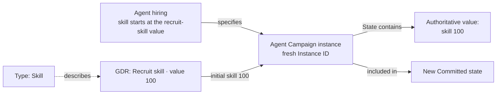
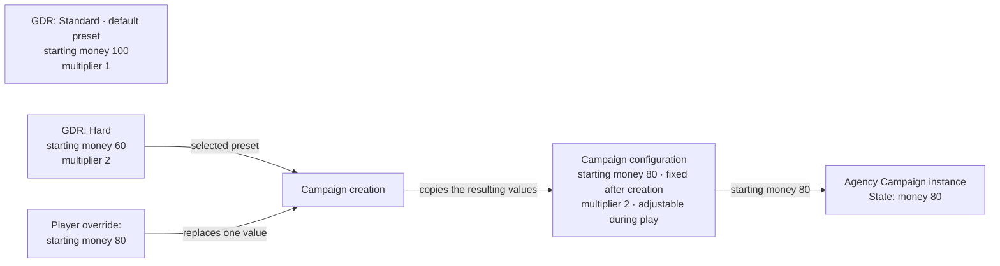
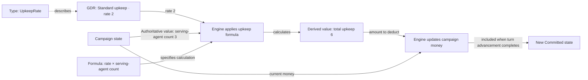
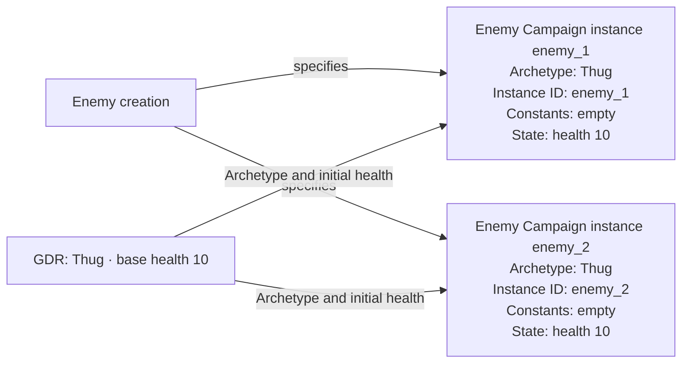
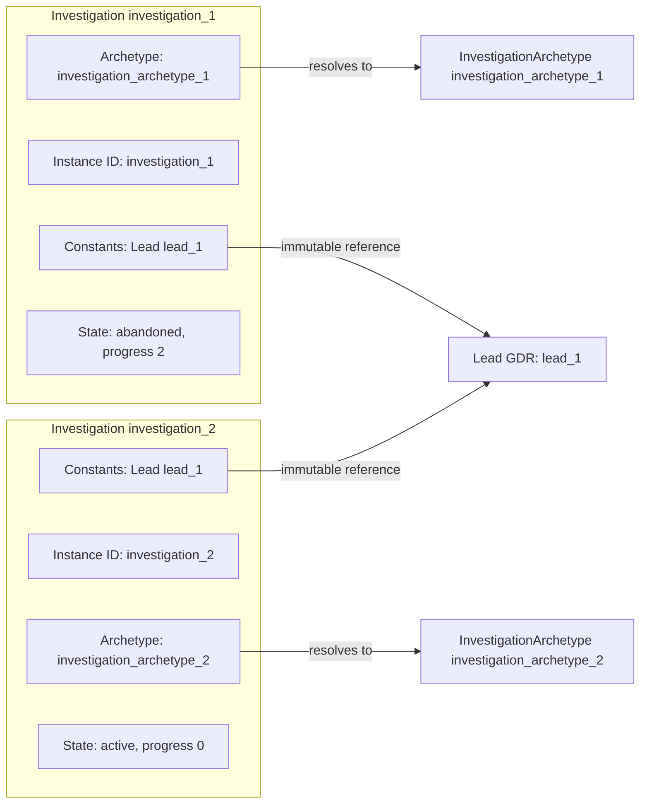
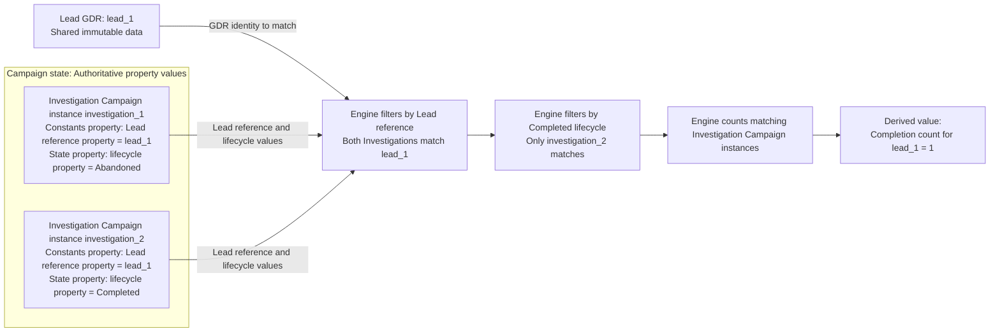
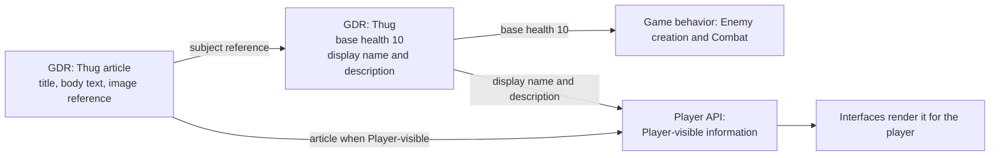

# Game Data Records

| Metadata    | Value                                                          |
| ----------- | -------------------------------------------------------------- |
| Spec ID     | GDR                                                            |
| Family      | Foundation                                                     |
| Status      | Accepted                                                       |
| Audience    | Engine designer, Content designer, Implementer                 |
| Conventions | [Specification conventions](../governance/spec-conventions.md) |

# Overview

This document defines the purposes a Game Data Record (GDR) can serve relative to game behavior and Campaign state, and gives a worked example of each purpose. It owns no Campaign state structure; e.g., Campaign instances and their creation are owned by [Campaign State](campaign-state.md).

# Relationships

- Uses [Campaign State](./campaign-state.md)
- Uses [Core Concepts](./core-concepts.md)
- Uses [Engine Contract](./engine-contract.md)
- Used by [Domain Model](./domain-model.md)
- Used by [Player Information](../interfaces/player-information.md)

# Glossary

GDR, Type, Authoritative value, and Derived value are defined by [Core Concepts](core-concepts.md#glossary).
Committed state, Player API, and Player-visible information are defined by the [Engine Contract glossary](engine-contract.md#glossary).
Campaign instance, Instance ID, Archetype, Constants, State, and Campaign configuration are defined by [Campaign State](campaign-state.md#glossary).

# Purposes of GDRs

GDRs can serve the following seven purposes. The purposes can overlap; they do not define separate Types or required
implementation interfaces. Each of the following sections is a worked example of one purpose.

| Purpose                          | How the engine uses the GDR                                                                                                                                                                              | Example                                                                                                                    |
| -------------------------------- | -------------------------------------------------------------------------------------------------------------------------------------------------------------------------------------------------------- | -------------------------------------------------------------------------------------------------------------------------- |
| Campaign instance initialization | [Campaign instance creation](campaign-state.md#campaign-instance-creation) takes a GDR’s value as the initial value of a property of a new Campaign instance. The player cannot override the value.      | A newly hired Agent has skill 100, the value of the recruit-skill GDR.                                                     |
| Campaign configuration preset    | Campaign creation takes the GDR’s values as the complete initial Campaign configuration. Before creation, the engine lets the player override individual values of the selected preset.                  | A Campaign created from the Hard preset with one override has starting money 80 and investigation difficulty multiplier 2. |
| Calculation parameter            | The engine reads a GDR when computing a Derived value.                                                                                                                                                   | The engine reads the rate from the Standard upkeep GDR to calculate upkeep.                                                |
| Archetype                        | A Campaign instance references the GDR as its Archetype; the GDR supplies shared characteristics and initial values named by [Campaign instance creation](campaign-state.md#campaign-instance-creation). | A newly created Enemy whose Archetype is Thug has current health 10 and a fresh Instance ID.                               |
| Referenced GDR                   | A Campaign instance holds a reference to a GDR other than its Archetype.                                                                                                                                 | An Investigation holds a reference to the Lead GDR it pursues.                                                             |
| Key for campaign facts           | Campaign state holds facts keyed by a GDR’s identity while the GDR remains immutable.                                                                                                                    | The engine records completions against a Lead GDR’s identity.                                                              |
| Display content                  | No game behavior reads the GDR's value; the engine exposes it to the player through Player API, subject to Player-visible information boundaries.                                                        | The Thug GDR's display name and description appear in the enemy list and the encyclopedia.                                 |

# GDR purpose: campaign instance initialization

Consider an illustrative creation of an Agent hired during play:

| Element             | Modeling role                                                              | Meaning in this example                                                                                                      |
| ------------------- | -------------------------------------------------------------------------- | ---------------------------------------------------------------------------------------------------------------------------- |
| Skill               | Type                                                                       | Describes a nonnegative integer skill.                                                                                       |
| Recruit skill       | GDR                                                                        | Has Type Skill and value 100.                                                                                                |
| Agent hiring        | [Campaign instance creation](campaign-state.md#campaign-instance-creation) | Hiring creates one Agent Campaign instance with a fresh Instance ID and skill in State equal to the recruit-skill GDR value. |
| Agent               | Campaign instance                                                          | The newly created Agent Campaign instance, with skill 100 in State.                                                          |
| Agent skill         | Authoritative value                                                        | Initially 100 in the Agent Campaign instance’s State.                                                                        |
| New Committed state | Committed state                                                            | Contains the Agent Campaign instance when the hiring action completes.                                                       |

Recruit skill is a Campaign instance initialization GDR distinct from the Agent's Archetype so that one value applies
to newly hired Agents of every Archetype without being repeated in each Archetype.

The example shows only the skill initial value; the specification owning Agent hiring also states the Agent's
other initial values. When the hiring action completes, the new Committed state contains an Agent Campaign instance
with a fresh Instance ID and skill 100 in State, the value of the recruit-skill GDR.

If training later raises the Agent's skill to 110, the engine reads 110 from the Agent Campaign instance’s State.
The recruit-skill GDR still contains the initial value of 100.

The engine exposes no way for the player to change a value this purpose supplies. That distinguishes it from the
Campaign configuration preset purpose, described next.

# GDR purpose: campaign configuration preset

When serving the Campaign configuration preset purpose, a GDR supplies one value for every Campaign configuration
value, and campaign creation takes those values as the initial Campaign configuration. The Game build can supply
several such GDRs, and the player selects one of them. Unlike every other purpose, this one comes with a built-in
engine capability: before the Campaign is created, the player may override individual values of the selected preset.

A value belongs to Campaign configuration if and only if the preset GDRs supply it. Whatever no preset can change is
not Campaign configuration. It is either a GDR serving another purpose, e.g. the recruit-skill GDR, or game behavior,
e.g. a starting turn that is the same for every Campaign.

Consider an illustrative Game build with two presets and two Campaign configuration values:

| Element                             | Modeling role                                                              | Meaning in this example                                                                                                       |
| ----------------------------------- | -------------------------------------------------------------------------- | ----------------------------------------------------------------------------------------------------------------------------- |
| CampaignConfiguration               | Type                                                                       | Describes one value for every Campaign configuration value: starting money and an investigation difficulty multiplier.        |
| Standard                            | GDR serving the Campaign configuration preset purpose                      | Has Type CampaignConfiguration, starting money 100, and investigation difficulty multiplier 1. It is the default preset.      |
| Hard                                | GDR serving the Campaign configuration preset purpose                      | Has Type CampaignConfiguration, starting money 60, and investigation difficulty multiplier 2.                                 |
| Preset selection                    | Player choice before creation                                              | The player selects Hard instead of the default Standard.                                                                      |
| Override                            | Player choice before creation                                              | The player overrides Hard's starting money with 80 and leaves its investigation difficulty multiplier unchanged.              |
| Campaign configuration              | Component of Campaign state                                                | Holds starting money 80 and investigation difficulty multiplier 2 when campaign creation completes.                           |
| Starting money                      | Authoritative value, fixed after creation                                  | 80 in Campaign configuration for the whole Campaign.                                                                          |
| Investigation difficulty multiplier | Authoritative value, adjustable during play                                | Initially 2 in Campaign configuration.                                                                                        |
| Agency creation                     | [Campaign instance creation](campaign-state.md#campaign-instance-creation) | Campaign creation creates the Agency Campaign instance with money in State equal to starting money in Campaign configuration. |

Campaign creation copies the selected preset's values into the initial Campaign configuration, replacing each
overridden value with the player's override. The initial Campaign configuration therefore holds starting money 80 and
investigation difficulty multiplier 2, and the newly created Agency has money 80 in State. The Hard GDR still has
starting money 60: the override changed nothing in the GDR. Campaign state holds the resulting values and no
reference to Hard.

The preset supplies both classes of Campaign configuration value. If the player later changes the investigation
difficulty multiplier to 1 during play, the engine reads 1 from Campaign configuration, and the Hard GDR still has
multiplier 2. Starting money is fixed after creation: it stays 80 in Campaign configuration even after an expense
reduces Agency money to 70, because Agency money is a separate Authoritative value in the Agency Campaign instance's
State.

# GDR purpose: calculation parameter

Consider an illustrative upkeep calculation for agents serving in a campaign. Its complete local setup is:

| Element             | Modeling role       | Meaning in this example                                                     |
| ------------------- | ------------------- | --------------------------------------------------------------------------- |
| UpkeepRate          | Type                | Describes a nonnegative integer amount of money per serving agent per turn. |
| Standard upkeep     | GDR                 | Has Type UpkeepRate and value 2 money per serving agent per turn.           |
| Serving-agent count | Authoritative value | Value in Campaign state, currently 3.                                       |
| Upkeep calculation  | Formula             | Upkeep for one turn equals the rate multiplied by the serving-agent count.  |
| Total upkeep        | Derived value       | 2 × 3 = 6 money for this turn.                                              |
| Upkeep deduction    | State change        | Deduct total upkeep from Agency money.                                      |

During "advance turn" computation, the engine reads the rate of 2 from the Standard upkeep GDR, which conforms to
Type UpkeepRate, and the serving-agent count of 3, an Authoritative value in Campaign state. The engine applies the
upkeep formula to these inputs, producing total upkeep of 6, a Derived value. Applying the upkeep deduction, the engine deducts 6 from the campaign's current money; the updated
money becomes part of the new Committed state, which is the result of turn advancement completion.

# GDR purpose: archetype

Consider an illustrative creation of two Enemy Campaign instances whose Archetype is the same Thug GDR:

| Element             | Modeling role                                                              | Meaning in this example                                                                                                                                                                  |
| ------------------- | -------------------------------------------------------------------------- | ---------------------------------------------------------------------------------------------------------------------------------------------------------------------------------------- |
| Enemy               | Type                                                                       | Describes the Enemy Campaign instances.                                                                                                                                                  |
| EnemyArchetype      | Type                                                                       | Describes the shared enemy characteristics and initial values.                                                                                                                           |
| Thug                | GDR serving the Archetype purpose                                          | Has Type EnemyArchetype and base health 10.                                                                                                                                              |
| Enemy creation      | [Campaign instance creation](campaign-state.md#campaign-instance-creation) | A newly created Enemy Campaign instance has a fresh Instance ID, its EnemyArchetype as its Archetype, empty Constants, and current health in State equal to the Archetype's base health. |
| enemy_1 and enemy_2 | Campaign instances                                                         | Distinct Enemy Campaign instances sharing Thug as their Archetype, with independent State and Constants.                                                                                 |
| Current health      | Authoritative value                                                        | Initially 10 in each Enemy Campaign instance’s State.                                                                                                                                    |

Each newly created Enemy Campaign instance whose Archetype is Thug has current health 10 in State and its own fresh
Instance ID; here the two Instance IDs are enemy_1 and enemy_2. Each belongs to its owning Mission.
Both Enemy Campaign instances refer to the same GDR; damaging enemy_1 changes its health without changing enemy_2 or Thug.

# GDR purpose: referenced GDR

When serving the Referenced GDR purpose, a GDR is referenced by a Campaign instance other than as its Archetype.
Consider an illustrative Lead and an Investigation of that Lead. The complete comparison needed here is:

| Example concept        | Modeling role                                                                                                                                   | Question it answers                                                        |
| ---------------------- | ----------------------------------------------------------------------------------------------------------------------------------------------- | -------------------------------------------------------------------------- |
| Lead                   | GDR serving the Referenced GDR purpose, representing a Lead to pursue.                                                                          | Which Lead can be pursued?                                                 |
| Investigation          | Campaign instance for investigation of a given Lead, with its own Instance ID, progress in State, and an immutable Lead reference in Constants. | Which Investigation concerns that Lead, and how has it progressed?         |
| InvestigationArchetype | GDR used as an Investigation's Archetype, supplying shared characteristics and initial values independently of the referenced Lead.             | What shared characteristics and initial values does the Investigation use? |

Suppose Lead lead_1 is referenced by Investigation investigation_1, created with InvestigationArchetype investigation_archetype_1. Its Instance ID is investigation_1; its Constants contains the
immutable Lead reference, and its State contains lifecycle initialized to active and progress initialized to 0, as an illustrative specification of Investigation creation would state. The archetype remains the separate shared
component. Adding the Lead reference does not create a fifth property or make lead_1 the Investigation's archetype.

For this example, investigation_1 reaches progress 2 and is abandoned. A new Investigation investigation_2 at lead_1 starts at progress 0 with its own Instance ID.
Use archetype investigation_archetype_2 for investigation_2 to show that the Investigation's Lead reference and Archetype are independent relationships. These
are symbolic GDRs without selected production properties or mechanics. The example assumes both combinations are
permitted; it does not define action preconditions or invariants governing them.

Both Investigations can share lead_1 without sharing progress. Retargeting investigation_1 to another Lead or replacing investigation_archetype_1 after creation
would violate its fixed facts. Using lead_1 as its archetype would fail the expected InvestigationArchetype reference,
regardless of whether some properties match.

# GDR purpose: key for campaign facts

When serving the Key for campaign facts purpose, a GDR’s identity associates campaign-specific facts with that GDR. The facts belong to Campaign state;
the GDR remains shared and immutable.

Continuing the illustrative Investigation example, suppose investigation_2 completes after investigation_1 was abandoned.
Campaign state retains both Investigation Campaign instances, including the values of the Lead reference property
within each Campaign instance’s Constants property and the lifecycle property within its State property.

| Element                                                                        | Modeling role                                  | Meaning in this example                                                                                                                                   |
| ------------------------------------------------------------------------------ | ---------------------------------------------- | --------------------------------------------------------------------------------------------------------------------------------------------------------- |
| lead_1                                                                         | GDR serving the Key for campaign facts purpose | Its identity selects the Investigations concerning this Lead; the GDR remains unchanged.                                                                  |
| Properties of completed investigations that denote to which leads they pertain | Authoritative values                           | The Lead reference property within the Constants property of the Completed Investigation Campaign instance investigation_2 identifies lead_1.             |
| Completion count for lead_1                                                    | Derived value                                  | Count Investigation Campaign instances whose Lead reference property identifies lead_1 and whose lifecycle property has value Completed. The result is 1. |

How to determine the Derived value of the completion count for the Lead GDR lead_1 from Authoritative values:

1. **Collect Investigations:** Start with all Investigation Campaign instances in the Campaign state.
2. **Filter by Lead reference:** For each Investigation Campaign instance, read the value of the Lead reference property within its Constants property. Keep only Campaign instances whose Lead reference identifies lead_1.
3. **Filter by Completed lifecycle:** For each remaining Investigation Campaign instance, read the value of the lifecycle property within its State property. Keep only Campaign instances whose lifecycle property has the value Completed.
4. **Count matching Investigations:** Count the remaining Investigation Campaign instances. The result is the Derived value of the completion count for lead_1. In this example, investigation_1 is excluded because its lifecycle property has the value Abandoned; investigation_2 is counted, so the result is 1.

The Lead reference and lifecycle property values read in steps 2 and 3 are Authoritative values.

# GDR purpose: display content

When serving the Display content purpose, a GDR supplies values that exist only for the player to see, e.g. names,
descriptions, in-game encyclopedia articles, and references to images or other media. Consider an illustrative Thug
enemy and its encyclopedia article:

| Element             | Modeling role                                          | Meaning in this example                                                                                        |
| ------------------- | ------------------------------------------------------ | -------------------------------------------------------------------------------------------------------------- |
| EnemyArchetype      | Type                                                   | Describes the shared enemy characteristics and initial values, including a display name and a description.     |
| Thug                | GDR serving the Archetype and Display content purposes | Has Type EnemyArchetype, base health 10, display name "Thug", and a one-sentence description.                  |
| EncyclopediaArticle | Type                                                   | Describes an encyclopedia article: a title, body text, an image reference, and a reference to its subject GDR. |
| Thug article        | GDR serving the Display content purpose                | Has Type EncyclopediaArticle, title "Thug", body text, an image reference, and a reference to the Thug GDR.    |

Combat reads Thug's base health 10 as its Archetype initial value; no game behavior reads its display name, its description,
or the Thug article. Through Player API, the engine exposes the display name and description wherever a Player-visible
view shows an Enemy whose Archetype is Thug, and exposes the Thug article in the encyclopedia once the player is
entitled to see it. The purposes overlap: Thug serves the Archetype and Display content purposes at once.

Display content follows these requirements:

- **No gameplay dependence:** No game behavior reads a value that serves the Display content purpose. Changing Display content
  in a Game build changes only what the player sees; equal initial Campaign state and the same ordered committed
  commands still produce equal Campaign state.
- **Visibility:** The engine exposes Display content only as Player-visible information. Display content describing
  something hidden from the player stays hidden until it becomes Player-visible.
  [Player Information](../interfaces/player-information.md) owns those visibility conditions.
- **No inference:** Relationships and gameplay facts are never inferred from Display content, extending the rule under
  [References](campaign-state.md#references). The Thug article identifies its subject through its reference to the Thug GDR, not
  through its title.
- **Media:** A reference to an image or other media is a value in the GDR; the referenced media is part of the Game
  build. Media formats and loading are left to the implementation.

