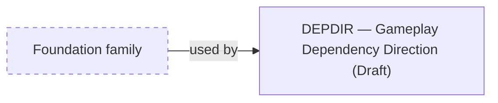

# About the Guidance family

> Informative overview. It owns no rules; each linked specification owns its content.

# What this family is for

Guidance documents steer implementers toward code that is easier to maintain and to check against the other
specifications. They are non-behavioural: they own no Rule, observable contract, or GDR, and no acceptance test depends
on them.

# Documents

## Gameplay Dependency Direction

[Gameplay Dependency Direction](gameplay-dependency-direction.md) answers _what may gameplay code read?_ It steers
gameplay code away from Campaign state beyond its necessary inputs.

# How they relate

Gameplay Dependency Direction uses the Foundation family's vocabulary and continuation guarantees, which it helps
implementations satisfy. No specification depends on it.

<!-- generated:family-diagram:start -->

_Generated from the specifications’ Relationships sections by `npm run docs:generate`; do not edit between the markers. Arrows run from Dependency to Dependent; dashed boxes stand for whole other Families._

## Within the family

This family has a single specification, so there are no relationships within it.

## Across families

<!-- generated:family-diagram:end -->

# Why these boundaries

Guidance is kept apart so that advice never becomes an observable contract. An implementation that ignores it can still
satisfy every other specification.
