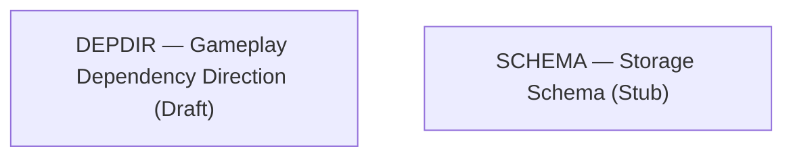
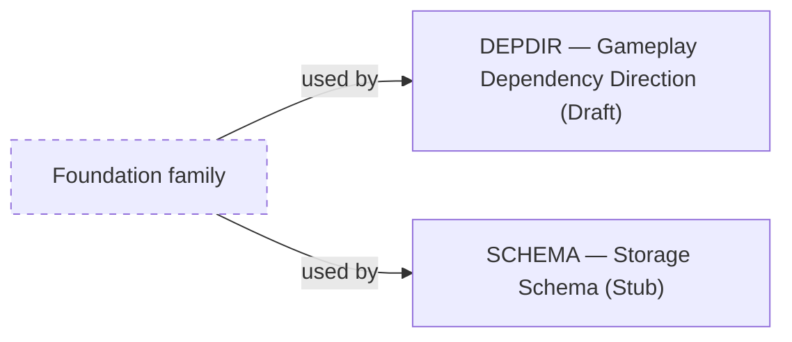

# About the Implementation family

> Informative overview. It owns no rules; each linked specification owns its content.

# What this family is for

Implementation documents steer implementers toward code that is easier to maintain and to check against the other
specifications. They are non-behavioural: they own no game behavior, observable contract, or GDR, and no acceptance test depends
on them.

# Documents

## Gameplay Dependency Direction

[Gameplay Dependency Direction](gameplay-dependency-direction.md) answers _what may gameplay code read?_ It steers
gameplay code away from Campaign state beyond its necessary inputs.

## Storage Schema

[Storage Schema](storage-schema.md) answers _how might everything persisted be laid out?_ It steers implementers toward
one physical layout for Game storage.

# How they relate

Both documents use the Foundation family: Gameplay Dependency Direction uses its vocabulary and determinism guarantees,
and Storage Schema uses its data ownership, Campaign save, and Timeline contracts. No specification depends on either.

<!-- generated:family-diagram:start -->

_Generated from the specifications’ Relationships sections by `npm run docs:generate`; do not edit between the markers. Arrows run from Dependency to Dependent; dashed boxes stand for whole other Families._

## Within the family

No relationships are declared within this family.

## Across families

<!-- generated:family-diagram:end -->

# Why these boundaries

The Implementation family is kept apart so that advice to implementers never becomes an observable contract. An implementation that ignores its documents can still
satisfy every other specification.
