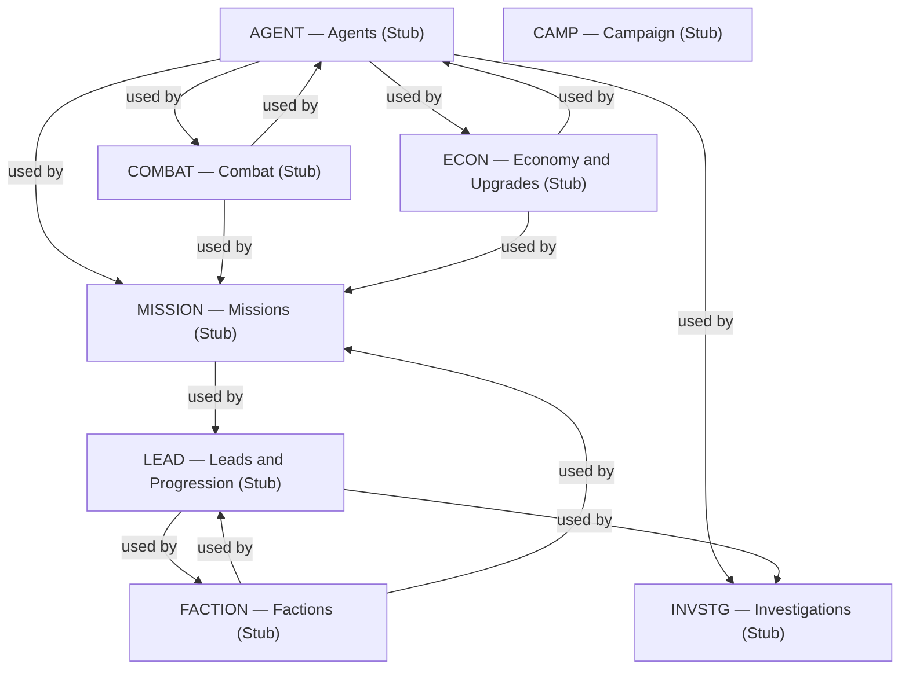
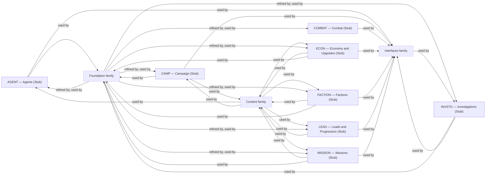

# About the Mechanics family

> Informative overview. It owns no rules; each linked specification owns its content.

# What this family is for

Mechanics specifications own the player-facing game systems: their rules, transitions, formulas, and effects. Each one
refines part of the [Domain Model](../foundation/domain-model.md) with the detailed behavior of one system, using
[Numbers and Randomness](../foundation/numbers-and-randomness.md) for arithmetic and draws. Exact balance values and
catalogs come from the Content family; when each rule runs comes from
[Turn Resolution](../foundation/turn-resolution.md).

# Documents

## Campaign

[Campaign](campaign.md) answers _how does a campaign start, change, and end?_ It owns campaign initialization,
adjustable Campaign configuration, global panic, and the victory and defeat predicates.

## Agents

[Agents](agents.md) answers _what can an agent do, and how does an agent change over time?_ It owns agent capability,
task availability, development, exhaustion, and recovery.

## Economy and Upgrades

[Economy and Upgrades](economy-and-upgrades.md) answers _where does the agency's money come from and go?_ It owns
resource flows, personnel purchases, and agency improvements.

## Leads and Progression

[Leads and Progression](leads-and-progression.md) answers _what becomes available, and when?_ It owns the progression
graph and the lifecycle of Leads, separately from the Investigations that pursue them.

## Investigations

[Investigations](investigations.md) answers _how does pursuing a Lead progress and complete?_ It owns investigation
progress, stochastic completion, player uncertainty, and commitment costs.

## Combat

[Combat](combat.md) answers _how does a battle play out?_ It owns fully automatic battles and their reproducible
results, independently of what those results mean for the campaign.

## Missions

[Missions](missions.md) answers _what does committing agents to a mission cost, and what follows from its result?_ It
owns mission commitments and turns Battle results into campaign consequences.

## Factions

[Factions](factions.md) answers _how do the opponents push back?_ It owns escalating faction pressure, Faction
operation occurrence generation, suppression, and permanent defeat.

# How they relate

Agents is the hub: Combat, Economy and Upgrades, Investigations, and Missions all use agent capabilities. Missions sits
where several systems meet, combining Agents, Combat, Economy and Upgrades, and Factions. Leads and Progression and
Factions use each other, since faction state unlocks progression and progression effects shape factions. Every
Mechanics document is refined from the Foundation family and supplies the meanings that the Content family fills with
values.

<!-- generated:family-diagram:start -->

_Generated from the specifications’ Relationships sections by `npm run docs:generate`; do not edit between the markers. Arrows run from Dependency to Dependent; dashed boxes stand for whole other Families._

## Within the family

## Across families

<!-- generated:family-diagram:end -->

# Why these boundaries

- **Combat versus Missions:** a battle's resolution is kept separate from its campaign consequences, so combat can be
  tested and tuned without the campaign around it.
- **Leads and Progression versus Investigations:** what is available is separated from how the player pursues it, so
  the progression graph can change without touching investigation mathematics.
- **Campaign versus the rest:** campaign-wide state (configuration, panic, and the ending predicates) belongs to no
  single system.
- **Formulas versus values:** each document owns formulas and meanings; [Initial Campaign
  Content](../content/initial-campaign.md) owns the numbers, so balancing does not change behavior specifications.

# Reading order

Start with [Agents](agents.md), then [Combat](combat.md) and [Missions](missions.md). Read
[Leads and Progression](leads-and-progression.md) before [Investigations](investigations.md), and
[Factions](factions.md) after both. [Economy and Upgrades](economy-and-upgrades.md) and [Campaign](campaign.md) can be
read at any point.
