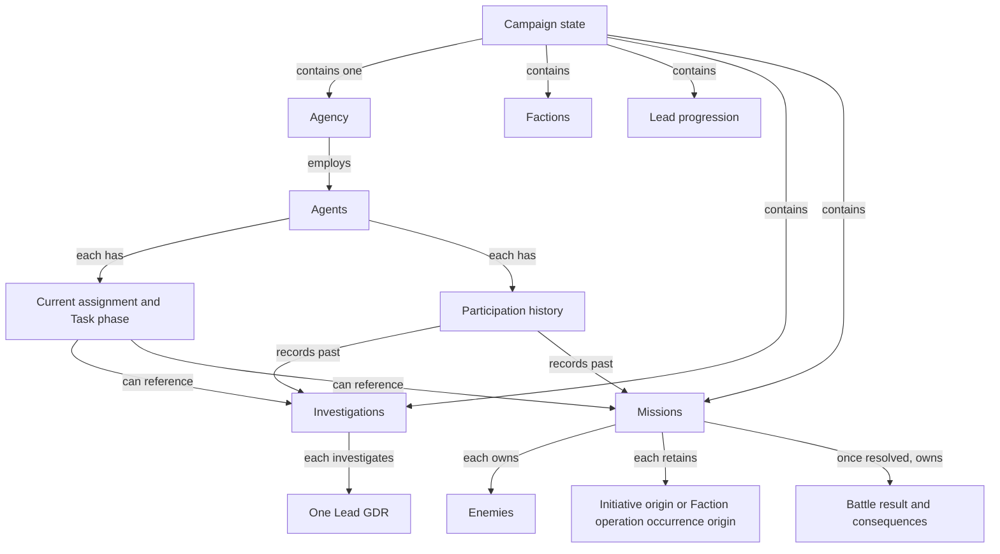

# Domain Model

| Metadata    | Value                                                                                     |
| ----------- | ----------------------------------------------------------------------------------------- |
| Spec ID     | DOM                                                                                       |
| Family      | Mechanics                                                                                 |
| Status      | Draft                                                                                     |
| Audience    | Engine designer, Content designer, AI designer, Implementer                               |
| Owns        | Game concepts, how they relate, and the structural invariants that span several concepts. |
| Conventions | [Specification conventions](../governance/spec-conventions.md)                            |

# Overview

This document defines what exists in the game and how those concepts relate. A Campaign contains one player-controlled
Agency that allocates Agents, pursues Leads, undertakes Missions, and opposes Factions.

It applies the vocabulary of [Core Concepts](../foundation/core-concepts.md) and the rules of [Campaign State](../foundation/campaign-state.md) to
these concepts without adding to either. Each concept is classified by its modeling role under
[Game concepts](#game-concepts).

This document owns the definition of each concept and the rules that relate one concept to another, e.g. that an
Agent's Current assignment places it in a Current team. It does not own what a single concept has or does on its
own, e.g. its properties, lifecycle states, formulas, and transitions; these belong to the specification of the
[Mechanics family](about-mechanics.md) that refines the concept. It does not own which properties the
player sees, which the specification owning each value states, under
[Player queries and actions](../foundation/engine-contract.md#player-queries-and-actions) in Engine Contract. A concept can include facts
hidden from the player.

# Relationships

- Uses [Campaign State](../foundation/campaign-state.md)
- Uses [Core Concepts](../foundation/core-concepts.md)
- Uses [Engine Contract](../foundation/engine-contract.md)
- Uses [Game Data Records](../foundation/game-data-records.md)
- Used by [Basic Autopilot AI](../autopilot-ais/basic-autopilot-ai.md)
- Used by [Bootstrap GDRs](../content/bootstrap-gdrs.md)
- Used by [Turn Advancement](./turn-advancement.md)
- Used by [Web UI](../ui/web-ui.md)
- Refined by [Agents](agents-spec.md)
- Refined by [Combat](combat.md)
- Refined by [Economy and Upgrades](economy-and-upgrades.md)
- Refined by [Factions](factions.md)
- Refined by [Investigations](investigations.md)
- Refined by [Leads and Progression](leads-and-progression.md)
- Refined by [Missions](missions.md)
- Refined by [Panic and Endings](panic-and-endings.md)

# Glossary

Campaign, Campaign state, Type, GDR, Authoritative value, and Derived value are defined by the
[Core Concepts glossary](../foundation/core-concepts.md#glossary). Campaign instance, Instance ID, Archetype, Constants, State,
Role Type, World history, and Campaign configuration are defined by the
[Campaign State glossary](../foundation/campaign-state.md#glossary). Committed state is defined by the
[Engine Contract glossary](../foundation/engine-contract.md#glossary).

## Agency and Agents

The player-controlled organization, its Agents, and what each Agent is doing.

| Term               | Definition                                                                                                             |
| ------------------ | ---------------------------------------------------------------------------------------------------------------------- |
| Agency             | The organization the player controls in a Campaign. It holds the money, funding, and upgrades, and employs the Agents. |
| Agent              | An operative employed by the Agency, whom the player assigns to Investigations and Missions.                           |
| Current assignment | What an Agent is currently ordered to do, e.g. take part in a particular Investigation or Mission.                     |
| Task phase         | Whether an Agent is carrying out its Current assignment (At assignment) or still travelling to it (In transit).        |

## Leads, Investigations, and Missions

The work the Agency discovers and undertakes.

| Term             | Definition                                                                                                                                                                      |
| ---------------- | ------------------------------------------------------------------------------------------------------------------------------------------------------------------------------- |
| Lead             | A line of inquiry the Agency can investigate. Investigating it can open further Leads and Missions.                                                                             |
| Lead progression | What the Agency has earned on each Lead so far in a Campaign, e.g. wins and unlocks.                                                                                            |
| Investigation    | One effort by a team of Agents to investigate one Lead, from its start until it concludes.                                                                                      |
| Mission          | One operation on which the Agency deploys a team of Agents to fight Enemies, undertaken either on the Agency's own initiative or in response to a Faction operation occurrence. |
| Current team     | The Agents currently assigned to a given Investigation or Mission.                                                                                                              |

## Combat

The participants and retained results of combat.

| Term                | Definition                                                                                                                                      |
| ------------------- | ----------------------------------------------------------------------------------------------------------------------------------------------- |
| Combatant           | An Agent or an Enemy as a participant in a Mission's combat. Both can fight because both have skill, health, exhaustion, and weapon capability. |
| Combatant Role Type | What an Agent or an Enemy must have in order to be a Combatant, and what it gains while a battle lasts.                                         |
| Enemy               | An opponent that the Agency's Agents fight in the combat of one Mission.                                                                        |
| Battle result       | The record of how a Mission's combat went, kept after the Mission resolves and used to determine the Mission's consequences for the Campaign.   |

## Factions

The opposing organizations and their operations.

| Term                         | Definition                                                                                                |
| ---------------------------- | --------------------------------------------------------------------------------------------------------- |
| Faction                      | An organization that opposes the Agency and carries out operations in the world.                          |
| Faction operation occurrence | One operation carried out by a Faction, against which the Agency can intervene with one Response Mission. |

## Retained records

Records kept to explain past gameplay.

| Term                  | Definition                                                                                                |
| --------------------- | --------------------------------------------------------------------------------------------------------- |
| Participation history | The permanent record of which Agents took part in which past Investigations and Missions.                 |
| Report                | An account of something that happened in the Campaign, e.g. a battle, explaining its facts to the player. |

# Game concepts

The following table is the complete set of concepts this specification declares, each with its modeling role. The
[Glossary](#glossary) states what each concept is; this table states how it is modeled.

| Concept                                       | Modeling role                                                                                                         | Multiplicity within one Campaign                                                                                                             |
| --------------------------------------------- | --------------------------------------------------------------------------------------------------------------------- | -------------------------------------------------------------------------------------------------------------------------------------------- |
| Agency                                        | Campaign instance Type                                                                                                | Exactly one, under [Agency per Campaign](#agency-per-campaign)                                                                               |
| Agent                                         | Campaign instance Type                                                                                                | Any number; roster limits belong to Economy and Upgrades                                                                                     |
| Investigation                                 | Campaign instance Type                                                                                                | At most one Active Investigation per Lead, under [Leads and Investigations](#leads-and-investigations)                                       |
| Mission                                       | Campaign instance Type                                                                                                | Any number; exactly one Response Mission per Faction operation occurrence, under [Mission kind and provenance](#mission-kind-and-provenance) |
| Enemy                                         | Campaign instance Type                                                                                                | Any number, each belonging to exactly one Mission, under [Combat and consequences](#combat-and-consequences)                                 |
| Faction                                       | Campaign instance Type                                                                                                | Undecided; see [Open decisions](factions.md#open-decisions) in Factions                                                                      |
| Combatant Role Type                           | Role Type adopted by Agent and Enemy, under [Combatant Role Type](#combatant-role-type); not a Campaign instance Type | No Campaign instances                                                                                                                        |
| Lead                                          | GDR serving the Referenced GDR and Key for campaign facts purposes                                                    | Not a Campaign instance                                                                                                                      |
| Weapon and upgrade GDRs                       | GDRs                                                                                                                  | Not Campaign instances                                                                                                                       |
| Archetypes of the six Campaign instance Types | GDRs serving the Archetype purpose                                                                                    | Not Campaign instances; sharing an Archetype does not limit how many Campaign instances exist                                                |

GDR purposes are defined under [Purposes of GDRs](../foundation/game-data-records.md#purposes-of-gdrs). Every Campaign instance of
the six Campaign instance Types has the four properties stated under
[Campaign instance structure](../foundation/campaign-state.md#campaign-instance-structure). Each concept's section below states how
the concept relates to the other concepts and names the Mechanics specification that refines it. That Mechanics
specification owns what the concept has on its own. Being a property of a concept does not determine whether a value
is an Authoritative value or a Derived value; e.g., an Agent's career statistics may be Derived values calculated from
retained facts.

Arrows show the labelled relationships, not inheritance.

# Campaign and Agency

A Campaign contains one Agency, the current turn, panic and the Campaign outcome, Lead progression, Agents, Factions,
Investigations, and Missions. The Agency owns money, recurring funding, upgrade acquisitions, and its roster of
Agents. Campaign-wide properties, e.g. the current turn and panic, belong directly to Campaign state, not to the
Agency.

## Agency per Campaign

Campaign state must contain exactly one Agency, because a Campaign has exactly one player under
[Single-player scope](../foundation/engine-contract.md#single-player-scope) in Engine Contract. Trading between Campaigns is out of
scope.

## Initial Campaign state

Everything a new Campaign starts with is either game data, supplied as GDRs by the Game build, or game behavior,
stated as rules in specifications. Among GDRs, only those serving the Campaign configuration preset purpose can be
overridden by the player before creation; every other GDR is fixed, e.g. a Faction's Archetype.

Which Campaign instances the initial Campaign state contains is the same for every new Campaign. No GDR serving the Campaign configuration preset purpose, under
[GDR purpose: campaign configuration preset](../foundation/game-data-records.md#gdr-purpose-campaign-configuration-preset), adds,
removes, or selects an initial Campaign instance; e.g., no preset changes the initial roster of Agents, the initial
Factions, or the initial Missions. A Campaign configuration value can still supply an initial value of an initial
Campaign instance, e.g. starting money becomes the Agency's initial money, and can influence which Campaign instances
come into existence during play, e.g. a multiplier of how often Missions appear.

The initial Campaign state contains exactly one Agency, under [Agency per Campaign](#agency-per-campaign). For
each Campaign instance Type, the Mechanics specification that refines it states the rule determining the initial
Campaign instances of that Type and the source of each of their initial values, under
[Campaign instance creation](../foundation/campaign-state.md#campaign-instance-creation); e.g., "the initial Campaign state contains
one Faction for each Faction Archetype the Game build supplies". The rule is game behavior; the content it reads is
supplied by GDRs that serve no Campaign configuration preset purpose, e.g. the Faction Archetypes and their values.
This section states what the initial
Campaign state contains, not which code creates it.

## Campaign instance identity scope

Agency, Agent, Investigation, Mission, Enemy, and Faction share one Instance ID scope: Instance IDs must be unique
across all six Types within one Campaign. A repeated Investigation or Mission is therefore a distinct Campaign
instance with its own Instance ID. [Campaign instance identity](../foundation/campaign-state.md#campaign-instance-identity) owns the
general identity rules; this section declares the scope those rules require.

# Agent

An Agent is a Campaign instance belonging to the Agency. Agent adopts the Combatant Role Type, under
[Combatant Role Type](#combatant-role-type). Its Current assignment gives its current orders; an Investigation or
Mission Current assignment references that Investigation or Mission. Its Participation history links it to the
Investigations and Missions it previously participated in.

[Agents](agents-spec.md) owns what an Agent has, the Agent lifecycle, the Current assignments an Agent
can have, Task phase, and the formulas for the attributes. Whatever its lifecycle state, an Agent remains in World
history with its final values and Participation history, under
[Historical fact preservation](../foundation/campaign-state.md#historical-fact-preservation).

## Current versus historical teams

The Current team of an Investigation or Mission must agree with Current assignments: an Agent whose Current assignment
references Investigation I belongs to the Current team of I, including while In transit. Whether an Agent In transit
contributes is owned by Agents and [Investigations](investigations.md). An Agent cannot belong to more
than one Current team. In Committed state, the Agent-side and team-side views of Current team membership agree.

Participation history describes the same relationship for the past: an Agent's Participation history and the past
participants of an Investigation or Mission are one relationship seen from opposite sides. Agents recorded in
Participation history are not members of the Current team, and Participation history neither assigns nor reserves an
Agent; e.g., a concluded Mission retains an Agent's Participation history after that Agent is assigned elsewhere.

# Lead and Investigation

A Lead is a GDR, and an Investigation is a Campaign instance for investigation of one Lead. A Lead is a Referenced
GDR, distinct from the InvestigationArchetype that is the Investigation's Archetype, as
[GDR purpose: referenced GDR](../foundation/game-data-records.md#gdr-purpose-referenced-gdr) illustrates. Lead progression is
the part of Campaign state that records, for each Lead GDR, what the Agency has earned on that Lead; it holds only
facts that are not Derived values.

[Leads and Progression](leads-and-progression.md) owns what a Lead GDR describes, discovery, and unlock
effects. [Investigations](investigations.md) owns what an Investigation has, the Investigation
lifecycle, progress, completion probability, Current team changes, and abandonment.

## Leads and Investigations

An Investigation must retain its reference to one Lead GDR in Constants. An Investigation is Active from its creation
until it concludes; Investigations owns the lifecycle states and what concludes an Investigation. At most one Active
Investigation may exist for a Lead in a Campaign, whatever the Archetypes of the Investigations of that Lead. In
Committed state, an Active Investigation must have at least one Agent in its Current team, and an Investigation that
is not Active must have an empty Current team.

An Investigation that is not Active retains its Instance ID and Participation history. A later Investigation of the
same Lead is another Campaign instance, under [Campaign instance identity scope](#campaign-instance-identity-scope).

## Progression facts

Wins and earned unlocks must be explicit Authoritative values in Campaign state with source references where applicable.
Once recorded, a win or earned unlock therefore remains, even when the condition that earned it no longer holds, under
[Authoritative and Derived values](../foundation/core-concepts.md#authoritative-and-derived-values) in Core Concepts.
A Lead's completion count is a Derived value, calculated from Investigation Campaign instances as
[Value classification](../foundation/campaign-state.md#value-classification) describes; Lead progression holds no completion
record. Faction defeat and a Lead's Faction affiliation must not depend on specially spelled identifiers. Leads and
Progression owns the predicates and effects of progression facts.

# Mission, Enemy, and Combat

A Mission is a Campaign instance that the Agency undertakes with a Current team against the Enemies the Mission owns;
a resolved Mission owns one Battle result. An Enemy is a Campaign instance owned by one Mission; its Archetype is an
EnemyArchetype. Agents and Enemies are the Combatants of a Mission's combat: Agent and Enemy both adopt the
Combatant Role Type.

[Missions](missions.md) owns what a Mission has, the Mission lifecycle, deployment, deadlines, rewards,
and partial success. [Combat](combat.md) owns battle resolution and what a Battle result holds.

## Mission kind and provenance

Mission Constants must retain Mission kind and provenance. A Mission is either an Initiative Mission, pursuing an
Agency objective, or a Response Mission, intervening against a Faction operation occurrence. An Initiative Mission
must retain its creation source; e.g., an Investigation or campaign creation. A Response Mission must retain its
Faction operation occurrence origin, which identifies the initiating Faction.

Each Faction operation occurrence creates exactly one Response Mission. Two Response Missions originating from the
same Faction are distinct Campaign instances. A Faction operation occurrence spanning several Missions, or having no
Response Mission, is out of scope. Target Faction and initiating Faction are explicit references, never inferred from
a Mission's name.

## Combatant Role Type

The Combatant Role Type is a Role Type under [Role Types](../foundation/campaign-state.md#role-types). It states what a Campaign
instance Type must have for its Campaign instances to be Combatants, and what a Combatant gains while a battle lasts.

- **Adoption condition:** a Campaign instance Type can adopt the Combatant Role Type if the State of its Campaign
  instances has all of the following properties: skill, current health, maximum health, exhaustion, and equipped
  weapon values. This set is exhaustive.
- **Adopters:** Agent and Enemy adopt the Combatant Role Type. This set is exhaustive.
- **Gained properties:** every Combatant taking part in a battle gains properties that mean something only while
  that battle lasts, e.g. morale and incapacitated. It gains them when the battle begins and loses them when the
  battle ends. [Combat](combat.md) owns the exhaustive set of gained properties.

The properties named by the adoption condition persist outside combat; e.g., an Agent has health and exhaustion
between Missions. What outlasts a battle is its Battle result and every change the battle made to those properties,
e.g. lost health.

The Combatant Role Type is not a Campaign instance Type, so a Combatant is never a Campaign instance separate from
its Agent or Enemy. If it were, every Agent would be two Campaign instances with two Instance IDs, and health would
belong to the second one instead of to the Agent. The Agent changed by combat is instead the same Agent that returns
to the Agency, under [Combat and consequences](#combat-and-consequences).

## Attribute bounds

Every Campaign instance of a Campaign instance Type that adopts the Combatant Role Type, i.e. every Agent and Enemy,
must obey these bounds: maximum health must be positive; current
health must be between zero and maximum health inclusive; skill and exhaustion must be nonnegative. Agents owns the
health an Agent has in each lifecycle state, dismissal eligibility, exhaustion caps, and rounding.

## Combat and consequences

An Enemy must belong to exactly one Mission. Enemies sharing an Archetype share neither Instance ID nor health. Combat
changes the participating Agent and Enemy Campaign instances themselves: the Agent changed by combat is the same Agent
that returns to the Agency. A Battle result is distinct from the Mission's consequences for the Campaign, so a failed
battle can still yield damage-related benefits. A retained Battle result is never rewritten, under
[Historical fact preservation](../foundation/campaign-state.md#historical-fact-preservation). Combat owns which facts a Battle
result retains.

# Faction and Faction operation occurrences

A Faction is a Campaign instance for one opposing organization. Its Archetype supplies its descriptive identity and
configuration. [Factions](factions.md) owns what a Faction has, escalation, Faction operation occurrence
generation, suppression, and defeat.

A Faction operation occurrence is the origin of one Response Mission: its initiating Faction, severity, type, and
creation facts are values in that Mission's Constants, and that Mission's Instance ID identifies the Faction operation
occurrence. It is not a separate Campaign instance.

# Weapons and upgrades

Weapon GDRs describe damage configuration. Equipped weapon values and their modifications during a Campaign belong to
the State of an Agent or Enemy, among the properties the Combatant Role Type requires; individual inventory items are out of scope. Upgrade GDRs supply shared
upgrade data; acquisitions and their amount or level belong to the Agency.
[Economy and Upgrades](economy-and-upgrades.md) owns acquisition costs, capacity accounting, and upgrade
effects.

# Reports

A Report links historical facts and explanations in World history to commands or turns and to Campaign instances. A
Report explaining a retained Battle result uses the retained values, never current calculations, under
[Historical fact preservation](../foundation/campaign-state.md#historical-fact-preservation).

A Report is Player-visible information, and it contains only facts that are Player-visible information under the
specification that owns each fact, as [Information boundary](../foundation/engine-contract.md#information-boundary) in
Engine Contract requires; e.g., a battle Report states the damage an Enemy took only if [Combat](combat.md) makes that
damage Player-visible. Reports are retained in World history, so restoring a Committed state restores exactly the
Reports of that Committed state, under
[Derived value consistency](../foundation/engine-contract.md#derived-value-consistency) in Engine Contract.

# Edge cases and failure behavior

| Case                                                                        | Result and owner                                                                                                                                                                       |
| --------------------------------------------------------------------------- | -------------------------------------------------------------------------------------------------------------------------------------------------------------------------------------- |
| An Agent is In transit to an Investigation                                  | The Agent belongs to its Current team; arrival and progress timing belong to Agents and Investigations                                                                                 |
| The last Agent leaves the Current team of an Active Investigation           | No Committed state contains an Active Investigation with an empty Current team; the resulting lifecycle and numerical effects belong to Investigations                                 |
| An Investigation concludes while members of its Current team are In transit | In the next Committed state no Current assignment references it; the replacement Current assignments belong to Agents and Investigations                                               |
| A concluded Mission retains an Agent in its Participation history           | The Agent's Current assignment is not reserved, under [Current versus historical teams](#current-versus-historical-teams)                                                              |
| The roster is empty, or no Missions or Investigations exist                 | Valid; [Panic and Endings](panic-and-endings.md) owns defeat conditions                                                                                                                |
| A Faction is defeated with outstanding Missions or Leads                    | References remain resolvable under [References](../foundation/campaign-state.md#references); Factions, Leads and Progression, and Missions own the resulting availability and outcomes |

# Acceptance examples

These are structural fixtures, not playable scenarios or API signatures. Symbolic identifiers are labels, not a chosen
identifier format. Numbers below are exact test-only integers, not campaign balance. All other scalar values owned by
Mechanics specifications are assumed valid for these structural checks.

## A. Valid relationships

Given turn 3 and:

- Campaign state c1 with its single Agency ag1.
- Archetypes supplied by the current Game build: G1 (Agency), A1 (Agent), I1 (Investigation), M1 (Mission),
  F1 (Faction), and E1 (Enemy), plus the GDRs L1 (Lead) and W1 (weapon). These are test GDRs with no other required
  properties in this fixture.
- Faction f1 with Archetype F1.
- Agent a1 whose Current assignment references Investigation i1, In transit.
- Agent a2 whose Current assignment references Mission m1, At assignment.
- Active Investigation i1 referring to L1, Current team {a1}.
- Initiative Mission m1 with Archetype M1, originating from campaign creation, targeting f1, Current team {a2}.
- Enemy e1 owned by m1, with Archetype E1.
- Each Agent and Enemy has skill 100, health 10 of maximum health 10, exhaustion 0, and equipped values referring to W1.
- Other collections empty.

Each Campaign instance has the following allocation of the properties this specification names; the properties that
Mechanics specifications add are assumed valid:

| Campaign instance | Instance ID         | Archetype | Constants                                                        | State                                                                                                      |
| ----------------- | ------------------- | --------- | ---------------------------------------------------------------- | ---------------------------------------------------------------------------------------------------------- |
| ag1               | ag1                 | G1        | Empty                                                            | Resources, upgrades, roster {a1, a2}                                                                       |
| a1, a2            | a1, a2 respectively | A1        | Agency ag1                                                       | Current assignment, Task phase, the properties the Combatant Role Type requires, and Participation history |
| i1                | i1                  | I1        | Lead L1                                                          | Active, Current team {a1}, Participation history                                                           |
| m1                | m1                  | M1        | Initiative kind; campaign-creation provenance; target Faction f1 | Current team {a2}, Enemies {e1}, and no Battle result until resolved                                       |
| e1                | e1                  | E1        | Mission m1                                                       | The properties the Combatant Role Type requires                                                            |
| f1                | f1                  | F1        | Empty                                                            | The values Factions owns                                                                                   |

Campaign state c1 holds turn 3, Lead progression, and collections containing Agency ag1, Agents a1 and a2,
Investigation i1, Mission m1, and Faction f1; e1 is reached through m1. Required references resolve in c1. Immutable
affiliation and target references are assumptions of this fixture, not lifecycle rules.

These relationships satisfy [Agency per Campaign](#agency-per-campaign),
[Campaign instance identity scope](#campaign-instance-identity-scope),
[Current versus historical teams](#current-versus-historical-teams), [Attribute bounds](#attribute-bounds),
[Leads and Investigations](#leads-and-investigations), [Mission kind and provenance](#mission-kind-and-provenance),
and [Combat and consequences](#combat-and-consequences). Current team membership does not assert that a1 makes
progress while In transit. The Mechanics specifications that refine a concept check the rules they own against this
fixture; e.g., [Acceptance examples](agents-spec.md#acceptance-examples) in Agents checks the Agent
lifecycle.

## B. Invalid variants

Each row independently changes fixture A and describes an invalid state.

| Change                                                                                    | Violation                                                             |
| ----------------------------------------------------------------------------------------- | --------------------------------------------------------------------- |
| Give e1 the same Instance ID as a1                                                        | [Campaign instance identity scope](#campaign-instance-identity-scope) |
| Add a second Agency                                                                       | [Agency per Campaign](#agency-per-campaign)                           |
| List a1 in the Current team of m1 while a1 is assigned to i1                              | [Current versus historical teams](#current-versus-historical-teams)   |
| Set the health of a1 or e1 to 11 with maximum health 10, or set its exhaustion below zero | [Attribute bounds](#attribute-bounds)                                 |
| Add another Active Investigation for L1, or leave i1 Active with an empty Current team    | [Leads and Investigations](#leads-and-investigations)                 |
| Mark m1 Response without Faction operation occurrence provenance                          | [Mission kind and provenance](#mission-kind-and-provenance)           |
| Assign e1 a second owning Mission                                                         | [Combat and consequences](#combat-and-consequences)                   |

## C. Completion and later Participation history

Given i1 concludes and m1 resolves under their owning specifications, a valid resulting state has:

- i1 no longer Active, with an empty Current team, and a1 retained in its Participation history.
- m1 with a retained Battle result and a2 in its Participation history, but no Current assignment of a2 referencing it.
- a1 and a2 each with a Current assignment that references neither i1 nor m1.
- An explicit progression fact for any win of m1, and a completion count of 1 for L1, derived from i1.

This satisfies [Current versus historical teams](#current-versus-historical-teams),
[Leads and Investigations](#leads-and-investigations), [Progression facts](#progression-facts), and
[Combat and consequences](#combat-and-consequences). Assigning a1 to another Investigation does not rewrite the
Participation history of i1. A later Investigation of L1 has a new Instance ID
([Leads and Investigations](#leads-and-investigations)). This fixture does not choose the replacement Current
assignments or turn timing.
