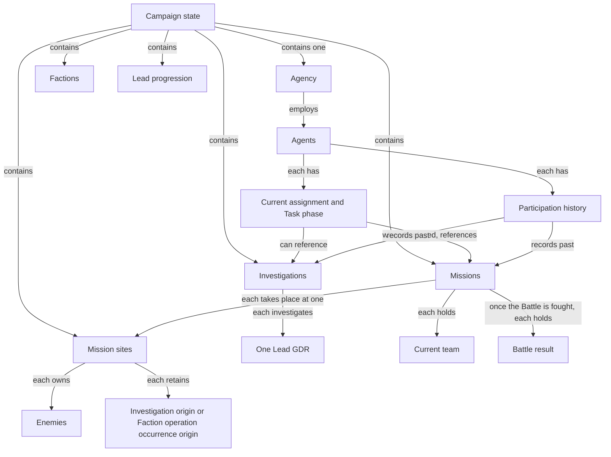

# Domain Model

| Metadata    | Value                                                                                     |
| ----------- | ----------------------------------------------------------------------------------------- |
| Spec ID     | DOM                                                                                       |
| Family      | Mechanics                                                                                 |
| Status      | Draft                                                                                     |
| Audience    | Engine designer, Content designer, AI designer, Implementer                               |
| Owns        | Game concepts, how they relate, and the structural invariants that span several concepts. |
| Conventions | [Specification conventions](../governance/spec-conventions.md)                            |

# Overview

The game is a [Campaign](../foundation/core-concepts.md#glossary) in which the player controls one Agency. Its
concepts are modeled with the vocabulary of [Campaign State](../foundation/campaign-state.md): each is a Campaign
instance Type, a Role Type, or a Game Data Record (GDR).

The Agency employs Agents and gives each Agent a Current assignment. Agents investigate Leads in Investigations, and
completing an Investigation can create an Initiative Mission site. Factions, the organizations that oppose the Agency,
create Response Mission sites through their operations. Deploying a team of Agents to a Mission site creates a Mission,
in which those Agents fight the Enemies present there in a Battle. Each Agent belongs to the Current team of the one
Investigation or Mission its Current assignment references, if any.

# Relationships

- Uses [Campaign State](../foundation/campaign-state.md)
- Uses [Core Concepts](../foundation/core-concepts.md)
- Uses [Engine Contract](../foundation/engine-contract.md)
- Uses [Game Data Records](../foundation/game-data-records.md)
- Used by [Basic Autopilot AI](../autopilot-ais/basic-autopilot-ai.md)
- Used by [Bootstrap GDRs](../content/bootstrap-gdrs.md)
- Used by [Turn Advancement](./turn-advancement.md)
- Used by [Web UI](../ui/web-ui.md)
- Refined by [Agents](agents-spec.md)
- Refined by [Combat](combat.md)
- Refined by [Economy and Upgrades](economy-and-upgrades.md)
- Refined by [Factions](factions.md)
- Refined by [Investigations](investigations.md)
- Refined by [Leads and Progression](leads-and-progression.md)
- Refined by [Missions](missions.md)
- Refined by [Panic and Endings](panic-and-endings.md)

# Glossary

These terms name the concepts of the game. Modeling terms are in the
[Core Concepts](../foundation/core-concepts.md#glossary) and [Campaign State](../foundation/campaign-state.md#glossary)
glossaries; terms about a single concept are in the Glossary of the Mechanics specification that refines it, e.g. the
[Agents](agents-spec.md#glossary) and [Combat](combat.md#glossary) glossaries.

## Agency and Agents

The player-controlled organization, its Agents, what each Agent is doing, and what each has taken part in.

| Term                  | Definition                                                                                                             |
| --------------------- | ---------------------------------------------------------------------------------------------------------------------- |
| Agency                | The organization the player controls in a Campaign. It holds the money, funding, and upgrades, and employs the Agents. |
| Agent                 | An operative employed by the Agency, whom the player assigns to Investigations and Missions.                           |
| Current assignment    | What an Agent is currently ordered to do, e.g. take part in a particular Investigation or Mission.                     |
| Task phase            | Whether an Agent is carrying out its Current assignment (At assignment) or still travelling to it (In transit).        |
| Participation history | The permanent record of which Agents took part in which past Investigations and Missions.                              |

## Leads, Investigations, Mission sites, and Missions

The work the Agency discovers and undertakes.

| Term                    | Definition                                                                                                                  |
| ----------------------- | --------------------------------------------------------------------------------------------------------------------------- |
| Lead                    | A line of inquiry the Agency can investigate. Investigating it can open further Leads and Mission sites.                    |
| Lead progression        | What the Agency has earned on each Lead so far in a Campaign: the Won Missions at the Mission sites that Lead created.      |
| Investigation           | One effort by a team of Agents to investigate one Lead, from its start until it concludes.                                  |
| Mission site            | A place where Enemies of one Faction are present for a limited time, and to which the Agency can deploy one team of Agents. |
| Initiative Mission site | A Mission site the Agency found by completing an Investigation of a Lead.                                                   |
| Response Mission site   | A Mission site created by a Faction operation occurrence, where the Agency can stop that operation.                         |
| Mission                 | One deployment of a team of Agents to one Mission site, together with its outcome.                                          |
| Initiative Mission      | A Mission at an Initiative Mission site.                                                                                    |
| Response Mission        | A Mission at a Response Mission site.                                                                                       |
| Current team            | The Agents currently assigned to a given Investigation or Mission.                                                          |

## Combat

The participants and retained results of a [Battle](combat.md#glossary).

| Term                | Definition                                                                                                                            |
| ------------------- | ------------------------------------------------------------------------------------------------------------------------------------- |
| Combatant           | An Agent or an Enemy as a participant in a Battle. Both can fight because both have skill, health, exhaustion, and weapon capability. |
| Combatant Role Type | What an Agent or an Enemy must have in order to be a Combatant, and what it gains while a Battle lasts.                               |
| Enemy               | An opponent present at one Mission site, whom the Agency's Agents fight in a Battle.                                                  |
| Battle result       | The record of how a Battle went, kept as part of its Mission and used to determine the consequences for the Campaign.                 |

## Factions

The opposing organizations and their operations.

| Term                         | Definition                                                                       |
| ---------------------------- | -------------------------------------------------------------------------------- |
| Faction                      | An organization that opposes the Agency and carries out operations in the world. |
| Faction operation occurrence | One operation carried out by a Faction, which creates one Response Mission site. |

# Game concepts

Each game concept has the following modeling role and multiplicity. This table is exhaustive.

| Concept                                         | Modeling role                                                                                                         | Multiplicity within one Campaign                                                                                                                                                                                                                         |
| ----------------------------------------------- | --------------------------------------------------------------------------------------------------------------------- | -------------------------------------------------------------------------------------------------------------------------------------------------------------------------------------------------------------------------------------------------------- |
| Agency                                          | Campaign instance Type                                                                                                | Exactly one, under [Agency per Campaign](#agency-per-campaign)                                                                                                                                                                                           |
| Agent                                           | Campaign instance Type                                                                                                | Any number; the roster is limited under [Agency caps](economy-and-upgrades.md#agency-caps)                                                                                                                                                               |
| Investigation                                   | Campaign instance Type                                                                                                | At most one Active Investigation per Lead, under [Leads and Investigations](#leads-and-investigations)                                                                                                                                                   |
| Mission site                                    | Campaign instance Type                                                                                                | Any number; none in the initial Campaign state, under [Initial Campaign state](#initial-campaign-state); exactly one Response Mission site per Faction operation occurrence, under [Mission site kind and provenance](#mission-site-kind-and-provenance) |
| Mission                                         | Campaign instance Type                                                                                                | Any number; at most one per Mission site, under [Mission at a Mission site](#mission-at-a-mission-site)                                                                                                                                                  |
| Enemy                                           | Campaign instance Type                                                                                                | Any number, each belonging to exactly one Mission site, under [Combat and consequences](#combat-and-consequences)                                                                                                                                        |
| Faction                                         | Campaign instance Type                                                                                                | Exactly one per FactionArchetype supplied by the Game build, under [Initial Campaign state](#initial-campaign-state)                                                                                                                                     |
| Combatant Role Type                             | Role Type adopted by Agent and Enemy, under [Combatant Role Type](#combatant-role-type); not a Campaign instance Type | No Campaign instances                                                                                                                                                                                                                                    |
| Lead                                            | GDR serving the Referenced GDR and Key for campaign facts purposes                                                    | Not a Campaign instance                                                                                                                                                                                                                                  |
| Weapon and upgrade GDRs                         | GDRs                                                                                                                  | Not Campaign instances                                                                                                                                                                                                                                   |
| Archetypes of the seven Campaign instance Types | GDRs serving the Archetype purpose                                                                                    | Not Campaign instances; sharing an Archetype does not limit how many Campaign instances exist                                                                                                                                                            |

GDR purposes are defined under [Purposes of GDRs](../foundation/game-data-records.md#purposes-of-gdrs). Every Campaign instance of
the seven Campaign instance Types has the four properties stated under
[Campaign instance structure](../foundation/campaign-state.md#campaign-instance-structure). What a single concept has or
does on its own, e.g. its properties, lifecycle states, and formulas, belongs to the specification of the
[Mechanics family](about-mechanics.md) that refines that concept. A concept can include facts hidden from the player.
Being a property of a concept does not determine whether a value
is an Authoritative value or a Derived value; e.g., an Agent's career statistics may be Derived values calculated from
retained facts.

Arrows show the labelled relationships, not inheritance.

# Campaign and Agency

A Campaign contains one Agency, the current turn, [Panic](panic-and-endings.md#glossary) and the
[Campaign ending](panic-and-endings.md#glossary), Lead progression, Agents, Factions,
Investigations, Mission sites, and Missions. The Agency owns money, recurring funding, upgrade acquisitions, and its roster of
Agents. Campaign-wide properties, e.g. the current turn and Panic, belong directly to Campaign state, not to the
Agency.

## Agency per Campaign

Campaign state must contain exactly one Agency, because a Campaign has exactly one player under
[Single-player scope](../foundation/engine-contract.md#single-player-scope) in Engine Contract. Trading between Campaigns is out of
scope.

## Initial Campaign state

Everything a new Campaign starts with is either game data, supplied as GDRs by the Game build, or game behavior,
stated as rules in specifications. Among GDRs, only those serving the Campaign configuration preset purpose can be
overridden by the player before creation; every other GDR is fixed, e.g. a Faction's Archetype.

Which Campaign instances the initial Campaign state contains is the same for every new Campaign. No GDR serving the Campaign configuration preset purpose, under
[GDR purpose: campaign configuration preset](../foundation/game-data-records.md#gdr-purpose-campaign-configuration-preset), adds,
removes, or selects an initial Campaign instance; e.g., no preset changes the initial roster of Agents, the initial
Factions, or the absence of initial Mission sites. A Campaign configuration value can still supply an initial value of
an initial Campaign instance, e.g. starting money becomes the Agency's initial money, and can influence which Campaign
instances come into existence during play, e.g. a multiplier of how often Mission sites appear.

The initial Campaign state contains exactly one Agency, under [Agency per Campaign](#agency-per-campaign), exactly one
Faction for each FactionArchetype the Game build supplies, and no Mission sites, and therefore no Missions and no
Enemies. For each Campaign instance Type, the rule determining the initial Campaign instances of that Type and the
source of each of their initial values, under
[Campaign instance creation](../foundation/campaign-state.md#campaign-instance-creation), is in the Mechanics
specification that refines it; e.g., [Initial Factions](factions.md#initial-factions) gives which values each initial
Faction takes from its FactionArchetype. The rule is game behavior; the content it reads is supplied by GDRs that serve
no Campaign configuration preset purpose, e.g. the FactionArchetypes and their values.

## Campaign instance identity scope

Agency, Agent, Investigation, Mission site, Mission, Enemy, and Faction share one Instance ID scope, as
[Campaign instance identity](../foundation/campaign-state.md#campaign-instance-identity) requires: Instance IDs must
be unique across all seven Types within one Campaign. A repeated Investigation of one Lead, or a second Mission site
with the same Archetype, is therefore a distinct Campaign instance with its own Instance ID. A Mission and its Mission
site have different Instance IDs.

# Agent

An [Agent](agents-spec.md) is a Campaign instance belonging to the Agency. Agent adopts the Combatant Role Type, under
[Combatant Role Type](#combatant-role-type). Its Current assignment gives its current orders; an Investigation
Current assignment references that Investigation, and the Current assignment of a Deployed Agent references the Mission
it is Deployed on, so that the Agent takes part in that Mission. Its Participation history links it
to the Investigations and Missions it previously participated in.

Whatever its state in the [Agent lifecycle](agents-spec.md#agent-lifecycle), an Agent remains in World history with its final values and Participation history, under
[Historical fact preservation](../foundation/campaign-state.md#historical-fact-preservation).

## Current versus historical teams

The Current team of an Investigation or Mission must agree with Current assignments: an Agent whose Current assignment
references Investigation I belongs to the Current team of I, including while In transit, and an Agent whose Current
assignment references Mission M belongs to the Current team of M. Whether an Agent In transit contributes is decided
under [Transit rule](agents-spec.md#transit-rule) and [Progress gain](investigations.md#progress-gain). An Agent cannot belong to more
than one Current team. In Committed state, the Agent-side and team-side views of Current team membership agree, and
no Current assignment references a Mission that is no longer Deployed.

Participation history describes the same relationship for the past: an Agent's Participation history and the past
participants of an Investigation or Mission are one relationship seen from opposite sides. Agents recorded in
Participation history are not members of the Current team, and Participation history neither assigns nor reserves an
Agent; e.g., a Won Mission retains an Agent's Participation history after that Agent is assigned elsewhere.

# Lead and Investigation

A [Lead](leads-and-progression.md) is a GDR, and an [Investigation](investigations.md) is a Campaign instance for
investigation of one Lead. A Lead is a Referenced
GDR, distinct from the InvestigationArchetype that is the Investigation's Archetype, as
[GDR purpose: referenced GDR](../foundation/game-data-records.md#gdr-purpose-referenced-gdr) illustrates. Lead progression is
the part of Campaign state that records, for each Lead GDR, what the Agency has earned on that Lead; it holds only
facts that are not Derived values.

## Leads and Investigations

An Investigation must retain its reference to one Lead GDR in Constants. An Investigation is Active from its creation
until it concludes under [Investigation lifecycle](investigations.md#investigation-lifecycle). At most one Active
Investigation may exist for a Lead in a Campaign, whatever the Archetypes of the Investigations of that Lead. In
Committed state, an Active Investigation must have at least one Agent in its Current team, and an Investigation that
is not Active must have an empty Current team.

An Investigation that is not Active retains its Instance ID and Participation history. A later Investigation of the
same Lead is another Campaign instance, under [Campaign instance identity scope](#campaign-instance-identity-scope).

## Progression facts

Wins, i.e. the Won Missions at the Mission sites a Lead created, must be explicit Authoritative values in Campaign state
with source references. Once recorded, a win therefore remains, even when the condition that earned it no longer holds, under
[Authoritative and Derived values](../foundation/core-concepts.md#authoritative-and-derived-values) in Core Concepts.
A Lead's completion count is a Derived value, calculated from Investigation Campaign instances as
[Value classification](../foundation/campaign-state.md#value-classification) describes; Lead progression holds no completion
record. No rule of a Mechanics specification reads the completion count. Faction defeat and a Lead's Faction
affiliation must not depend on specially spelled identifiers.

# Mission site, Mission, Enemy, and Combat

A [Mission site](missions.md#mission-site) is a Campaign instance whose Archetype is a MissionSiteArchetype. It owns
the Enemies present at it. A [Mission](missions.md#mission) is a Campaign instance whose Archetype is a
MissionArchetype. It takes place at one Mission site, and it comes into existence when the player deploys a team of
Agents to that Mission site. A Mission holds its Current team and, once the [Battle](combat.md#glossary) is fought, its
[Battle result](combat.md#battle-result). An Enemy is a Campaign instance owned by one Mission site;
its Archetype is an EnemyArchetype. The Agents in a Mission's Current team and the Enemies of its Mission site are the
Combatants of its Battle: Agent and Enemy both adopt the Combatant Role Type.

## Mission site kind and provenance

Mission site Constants must retain the Mission site's kind, its origin, and its target Faction. A Mission site is
either an Initiative Mission site or a Response Mission site; the kind is fixed when the Mission site is created. An
Initiative Mission site must retain its origin: the Investigation whose completion created it, and through that
Investigation the Lead it investigated. A Response Mission site must retain its Faction operation occurrence origin,
which identifies the initiating Faction.

Each Faction operation occurrence creates exactly one Response Mission site. Two Response Mission sites originating
from the same Faction are distinct Campaign instances. A Faction operation occurrence spanning several Mission sites,
or having no Response Mission site, is out of scope. Target Faction and initiating Faction are explicit references,
never inferred from a Mission site's name.

A Mission has the kind of its Mission site: a Mission at an Initiative Mission site is an Initiative Mission, and a
Mission at a Response Mission site is a Response Mission. The kind of a Mission is a Derived value read through its
Mission site reference; a Mission stores no kind of its own.

## Mission at a Mission site

A Mission is a Campaign instance Type. Mission Constants must retain an Immutable reference to the one Mission site at
which the Mission takes place: no Mission exists without a Mission site. A Mission comes into existence only when the
player deploys a team of Agents to its Mission site; no other rule creates one.

A Mission site has at most one Mission, because the Agency can deploy only one team of Agents to it, once. A Mission
site that no team is ever deployed to never has a Mission. The Mission of a Mission site is a Derived value: the
Mission whose Mission site reference identifies that Mission site. Both are retained in World history for the whole
Campaign with their final values, under
[Historical fact preservation](../foundation/campaign-state.md#historical-fact-preservation), so the reference always
resolves.

A Mission is its own Campaign instance, not a part of its Mission site's State, because it carries facts the Mission
site does not have, e.g. the Turn it was deployed in, the team sent, its own lifecycle from deployment to its outcome,
and its Battle result; and because Current assignments, Participation history, and Lead progression reference it
directly. A Battle result, by contrast, is not a Campaign instance: it is a part of the Mission that holds it.

The Mission site and its Mission have separate lifecycles, under
[Mission site lifecycle](missions.md#mission-site-lifecycle) and [Mission lifecycle](missions.md#mission-lifecycle).
The Mission site's lifecycle describes the opportunity, e.g. whether a team can still be deployed to it or whether it
expired unattended; the Mission's lifecycle describes the attempt, e.g. whether its Battle is still to be fought and
whether it was Won or Lost.

## Combatant Role Type

The Combatant Role Type is a Role Type under [Role Types](../foundation/campaign-state.md#role-types). It states what a Campaign
instance Type must have for its Campaign instances to be Combatants, and what a Combatant gains while a Battle lasts.

- **Adoption condition:** a Campaign instance Type can adopt the Combatant Role Type if the State of its Campaign
  instances has all of the following properties: skill, current health, maximum health, exhaustion, and equipped
  weapon values. This set is exhaustive.
- **Adopters:** Agent and Enemy adopt the Combatant Role Type. This set is exhaustive.
- **Gained properties:** every Combatant taking part in a Battle gains properties that mean something only while
  that Battle lasts, e.g. whether it is [Incapacitated](combat.md#glossary). It gains them when the Battle begins and
  loses them when the Battle ends. The exhaustive set of gained properties is under
  [Battle-only properties](combat.md#battle-only-properties).

The properties named by the adoption condition persist outside a Battle; e.g., an Agent has health and exhaustion
between Battles. What outlasts a Battle is its Battle result and every change the Battle made to those properties,
e.g. lost health.

The Combatant Role Type is not a Campaign instance Type, so a Combatant is never a Campaign instance separate from
its Agent or Enemy. If it were, every Agent would be two Campaign instances with two Instance IDs, and health would
belong to the second one instead of to the Agent. The Agent changed by a Battle is instead the same Agent that returns
to the Agency, under [Combat and consequences](#combat-and-consequences).

## Attribute bounds

Every Campaign instance of a Campaign instance Type that adopts the Combatant Role Type, i.e. every Agent and Enemy,
must obey these bounds: maximum health must be positive; current
health must be between zero and maximum health inclusive; skill and exhaustion must be nonnegative. An Agent obeys
further bounds under [Attribute ranges](agents-spec.md#attribute-ranges).

## Combat and consequences

An Enemy must belong to exactly one Mission site. Enemies sharing an Archetype share neither Instance ID nor health. A
Battle changes the participating Agent and Enemy Campaign instances themselves: the Agent changed by a Battle is the
same Agent that returns to the Agency. A Battle result is distinct from the consequences for the Campaign determined
from it under [Consequences](missions.md#consequences). No damage-related benefit is given for a Battle the team did
not prevail in, and a Lost Mission yields nothing. A retained Battle result is never rewritten, under
[Historical fact preservation](../foundation/campaign-state.md#historical-fact-preservation).

# Faction and Faction operation occurrences

A [Faction](factions.md) is a Campaign instance for one opposing organization. Its Archetype supplies its descriptive
identity and configuration.

A Faction operation occurrence is the origin of one Response Mission site: its initiating Faction, severity, type, and
creation facts are values in that Mission site's Constants, and that Mission site's Instance ID identifies the Faction
operation occurrence. It is not a separate Campaign instance.

# Weapons and upgrades

Weapon GDRs describe damage configuration, under [Weapon](combat.md#weapon). Equipped weapon values and their
modifications during a Campaign belong to the State of an Agent or Enemy, among the properties the Combatant Role Type
requires; individual inventory items are out of scope. Upgrade GDRs supply shared upgrade data; acquisitions and their
amount or level belong to the Agency, under [Upgrades](economy-and-upgrades.md#upgrades).

# Edge cases and failure behavior

| Case                                                                                      | Result and owner                                                                                                                                                                                                                                                                                                                |
| ----------------------------------------------------------------------------------------- | ------------------------------------------------------------------------------------------------------------------------------------------------------------------------------------------------------------------------------------------------------------------------------------------------------------------------------- |
| An Agent is In transit to an Investigation                                                | The Agent belongs to its Current team; arrival and progress timing belong to Agents and Investigations                                                                                                                                                                                                                          |
| The last Agent leaves the Current team of an Active Investigation                         | No Committed state contains an Active Investigation with an empty Current team; the resulting lifecycle and numerical effects belong to Investigations                                                                                                                                                                          |
| An Investigation concludes while members of its Current team are In transit               | In the next Committed state no Current assignment references it; the replacement Current assignments belong to Agents and Investigations                                                                                                                                                                                        |
| The player deploys Agents to a Mission site                                               | A new Mission at that Mission site comes into existence, whose Current team is those Agents, and each of them is Deployed with a Current assignment that references the Mission, under [Current versus historical teams](#current-versus-historical-teams); preconditions, rejection, and transit belong to Missions and Agents |
| A team is to be deployed to a Mission site that already has a Mission                     | Never valid: a Mission site has at most one Mission, under [Mission at a Mission site](#mission-at-a-mission-site); Missions owns the rejection                                                                                                                                                                                 |
| A Mission site is never deployed to, e.g. it is Expired                                   | It never has a Mission or a Battle result, under [Mission at a Mission site](#mission-at-a-mission-site); Missions owns the consequences                                                                                                                                                                                        |
| A Mission retains an Agent in its Participation history after it is Won or Lost           | The Agent's Current assignment is not reserved, under [Current versus historical teams](#current-versus-historical-teams)                                                                                                                                                                                                       |
| The roster is empty, or no Mission sites or Investigations exist                          | Valid; [Panic and Endings](panic-and-endings.md) owns defeat conditions                                                                                                                                                                                                                                                         |
| A Faction is Defeated while Mission sites targeting it or Leads affiliated with it remain | References remain resolvable under [References](../foundation/campaign-state.md#references); Factions, Leads and Progression, and Missions own the resulting availability and outcomes                                                                                                                                          |

# Acceptance examples

These are structural fixtures, not playable scenarios or API signatures. Symbolic identifiers are labels, not a chosen
identifier format. Numbers below are exact test-only integers, not campaign balance. All other scalar values of
Mechanics specifications are assumed valid for these structural checks.

## A. Valid relationships

Given turn 3 and:

- Campaign state c1 with its single Agency ag1.
- Archetypes supplied by the current Game build: G1 (Agency), A1 (Agent), I1 (Investigation), S1 (Mission site),
  M1 (Mission), F1 (Faction), and E1 (Enemy), plus the GDRs L1 and L2 (Leads) and W1 (weapon). These are test GDRs with no other
  required properties in this fixture.
- Faction f1 with Archetype F1.
- Agent a1 whose Current assignment references Investigation i1, In transit.
- Agent a2, Deployed on Mission m1, so that its Current assignment references m1, At assignment.
- Investigation i0 referring to L2, no longer Active, with an empty Current team.
- Active Investigation i1 referring to L1, Current team {a1}.
- Initiative Mission site s1 with Archetype S1, originating from Investigation i0 of L2, targeting f1, Attempted.
- Mission m1 with Archetype M1 at Mission site s1, deployed in turn 3, Deployed, with Current team {a2}.
- Enemy e1 owned by s1, with Archetype E1.
- Each Agent and Enemy has skill 100, health 10 of maximum health 10, exhaustion 0, and equipped values referring to W1.
- Other collections empty.

Each Campaign instance has the following allocation of the properties named in the sections above; the properties
that Mechanics specifications add are assumed valid:

| Campaign instance | Instance ID         | Archetype | Constants                                                              | State                                                                                                      |
| ----------------- | ------------------- | --------- | ---------------------------------------------------------------------- | ---------------------------------------------------------------------------------------------------------- |
| ag1               | ag1                 | G1        | Empty                                                                  | Resources, upgrades, roster {a1, a2}                                                                       |
| a1, a2            | a1, a2 respectively | A1        | Agency ag1                                                             | Current assignment, Task phase, the properties the Combatant Role Type requires, and Participation history |
| i0                | i0                  | I1        | Lead L2                                                                | Not Active, empty Current team, Participation history                                                      |
| i1                | i1                  | I1        | Lead L1                                                                | Active, Current team {a1}, Participation history                                                           |
| s1                | s1                  | S1        | Initiative kind; origin Investigation i0 of Lead L2; target Faction f1 | Attempted, Enemies {e1}                                                                                    |
| m1                | m1                  | M1        | Mission site s1; turn deployed 3; team sent {a2}                       | Deployed, Current team {a2}, and no Battle result until the Battle is fought                               |
| e1                | e1                  | E1        | Mission site s1                                                        | The properties the Combatant Role Type requires                                                            |
| f1                | f1                  | F1        | Empty                                                                  | The values under [Faction State](factions.md#faction-state)                                                |

Campaign state c1 holds turn 3, Lead progression, and collections containing Agency ag1, Agents a1 and a2,
Investigations i0 and i1, Mission site s1, Mission m1, and Faction f1; e1 is reached through s1, and the Mission of
s1 is m1, the Mission whose Mission site reference identifies s1. Required
references resolve in c1. Immutable affiliation, origin, and target references are assumptions of this fixture, not
lifecycle rules.

These relationships satisfy [Agency per Campaign](#agency-per-campaign),
[Campaign instance identity scope](#campaign-instance-identity-scope),
[Current versus historical teams](#current-versus-historical-teams), [Attribute bounds](#attribute-bounds),
[Leads and Investigations](#leads-and-investigations),
[Mission site kind and provenance](#mission-site-kind-and-provenance),
[Mission at a Mission site](#mission-at-a-mission-site), and [Combat and consequences](#combat-and-consequences).
Current team membership does not assert that a1 makes progress while In transit. The rules of a single concept are
checked against this fixture by the Mechanics specification that refines it; e.g.,
[Acceptance examples](agents-spec.md#acceptance-examples) in Agents checks the Agent lifecycle.

## B. Invalid variants

Each row independently changes fixture A and describes an invalid state.

| Change                                                                                    | Violation                                                             |
| ----------------------------------------------------------------------------------------- | --------------------------------------------------------------------- |
| Give e1 the same Instance ID as a1                                                        | [Campaign instance identity scope](#campaign-instance-identity-scope) |
| Give m1 the same Instance ID as s1                                                        | [Campaign instance identity scope](#campaign-instance-identity-scope) |
| Add a second Agency                                                                       | [Agency per Campaign](#agency-per-campaign)                           |
| List a1 in the Current team of m1 while a1 is assigned to i1                              | [Current versus historical teams](#current-versus-historical-teams)   |
| Make m1 Won while the Current assignment of a2 still references m1                        | [Current versus historical teams](#current-versus-historical-teams)   |
| Set the health of a1 or e1 to 11 with maximum health 10, or set its exhaustion below zero | [Attribute bounds](#attribute-bounds)                                 |
| Add another Active Investigation for L1, or leave i1 Active with an empty Current team    | [Leads and Investigations](#leads-and-investigations)                 |
| Mark s1 as a Response Mission site without a Faction operation occurrence origin          | [Mission site kind and provenance](#mission-site-kind-and-provenance) |
| Add a second Mission whose Mission site reference identifies s1                           | [Mission at a Mission site](#mission-at-a-mission-site)               |
| Remove the Mission site reference of m1                                                   | [Mission at a Mission site](#mission-at-a-mission-site)               |
| Assign e1 a second owning Mission site                                                    | [Combat and consequences](#combat-and-consequences)                   |

## C. Completion and later Participation history

Given i1 is Completed and the Battle of m1 is fought and m1 becomes Won, a valid resulting state has:

- i1 no longer Active, with an empty Current team, and a1 retained in its Participation history.
- s1 still Attempted, and m1 still its Mission; m1 now holds a retained Battle result, has an empty Current team, and
  has a2 in its Participation history; no Current assignment of a2 references m1.
- a1 and a2 each with a Current assignment that references neither i1 nor m1.
- An explicit progression fact recording the win of m1 against L2, which created s1 through i0, and completion counts
  of 1 for L1 and 1 for L2, derived from i1 and i0 respectively.

This satisfies [Current versus historical teams](#current-versus-historical-teams),
[Leads and Investigations](#leads-and-investigations), [Progression facts](#progression-facts),
[Mission at a Mission site](#mission-at-a-mission-site), and [Combat and consequences](#combat-and-consequences).
Assigning a1 to another Investigation does not rewrite the Participation history of i1, and assigning a2 elsewhere
does not rewrite the Participation history of m1. A later Investigation of L1 has a new Instance ID
([Leads and Investigations](#leads-and-investigations)). This fixture does not choose the replacement Current
assignments or turn timing.

## D. Initial Campaign state

Given a new Campaign created from a Game build that supplies exactly two FactionArchetypes, F1 and F2, the initial
Campaign state contains exactly one Agency, exactly two Factions, one with Archetype F1 and one with Archetype F2, and
no Mission sites, no Missions, and no Enemies, under [Initial Campaign state](#initial-campaign-state). An initial
Campaign state with a second Faction of Archetype F1, with no Faction of Archetype F2, or with any Mission site, is
invalid.

# TODOs

- TODO: State what the Turn report and each History entry hold of each value the Mechanics specifications own, including the reduced form of a Battle result that a History entry keeps, e.g. which Agents survived, were wounded, or were Killed, under [Turn report and history](../foundation/campaign-state.md#turn-report-and-history) in Campaign State.
- TODO (later): Damage-related benefits for a Battle the team did not prevail in, under
  [Combat and consequences](#combat-and-consequences).
